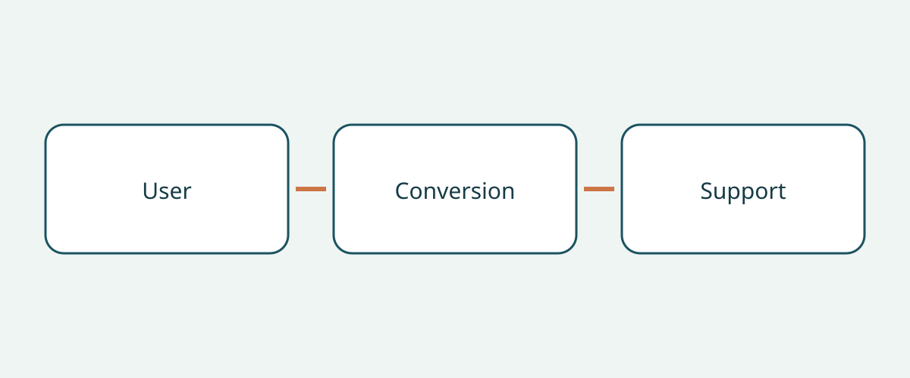

# Wheelchair-Accessible Vehicle Purchase Checks

A wheelchair-accessible vehicle purchase begins with a person and a journey, not a van badge. A listing can show an attractive cabin and a deployed ramp without answering whether the intended user can enter, travel in the proposed position and leave with the assistance actually available. Treat the base vehicle, completed conversion and intended wheelchair arrangement as separate parts of the buying decision. A satisfactory answer for one part does not settle the others.

This guide recommends a document-and-demonstration approach for overseas buyers and fleet purchasers. It is not a medical suitability assessment, installation manual or statement of registration requirements. US manufacturer examples and UK consumer guidance below explain questions worth asking; they do not establish universal dimensions, equipment capacities or legal duties. A vehicle that looks spacious in photographs still needs assessment against the intended use.

## Describe the journey before comparing conversions

Write down whether the person will travel in the wheelchair, transfer to a vehicle seat or seek a driving arrangement. Record who will assist, where boarding normally happens and which other passengers travel. These are questions for the buyer and relevant specialists, not conclusions a seller should infer from a wheelchair photograph. Avoid treating a passenger conversion as evidence that a driving arrangement is suitable.

NHTSA's US adapted-vehicle guidance recommends consulting a driver rehabilitation specialist before purchase. Its discussion also includes passenger seating, entering and exiting, and appropriate lifts or other equipment. That recommendation is useful because selecting the right questions can precede selecting a vehicle. Ask the specialist what assessment and demonstration are appropriate for the intended person. A sales demonstration alone should not be treated as an individualized clinical judgment.

## Identify the conversion, not just the base model

Ask the seller to identify the base vehicle and its original sales market, together with the converter, conversion designation and supporting records for the completed vehicle. Keep the advertised model year separate from any conversion date. If the seller offers a generic brochure, ask which version and period it actually describes. Record unresolved differences rather than assuming that an apparently similar interior means the same equipment is installed.

BraunAbility's US dimension guide separates door opening height and width, ramp width, usable floor length and ramp angle by conversion variant and model-year range. This demonstrates why the base vehicle name alone does not specify conversion geometry. It does not supply measurements for an unidentified used conversion. Request the applicable converter document and specialist confirmation of the actual vehicle, rather than copying a number from another variant into the purchase agreement.

## Follow the occupied-chair route

BraunAbility describes both side-entry and rear-entry accessible vehicles. Compare the proposed entry route with the buyer's real boarding location and available assistance rather than selecting a layout by label alone. Ask for a supervised demonstration planned around the intended user and wheelchair. The purpose is to establish whether further assessment is needed, not to improvise a way around an unsuitable entrance or restraint arrangement.

The UK consumer-research organization RiDC recommends considering assistance during entry, head clearance, the wheelchair travelling position and communication with other occupants. These are RiDC's advisory questions, not statutory thresholds. Include the transition from entrance to travelling position in the discussion: a doorway photograph does not answer what happens inside the cabin. Record any concern raised by the user in their own terms so it is not lost in a seller's general assurance of accessibility.

Motability's UK scheme guidance distinguishes ramp and lift layouts and notes that fitting a lift can reduce headroom in some vehicles. Retain that qualification. It is not a claim that every lift reduces headroom or that a ramp is always preferable. Ask how the installed equipment affects this particular cabin, and seek appropriate confirmation rather than deriving a universal clearance from a category description.

## Separate wheelchair securement from occupant restraint

Q’STRAINT describes its complete four-point system as including wheelchair tie-downs or retractors, occupant lap-and-shoulder restraints and floor anchorages. Those are different components. The presence of wheelchair straps alone does not answer how the occupant is restrained. Conversely, a visible passenger belt does not identify the complete wheelchair securement arrangement.

Request equipment identities, applicable instructions and a specialist assessment of compatibility with the intended wheelchair, occupant arrangement and completed conversion. Ask the seller to account for the complete supplied equipment, not merely state that belts are included. This is an evidence request, not guidance on fitting anchors, changing seats or attaching restraints. Leave assessment and any corrective work to appropriately qualified specialists; do not use this article as an installation checklist.

## Build a conversion-specific purchase file

| Purchase question | Evidence to request | Reason to pause |
|---|---|---|
| Which conversion is offered? | Converter identity, designation and applicable records | Only the base vehicle brochure is supplied |
| Can the intended journey be assessed? | Specialist advice and an appropriate supervised demonstration | The intended user or chair arrangement has not been considered |
| What restraint equipment is included? | Component identities, instructions and compatibility assessment | Wheelchair straps are presented as the whole occupant restraint system |
| Who can support it locally? | Written service contacts and scope for the actual conversion | Support is promised without identifying the equipment |
| What does the warranty cover? | Separate written terms for base vehicle and conversion where available | Base-vehicle coverage is assumed to cover modifications |

Ask for conversion maintenance records and explanations of missing records. Keep requests proportionate, but distinguish “not provided” from “confirmed satisfactory.” For an overseas transaction, seek current confirmation that the named service provider can support the actual conversion in the receiving location. This guide does not establish local availability, warranty transferability or export coverage. Put unresolved support questions beside the quote so they remain visible when comparing offers.

## Decide what would change the purchase decision

A useful comparison identifies a specific open question and the evidence that would resolve it. “Accessible vehicle” is too broad; “converter identity confirmed, intended chair arrangement still awaiting assessment” is actionable. If entry, travelling position or restraint compatibility remains unresolved, this guide recommends postponing commitment until the relevant specialist has addressed it. A discount is not evidence of suitability.

Keep vehicle condition, destination registration and import eligibility as separate enquiries. Neither an accessibility demonstration nor a converter brochure establishes those conclusions. Similarly, do not assume the base-vehicle warranty covers the conversion. Request written terms without promising that a particular seller, manufacturer or country will provide coverage. Reconfirm vehicle applicability, document revision and local service support at the time of purchase.

## Frequently asked questions

### Is a larger base vehicle automatically the better choice?

No such conclusion follows from these sources. Compare the completed conversion and intended journey. Doorway, internal position, assistance and equipment questions remain even when the base vehicle appears larger.

### Can a seller's ramp video replace an assessment?

Treat it as supporting information only. Ask a relevant specialist what demonstration is appropriate for the intended user and wheelchair, and record what the video does not establish.

### Are wheelchair straps the same as occupant restraints?

No. Q’STRAINT describes wheelchair tie-downs, occupant lap-and-shoulder restraints and floor anchorages as distinct parts of its complete four-point system. Ask for the actual system's documentation and compatibility assessment.

### Does this checklist confirm that the conversion is legal to import?

No. It addresses purchase evidence and suitability questions for specialist assessment. Destination rules, vehicle condition and any individual clinical suitability require their own checks.

## Illustration

The diagram links the user, conversion and support questions in a purchase decision.

## Related reading

Browse [vehicle information](https://www.autobridgeexport.com/vehicles/) and [more buying guides](https://www.autobridgeexport.com/guides/).

## Sources and verification

Sources checked on 2026-11-05. Manufacturer examples retain their stated scope; UK advisory sources are not legal specifications.

- [Adapted vehicles](https://www.nhtsa.gov/vehicle-safety/adapted-vehicles) — US Department of Transportation / NHTSA.
- [Wheelchair accessible vehicle dimension guide](https://www.braunability.com/us/en/help-me-buy/dimensions-specs.html) — BraunAbility.
- [What is a wheelchair accessible vehicle?](https://www.braunability.com/us/en/help-me-buy/product-faqs/what-is-an-accessible-vehicle.html) — BraunAbility.
- [Securement 101](https://www.qstraint.com/it/securement-101/?accessibility-mode=on) — Q’STRAINT.
- [WAV sizes](https://www.motability.co.uk/whats-available/wavs/passenger/sizes) — Motability Operations.
- [WAV checklist](https://ridc.org.uk/features-reviews/out-and-about/wheelchair-accessible-vehicles-wavs-0/wavs-checklist) — Research Institute for Disabled Consumers.
