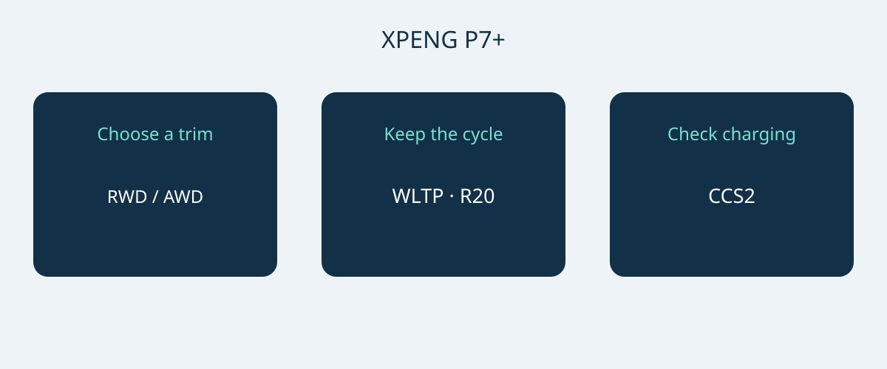

# XPENG P7+: Norway Range, Charging and Fastback Fit

The XPENG P7+ makes the most sense as a purchasing shortlist when its size, charging requirements and exact configuration fit the buyer's routine. A headline charging figure alone is not a purchasing case. The Norwegian specification dated 6 January 2026 describes a five-seat battery-electric fastback in RWD Long Range and AWD Performance forms. Those are the two versions compared here, not a universal specification for every P7+ sold elsewhere.

The document date is not proof of a formal model-year code. Ask for the offered vehicle's VIN, build month and original sales-market specification before matching a quotation to these figures. XPENG says configuration can vary with production month. The current Norwegian model page also uses Pro labels; that naming does not establish equivalence with the January RWD Long Range or AWD Performance configuration. P7, P7i and China-market P7+ extended-range versions should not be substituted into this comparison.

## Two trims, one clear trade-off

Both reference versions have an LFP battery with 74.9 kWh gross capacity. Gross capacity is the manufacturer's capacity designation here, not a separately verified usable-energy figure. On 20-inch wheels, the Norwegian specification gives the RWD Long Range 530 km WLTP and the AWD Performance 500 km WLTP. Keep the wheel size and test cycle attached when comparing offers. Neither value promises the distance a buyer will achieve on a particular journey.

| Norwegian reference specification | RWD Long Range | AWD Performance |
|---|---|---|
| Drive | Rear-wheel drive | All-wheel drive |
| Gross LFP battery | 74.9 kWh | 74.9 kWh |
| Range, WLTP, 20-inch wheels | 530 km | 500 km |
| Motor power | 230 kW | 230 + 140 kW, by axle |
| Motor torque | 450 Nm | 450 + 220 Nm, by axle |
| Manufacturer 0–100 km/h | 6.2 seconds | 4.3 seconds |

Source: XPENG Norwegian specification, 6 January 2026; battery-electric versions named above. The AWD output is deliberately retained as the source's axle ratings, rather than replaced with an unsupported combined homologated rating.

For a buyer who prioritizes the longer stated WLTP range, RWD Long Range is the logical version to examine first. AWD Performance is the alternative when all-wheel drive and the quicker manufacturer acceleration figure are explicit priorities. This is a selection recommendation, not a finding that one version has lower ownership costs or superior winter braking. Those conclusions are not established by this specification table. Compare both quotations on the same market, wheel configuration and included equipment before treating any price difference as a like-for-like comparison.

## A large fastback needs a space check

The reference dimensions are 5071 × 1937 × 1512 mm, with a 3000 mm wheelbase. These figures make parking access a serious part of the buying decision. Measure the intended parking space and inspect the approach, door-opening room and loading position. The published width should not be treated as a complete guarantee of clearance around mirrors or open doors. A successful parking demonstration is more useful than assuming that a familiar vehicle category will fit.

XPENG lists five seats and 573 L of luggage space, expanding to 1931 L with the rear seats folded. Use these as the manufacturer's reference volumes, not a promise that a particular suitcase, wheelchair or equipment case will fit. Folding the rear seats changes how the cabin can be used, so judge the normal passenger-and-luggage combination first. Ask for a loading demonstration with the objects you actually carry, then consider the folded-seat arrangement for occasional bulky loads. Do not translate luggage volume into payload or towing capability; neither is established here.

## Charging speed starts with the destination charger

The Norwegian reference supports 11 kW AC charging and up to 446 kW DC, with a European CCS2 connection. The manufacturer's charging-time reference is 12 minutes from 10–80% state of charge. It is a conditional charging window, not a universal stop duration. Vehicle and battery condition, temperature, starting charge and the charger can affect the result. A high advertised maximum does not mean every charger can supply it, or that the vehicle holds that rate throughout a session.

Build the charging decision around the places where the car will actually be parked. For routine use, ask a qualified installer or charging operator to confirm the available supply, connector and compatible charging arrangement. For longer trips, check the intended stations rather than selecting the vehicle solely from its peak DC figure. A supplier demonstration can help establish compatibility, but one successful session does not guarantee every later charging time. Leave journey planning room for charging conditions and interruptions instead of scheduling around the shortest advertised window.

## Treat assistance and after-sales support separately

The reference sheet lists seven airbags. XPILOT is driver assistance: the driver needs to remain attentive and intervene when necessary. Do not read the feature name as permission for unattended or autonomous driving. Have the seller demonstrate the functions and explain their limits for the actual vehicle, using its manual and applicable local instructions rather than a promotional clip from another market.

A Norwegian equipment sheet also cannot establish whether connected services, warranty support or software functions transfer to a different destination. Ask who handles diagnostics, repairs and parts for the offered VIN, and obtain the proposed support terms in writing. Current price, availability, tax treatment, import eligibility and warranty applicability need separate current confirmation. A model page is useful for product information, but it is not a destination-specific import decision or a binding commercial offer.

## What belongs in the quotation

- The exact P7+ trim, VIN, production month and original market, supported by the seller's vehicle documents.
- Wheel configuration and battery description matching the chosen reference, without silently borrowing another market's range figure.
- Included charging equipment, compatible connection and any separately priced accessories.
- Destination-specific service arrangements, connected-function limitations and written warranty terms.
- An itemized commercial offer with the seller identified and unresolved differences answered before a payment decision.

Pause the purchase if the seller offers only a generic P7+ badge, replaces the requested trim with a Pro name without configuration proof, or guarantees the reference charging time regardless of charger and conditions. A clear explanation of a different configuration is acceptable; an unexplained mixture of specifications is not a sound basis for comparing vehicles.

## Frequently asked questions

### Is this the specification of every P7+?
No. It is the Norwegian battery-electric reference dated 6 January 2026. It does not establish other markets, extended-range versions, a formal model-year code or the equipment of an individual VIN.

### Which trim suits a range-focused buyer?
Start with RWD Long Range: its stated 530 km WLTP on 20-inch wheels exceeds the AWD Performance's 500 km WLTP on the same wheel-size basis. Personal trip range still depends on operating conditions.

### Is a 12-minute charging stop guaranteed?
No. The manufacturer describes 10–80% charging under relevant conditions. Charger capability, battery and vehicle condition, temperature and starting charge matter; total stop time is a separate practical question.

### Does the larger luggage figure apply with all seats occupied?
No. The 1931 L figure is for the rear seats folded; the reference luggage volume otherwise listed is 573 L. Check actual luggage and passenger needs together.

Original decision diagram linking P7+ trim, range comparison and charging compatibility.

## Sources and verification

Sources checked on 2026-11-05.

- [XPENG — XPENG P7+ Norwegian specification sheet, 6 January 2026](https://s-cdn.xpeng.com/commoncms/prod/2026-02-12/24d25f0ebb8c439b80144b3cc7ee5b00.pdf)
- [XPENG — XPENG P7+ Norway model page](https://www.xpeng.com/no/model/p7plus)
- [XPENG — XPENG P7+ Norway configurator](https://store.xpeng.com/no/configurator/P7%2B?source=ow_os_top_nav)
- [Bilforlaget — Xpeng P7+ RWD Long Range test](https://www.bilnorge.no/biltest-elbil-hurtiglading/oslo-kristiansand-pa-10-minutter/4178720)
- [NAF / Motor — Xpeng med diger kombicoupé](https://www.motor.no/aktuelt/xpeng-med-diger-kombicoupe-p7/342336)
- [Norsk elbilforening — XPENG P7+ Norwegian introduction: range, charging and luggage](https://elbil.no/xpeng-p7-plus-ki-pris-norge/)

[Explore vehicles](https://www.autobridgeexport.com/vehicles/) · [Read buying guides](https://www.autobridgeexport.com/guides/)
