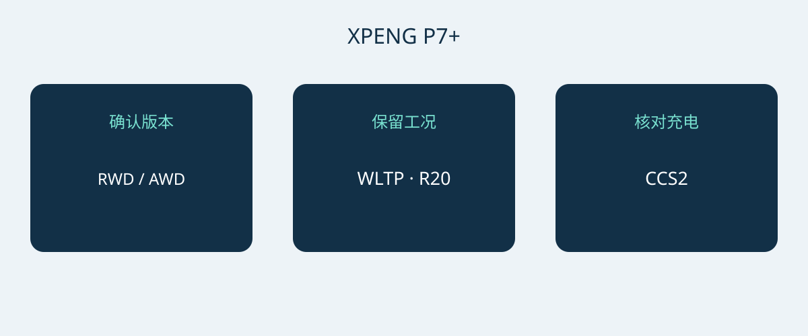

# 小鹏 P7+ 挪威版选购：续航、充电与溜背空间

小鹏 P7+ 是否值得进入采购名单，首先取决于车身尺寸、日常充电条件和所售配置是否适合实际用途，而不是单看最高充电功率。本文采用日期为2026年1月6日的挪威规格资料，讨论五座纯电溜背车型的 RWD Long Range 与 AWD Performance 两个版本。这不是所有市场 P7+ 的通用配置表。

资料日期不能代替正式车型年款代码。买家应向卖方索取具体车辆的 VIN、生产月份和原销售市场配置文件，再与本文数字核对。小鹏提示配置可能随生产月份变化；当前挪威车型页面也使用 Pro 名称，但不能据此认定它与一月资料中的两个版本完全对应。P7、P7i 以及中国市场 P7+ 增程版本均不应混入本次比较。

## 两个版本的选择重点

两个参考版本均使用总容量为74.9 kWh的 LFP 电池。这里的总容量不等于另经核实的可用电量。配备20英寸车轮时，挪威资料列出的 RWD Long Range 续航为530 km WLTP，AWD Performance 为500 km WLTP。比较供应商报价时，车轮尺寸和测试工况应与数字一起保留，不能只摘录“续航里程”。这些数值也不是对某条实际路线的行驶距离承诺。

| 挪威参考规格 | RWD Long Range | AWD Performance |
|---|---|---|
| 驱动方式 | 后轮驱动 | 全轮驱动 |
| LFP 电池总容量 | 74.9 kWh | 74.9 kWh |
| WLTP 续航，20英寸车轮 | 530 km | 500 km |
| 电机功率 | 230 kW | 230 + 140 kW，分轴标示 |
| 电机扭矩 | 450 Nm | 450 + 220 Nm，分轴标示 |
| 厂商0–100 km/h加速 | 6.2秒 | 4.3秒 |

来源为小鹏2026年1月6日挪威规格文件，适用于表中纯电版本。全轮驱动车型保留原资料的分轴输出表达，不改写为未经确认的整车认证综合输出。

如果采购重点是较长的标称 WLTP 续航，可以先考察 RWD Long Range；如果明确需要全轮驱动和更快的厂商加速数据，再比较 AWD Performance。这是选型建议，并不意味着前者用车成本一定更低，或后者冬季制动能力必然更强。比较两份报价之前，应先统一原销售市场、车轮配置和随车设备，避免把配置差异误当成单纯的价格优势。

## 大型溜背车需要实际空间验证

参考车身尺寸为5071 × 1937 × 1512 mm，轴距3000 mm。停车位是否合适，应成为采购判断的一部分。建议测量停车位，并观察进出路线、开门空间和装卸行李时的站立位置。公布的车宽不能直接当成后视镜或车门打开后的完整净空要求；与其根据车型类别猜测，不如安排实际停车演示。

小鹏列出五座布局、573 L行李厢容积，以及后排座椅放倒后的1931 L容积。这些是厂商参考容积，不保证某个行李箱、轮椅或设备箱一定能够放入。后排放倒会改变乘员空间的使用方式，所以应先验证日常乘员与行李同时乘载的情形，再考虑偶尔运输大件物品。建议带上常用物品试装，观察开口、摆放和取出是否方便。行李厢容积也不能换算成载重或牵引能力，本文没有提供这些能力的依据。

## 先看常用充电地点，再看峰值功率

挪威参考配置列出11 kW交流充电、最高446 kW直流充电，以及欧洲 CCS2 接口。厂商给出的充电时间参考为电量从10–80%用时12分钟。它描述的是有条件的充电区间，不是所有充电站都能兑现的停留时间。车辆和电池状态、温度、初始电量以及充电设备都可能影响结果。最高功率不代表任何充电桩都能提供该功率，也不代表整个充电过程始终维持这一水平。

采购时应从车辆通常停放的地点出发，请合格安装人员或充电运营方确认供电条件、接口和兼容方案。长途使用则要核对计划经过的站点，而不是仅凭最高直流功率决定车型。卖方现场演示能够帮助确认兼容性，但一次成功充电不代表以后每次都能达到相同时间。行程安排宜为充电条件变化和可能的等待预留余量，不宜把最短宣传时间当成固定日程。

## 驾驶辅助与售后承诺分别核对

参考规格列有七个安全气囊。XPILOT 属于驾驶辅助，驾驶员仍需保持注意，并在必要时介入。不能把功能名称理解为允许无人看管或自动驾驶。建议让卖方依据具体车辆的用户手册和适用当地说明演示功能及限制，而不是用另一个市场的宣传片代替实际配置说明。

挪威设备清单也不能证明联网服务、保修支持或软件功能能够转移到其他目的地。应确认所售 VIN 的诊断、维修和零件由谁负责，并取得书面售后条件。现价、库存、税务待遇、进口资格和保修适用范围都需要另外核实。车型网页可以说明产品，却不能代替目的地准入判断或有约束力的商业报价。

## 报价中值得明确的内容

- 写明 P7+ 具体配置名称、VIN、生产月份和原销售市场，并提供对应车辆文件。
- 车轮配置和电池描述应与所选参考版本一致，不借用其他市场的续航数字。
- 列清随车充电设备、兼容接口以及另计费用的附件。
- 说明目的地服务安排、联网功能限制和书面保修条件。
- 提供分项商业报价，明确卖方身份，并在付款决定前解释尚未对应的差异。

如果卖方仅提供笼统的 P7+ 名称，用 Pro 名称替代所需版本却没有配置证明，或不区分充电桩与环境条件就保证参考充电时间，建议暂缓采购。不同配置本身并非问题，无法解释的参数混用才会破坏比较基础。

## 常见问题

### 这些参数适用于全部 P7+ 吗？
不适用。本文是2026年1月6日挪威纯电版本的资料参考，不能证明其他市场、增程版本、正式年款代码或某个 VIN 的实际设备。

### 注重续航应该先看哪一版？
可以先看 RWD Long Range：20英寸车轮条件下标称530 km WLTP，高于同车轮尺寸口径 AWD Performance 的500 km WLTP。个人路线的实际续航仍取决于使用条件。

### 12分钟充电是否有保证？
没有。厂商描述的是相关条件下10–80%的充电区间。充电设备、电池与车辆状态、温度和初始电量均会影响结果，整个停车过程又是另一个实际问题。

### 1931 L容积可以在满员时使用吗？
不能这样理解。1931 L对应后排座椅放倒，另列的参考行李容积为573 L。应把乘员人数和实际行李需求一起验证。

原创选型示意图，连接P7+版本、续航比较与充电兼容性。

## 来源与核验

资料核验日期： 2026-11-05.

- [XPENG — XPENG P7+ Norwegian specification sheet, 6 January 2026](https://s-cdn.xpeng.com/commoncms/prod/2026-02-12/24d25f0ebb8c439b80144b3cc7ee5b00.pdf)
- [XPENG — XPENG P7+ Norway model page](https://www.xpeng.com/no/model/p7plus)
- [XPENG — XPENG P7+ Norway configurator](https://store.xpeng.com/no/configurator/P7%2B?source=ow_os_top_nav)
- [Bilforlaget — Xpeng P7+ RWD Long Range test](https://www.bilnorge.no/biltest-elbil-hurtiglading/oslo-kristiansand-pa-10-minutter/4178720)
- [NAF / Motor — Xpeng med diger kombicoupé](https://www.motor.no/aktuelt/xpeng-med-diger-kombicoupe-p7/342336)
- [Norsk elbilforening — XPENG P7+ Norwegian introduction: range, charging and luggage](https://elbil.no/xpeng-p7-plus-ki-pris-norge/)

[浏览车型](https://www.autobridgeexport.com/vehicles/) · [阅读采购指南](https://www.autobridgeexport.com/guides/)
