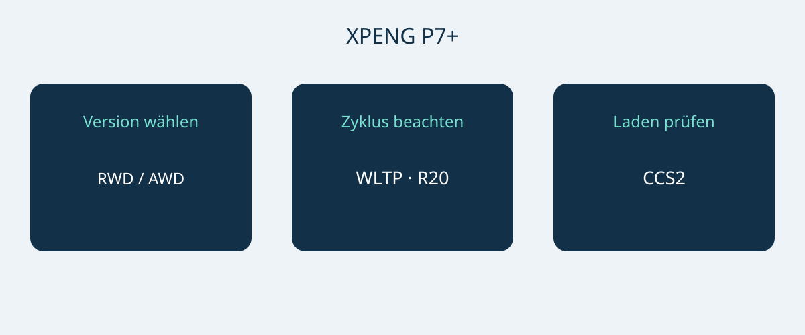

# XPENG P7+: Reichweite, Laden und Platz in Norwegen

Der XPENG P7+ kommt für eine Kaufentscheidung infrage, wenn Abmessungen, Ladebedarf und konkrete Ausstattung zum vorgesehenen Einsatz passen. Eine hohe maximale Ladeleistung allein ist kein ausreichendes Kaufargument. Das norwegische Datenblatt vom 6. Januar 2026 beschreibt einen fünfsitzigen batterieelektrischen Fastback in den Ausführungen RWD Long Range und AWD Performance. Nur diese beiden Referenzversionen werden hier verglichen, nicht sämtliche weltweit angebotenen P7+.

Das Dokumentdatum belegt keinen formalen Modelljahrcode. Lassen Sie sich VIN, Produktionsmonat und Spezifikation des ursprünglichen Absatzmarktes nennen. Lassen Sie sich die Ausstattung für den betreffenden Produktionsmonat vom Verkäufer bestätigen. Die aktuelle norwegische Modellseite verwendet außerdem Pro-Bezeichnungen; daraus folgt keine Gleichsetzung mit den Januarversionen. P7, P7i und chinesische P7+ mit Reichweitenverlängerer gehören nicht in diesen Vergleich.

## Zwei Antriebe, unterschiedliche Prioritäten

Beide Referenzversionen besitzen eine LFP-Batterie mit 74.9 kWh Bruttokapazität. Das ist keine separat bestätigte nutzbare Energiemenge. Mit 20-Zoll-Rädern nennt das Datenblatt 530 km WLTP für RWD Long Range und 500 km WLTP für AWD Performance. Radgröße und Prüfzyklus gehören zu jeder Zahlenangabe. Die Werte garantieren keine Reichweite auf einer konkreten Fahrt.

| Norwegische Referenz | RWD Long Range | AWD Performance |
|---|---|---|
| Antrieb | Hinterradantrieb | Allradantrieb |
| LFP-Batterie brutto | 74.9 kWh | 74.9 kWh |
| WLTP-Reichweite, 20-Zoll-Räder | 530 km | 500 km |
| Motorleistung | 230 kW | 230 + 140 kW, nach Achse |
| Motordrehmoment | 450 Nm | 450 + 220 Nm, nach Achse |
| 0–100 km/h laut Hersteller | 6.2 Sekunden | 4.3 Sekunden |

Quelle: norwegisches XPENG-Datenblatt vom 6. Januar 2026 für die genannten Elektroversionen. Die AWD-Werte beschreiben die beiden Achsen getrennt und sind keine separat bestätigte homologierte Gesamtleistung.

Wer die höhere ausgewiesene WLTP-Reichweite bevorzugt, sollte zuerst RWD Long Range prüfen. AWD Performance ist die Alternative, wenn Allradantrieb und die schnellere Herstellerbeschleunigung ausdrücklich wichtig sind. Daraus lassen sich weder geringere Betriebskosten noch bessere Bremsleistungen im Winter ableiten. Vergleichen Sie Angebote mit demselben Marktbezug, derselben Radkonfiguration und nachvollziehbarer Ausstattung, bevor Sie einen Preisunterschied bewerten.

## Der große Fastback braucht einen Platztest

Die Referenzabmessungen betragen 5071 × 1937 × 1512 mm, der Radstand 3000 mm. Messen Sie den vorgesehenen Stellplatz und prüfen Sie Zufahrt, Türöffnung und Ladeposition. Die veröffentlichte Breite garantiert nicht den gesamten Freiraum um Spiegel oder geöffnete Türen. Eine praktische Parkdemonstration ist aussagekräftiger als die Annahme, ein Fahrzeug dieser Kategorie werde schon passen.

XPENG nennt fünf Sitzplätze sowie 573 L Gepäckraum und 1931 L bei umgeklappten Rücksitzen. Diese Herstellerangaben versprechen nicht, dass ein bestimmter Koffer, Rollstuhl oder Gerätekasten hineinpasst. Prüfen Sie zuerst den üblichen gemeinsamen Bedarf von Passagieren und Gepäck und anschließend gelegentliche sperrige Ladung bei umgeklappten Sitzen. Eine Probe mit den tatsächlich mitgeführten Gegenständen ist sinnvoll. Aus dem Kofferraumvolumen folgen keine bestätigte Nutzlast und keine Anhängelast.

## Ladeplanung beginnt am tatsächlichen Standort

Die norwegische Referenz nennt 11 kW AC, bis zu 446 kW DC und einen europäischen CCS2-Anschluss. Der Hersteller gibt 12 Minuten für das Ladefenster 10–80% an. Das ist ein bedingter Referenzwert und keine Garantie für jeden Ladestopp. Fahrzeug- und Batteriezustand, Temperatur, Anfangsladestand und Ladestation beeinflussen das Ergebnis. Nicht jede Säule stellt die Spitzenleistung bereit, und die Leistung bleibt nicht zwangsläufig während der gesamten Sitzung gleich.

Lassen Sie für das regelmäßige Laden Stromversorgung, Anschluss und Kompatibilität von einem qualifizierten Installateur oder Betreiber bestätigen. Prüfen Sie für lange Fahrten die vorgesehenen Stationen, statt nur nach dem maximalen DC-Wert zu entscheiden. Eine Vorführung durch den Verkäufer kann die Kompatibilität zeigen; eine erfolgreiche Sitzung garantiert jedoch keine künftigen Ladezeiten. Planen Sie Spielraum für Ladebedingungen und Unterbrechungen ein, anstatt die kürzeste Werbezeit fest in den Reiseplan einzubauen.

## Assistenz und Betreuung getrennt betrachten

Das Datenblatt führt sieben Airbags auf. XPILOT ist Fahrerassistenz: Der Fahrer muss aufmerksam bleiben und bei Bedarf eingreifen. Der Name bedeutet weder autonomes noch unbeaufsichtigtes Fahren. Lassen Sie Funktionen und Grenzen am konkreten Fahrzeug anhand des Handbuchs und der geltenden örtlichen Hinweise erläutern, nicht anhand eines Werbevideos aus einem anderen Markt.

Eine norwegische Ausstattungsliste belegt auch keine Übertragbarkeit vernetzter Dienste, von Garantieansprüchen oder Softwarefunktionen ins Zielland. Klären Sie schriftlich, wer Diagnose, Reparaturen und Ersatzteile für die angebotene VIN übernimmt. Preis, Verfügbarkeit, steuerliche Behandlung, Importfähigkeit und Garantieumfang benötigen eine separate aktuelle Bestätigung. Eine Produktseite ist weder eine Einfuhrentscheidung noch ein verbindliches Handelsangebot.

## Diese Punkte gehören ins Angebot

- Genaue Ausführung, VIN, Produktionsmonat und Ursprungsmarkt mit passenden Fahrzeugunterlagen.
- Radkonfiguration und Batteriebeschreibung entsprechend der gewählten Referenz, ohne Reichweite eines anderen Marktes.
- Enthaltenes Ladezubehör, kompatibler Anschluss und separat berechnete Extras.
- Service im Zielland, Einschränkungen vernetzter Funktionen und schriftliche Garantiebedingungen.
- Aufgeschlüsseltes Angebot, Verkäuferidentität und Antworten auf offene Unterschiede vor einer Zahlungsentscheidung.

Pausieren Sie die Kaufentscheidung, wenn nur eine allgemeine P7+-Bezeichnung vorliegt, eine Pro-Version ohne Ausstattungsnachweis eingesetzt wird oder Ladezeiten unabhängig von Säule und Bedingungen garantiert werden. Eine andere, verständlich belegte Konfiguration lässt sich bewerten; unerklärte Mischangaben bieten keine verlässliche Vergleichsgrundlage.

## Häufige Fragen

### Gelten die Werte für jeden P7+?
Nein. Es handelt sich um die norwegische Elektroreferenz vom 6. Januar 2026, nicht um andere Märkte, Versionen mit Reichweitenverlängerer, einen formalen Modelljahrcode oder eine bestimmte VIN.

### Welche Version zuerst bei hoher Reichweitenpriorität?
RWD Long Range nennt 530 km WLTP mit 20-Zoll-Rädern gegenüber 500 km WLTP für AWD Performance auf derselben Radbasis. Die persönliche Fahrstrecke bleibt von den Einsatzbedingungen abhängig.

### Sind 12 Minuten Laden garantiert?
Nein. Das Herstellerfenster 10–80% hängt unter anderem von Säule, Temperatur, Fahrzeugzustand und Anfangsladestand ab. Die gesamte Standzeit ist zusätzlich zu betrachten.

### Stehen 1931 L bei voller Sitzbelegung zur Verfügung?
Nein. Dieser Wert gilt bei umgeklappten Rücksitzen; der andere genannte Gepäckraumwert beträgt 573 L. Prüfen Sie Personen- und Gepäckbedarf zusammen.

Eigene Entscheidungsgrafik zu P7+-Version, Reichweitenvergleich und Ladekompatibilität.

## Quellen und Prüfung

Quellen geprüft am 2026-11-05.

- [XPENG — XPENG P7+ Norwegian specification sheet, 6 January 2026](https://s-cdn.xpeng.com/commoncms/prod/2026-02-12/24d25f0ebb8c439b80144b3cc7ee5b00.pdf)
- [XPENG — XPENG P7+ Norway model page](https://www.xpeng.com/no/model/p7plus)
- [XPENG — XPENG P7+ Norway configurator](https://store.xpeng.com/no/configurator/P7%2B?source=ow_os_top_nav)
- [Bilforlaget — Xpeng P7+ RWD Long Range test](https://www.bilnorge.no/biltest-elbil-hurtiglading/oslo-kristiansand-pa-10-minutter/4178720)
- [NAF / Motor — Xpeng med diger kombicoupé](https://www.motor.no/aktuelt/xpeng-med-diger-kombicoupe-p7/342336)
- [Norsk elbilforening — XPENG P7+ Norwegian introduction: range, charging and luggage](https://elbil.no/xpeng-p7-plus-ki-pris-norge/)

[Fahrzeuge ansehen](https://www.autobridgeexport.com/vehicles/) · [Kaufratgeber lesen](https://www.autobridgeexport.com/guides/)
