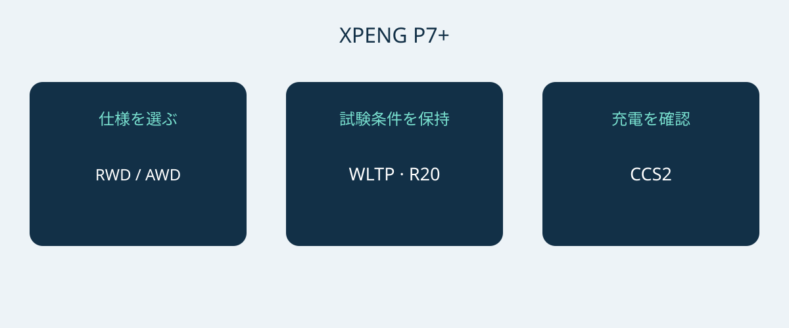

# XPENG P7+：ノルウェー仕様の航続距離・充電・使い勝手

XPENG P7+を購入候補にする際は、最高充電出力だけでなく、車体寸法、充電環境、実際の仕様が使い方に合うかを確認したいところです。2026年1月6日付のノルウェー仕様書は、5人乗りのバッテリー電気自動車のファストバックとして、RWD Long RangeとAWD Performanceを掲載しています。本稿の比較対象はこの2仕様であり、世界共通のP7+仕様ではありません。

資料の日付は正式なモデルイヤーの証明にはなりません。見積車両のVIN、製造月、当初の販売市場向け仕様書を取り寄せてください。その製造月に対応する仕様を販売者に確認してください。現在のノルウェーのモデルページにはPro名称もありますが、1月資料の2仕様との同一性は確認できません。P7、P7i、中国市場の航続距離延長型P7+を混ぜて比較することも避けてください。

## グレード選びは優先順位から

両仕様のLFPバッテリー総容量は74.9 kWhです。総容量であり、別途確認された使用可能電力量ではありません。20インチホイール装着時の公表値は、RWD Long Rangeが530 km WLTP、AWD Performanceが500 km WLTPです。比較では試験サイクルとホイール径を数字から切り離さないことが大切です。いずれも特定の走行経路で達成できる距離の保証ではありません。

| ノルウェー参考仕様 | RWD Long Range | AWD Performance |
|---|---|---|
| 駆動方式 | 後輪駆動 | 全輪駆動 |
| LFPバッテリー総容量 | 74.9 kWh | 74.9 kWh |
| WLTP航続距離、20インチ | 530 km | 500 km |
| モーター出力 | 230 kW | 230 + 140 kW、車軸別 |
| モータートルク | 450 Nm | 450 + 220 Nm、車軸別 |
| メーカー公表0–100 km/h | 6.2秒 | 4.3秒 |

出典は2026年1月6日のXPENGノルウェー仕様書で、上記の電気自動車に限ります。AWDの数値は2つの車軸を個別に示しており、別途認証されたシステム合算出力を意味しません。

公表WLTP航続距離を優先するなら、まずRWD Long Rangeを検討できます。全輪駆動とより速いメーカー公表加速値が明確な希望なら、AWD Performanceが比較対象です。ただし、維持費の低さや冬季の制動性能の優劣まで示したものではありません。価格差を評価する前に、販売市場、ホイール、付属装備をそろえて見積もりを比較してください。

## 大きな車体と荷物を実際に確認

参考寸法は5071 × 1937 × 1512 mm、ホイールベースは3000 mmです。予定する駐車場所を測り、進入路、ドアを開ける空間、荷物を積む位置を確認しましょう。公表車幅だけでミラー周囲やドア開放時の余裕まで保証されるわけではありません。車種分類から推測するより、実際の駐車実演が役立ちます。

XPENGは5席と573 Lの荷室容量、後席を倒した場合の1931 Lを掲載しています。これらはメーカーの容量値であり、特定のスーツケース、車いす、機材箱が入る保証ではありません。まず普段の乗員と荷物を同時に収められるか確認し、その後に後席を倒した大きな荷物の積載を考えてください。実物で試すのが有効です。荷室容積から積載重量やけん引能力を推定することはできません。

## 充電は普段使う設備から考える

ノルウェー参考仕様はAC 11 kW、DC最大446 kW、欧州CCS2接続を掲載しています。メーカーの充電時間参考値は10–80%で12分です。条件付きの充電区間であり、すべての充電停止時間を保証する数字ではありません。車両や電池の状態、温度、開始時の残量、充電器によって結果は変わります。すべての充電器が最大出力を供給できるわけでも、充電中ずっと同じ出力が続くわけでもありません。

日常用には、適切な資格を持つ施工業者や運営者に電源、端子、対応条件を確認してください。長距離移動では最高DC出力だけで決めず、利用予定の充電拠点を調べます。販売者の実演は接続確認に役立ちますが、一度成功しても将来の充電時間を保証しません。最短の広告値に予定を合わせず、充電条件の変化や中断に余裕を持たせましょう。

## 運転支援と購入後の対応

仕様書には7個のエアバッグが記載されています。XPILOTは運転支援であり、運転者は注意を払い、必要時に介入する必要があります。無人または監視不要の自動運転を意味しません。他市場の宣伝動画ではなく、当該車両の取扱説明書と現地の適用案内に沿って機能と制限を説明してもらってください。

ノルウェーの装備表だけでは、コネクテッドサービス、保証、ソフトウェア機能が別の仕向地に引き継がれるかは分かりません。対象VINの診断、修理、部品供給の担当者を確認し、条件を書面化しましょう。価格、在庫、税務、輸入可否、保証適用は別途最新の確認が必要です。商品ページは輸入判断や拘束力のある見積もりの代わりにはなりません。

## 見積書で明確にしたい項目

- 正確な仕様名、VIN、製造月、当初の販売市場と対応する車両書類。
- 選んだ参考仕様に合うホイールと電池情報。他市場の航続距離を流用しないこと。
- 付属充電機器、対応接続、別料金のアクセサリー。
- 仕向地の整備体制、接続機能の制限、書面による保証条件。
- 内訳のある見積もり、販売者の身元、支払い判断前の相違点への回答。

P7+という名称だけで詳細がない、仕様証明なくPro名称に置き換える、充電器や条件にかかわらず充電時間を保証する場合は、購入判断を保留するのが妥当です。違う仕様でも説明が明確なら検討できますが、根拠なく混ぜられた数値では比較できません。

## よくある質問

### すべてのP7+に使える数値ですか？
いいえ。2026年1月6日付のノルウェー電気自動車仕様です。他市場、航続距離延長型、正式なモデルイヤー、個別VINの装備は証明しません。

### 航続距離重視ならどちらから見ればよいですか？
20インチで530 km WLTPのRWD Long Rangeから検討できます。同条件のAWD Performanceは500 km WLTPです。実際の経路での距離は使用条件に左右されます。

### 12分充電は保証ですか？
いいえ。メーカーの10–80%参考値には充電器、温度、車両状態、開始残量などの条件があります。停車全体の時間は別に考える必要があります。

### 全席使用中も1931 L使えますか？
いいえ。1931 Lは後席を倒した場合です。別に掲載された容量は573 Lで、乗員と荷物を一緒に確認してください。

P7+の仕様、航続距離比較、充電互換性を結ぶオリジナル図。

## 出典と確認

資料確認日： 2026-11-05.

- [XPENG — XPENG P7+ Norwegian specification sheet, 6 January 2026](https://s-cdn.xpeng.com/commoncms/prod/2026-02-12/24d25f0ebb8c439b80144b3cc7ee5b00.pdf)
- [XPENG — XPENG P7+ Norway model page](https://www.xpeng.com/no/model/p7plus)
- [XPENG — XPENG P7+ Norway configurator](https://store.xpeng.com/no/configurator/P7%2B?source=ow_os_top_nav)
- [Bilforlaget — Xpeng P7+ RWD Long Range test](https://www.bilnorge.no/biltest-elbil-hurtiglading/oslo-kristiansand-pa-10-minutter/4178720)
- [NAF / Motor — Xpeng med diger kombicoupé](https://www.motor.no/aktuelt/xpeng-med-diger-kombicoupe-p7/342336)
- [Norsk elbilforening — XPENG P7+ Norwegian introduction: range, charging and luggage](https://elbil.no/xpeng-p7-plus-ki-pris-norge/)

[車両一覧を見る](https://www.autobridgeexport.com/vehicles/) · [購入ガイドを読む](https://www.autobridgeexport.com/guides/)
