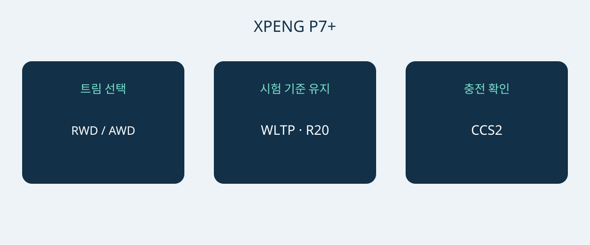

# XPENG P7+: 노르웨이 사양의 주행거리·충전·공간 비교

XPENG P7+를 구매 후보로 삼으려면 최고 충전 출력보다 차체 크기, 충전 여건, 실제 사양이 용도에 맞는지 먼저 살펴야 합니다. 2026년 1월 6일 노르웨이 사양서는 5인승 배터리 전기 패스트백의 RWD Long Range와 AWD Performance를 다룹니다. 아래 비교는 이 두 사양에 한정되며, 전 세계 P7+의 공통 사양이 아닙니다.

문서 날짜만으로 공식 모델 연식을 확정할 수는 없습니다. 견적 차량의 VIN, 생산 월, 최초 판매 시장 사양서를 요청하세요. 해당 생산 월의 구체적인 사양을 판매자에게 확인하세요. 현재 노르웨이 모델 페이지의 Pro 명칭 역시 1월 자료의 두 트림과 동일하다는 증거가 아닙니다. P7, P7i, 중국 시장의 주행거리 연장형 P7+를 이번 비교에 섞지 마세요.

## 두 트림의 선택 기준

두 참고 사양 모두 총용량 74.9 kWh의 LFP 배터리를 사용합니다. 총용량은 별도로 확인한 사용 가능 에너지와 다릅니다. 20인치 휠 기준 공표 주행거리는 RWD Long Range가 530 km WLTP, AWD Performance가 500 km WLTP입니다. 숫자에는 휠 크기와 시험 주기를 항상 함께 표시해야 합니다. 어느 값도 특정 경로에서 달성할 거리를 보장하지 않습니다.

| 노르웨이 참고 사양 | RWD Long Range | AWD Performance |
|---|---|---|
| 구동 방식 | 후륜구동 | 사륜구동 |
| LFP 배터리 총용량 | 74.9 kWh | 74.9 kWh |
| WLTP 주행거리, 20인치 휠 | 530 km | 500 km |
| 모터 출력 | 230 kW | 230 + 140 kW, 차축별 |
| 모터 토크 | 450 Nm | 450 + 220 Nm, 차축별 |
| 제조사 0–100 km/h 가속 | 6.2초 | 4.3초 |

출처는 2026년 1월 6일 XPENG 노르웨이 사양서이며 표의 전기차 버전에 적용됩니다. AWD 수치는 두 차축을 각각 나타내며 별도로 인증된 시스템 합산 출력을 의미하지 않습니다.

공표 WLTP 주행거리가 우선이면 RWD Long Range부터 살펴볼 수 있습니다. 사륜구동과 더 빠른 제조사 가속 수치가 명확한 우선순위라면 AWD Performance가 대안입니다. 이 선택 기준이 유지비 절감이나 겨울 제동 성능 우위를 입증하지는 않습니다. 가격 차이를 판단하기 전에 판매 시장, 휠 구성, 포함 장비를 맞춰 견적을 비교하세요.

## 주차와 짐 적재를 실제로 확인

참고 차체 크기는 5071 × 1937 × 1512 mm, 휠베이스는 3000 mm입니다. 예정된 주차 공간을 측정하고 진입로, 문을 열 여유, 짐을 싣는 위치를 확인하세요. 공표 차폭은 거울 주변이나 문을 연 상태의 전체 여유 공간을 보장하지 않습니다. 익숙한 차급이니 들어갈 것이라고 추측하기보다 실제 주차 시연을 요청하는 편이 낫습니다.

XPENG는 5좌석, 트렁크 573 L, 뒷좌석을 접었을 때 1931 L를 제시합니다. 제조사 용적 수치는 특정 여행가방, 휠체어, 장비 상자가 들어간다는 보장이 아닙니다. 평소 승객과 짐을 함께 싣는 상황부터 검토한 뒤, 좌석을 접어 가끔 큰 짐을 옮길 때를 살펴보세요. 실제 사용하는 물건으로 시험하는 것이 좋습니다. 적재 용적을 적재중량이나 견인 능력으로 환산할 근거는 없습니다.

## 충전은 사용할 장소를 기준으로 판단

노르웨이 참고 사양은 AC 11 kW, DC 최대 446 kW와 유럽 CCS2 연결을 제시합니다. 제조사 충전 시간 참고값은 잔량 10–80%에 12분입니다. 조건부 충전 구간이지 모든 정차 시간을 보장하는 수치가 아닙니다. 차량과 배터리 상태, 온도, 시작 잔량, 충전기가 결과에 영향을 줍니다. 모든 충전기가 최고 출력을 공급하거나 충전 내내 그 출력이 유지되는 것은 아닙니다.

일상 충전은 자격을 갖춘 설치업체나 운영자에게 전원, 커넥터, 호환성을 확인하세요. 장거리에서는 최고 DC 수치만 보지 말고 이용할 충전소를 점검해야 합니다. 판매자 시연은 호환성을 확인하는 데 도움이 되지만, 한 번 성공한 충전이 이후 시간을 보장하지는 않습니다. 가장 짧은 광고 시간에 일정을 맞추지 말고 충전 조건 변화와 중단 가능성을 고려한 여유를 두세요.

## 운전자 보조와 사후 지원을 구분

사양서에는 에어백 7개가 기재되어 있습니다. XPILOT은 운전자 보조 기능이며 운전자는 주의를 유지하고 필요할 때 개입해야 합니다. 이름만으로 무인 또는 감독 없는 자율주행을 뜻하지 않습니다. 다른 시장의 홍보 영상 대신 해당 차량 설명서와 현지 적용 안내를 바탕으로 기능과 한계를 시연해 달라고 요청하세요.

노르웨이 장비표는 연결 서비스, 보증, 소프트웨어 기능이 다른 목적지로 이전되는지도 입증하지 않습니다. 제시된 VIN의 진단, 수리, 부품 공급 담당자를 확인하고 조건을 서면으로 받으세요. 현재 가격, 재고, 세금, 수입 가능 여부, 보증 적용은 별도의 최신 확인이 필요합니다. 모델 페이지는 목적지 수입 판단이나 구속력 있는 거래 제안을 대체하지 못합니다.

## 견적에 명시할 내용

- 정확한 트림, VIN, 생산 월, 최초 판매 시장과 대응 차량 서류.
- 선택한 참고 사양에 맞는 휠과 배터리 정보. 다른 시장의 주행거리 차용은 피할 것.
- 포함된 충전 장비, 호환 연결, 별도 비용 액세서리.
- 목적지 서비스 체계, 연결 기능 제한, 서면 보증 조건.
- 항목별 거래 제안, 판매자 신원, 결제 결정 전 사양 차이에 대한 설명.

P7+라는 이름만 제시하거나, 증빙 없이 Pro로 바꾸거나, 충전기와 조건에 관계없이 충전 시간을 보장한다면 구매 결정을 보류하는 편이 좋습니다. 다른 사양이라도 명확히 설명되면 검토할 수 있지만, 이유 없이 섞인 수치는 신뢰할 비교 근거가 아닙니다.

## 자주 묻는 질문

### 모든 P7+에 적용되는 수치인가요?
아닙니다. 2026년 1월 6일 노르웨이 전기차 참고 사양입니다. 다른 시장, 주행거리 연장형, 공식 연식, 개별 VIN 장비를 입증하지 않습니다.

### 주행거리 우선이면 어느 트림부터 볼까요?
20인치 휠에서 530 km WLTP를 제시하는 RWD Long Range부터 검토할 수 있습니다. 같은 휠 기준 AWD Performance는 500 km WLTP입니다. 실제 경로의 거리는 사용 조건에 달려 있습니다.

### 12분 충전이 보장되나요?
아닙니다. 제조사의 10–80% 구간에는 충전기, 온도, 차량 상태, 시작 잔량 등의 조건이 있습니다. 전체 정차 시간은 별도로 판단해야 합니다.

### 모든 좌석에 승객이 타도 1931 L를 쓰나요?
아닙니다. 뒷좌석을 접었을 때의 수치입니다. 별도로 제시된 용적은 573 L이며 승객과 짐의 필요를 함께 확인하세요.

P7+ 트림과 주행거리 비교, 충전 호환성을 연결한 자체 제작 도식.

## 출처 및 확인

자료 확인일: 2026-11-05.

- [XPENG — XPENG P7+ Norwegian specification sheet, 6 January 2026](https://s-cdn.xpeng.com/commoncms/prod/2026-02-12/24d25f0ebb8c439b80144b3cc7ee5b00.pdf)
- [XPENG — XPENG P7+ Norway model page](https://www.xpeng.com/no/model/p7plus)
- [XPENG — XPENG P7+ Norway configurator](https://store.xpeng.com/no/configurator/P7%2B?source=ow_os_top_nav)
- [Bilforlaget — Xpeng P7+ RWD Long Range test](https://www.bilnorge.no/biltest-elbil-hurtiglading/oslo-kristiansand-pa-10-minutter/4178720)
- [NAF / Motor — Xpeng med diger kombicoupé](https://www.motor.no/aktuelt/xpeng-med-diger-kombicoupe-p7/342336)
- [Norsk elbilforening — XPENG P7+ Norwegian introduction: range, charging and luggage](https://elbil.no/xpeng-p7-plus-ki-pris-norge/)

[차량 살펴보기](https://www.autobridgeexport.com/vehicles/) · [구매 가이드 읽기](https://www.autobridgeexport.com/guides/)
