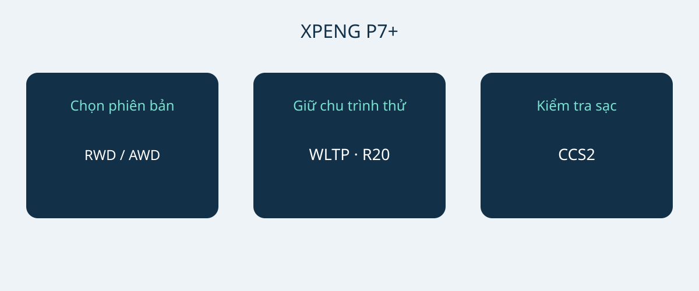

# XPENG P7+: tầm hoạt động, sạc và không gian bản Na Uy

XPENG P7+ phù hợp để đưa vào danh sách cân nhắc khi kích thước, nhu cầu sạc và cấu hình thực tế đáp ứng mục đích sử dụng. Công suất sạc cực đại không đủ để quyết định mua. Tài liệu Na Uy ngày 6 tháng 1 năm 2026 mô tả xe thuần điện kiểu fastback năm chỗ với hai bản RWD Long Range và AWD Performance. Đây là phạm vi so sánh, không phải cấu hình chung cho mọi P7+ trên thế giới.

Ngày tài liệu không xác nhận mã năm mẫu chính thức. Hãy yêu cầu VIN, tháng sản xuất và thông số của thị trường bán ban đầu. Đề nghị bên bán xác nhận cấu hình tương ứng với tháng sản xuất đó. Trang xe Na Uy hiện dùng thêm tên Pro, nhưng chưa chứng minh tương đương với hai bản trong tài liệu tháng 1. Không trộn thông số P7, P7i hay P7+ có bộ kéo dài hành trình tại Trung Quốc vào đây.

## Chọn bản theo ưu tiên

Cả hai bản tham chiếu có pin LFP với dung lượng tổng 74.9 kWh. Dung lượng tổng không phải mức năng lượng khả dụng được xác minh riêng. Với bánh 20 inch, tài liệu công bố RWD Long Range đạt 530 km WLTP và AWD Performance đạt 500 km WLTP. Khi so sánh, luôn giữ kích thước bánh và chu trình thử đi cùng số liệu. Không con số nào bảo đảm quãng đường trên một hành trình cụ thể.

| Thông số tham chiếu Na Uy | RWD Long Range | AWD Performance |
|---|---|---|
| Dẫn động | Cầu sau | Bốn bánh |
| Dung lượng tổng pin LFP | 74.9 kWh | 74.9 kWh |
| Tầm hoạt động WLTP, bánh 20 inch | 530 km | 500 km |
| Công suất động cơ | 230 kW | 230 + 140 kW, theo trục |
| Mô-men xoắn | 450 Nm | 450 + 220 Nm, theo trục |
| Tăng tốc 0–100 km/h của hãng | 6.2 giây | 4.3 giây |

Nguồn: tài liệu XPENG Na Uy ngày 6 tháng 1 năm 2026 cho các bản thuần điện nêu trên. Các số liệu AWD mô tả riêng hai trục, không phải công suất tổng của hệ thống được chứng nhận riêng.

Nếu ưu tiên tầm hoạt động WLTP công bố, có thể xem RWD Long Range trước. AWD Performance là lựa chọn khác khi dẫn động bốn bánh và thời gian tăng tốc ngắn hơn là yêu cầu rõ ràng. Đây không phải kết luận về chi phí sử dụng thấp hơn hay khả năng phanh mùa đông tốt hơn. Trước khi đánh giá chênh lệch giá, đối chiếu cùng thị trường, bánh xe và trang bị đi kèm.

## Thử chỗ đỗ và hành lý

Kích thước tham chiếu là 5071 × 1937 × 1512 mm, chiều dài cơ sở 3000 mm. Đo chỗ đỗ dự kiến, xem đường vào, khoảng mở cửa và vị trí chất hành lý. Chiều rộng công bố không bảo đảm toàn bộ khoảng trống quanh gương hoặc cửa mở. Một lần thử đỗ thực tế có giá trị hơn suy đoán theo phân khúc xe.

XPENG ghi năm chỗ, khoang hành lý 573 L và 1931 L khi gập ghế sau. Đây là thể tích của hãng, không bảo đảm một vali, xe lăn hoặc thùng thiết bị cụ thể sẽ vừa. Hãy thử nhu cầu chở người và hành lý hằng ngày trước, rồi mới xét đồ cồng kềnh khi gập ghế. Nên dùng chính đồ thường chở để thử. Thể tích khoang không xác lập tải trọng hoặc khả năng kéo rơ-moóc.

## Bắt đầu từ nơi sạc thực tế

Bản tham chiếu Na Uy có sạc AC 11 kW, DC tối đa 446 kW và kết nối CCS2 châu Âu. Hãng đưa ra mốc 12 phút cho khoảng 10–80% pin. Đây là khoảng sạc có điều kiện, không phải thời gian dừng được bảo đảm ở mọi nơi. Tình trạng xe và pin, nhiệt độ, mức pin ban đầu và trụ sạc đều ảnh hưởng kết quả. Không phải trụ nào cũng cung cấp công suất cực đại, và xe không nhất thiết giữ mức đó suốt phiên sạc.

Đối với sạc thường xuyên, nhờ đơn vị lắp đặt đủ năng lực hoặc nhà vận hành xác nhận nguồn điện, đầu nối và tính tương thích. Với đường dài, kiểm tra các trạm dự kiến thay vì chỉ chọn theo công suất đỉnh. Trình diễn của bên bán giúp xác nhận kết nối, nhưng một phiên thành công không bảo đảm các phiên sau. Dành khoảng dự phòng cho điều kiện sạc và gián đoạn; không lập lịch chỉ theo thời gian quảng cáo ngắn nhất.

## Tách hỗ trợ lái và dịch vụ sau mua

Tài liệu ghi bảy túi khí. XPILOT là hỗ trợ người lái; người lái vẫn cần chú ý và can thiệp khi cần. Tên chức năng không có nghĩa xe tự lái mà không cần giám sát. Yêu cầu giải thích chức năng và giới hạn theo sổ tay đúng xe và hướng dẫn địa phương, thay vì video quảng cáo từ thị trường khác.

Danh mục trang bị Na Uy cũng không chứng minh dịch vụ kết nối, bảo hành hoặc phần mềm được chuyển sang điểm đến khác. Xác định ai chịu trách nhiệm chẩn đoán, sửa chữa và phụ tùng cho VIN được chào bán, rồi lấy điều kiện bằng văn bản. Giá, tồn kho, thuế, khả năng nhập khẩu và bảo hành cần được xác nhận cập nhật riêng. Trang sản phẩm không thay thế quyết định nhập khẩu hoặc đề nghị thương mại có ràng buộc.

## Nội dung nên có trong báo giá

- Bản xe chính xác, VIN, tháng sản xuất, thị trường ban đầu và giấy tờ tương ứng.
- Bánh và pin phù hợp tham chiếu đã chọn, không lấy tầm hoạt động từ thị trường khác.
- Thiết bị sạc đi kèm, kết nối tương thích và phụ kiện tính phí riêng.
- Dịch vụ tại điểm đến, giới hạn chức năng kết nối và điều khoản bảo hành bằng văn bản.
- Báo giá chi tiết, danh tính bên bán và giải thích chênh lệch trước quyết định thanh toán.

Nên tạm dừng mua nếu bên bán chỉ ghi chung P7+, thay bằng tên Pro mà không có chứng minh cấu hình, hoặc bảo đảm thời gian sạc bất kể trụ và điều kiện. Cấu hình khác được giải thích rõ vẫn có thể đánh giá; số liệu trộn lẫn không giải thích thì không đủ cơ sở so sánh.

## Câu hỏi thường gặp

### Các số liệu áp dụng cho mọi P7+ không?
Không. Đây là tham chiếu thuần điện Na Uy ngày 6 tháng 1 năm 2026, không xác nhận thị trường khác, bản kéo dài hành trình, năm mẫu chính thức hay trang bị của một VIN.

### Ưu tiên tầm hoạt động thì xem bản nào trước?
RWD Long Range công bố 530 km WLTP với bánh 20 inch, so với 500 km WLTP của AWD Performance trên cùng cơ sở. Quãng đường thực tế còn tùy điều kiện sử dụng.

### Sạc 12 phút có được bảo đảm không?
Không. Mốc 10–80% phụ thuộc trụ, nhiệt độ, tình trạng xe và mức pin ban đầu. Tổng thời gian dừng là vấn đề khác.

### Có 1931 L khi mọi ghế đều có người ngồi không?
Không. Mức đó áp dụng khi gập ghế sau; thể tích còn lại được công bố là 573 L. Kiểm tra đồng thời nhu cầu người và hành lý.

Sơ đồ tự thiết kế nối phiên bản P7+, so sánh tầm hoạt động và tương thích sạc.

## Nguồn và xác minh

Nguồn được kiểm tra ngày 2026-11-05.

- [XPENG — XPENG P7+ Norwegian specification sheet, 6 January 2026](https://s-cdn.xpeng.com/commoncms/prod/2026-02-12/24d25f0ebb8c439b80144b3cc7ee5b00.pdf)
- [XPENG — XPENG P7+ Norway model page](https://www.xpeng.com/no/model/p7plus)
- [XPENG — XPENG P7+ Norway configurator](https://store.xpeng.com/no/configurator/P7%2B?source=ow_os_top_nav)
- [Bilforlaget — Xpeng P7+ RWD Long Range test](https://www.bilnorge.no/biltest-elbil-hurtiglading/oslo-kristiansand-pa-10-minutter/4178720)
- [NAF / Motor — Xpeng med diger kombicoupé](https://www.motor.no/aktuelt/xpeng-med-diger-kombicoupe-p7/342336)
- [Norsk elbilforening — XPENG P7+ Norwegian introduction: range, charging and luggage](https://elbil.no/xpeng-p7-plus-ki-pris-norge/)

[Xem các mẫu xe](https://www.autobridgeexport.com/vehicles/) · [Đọc hướng dẫn mua xe](https://www.autobridgeexport.com/guides/)
