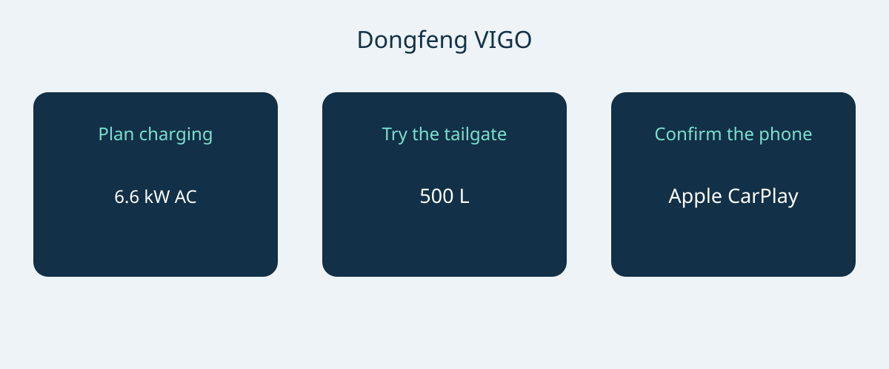

# Dongfeng VIGO: New Zealand Charging and Cargo Checks

The Dongfeng VIGO deserves a practical buying assessment rather than a decision based on a single range headline. The New Zealand reference combines a battery-electric, front-wheel-drive configuration with a split tailgate and a compact footprint. Its usefulness depends on whether the buyer can charge conveniently, load everyday belongings comfortably and connect the phone they actually use. Those questions are worth resolving on the offered vehicle before negotiating the final package.

This article uses the New Zealand brochure in its October 2026 edition, together with the official local model page. The brochure date is not a factory model-year declaration. Its technical configuration is the New Zealand 51.87 kWh front-wheel-drive version, described as Standard in the brochure; it should not be relabelled with another market's trim names. Ask for the VIN, build date and original sales specification. Do not treat Malaysian, Hong Kong, Singaporean or Chinese-market configurations as interchangeable merely because a related model name or appearance seems familiar.

## Start with the daily charging arrangement

The New Zealand reference lists a 51.87 kWh LFP battery, a 120 kW motor and 230 Nm of torque. The manufacturer states 7.8 seconds for 0–100 km/h. These figures describe the cited configuration, not every vehicle that might be offered under the VIGO name. The brochure's advertised range is 471 km CLTC. Keep CLTC attached: it is not an independently established WLTP result or a guarantee of real-world journey distance.

The same brochure also describes a range conversion using a New Zealand government calculator. A converted figure is not evidence of an independent WLTP test. For a meaningful comparison with another car, ask for the applicable test basis rather than placing unlike cycles into one ranking. For route planning, consider the charging stops available and the conditions of use instead of turning a brochure number into a promised daily radius.

| New Zealand reference parameter | Value |
|---|---|
| Powertrain and drive | Battery electric; front-wheel drive |
| Battery | 51.87 kWh LFP |
| Maximum motor power | 120 kW |
| Maximum torque | 230 Nm |
| Manufacturer 0–100 km/h | 7.8 seconds |
| Advertised range | 471 km CLTC |
| Maximum AC charging | 6.6 kW |
| Maximum DC charging | 167 kW |
| Manufacturer charging window | 30–80% in 18 minutes |

Source: Dongfeng New Zealand October 2026 brochure, single reference configuration. A formal model-year code is not established by this edition.

The charging window is particularly important: 30–80% in 18 minutes is not a 10–80% claim. Nor does a maximum DC power of 167 kW mean that every session will reach or maintain that level. Auto Trader NZ reported a lower peak in its own test; one observed session does not prove a universal fault or establish a guaranteed rate for another car. Keep the manufacturer's capability and an individual review's experience separate.

For home or workplace charging, have a qualified installer or operator confirm the available supply and compatible equipment. The 6.6 kW AC maximum gives a reference for that discussion but does not prove the speed at a particular installation. For regular long trips, inspect the intended charging network and leave time for changing conditions. Ask the seller to demonstrate compatibility on the actual vehicle; do not accept a peak-power headline as a substitute for a workable charging plan.

## Test the split tailgate with your own belongings

The reference dimensions are 4306 × 1868 × 1654 mm, with a 2715 mm wheelbase and five seats. The brochure lists a 500 L luggage volume and a maximum of 1040 L, alongside 60/40 split-folding rear seats. These are useful starting points for examining cabin flexibility, but a volume figure alone cannot tell you whether a particular stroller, wheelchair or equipment case can be loaded easily.

The brochure's standard split tailgate has upper and lower sections and is manual. Do not assume powered operation from the split design or a demonstration of an accessory-equipped vehicle. Open both sections, try the loading position and check access in the intended parking space. A lower section can change how close a person can stand to the luggage opening, so an actual trial matters more than interpreting a photograph. This is a recommended usability check, not a claim based on an AutoBridge physical test.

Try the normal passenger-and-luggage arrangement before relying on folded seats. If a seller proposes a powered accessory or another tailgate arrangement, have it identified separately in the quotation with its installation and support terms. Cargo volume is not payload, and the figures here do not establish towing capacity. Avoid converting an attractive space claim into a transport capability that has not been documented.

## Bring the phone, not just a connectivity checklist

The New Zealand material lists Apple CarPlay. Android Auto is described as an optional aftermarket accessory, not standard factory equipment. Ask exactly what is included in the offered vehicle and whether an accessory is already fitted, will be supplied separately or is merely available to order. A general statement that the car supports smartphone connection does not answer those questions.

The brochure lists a 12.8-inch centre screen, and the official model page lists automatic air conditioning with a heat pump. Neither item proves that a buyer's preferred phone applications or connected services will work in another destination. Pair the intended phone during a demonstration and ask the seller to explain the installed arrangement and support responsibility. Obtain accessory details in writing rather than assuming a successful demonstration of one device establishes compatibility for every phone.

## Make the quotation specific to the vehicle

- Identify VIN, build date, original New Zealand specification and the actual equipment supplied.
- Separate the manual standard tailgate from any powered accessory and list installation responsibility.
- Name the phone integration supplied, especially any Android Auto aftermarket accessory.
- Confirm charging equipment and compatibility with the buyer's intended charging locations.
- Obtain written service and warranty conditions for the destination, with a current itemized offer.

A New Zealand product page does not establish export eligibility, registration acceptance, taxes, freight charges or warranty coverage abroad. Current price and availability also need fresh confirmation. Pause the decision when the seller cannot reconcile the configuration, presents a converted range as a directly tested equivalent, or calls optional connectivity standard. Likewise, seek the exact applicable safety-assessment record if a rating is important to the purchase; this article does not establish an ANCAP or Euro NCAP star rating.

The strongest case for the VIGO is therefore conditional on three practical successes: a suitable charging arrangement, a satisfactory loading trial and a clearly documented phone setup. If those fit, the New Zealand reference gives a concrete basis for a more detailed quotation. If they do not, headline specifications cannot resolve the mismatch.

## Frequently asked questions

### Is this a formal model-year specification?
No. It is a New Zealand reference from the October 2026 brochure. Confirm factory identity and build details for the offered VIN rather than inferring them from the filename.

### Can the advertised range be compared directly with WLTP figures?
The 471 km claim is CLTC. The brochure's separately described conversion is not an independent WLTP test. Compare matching test bases and keep actual journey planning separate.

### Does the 18-minute claim mean 10–80% charging?
No. The manufacturer states 30–80%. Charging conditions and equipment still matter, and the peak power is not a guaranteed sustained rate.

### Are a powered tailgate and Android Auto standard?
The cited brochure describes a manual split tailgate. Android Auto is an optional aftermarket accessory; Apple CarPlay is listed. Check the actual vehicle and invoice rather than assuming an upgrade is included.

Original diagram connecting charging access, cargo use and phone-equipment confirmation.

## Sources and verification

Sources checked on 2026-11-05.

- [Dongfeng NZ / Armstrongs Distribution — VIGO New Zealand brochure, October 2026 edition](https://dongfeng.co.nz/wp-content/uploads/2026/10/Dongfeng-Vigo-Brochure-Oct26-Web.pdf)
- [Dongfeng NZ / Armstrongs Distribution — VIGO New Zealand official model page](https://dongfeng.co.nz/electric-vehicles/vigo-ev/)
- [Dongfeng NZ / Armstrongs Distribution — VIGO New Zealand launch release, January 15 2026](https://dongfeng.co.nz/newsroom/new-dongfeng-vigo-breaks-barriers-to-electric-vehicle-versatility-with-best-value-ev-suv-in-new-zealand/)
- [NZME / Driven Car Guide — VIGO review: sit, sleep and drive, March 9 2026](https://www.drivencarguide.co.nz/reviews/dongfeng-vigo-review-sit-sleep-and-drive/)
- [CarExpert — VIGO Quick Drive, February 19 2026](https://www.carexpert.co.nz/car-reviews/dongfeng-vigo-review-quick-drive)
- [Auto Trader NZ — VIGO review, April 11 2026](https://autotrader.co.nz/car-reviews/2026-dongfeng-vigo-review)

[Explore vehicles](https://www.autobridgeexport.com/vehicles/) · [Read buying guides](https://www.autobridgeexport.com/guides/)
