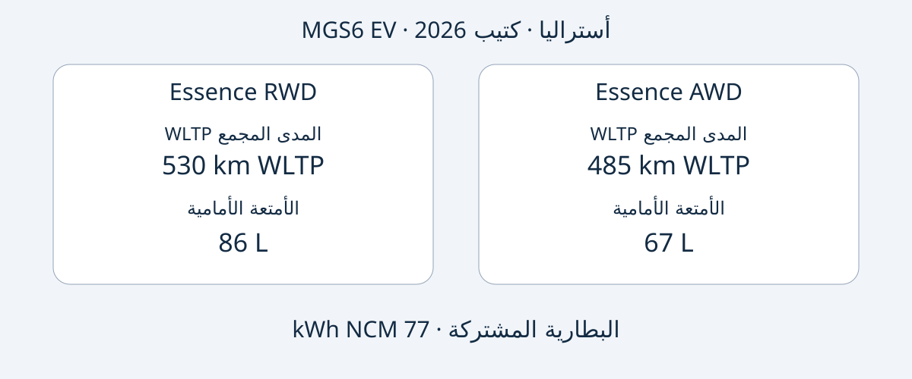

# MG MGS6 EV: اختيار Essence RWD أو AWD الأسترالية

تقدم MGS6 EV الأسترالية خيارين واضحين: تتميز Essence RWD بالمدى المعلن الأطول وفق دورة WLTP المجمعة وبحجرة أمتعة أمامية أكبر، بينما تقدم Essence AWD قدرة قصوى أعلى وزمن تسارع معلن أقصر. لكن هذه الفروق لا تحسم الشراء وحدها. ينبغي أيضاً تحديد السيارة المعروضة، ومطابقة تجهيزها مع المرجع الأسترالي، والتحقق من إمكان استخدامها وخدمتها في بلد الوجهة.

تعتمد المقارنة على كتيب MG الأسترالي بإصدار 2026، الذي جرى التحقق منه في 2026-11-05. السنة تخص إصدار الوثيقة، ولا تثبت أن كل سيارة معلن عنها تحمل رسمياً سنة الطراز MY2026. السيارة SUV كهربائية بالبطارية متوسطة الحجم. تنحصر المقارنة في Essence RWD وEssence AWD الأستراليتين، ولا تصف مواصفات عالمية موحدة أو تطابقاً مع طراز صيني يحمل اسماً آخر. تاريخ إنتاج السيارة المعينة يحتاج إلى مستنداتها.

## تجهيز واحد للبطارية وأولويات مختلفة

تخص جميع القيم سيارات البطارية الكهربائية الأسترالية في كتيب 2026. المدى وفق WLTP المجمعة، والتسارع رقم من الشركة المصنعة وليس اختباراً مستقلاً. توصف 77 kWh بأنها سعة البطارية، دون إثبات أنها السعة القابلة للاستخدام.

| البند | Essence RWD | Essence AWD |
|---|---|---|
| الدفع | خلفي | بجميع العجلات |
| البطارية | 77 kWh NCM | 77 kWh NCM |
| المدى المجمع WLTP | 530 km | 485 km |
| القدرة القصوى | 180 kW | 266 kW |
| العزم الأقصى | 350 Nm | 540 Nm |
| تسارع الشركة 0–100 km/h | 7.3 ثانية | 5.1 ثانية |
| حجرة الأمتعة الأمامية | 86 L | 67 L |

المصدر: [كتيب MG أستراليا](https://mgmotor.com.au/brochures/MGS6_EV_2026_v2.pdf). طريقة قياس أحجام الأمتعة غير محددة هنا، ولذلك لا تثبت الأرقام أن حقائب بعينها ستلائم الحجرة.

إذا كانت الأولوية للمدى المنشور والتخزين الأمامي، فمن المناسب البدء بدراسة RWD. وإذا كان المطلوب تحديداً قدرة وتسارع معلنان أعلى، فإن AWD تلبي هذه الرغبة. هذه مقارنة صفات موثقة، وليست تجربة قيادة أجرتها AutoBridge. ولا تثبت الأرقام اختلافات التكلفة الفعلية أو الأداء الشتوي أو مسافة الكبح أو قيمة إعادة البيع.

يُفضّل أن يذكر عرض السعر اسم الفئة كاملاً. عبارة «MGS6 EV، 77 kWh» لا تحدد الاختلاف الذي يغيّر المدى والأداء والتخزين الأمامي. اطلب إرفاق مواصفات السيارة المعروضة وبيانات VIN بالعرض، بدلاً من الاكتفاء بكتيب عام.

## افصل قدرة الشحن عن مدة الشحن

تذكر الفئتان الأستراليتان شحناً مدمجاً AC بقدرة 11 kW وشحناً DC أقصاه 144 kW. هذه قدرات وليست ضماناً لما يوفره أي مقبس أو محطة. يعلن الكتيب شحن 10–80% في 38 دقيقة عند 25°C، باستخدام شاحن 150 kW ضمن ظروف اختبار معيارية لدى الشركة. احتفظ بكل هذه الشروط عند مقارنة العروض.

قدرة المحطة الاسمية والحد الأقصى للسيارة قيمتان مختلفتان، ولا تمثل أي منهما متوسط القدرة خلال الجلسة. كما أن الزمن لا يصف الشحن من بطارية فارغة إلى ممتلئة. تؤثر المحطة والحرارة وحالة البطارية، لذا لا تبنِ جدول التسليم أو الرحلة على تكرار الزمن المعلن في كل توقف.

عند الشراء لمسار معين، اطلب تأكيد منفذ شحن السيارة والأجهزة المحلية المتوافقة ووثائق الشحن. افحص توافر الشحن في الوجهة بصورة منفصلة. لا تستنتج هذه المقالة استهلاك الكهرباء أو فاتورتها أو مدى فعلياً مضموناً من السعة ومدى الاختبار.

## الحجم لا يثبت ملاءمة الأمتعة

يورد الكتيب الأسترالي أبعاد 4708 × 1912 × 1664 mm وقاعدة عجلات 2835 mm للفئتين. حجم الحجرة الخلفية المعلن 581 L مع المقاعد قائمة و1690 L مع طيها. أما الحجرة الأمامية فتختلف، ولذلك تستحق تقييماً مستقلاً بدلاً من اعتبار جميع المساحات قابلة للاستبدال.

أعد قائمة بالأمتعة أو المعدات التي ستُنقل معاً، واطلب قياسات أو صوراً لفتحات التحميل ووضع المقاعد في السيارة المعروضة. الحجم باللترات لا يصف الشكل أو الوصول مع وجود ركاب أو إمكان تثبيت حمولة محددة. ولا يثبت الحمولة الوزنية أو قدرة السحب.

تتضمن الفئتان المرجعيتان مضخة حرارية، وشاشة معلومات وترفيه 12.8 بوصة، وشاشة للسائق 10.25 بوصة، وعجلات 20 بوصة. طابق ذلك مع مواصفات البيع الفعلية. أبعاد الشاشة لا تؤكد اللغات أو الخدمات المتصلة أو دعم البرمجيات في بلد آخر؛ اطلب إجابات مكتوبة تخص وجهتك.

## اقرأ تقييم السلامة مع تواريخه

ينطبق تقييم ANCAP لعام 2025 على الفئات المشمولة المصنّعة منذ ديسمبر 2025 والمباعة في أستراليا ونيوزيلندا منذ يونيو 2026. النتائج المعلنة هي 92% لحماية البالغين، و87% للأطفال، و84% لمستخدمي الطريق الأكثر عرضة للخطر، و81% لمساعدة السلامة. توضح [صفحة ANCAP](https://www.ancap.com.au/safety-ratings/mg/mgs6-ev/588e29) والتقرير نطاق التطبيق.

سنة التقييم وفترة الإنتاج وإصدار الكتيب معلومات مختلفة. لا تحل أي منها محل تحديد هوية السيارة. ولا يثبت التقييم اعتمادها في بلد الوجهة، أو يضمن منع الإصابة، أو يوضح حالة سيارة مستعملة حالياً. اطلب سجلات تخص السيارة بدلاً من اعتبار تقييم الطراز تقريراً عن حالتها.

## تحويل المقارنة إلى عرض قابل للتحقق

هذه طلبات شراء يوصي بها التحرير، وليست قائمة مستندات قانونية موحدة عالمياً:

- طلب VIN وإثبات تاريخ التصنيع وسوق البيع الأصلي ومواصفات Essence RWD أو Essence AWD كاملة.
- مطالبة البائع بتحديد الاختلافات عن الكتيب الأسترالي، بما فيها التجهيزات وأجهزة الشحن والبرمجيات.
- تأكيد السعر والمخزون وموعد التسليم والضمان والخدمة للصفقة المحددة. المعلومات الأسترالية لا تثبت تغطية الضمان بعد التصدير.
- التحقق من أهلية الاستيراد والتسجيل لدى المصادر المختصة قبل الالتزام المالي؛ الكتيب وANCAP لا يحسمانها.
- تعليق الشراء إذا تعذر التوفيق بين اسم الفئة وسجلات السيارة، أو قُدمت مواصفات سوق آخر بوصفها مطابقة دون مستندات.

الاختيار الأنسب يلبي استخداماً محدداً وتدعمه وثائق متسقة. القدرة الأعلى ليست أنفع دائماً، والمدى المختبري الأطول لا يضمن رحلة معينة. قارن الفئتين الأستراليتين أولاً ثم قيّم أدلة الصفقة نفسها.

## أسئلة شائعة

### هل يعني كتيب 2026 أن السيارة MY2026؟
لا. إنه إصدار الوثيقة. اطلب التسمية الرسمية وسجلات التصنيع، ولا تستنتجها من اسم الملف أو الإعلان.

### هل 77 kWh هي السعة القابلة للاستخدام؟
يسميها المصدر سعة البطارية. لا تعيد المقالة تعريفها كسعة قابلة للاستخدام ولا تحسب الاستهلاك منها.

### هل تطبق الأرقام على سوق آخر؟
ليس تلقائياً. ينبغي تطابق السوق والفئة وهوية السيارة. لا نساوي بين Essence الأسترالية وأسماء الفئات البريطانية أو الأوروبية.

### هل مدة 38 دقيقة مضمونة في كل مرة؟
لا. تخص 10–80% عند 25°C وشاحن 150 kW تحت ظروف الشركة المعيارية، وليست لكل جلسة أو للشحن الكامل.

## رسم المقارنة

رسم أصلي للفئتين الأستراليتين مع سعة البطارية المشتركة أسفلهما.

## المصادر وقراءات إضافية

تاريخ التحقق 2026-11-05. توثق MG المواصفات الأسترالية وANCAP نطاق التقييم. تقدم المقالات المستقلة سياق الإطلاق، وليست دليلاً على اختبار AutoBridge.

- [MG: الكتيب الأسترالي 2026](https://mgmotor.com.au/brochures/MGS6_EV_2026_v2.pdf)
- [MG: صفحة الطراز الأسترالي](https://mgmotor.com.au/vehicles/mgs6-ev)
- [ANCAP: التقييم](https://www.ancap.com.au/safety-ratings/mg/mgs6-ev/588e29)
- [ANCAP: التقرير](https://cdn.ancap.com.au/app/public/assets/c0121809eba68316282bba1fc3b9fcd6e0d03b41/original.pdf?1782710064=)
- [WhichCar: تجربة أسترالية](https://www.whichcar.com.au/reviews/mgs6-ev-first-drive-medium-suv)
- [CarsGuide: مراجعة أسترالية](https://www.carsguide.com.au/ev/mg-s6-ev-101791)

راجع أيضاً [دليل المركبات](https://www.autobridgeexport.com/vehicles/) و[أدلة الشراء](https://www.autobridgeexport.com/guides/).
