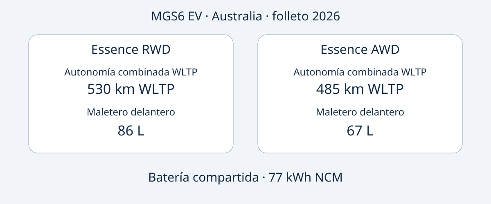

# MG MGS6 EV: elegir Essence RWD o AWD de Australia

El MGS6 EV australiano plantea una decisión concreta: el Essence RWD anuncia mayor autonomía combinada WLTP y un maletero delantero más grande; el Essence AWD ofrece mayor potencia máxima y una aceleración declarada más rápida. Ninguna ventaja resuelve por sí sola la compra. También importa identificar el vehículo ofrecido, comprobar su correspondencia con la referencia australiana y confirmar las posibilidades de uso y asistencia en destino.

La comparación utiliza el folleto australiano de MG, edición 2026, consultado el 2026-11-05. La fecha identifica el documento, no confirma que cada unidad sea oficialmente MY2026. El MGS6 EV es un SUV eléctrico mediano. Aquí se comparan únicamente Essence RWD y Essence AWD australianos, no una especificación mundial ni una supuesta equivalencia con otro modelo chino. La fecha de fabricación de la unidad debe comprobarse en sus documentos.

## Dos configuraciones con prioridades distintas

Todos los datos corresponden a los eléctricos australianos del folleto 2026. La autonomía es combinada WLTP y la aceleración procede del fabricante, no de una prueba propia. Los 77 kWh figuran como capacidad de batería, sin confirmación de capacidad utilizable.

| Característica | Essence RWD | Essence AWD |
|---|---|---|
| Tracción | Trasera | Integral |
| Batería | 77 kWh NCM | 77 kWh NCM |
| Autonomía combinada WLTP | 530 km | 485 km |
| Potencia máxima | 180 kW | 266 kW |
| Par máximo | 350 Nm | 540 Nm |
| 0–100 km/h del fabricante | 7.3 segundos | 5.1 segundos |
| Maletero delantero | 86 L | 67 L |

Fuente: [folleto de MG Australia](https://mgmotor.com.au/brochures/MGS6_EV_2026_v2.pdf). No se especifica aquí el método de medición del volumen; las cifras no garantizan que entren unas maletas determinadas.

Si la prioridad es la autonomía publicada y el almacenamiento delantero, conviene estudiar primero el RWD. Si se buscan expresamente mayor potencia y aceleración declarada, el AWD responde a esa preferencia. Se comparan atributos documentados, no resultados de conducción de AutoBridge. No permiten concluir diferencias de coste real, comportamiento invernal, distancia de frenado o valor de reventa.

Una oferta útil identifica la versión completa. «MGS6 EV, 77 kWh» omite la distinción que cambia autonomía, prestaciones y almacenamiento. Solicite que la especificación de la unidad y sus datos VIN acompañen al presupuesto, en lugar de recibir únicamente un folleto general.

## Leer juntas potencia y condiciones de carga

Ambas versiones australianas indican carga AC a bordo de 11 kW y un máximo DC de 144 kW. Son capacidades, no garantías de potencia disponible en cualquier enchufe o estación. El folleto anuncia 10–80% en 38 minutos a 25°C, con un cargador de 150 kW bajo condiciones normalizadas del fabricante. Conserve todos esos límites al comparar ofertas.

La potencia nominal de la estación y el máximo del vehículo describen magnitudes distintas. Ninguna determina la potencia media durante toda la sesión. El intervalo tampoco representa una carga de vacío a lleno. Importan el cargador, la temperatura y el estado de la batería; no suponga que cada parada repetirá ese tiempo al preparar una ruta o entrega.

Para una ruta concreta, solicite confirmación del conector de la unidad, los equipos locales compatibles y la documentación correspondiente. Investigue por separado el acceso a carga en destino. No calculamos consumo, factura eléctrica ni autonomía real garantizada a partir de capacidad y autonomía de laboratorio.

## El volumen no sustituye una comprobación de espacio

El folleto australiano indica 4708 × 1912 × 1664 mm y una batalla de 2835 mm en ambas versiones. El maletero trasero figura con 581 L con asientos levantados y 1690 L con asientos abatidos. El delantero cambia entre versiones, por lo que merece una evaluación separada: los distintos compartimentos no son intercambiables.

Liste los objetos que necesita llevar juntos y solicite medidas o fotografías de las aperturas de carga y la disposición de asientos de la unidad. Una cifra en litros no describe la forma, el acceso con pasajeros ni las posibilidades de sujeción. Tampoco demuestra carga útil o capacidad de remolque.

Ambas configuraciones de referencia incluyen bomba de calor, pantalla multimedia de 12.8 pulgadas, pantalla del conductor de 10.25 pulgadas y ruedas de 20 pulgadas. Confírmelo en la especificación vendida. El tamaño de pantalla no prueba idiomas disponibles, funcionamiento de servicios conectados o soporte de software en otro país. Pida respuestas escritas para su destino.

## Seguridad: conservar fechas y ámbito

La evaluación ANCAP de 2025 se aplica a las variantes evaluadas fabricadas desde diciembre de 2025 y comercializadas en Australia y Nueva Zelanda desde junio de 2026. Sus resultados son 92% para ocupantes adultos, 87% para niños, 84% para usuarios vulnerables y 81% para asistencia de seguridad. La [página de ANCAP](https://www.ancap.com.au/safety-ratings/mg/mgs6-ev/588e29) y el informe explican la aplicabilidad.

El año de evaluación, el periodo de fabricación y la edición del folleto son datos diferentes. Ninguno sustituye la identidad de la unidad. La evaluación no acredita homologación en destino, no garantiza evitar lesiones y no demuestra el estado actual de un vehículo usado. Solicite documentación de la unidad en lugar de tratar la calificación del modelo como informe de condición.

## Convertir la comparación en una oferta comprobable

Estas son recomendaciones editoriales de compra, no una lista universal de obligaciones legales:

- Solicitar VIN, prueba de fecha de fabricación, mercado de venta original y especificación completa Essence RWD o Essence AWD.
- Pedir al vendedor que identifique diferencias respecto del folleto australiano, incluidos equipo, carga y software.
- Confirmar precio, existencias, plazo, garantía y asistencia para la operación concreta. La información australiana no demuestra cobertura de garantía tras exportar.
- Verificar importación y matriculación mediante fuentes competentes antes de comprometer dinero; el folleto y ANCAP no resuelven esas cuestiones.
- Pausar la compra si no coinciden versión y documentos, o si se presenta otra configuración nacional como equivalente sin pruebas.

La versión adecuada satisface un uso definido y cuenta con documentos coherentes. Más potencia no implica mayor utilidad; más autonomía de laboratorio no garantiza completar un viaje. Primero compare las versiones australianas y luego las pruebas del presupuesto concreto.

## Preguntas frecuentes

### ¿El folleto 2026 acredita MY2026?
No. Es la edición documental. Pida la designación oficial y los registros de fabricación de la unidad; no los deduzca del archivo o anuncio.

### ¿Los 77 kWh son utilizables?
La fuente los denomina capacidad de batería. No se reinterpretan como capacidad utilizable ni se utilizan para calcular consumo.

### ¿Sirven los datos para otro mercado?
No automáticamente. Deben coincidir mercado, versión e identidad. No se equiparan las versiones Essence australianas con acabados británicos o europeos.

### ¿Siempre se tarda 38 minutos?
No. Se refiere a 10–80%, 25°C y cargador de 150 kW bajo condiciones normalizadas del fabricante, no a toda sesión ni a una carga completa.

## Diagrama comparativo

Diagrama original de las versiones australianas y su capacidad de batería compartida.

## Fuentes y lectura adicional

Consulta: 2026-11-05. MG documenta especificaciones australianas; ANCAP, su evaluación. Los artículos independientes aportan contexto del lanzamiento, no pruebas realizadas por AutoBridge.

- [MG: folleto australiano 2026](https://mgmotor.com.au/brochures/MGS6_EV_2026_v2.pdf)
- [MG: modelo australiano](https://mgmotor.com.au/vehicles/mgs6-ev)
- [ANCAP: evaluación](https://www.ancap.com.au/safety-ratings/mg/mgs6-ev/588e29)
- [ANCAP: informe](https://cdn.ancap.com.au/app/public/assets/c0121809eba68316282bba1fc3b9fcd6e0d03b41/original.pdf?1782710064=)
- [WhichCar: prueba australiana](https://www.whichcar.com.au/reviews/mgs6-ev-first-drive-medium-suv)
- [CarsGuide: análisis australiano](https://www.carsguide.com.au/ev/mg-s6-ev-101791)

Más [vehículos](https://www.autobridgeexport.com/vehicles/) y [guías de compra](https://www.autobridgeexport.com/guides/).
