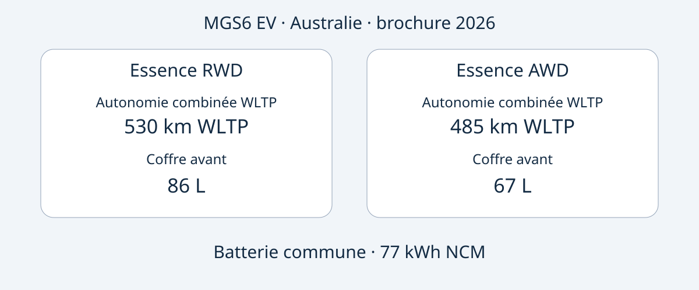

# MG MGS6 EV : choisir une Essence RWD ou AWD australienne

La MGS6 EV australienne propose un choix précis : l'Essence RWD présente la plus grande autonomie combinée WLTP annoncée et le coffre avant le plus volumineux ; l'Essence AWD offre davantage de puissance maximale et une accélération annoncée plus rapide. Ces différences ne suffisent pourtant pas à valider un achat. Il reste à identifier le véhicule proposé, à comparer sa configuration à la référence australienne et à vérifier les possibilités d'utilisation dans le pays de destination.

Cette comparaison repose sur la brochure australienne MG, édition 2026, consultée le 2026-11-05. L'année désigne le document, pas un millésime MY2026 confirmé pour chaque véhicule. La MGS6 EV est un SUV électrique de taille moyenne. Les données concernent uniquement les Essence RWD et Essence AWD australiennes ; elles ne définissent ni une configuration mondiale ni une équivalence avec un modèle chinois portant un autre nom. La date de fabrication du véhicule proposé reste à établir par ses documents.

## Deux priorités, une même capacité annoncée

Le tableau concerne les versions électriques australiennes de la brochure 2026. L'autonomie est combinée WLTP, l'accélération est une donnée du constructeur. Les 77 kWh sont désignés comme capacité de batterie, sans confirmation de capacité utilisable.

| Caractéristique | Essence RWD | Essence AWD |
|---|---|---|
| Transmission | Propulsion | Transmission intégrale |
| Batterie | 77 kWh NCM | 77 kWh NCM |
| Autonomie combinée WLTP | 530 km | 485 km |
| Puissance maximale | 180 kW | 266 kW |
| Couple maximal | 350 Nm | 540 Nm |
| 0–100 km/h constructeur | 7.3 secondes | 5.1 secondes |
| Coffre avant | 86 L | 67 L |

Source : [brochure MG Australie](https://mgmotor.com.au/brochures/MGS6_EV_2026_v2.pdf). La convention de mesure des volumes n'est pas précisée ici : ils ne prouvent pas que des bagages particuliers entreront.

Si la priorité est l'autonomie publiée et le rangement avant, la RWD constitue la première piste à examiner. Si le cahier des charges privilégie la puissance et l'accélération annoncées, l'AWD répond davantage à cette préférence. Il s'agit d'une comparaison documentaire, pas d'un essai AutoBridge. Ces données ne démontrent aucune différence de coût réel, de comportement hivernal, de distance de freinage ou de valeur de revente.

Un devis devrait donc indiquer la version complète. « MGS6 EV, 77 kWh » ne distingue pas les configurations qui font varier autonomie, performances et coffre avant. Demandez que les informations VIN et la configuration du véhicule proposé accompagnent le devis, plutôt qu'une brochure générique seulement.

## Comprendre les conditions de recharge

Les deux versions australiennes indiquent un chargeur embarqué AC de 11 kW et une puissance DC maximale de 144 kW. Ce ne sont pas des garanties de puissance disponible sur une prise ou une borne donnée. La brochure annonce 10–80% en 38 minutes à 25°C, avec une borne de 150 kW dans les conditions d'essai normalisées du constructeur. Conservez ces conditions lorsque vous comparez des offres.

La puissance nominale de la borne et le maximum accepté par la voiture sont deux informations différentes. Aucune n'indique la puissance moyenne pendant toute la session. Le temps annoncé ne couvre pas non plus une charge de vide à plein. La borne, la température et l'état de la batterie comptent : ne construisez pas un programme de livraison en supposant que chaque arrêt reproduira ce résultat.

Pour un itinéraire précis, demandez confirmation du connecteur du véhicule, des équipements locaux compatibles et de la documentation de recharge. Vérifiez séparément l'accès à la recharge à destination. Cet article ne déduit ni consommation, ni facture d'électricité, ni autonomie réelle garantie de la capacité de batterie et de l'autonomie normalisée.

## Volume et encombrement pratique

Pour les deux configurations, la brochure indique 4708 × 1912 × 1664 mm et un empattement de 2835 mm. Le coffre arrière est annoncé à 581 L avec les sièges relevés et 1690 L avec les sièges rabattus. Le coffre avant différent mérite donc une comparaison séparée : tous les espaces ne sont pas interchangeables.

Dressez la liste des bagages ou équipements à transporter simultanément. Demandez des mesures ou des photographies des ouvertures et de la position des sièges du véhicule proposé. Le volume seul ne décrit ni la forme, ni l'accès avec des passagers, ni les possibilités d'arrimage. Il ne prouve pas davantage une charge utile ou une capacité de remorquage.

Les deux versions de référence comprennent une pompe à chaleur, un écran multimédia de 12.8 pouces, un écran conducteur de 10.25 pouces et des roues de 20 pouces. Vérifiez ces équipements sur la configuration vendue. La taille d'écran ne confirme pas les langues disponibles, les services connectés ou le support logiciel à l'étranger. Demandez des réponses écrites pour la destination envisagée.

## Une évaluation de sécurité avec un périmètre daté

L'évaluation ANCAP de 2025 concerne les variantes évaluées fabriquées à partir de décembre 2025 et commercialisées en Australie et Nouvelle-Zélande à partir de juin 2026. Les résultats sont de 92% pour les adultes, 87% pour les enfants, 84% pour les usagers vulnérables et 81% pour l'assistance à la sécurité. La [page ANCAP](https://www.ancap.com.au/safety-ratings/mg/mgs6-ev/588e29) et le rapport précisent l'application.

Année de notation, période de fabrication et édition de brochure sont distinctes. Elles ne remplacent pas l'identification du véhicule. L'évaluation ne prouve ni homologation à destination, ni absence de risque de blessure, ni état actuel d'un exemplaire d'occasion. Demandez des documents propres au véhicule, sans confondre notation du modèle et rapport d'état.

## Obtenir une offre vérifiable

Ces demandes sont des recommandations d'achat, pas une liste universelle de documents légaux :

- Obtenir VIN, justificatif de fabrication, marché de vente initial et désignation complète Essence RWD ou Essence AWD.
- Faire préciser toute différence avec la brochure australienne, y compris équipements, recharge et logiciels.
- Confirmer prix, stock, délai, garantie et service pour la transaction précise. Les informations australiennes ne prouvent pas la garantie après exportation.
- Vérifier l'importation et l'immatriculation auprès des sources compétentes avant tout engagement financier ; brochure et ANCAP ne règlent pas ces questions.
- Suspendre l'achat si le vendeur ne rapproche pas la version annoncée des documents, ou prétend sans preuve qu'une autre configuration nationale est identique.

La meilleure version répond à un besoin défini et bénéficie de documents cohérents. Une puissance supérieure n'est pas forcément plus utile ; une autonomie de laboratoire supérieure ne garantit pas un trajet particulier. Comparez d'abord les versions australiennes, puis les preuves propres à l'offre.

## Questions fréquentes

### La brochure 2026 prouve-t-elle un millésime MY2026 ?
Non. Elle indique l'édition utilisée. Demandez la désignation officielle et les documents de fabrication du véhicule, sans les déduire du nom du fichier.

### Les 77 kWh sont-ils utilisables ?
Le constructeur parle de capacité de batterie. Nous ne la redéfinissons pas comme capacité utilisable et n'en calculons pas une consommation.

### Ces données s'appliquent-elles à un autre marché ?
Pas automatiquement. Marché, version et véhicule doivent correspondre. Aucune équivalence avec des finitions britanniques ou européennes n'est affirmée.

### Les 38 minutes sont-elles garanties ?
Non : 10–80%, 25°C, borne de 150 kW et conditions normalisées du constructeur ne décrivent pas toutes les sessions ni une recharge complète.

## Schéma comparatif

Schéma original des deux configurations australiennes, avec leur capacité de batterie commune.

## Sources et lectures complémentaires

Consultées le 2026-11-05. MG documente les spécifications australiennes ; ANCAP documente l'évaluation. Les articles indépendants apportent le contexte du lancement, pas la preuve d'essais AutoBridge.

- [MG : brochure australienne 2026](https://mgmotor.com.au/brochures/MGS6_EV_2026_v2.pdf)
- [MG : modèle australien](https://mgmotor.com.au/vehicles/mgs6-ev)
- [ANCAP : évaluation](https://www.ancap.com.au/safety-ratings/mg/mgs6-ev/588e29)
- [ANCAP : rapport](https://cdn.ancap.com.au/app/public/assets/c0121809eba68316282bba1fc3b9fcd6e0d03b41/original.pdf?1782710064=)
- [WhichCar : essai australien](https://www.whichcar.com.au/reviews/mgs6-ev-first-drive-medium-suv)
- [CarsGuide : présentation australienne](https://www.carsguide.com.au/ev/mg-s6-ev-101791)

Consultez aussi les [véhicules](https://www.autobridgeexport.com/vehicles/) et les [guides d'achat](https://www.autobridgeexport.com/guides/).
