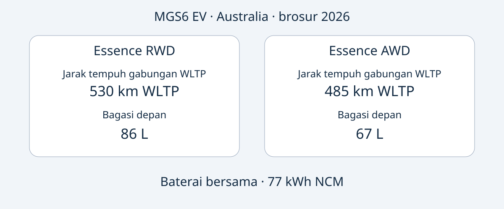

# MG MGS6 EV: memilih Essence RWD atau AWD Australia

MGS6 EV Australia menawarkan dua prioritas: Essence RWD memiliki jarak tempuh gabungan WLTP yang diumumkan lebih panjang dan bagasi depan lebih besar; Essence AWD menawarkan daya maksimum lebih tinggi serta waktu akselerasi pabrikan lebih singkat. Namun, keunggulan tersebut belum menyelesaikan keputusan pembelian. Identitas mobil yang ditawarkan, kesesuaiannya dengan spesifikasi Australia, dan dukungan penggunaan di tujuan tetap perlu diperiksa.

Perbandingan ini memakai brosur MG Australia edisi 2026, diperiksa pada 2026-11-05. Tahun tersebut menunjukkan edisi dokumen, bukan konfirmasi bahwa setiap unit secara resmi merupakan MY2026. MGS6 EV adalah SUV listrik baterai berukuran menengah. Pembahasan terbatas pada Essence RWD dan Essence AWD Australia, bukan spesifikasi global atau kesetaraan dengan model Tiongkok bernama lain. Tanggal produksi unit harus dicocokkan dengan dokumennya.

## Dua konfigurasi untuk kebutuhan berbeda

Semua angka berikut adalah spesifikasi mobil listrik Australia dalam brosur 2026. Jarak tempuh menggunakan WLTP gabungan; akselerasi adalah angka pabrikan, bukan uji jalan sendiri. Angka 77 kWh disebut kapasitas baterai, bukan kapasitas terpakai yang telah dikonfirmasi.

| Karakteristik | Essence RWD | Essence AWD |
|---|---|---|
| Penggerak | Roda belakang | Semua roda |
| Baterai | 77 kWh NCM | 77 kWh NCM |
| Jarak tempuh gabungan WLTP | 530 km | 485 km |
| Daya maksimum | 180 kW | 266 kW |
| Torsi maksimum | 350 Nm | 540 Nm |
| 0–100 km/h pabrikan | 7.3 detik | 5.1 detik |
| Bagasi depan | 86 L | 67 L |

Sumber: [brosur MG Australia](https://mgmotor.com.au/brochures/MGS6_EV_2026_v2.pdf). Metode pengukuran volume bagasi tidak ditetapkan di sini; angka tersebut tidak menjamin koper tertentu akan muat.

Jika prioritasnya jarak tempuh publikasi dan penyimpanan depan, RWD patut diperiksa terlebih dahulu. Jika pembeli secara khusus menginginkan daya dan akselerasi yang diumumkan lebih tinggi, AWD sesuai dengan preferensi tersebut. Ini perbandingan dokumen, bukan hasil uji AutoBridge. Angkanya tidak membuktikan perbedaan biaya nyata, kinerja musim dingin, jarak pengereman, atau nilai jual kembali.

Penawaran sebaiknya menyebut varian lengkap. “MGS6 EV, 77 kWh” tidak membedakan konfigurasi yang mengubah jarak tempuh, performa dan bagasi depan. Mintalah spesifikasi unit serta informasi VIN dilampirkan pada penawaran, bukan hanya brosur umum.

## Pisahkan kemampuan pengisian dan waktu pengisian

Kedua varian Australia mencantumkan pengisian AC bawaan 11 kW dan DC maksimum 144 kW. Ini kemampuan, bukan jaminan daya dari setiap stopkontak atau stasiun. Brosur menyebut 10–80% dalam 38 menit pada 25°C, memakai pengisi daya 150 kW dalam kondisi pengujian standar pabrikan. Pertahankan seluruh kondisi ini saat membandingkan penawaran.

Daya nominal stasiun dan batas DC kendaraan merupakan ukuran berbeda. Keduanya tidak menunjukkan daya rata-rata sepanjang sesi. Waktu tersebut juga bukan pengisian dari kosong hingga penuh. Perangkat, suhu dan kondisi baterai berpengaruh; jangan menyusun jadwal pengiriman dengan asumsi setiap pemberhentian mengulang waktu iklan.

Untuk rute tertentu, mintalah konfirmasi konektor unit, perangkat lokal yang didukung dan dokumen pengisian. Akses pengisian di tujuan perlu diperiksa secara terpisah. Artikel ini tidak menghitung konsumsi, tagihan listrik atau jarak tempuh nyata yang dijamin dari kapasitas baterai dan angka laboratorium.

## Volume bukan bukti barang pasti muat

Brosur Australia mencantumkan dimensi 4708 × 1912 × 1664 mm dan jarak sumbu roda 2835 mm untuk keduanya. Bagasi belakang diumumkan 581 L saat kursi tegak dan 1690 L saat dilipat. Bagasi depan berbeda sehingga sebaiknya dinilai tersendiri; semua ruang penyimpanan tidak saling menggantikan.

Buat daftar barang atau peralatan yang perlu dibawa bersamaan. Mintalah ukuran atau foto bukaan bagasi dan susunan kursi unit yang dijual. Liter saja tidak menjelaskan bentuk, akses ketika penumpang berada di dalam atau cara mengikat barang. Nilai ini juga tidak membuktikan kapasitas muatan berat maupun penarikan.

Kedua spesifikasi referensi mencantumkan pompa panas, layar infotainment 12.8 inci, layar pengemudi 10.25 inci dan roda 20 inci. Cocokkan dengan spesifikasi penjualan sebenarnya. Ukuran layar tidak memastikan bahasa tersedia, layanan terhubung atau dukungan perangkat lunak di negara lain. Mintalah jawaban tertulis terkait tujuan penggunaan.

## Baca penilaian keselamatan beserta tanggalnya

Penilaian ANCAP 2025 berlaku untuk varian yang dinilai, diproduksi sejak Desember 2025 dan dijual di Australia serta Selandia Baru sejak Juni 2026. Hasil kategori adalah 92% perlindungan dewasa, 87% anak, 84% pengguna jalan rentan dan 81% bantuan keselamatan. [Halaman ANCAP](https://www.ancap.com.au/safety-ratings/mg/mgs6-ev/588e29) dan laporan menjelaskan cakupannya.

Tahun penilaian, periode produksi dan edisi brosur merupakan informasi berbeda. Tidak satu pun menggantikan identitas unit. Penilaian keselamatan tidak membuktikan homologasi tujuan, menjamin pencegahan cedera, atau menunjukkan kondisi sebuah mobil bekas saat ini. Mintalah catatan khusus unit, bukan menganggap penilaian model sebagai laporan kondisi.

## Dari perbandingan menuju penawaran yang dapat diperiksa

Daftar berikut adalah rekomendasi editorial pembelian, bukan persyaratan dokumen hukum universal:

- Minta VIN, bukti tanggal produksi, pasar penjualan awal dan spesifikasi lengkap Essence RWD atau Essence AWD.
- Minta penjual menjelaskan perbedaan dari brosur Australia, termasuk perlengkapan, perangkat pengisian dan perangkat lunak.
- Konfirmasi harga, stok, waktu penyerahan, garansi dan layanan untuk transaksi tertentu. Informasi Australia tidak membuktikan garansi setelah ekspor.
- Periksa kelayakan impor dan registrasi melalui sumber berwenang sebelum berkomitmen membayar; brosur dan ANCAP tidak menjawabnya.
- Tunda pembelian apabila nama varian tidak dapat dicocokkan dengan catatan kendaraan, atau spesifikasi pasar lain dianggap setara tanpa bukti.

Pilihan terbaik sesuai dengan penggunaan yang jelas dan didukung dokumen konsisten. Daya lebih besar tidak selalu lebih berguna; jarak laboratorium lebih panjang tidak menjamin perjalanan tertentu. Bandingkan varian Australia dahulu, lalu nilai bukti transaksi yang ditawarkan.

## Pertanyaan umum

### Apakah brosur 2026 berarti MY2026?
Tidak. Itu edisi dokumen. Mintalah penamaan resmi dan catatan produksi kendaraan, jangan menyimpulkannya dari nama berkas atau iklan.

### Apakah 77 kWh merupakan kapasitas terpakai?
Sumber menyebut kapasitas baterai. Artikel tidak mengubahnya menjadi kapasitas terpakai atau menggunakannya untuk menghitung konsumsi.

### Apakah angka ini berlaku di pasar lain?
Tidak otomatis. Pasar, varian dan identitas perlu cocok. Tidak ada penyamaan Essence Australia dengan nama varian Inggris atau Eropa.

### Apakah setiap pengisian dijamin 38 menit?
Tidak. Angka tersebut untuk 10–80% pada 25°C menggunakan pengisi 150 kW dalam kondisi standar pabrikan, bukan setiap sesi atau pengisian penuh.

## Diagram perbandingan

Diagram asli kedua konfigurasi Australia dengan kapasitas baterai bersama di bawahnya.

## Sumber dan bacaan lanjutan

Diperiksa pada 2026-11-05. MG mendokumentasikan spesifikasi Australia; ANCAP mendokumentasikan cakupan penilaian. Artikel independen memberi konteks peluncuran, bukan bukti pengujian AutoBridge.

- [MG: brosur Australia 2026](https://mgmotor.com.au/brochures/MGS6_EV_2026_v2.pdf)
- [MG: halaman model Australia](https://mgmotor.com.au/vehicles/mgs6-ev)
- [ANCAP: penilaian](https://www.ancap.com.au/safety-ratings/mg/mgs6-ev/588e29)
- [ANCAP: laporan](https://cdn.ancap.com.au/app/public/assets/c0121809eba68316282bba1fc3b9fcd6e0d03b41/original.pdf?1782710064=)
- [WhichCar: uji Australia](https://www.whichcar.com.au/reviews/mgs6-ev-first-drive-medium-suv)
- [CarsGuide: ulasan Australia](https://www.carsguide.com.au/ev/mg-s6-ev-101791)

Lihat [koleksi kendaraan](https://www.autobridgeexport.com/vehicles/) dan [panduan pembelian](https://www.autobridgeexport.com/guides/).
