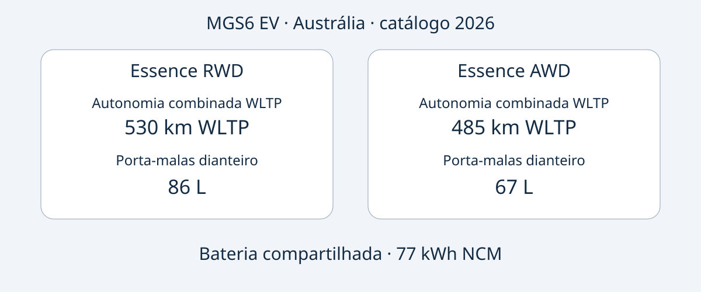

# MG MGS6 EV: escolher Essence RWD ou AWD australiano

O MGS6 EV australiano oferece duas prioridades distintas: o Essence RWD tem maior autonomia combinada WLTP anunciada e maior porta-malas dianteiro; o Essence AWD apresenta potência máxima superior e aceleração declarada mais rápida. Nenhuma dessas vantagens resolve toda a compra. É necessário identificar o veículo oferecido, comparar sua configuração à referência australiana e confirmar condições de uso e assistência no destino.

A comparação utiliza o catálogo australiano da MG, edição 2026, consultado em 2026-11-05. O ano identifica o documento, não confirma a designação formal MY2026 de cada unidade anunciada. O MGS6 EV é um SUV elétrico médio. Os dados abrangem somente Essence RWD e Essence AWD australianos, não uma especificação mundial nem equivalência presumida com um modelo chinês de outro nome. A fabricação da unidade deve ser comprovada pelos seus documentos.

## Duas configurações, objetivos diferentes

Todos os valores correspondem aos veículos elétricos australianos do catálogo 2026. A autonomia é combinada WLTP; a aceleração é declarada pelo fabricante, sem teste próprio. Os 77 kWh são chamados de capacidade da bateria, sem confirmação de capacidade utilizável.

| Característica | Essence RWD | Essence AWD |
|---|---|---|
| Tração | Traseira | Integral |
| Bateria | 77 kWh NCM | 77 kWh NCM |
| Autonomia combinada WLTP | 530 km | 485 km |
| Potência máxima | 180 kW | 266 kW |
| Torque máximo | 350 Nm | 540 Nm |
| 0–100 km/h do fabricante | 7.3 segundos | 5.1 segundos |
| Porta-malas dianteiro | 86 L | 67 L |

Fonte: [catálogo da MG Austrália](https://mgmotor.com.au/brochures/MGS6_EV_2026_v2.pdf). O método de medição dos volumes não está especificado aqui. Os números não comprovam que uma bagagem específica caberá.

Para quem prioriza autonomia publicada e armazenamento dianteiro, o RWD é o primeiro candidato a examinar. Para quem busca expressamente maior potência e aceleração anunciada, o AWD atende a essa preferência. Trata-se de comparação documental, não de avaliação ao volante da AutoBridge. Os dados não estabelecem diferenças de custo real, desempenho no inverno, distância de frenagem ou revenda.

Uma cotação útil identifica a versão por completo. “MGS6 EV, 77 kWh” omite justamente a diferença que altera autonomia, desempenho e espaço dianteiro. Peça que a configuração da unidade e os dados VIN acompanhem a proposta, em vez de receber apenas um catálogo genérico.

## Potência de recarga não é duração da sessão

Ambas as versões australianas indicam carregador AC embarcado de 11 kW e potência DC máxima de 144 kW. São capacidades, não garantias de fornecimento em qualquer tomada ou estação. O catálogo anuncia 10–80% em 38 minutos a 25°C, com carregador de 150 kW em condições padronizadas do fabricante. Preserve todas essas condições ao comparar propostas.

A potência nominal da estação e o máximo do veículo são grandezas diferentes. Nenhuma informa a potência média durante toda a recarga. O intervalo também não descreve carregar de vazio a cheio. Equipamento, temperatura e condição da bateria importam; não planeje cada parada como uma repetição automática do tempo anunciado.

Para uma rota específica, confirme o conector da unidade, os equipamentos locais compatíveis e a documentação de recarga. Avalie separadamente o acesso à infraestrutura no destino. Este texto não calcula consumo, conta de energia ou autonomia real garantida a partir da capacidade e do alcance de laboratório.

## Espaço: volume e encaixe não são equivalentes

O catálogo australiano informa 4708 × 1912 × 1664 mm e entre-eixos de 2835 mm para ambas as versões. O porta-malas traseiro tem volume anunciado de 581 L com bancos levantados e 1690 L com bancos rebatidos. Como o dianteiro varia, merece comparação própria: os compartimentos não são intercambiáveis.

Liste os objetos que precisam viajar juntos e solicite medidas ou fotos das aberturas e da disposição dos bancos na unidade oferecida. Litros não descrevem completamente formato, acesso com passageiros ou possibilidades de fixação da carga. Também não comprovam carga útil ou capacidade de reboque.

As configurações de referência incluem bomba de calor, tela multimídia de 12.8 polegadas, painel do motorista de 10.25 polegadas e rodas de 20 polegadas. Confira esses itens na especificação efetivamente vendida. Dimensões de tela não confirmam idiomas, serviços conectados ou suporte de software fora da Austrália. Peça respostas por escrito sobre o destino.

## Segurança com datas e aplicação definidas

A avaliação ANCAP de 2025 abrange as variantes avaliadas fabricadas a partir de dezembro de 2025 e comercializadas na Austrália e Nova Zelândia desde junho de 2026. Os resultados são 92% para ocupantes adultos, 87% para crianças, 84% para usuários vulneráveis e 81% para assistência de segurança. A [página ANCAP](https://www.ancap.com.au/safety-ratings/mg/mgs6-ev/588e29) e o relatório explicam a aplicação.

Ano de avaliação, período de fabricação e edição do catálogo são informações diferentes. Nenhuma substitui a identificação da unidade. A avaliação não comprova homologação no destino, não garante evitar lesões e não demonstra o estado atual de um usado. Solicite registros do próprio veículo, sem tratar classificação do modelo como laudo de condição.

## Uma proposta que possa ser conferida

As solicitações abaixo são recomendações editoriais de compra, não uma relação universal de documentos legais:

- Solicitar VIN, comprovação da data de fabricação, mercado de venda original e configuração completa Essence RWD ou Essence AWD.
- Pedir identificação de diferenças em relação ao catálogo australiano, inclusive equipamentos, recarga e software.
- Confirmar preço, estoque, prazo, garantia e assistência para a operação específica. Informações australianas não comprovam garantia após exportação.
- Verificar importação e registro em fontes competentes antes de comprometer recursos; catálogo e ANCAP não resolvem essas questões.
- Suspender a compra se o vendedor não conciliar versão e documentos, ou alegar equivalência com outro mercado sem comprovação.

A escolha adequada atende a um uso definido e possui documentação coerente. Mais potência não é automaticamente mais útil; maior autonomia de laboratório não garante uma viagem específica. Compare primeiro as versões australianas e depois as evidências da transação.

## Perguntas frequentes

### Catálogo 2026 significa MY2026?
Não. É a edição do documento. Confirme a designação formal e os registros de fabricação da unidade, sem deduzir pelo nome do arquivo ou anúncio.

### Os 77 kWh são utilizáveis?
A fonte fala em capacidade da bateria. O valor não é reinterpretado como utilizável nem usado para calcular consumo.

### Os números servem para outro mercado?
Não automaticamente. Mercado, versão e identidade precisam corresponder. Não se equiparam versões Essence australianas a acabamentos britânicos ou europeus.

### Os 38 minutos são garantidos?
Não. A referência é 10–80%, 25°C e carregador de 150 kW sob condições padronizadas do fabricante, não qualquer sessão nem uma carga completa.

## Diagrama comparativo

Diagrama original das versões australianas, com a capacidade de bateria compartilhada.

## Fontes e outras leituras

Consultadas em 2026-11-05. MG documenta as especificações australianas; ANCAP, a avaliação. Os artigos independentes contextualizam o lançamento, sem representar testes AutoBridge.

- [MG: catálogo australiano 2026](https://mgmotor.com.au/brochures/MGS6_EV_2026_v2.pdf)
- [MG: modelo australiano](https://mgmotor.com.au/vehicles/mgs6-ev)
- [ANCAP: avaliação](https://www.ancap.com.au/safety-ratings/mg/mgs6-ev/588e29)
- [ANCAP: relatório](https://cdn.ancap.com.au/app/public/assets/c0121809eba68316282bba1fc3b9fcd6e0d03b41/original.pdf?1782710064=)
- [WhichCar: avaliação australiana](https://www.whichcar.com.au/reviews/mgs6-ev-first-drive-medium-suv)
- [CarsGuide: análise australiana](https://www.carsguide.com.au/ev/mg-s6-ev-101791)

Veja outros [veículos](https://www.autobridgeexport.com/vehicles/) e [guias de compra](https://www.autobridgeexport.com/guides/).
