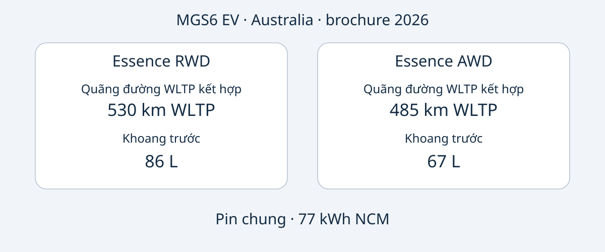

# MG MGS6 EV: chọn Essence RWD hay AWD tại Australia

MGS6 EV tại Australia có hai hướng lựa chọn rõ ràng: Essence RWD có quãng đường WLTP kết hợp được công bố dài hơn và khoang hành lý trước lớn hơn; Essence AWD có công suất cực đại cao hơn và thời gian tăng tốc do hãng công bố ngắn hơn. Tuy nhiên, các ưu điểm này chưa quyết định toàn bộ giao dịch. Người mua còn cần xác định chiếc xe được chào bán, đối chiếu cấu hình Australia và kiểm tra điều kiện sử dụng, dịch vụ tại nơi đến.

Bài viết sử dụng brochure MG Australia phiên bản tài liệu 2026, kiểm tra ngày 2026-11-05. Năm này chỉ phiên bản tài liệu, không xác nhận mọi xe quảng cáo đều mang niên hiệu chính thức MY2026. MGS6 EV là SUV điện chạy pin cỡ trung. So sánh chỉ áp dụng cho Essence RWD và Essence AWD Australia, không phải cấu hình toàn cầu hay khẳng định tương đương một mẫu xe Trung Quốc có tên khác. Ngày sản xuất của xe cụ thể cần được xác nhận bằng hồ sơ.

## Hai cấu hình, hai ưu tiên

Các số liệu dưới đây thuộc xe thuần điện Australia trong brochure 2026. Quãng đường là WLTP kết hợp; tăng tốc là số liệu hãng, không phải thử nghiệm của AutoBridge. 77 kWh được gọi là dung lượng pin, chưa xác nhận là dung lượng sử dụng được.

| Hạng mục | Essence RWD | Essence AWD |
|---|---|---|
| Dẫn động | Cầu sau | Bốn bánh |
| Pin | 77 kWh NCM | 77 kWh NCM |
| Quãng đường WLTP kết hợp | 530 km | 485 km |
| Công suất cực đại | 180 kW | 266 kW |
| Mô-men xoắn cực đại | 350 Nm | 540 Nm |
| 0–100 km/h theo hãng | 7.3 giây | 5.1 giây |
| Khoang hành lý trước | 86 L | 67 L |

Nguồn: [brochure MG Australia](https://mgmotor.com.au/brochures/MGS6_EV_2026_v2.pdf). Phương pháp đo thể tích khoang hành lý không được xác định ở đây; số liệu không bảo đảm một loại vali cụ thể sẽ vừa.

Nếu ưu tiên quãng đường công bố và khoang chứa phía trước, RWD là lựa chọn nên khảo sát trước. Nếu thực sự cần công suất và tăng tốc công bố cao hơn, AWD đáp ứng ưu tiên đó. Đây là đối chiếu tài liệu, không phải đánh giá lái thử của AutoBridge. Các số liệu không chứng minh khác biệt về chi phí thực tế, vận hành mùa đông, quãng đường phanh hay giá bán lại.

Báo giá nên ghi đầy đủ cấu hình. Dòng “MGS6 EV, 77 kWh” bỏ qua chính khác biệt làm thay đổi quãng đường, hiệu năng và khoang trước. Hãy đề nghị đính kèm thông tin VIN và cấu hình chiếc xe vào báo giá, thay vì chỉ nhận brochure chung.

## Đọc công suất cùng điều kiện sạc

Cả hai cấu hình Australia ghi công suất sạc AC trên xe 11 kW và DC cực đại 144 kW. Đó là khả năng kỹ thuật, không phải cam kết mọi ổ điện hoặc trạm sạc đều cung cấp mức đó. Brochure công bố 10–80% trong 38 phút ở 25°C, dùng bộ sạc 150 kW trong điều kiện thử nghiệm chuẩn hóa của hãng. Cần giữ nguyên các điều kiện khi so sánh chào giá.

Công suất định mức trạm và mức DC cực đại của xe là hai đại lượng khác nhau. Không đại lượng nào cho biết công suất trung bình toàn phiên. Thời gian này cũng không phải từ cạn đến đầy. Trạm sạc, nhiệt độ và tình trạng pin đều có ảnh hưởng; không nên lập lịch vận chuyển với giả định mọi lần dừng đều mất đúng thời gian quảng cáo.

Với một tuyến cụ thể, hãy xác nhận đầu nối của xe, thiết bị địa phương tương thích và tài liệu sạc. Khả năng tiếp cận hạ tầng tại điểm đến cần được kiểm tra riêng. Bài viết không suy ra mức tiêu thụ điện, hóa đơn điện hay quãng đường thực tế bảo đảm từ dung lượng pin và quãng đường thử nghiệm.

## Thể tích không thay thế việc kiểm tra đồ có vừa hay không

Brochure Australia ghi kích thước 4708 × 1912 × 1664 mm và chiều dài cơ sở 2835 mm cho cả hai cấu hình. Khoang sau có thể tích công bố 581 L khi dựng ghế và 1690 L khi gập ghế. Khoang trước khác nhau nên cần xem riêng, không coi mọi không gian chứa đồ là thay thế lẫn nhau.

Hãy liệt kê hành lý hoặc thiết bị cần chở cùng lúc, rồi xin ảnh hoặc kích thước cửa khoang và cách bố trí ghế của chiếc xe. Số lít không diễn tả đầy đủ hình dạng, khả năng tiếp cận khi có hành khách hay cách cố định hàng. Nó cũng không chứng minh tải trọng hoặc khả năng kéo.

Hai cấu hình tham chiếu có bơm nhiệt, màn hình giải trí 12.8 inch, màn hình người lái 10.25 inch và bánh xe 20 inch. Cần đối chiếu với cấu hình thực bán. Kích thước màn hình không xác nhận ngôn ngữ, dịch vụ kết nối hoặc hỗ trợ phần mềm tại nước khác. Nên yêu cầu trả lời bằng văn bản cho nơi sử dụng dự kiến.

## Đánh giá an toàn phải đi cùng phạm vi thời gian

Đánh giá ANCAP năm 2025 áp dụng cho các cấu hình được đánh giá sản xuất từ tháng 12/2025 và bán tại Australia, New Zealand từ tháng 6/2026. Điểm công bố là 92% bảo vệ người lớn, 87% bảo vệ trẻ em, 84% bảo vệ người tham gia giao thông dễ bị tổn thương và 81% hỗ trợ an toàn. [Trang ANCAP](https://www.ancap.com.au/safety-ratings/mg/mgs6-ev/588e29) cùng báo cáo giải thích phạm vi áp dụng.

Năm đánh giá, mốc sản xuất và phiên bản brochure là thông tin khác nhau. Không mục nào thay thế việc xác định chiếc xe. Đánh giá không chứng minh homologation tại điểm đến, không bảo đảm tránh thương tích và không xác nhận tình trạng hiện tại của xe cũ. Hãy xin hồ sơ riêng của xe, thay vì coi điểm của mẫu xe là báo cáo tình trạng.

## Chuyển so sánh thành một chào giá có thể kiểm chứng

Các yêu cầu sau là khuyến nghị mua hàng của ban biên tập, không phải danh mục hồ sơ pháp lý chung cho mọi nơi:

- Xin VIN, bằng chứng ngày sản xuất, thị trường bán ban đầu và cấu hình Essence RWD hoặc Essence AWD đầy đủ.
- Yêu cầu người bán nêu khác biệt với brochure Australia, gồm trang bị, phần cứng sạc và phần mềm.
- Xác nhận giá, tồn kho, thời gian giao, bảo hành và dịch vụ cho giao dịch cụ thể. Thông tin Australia không tự chứng minh bảo hành sau xuất khẩu.
- Kiểm tra nhập khẩu và đăng ký với nguồn có thẩm quyền trước khi cam kết tiền; brochure và ANCAP không giải quyết được các vấn đề này.
- Tạm dừng nếu người bán không giải thích được sự khác nhau giữa tên cấu hình và hồ sơ xe, hoặc khẳng định cấu hình thị trường khác tương đương mà không có tài liệu.

Cấu hình phù hợp đáp ứng nhu cầu rõ ràng và có hồ sơ nhất quán. Công suất lớn hơn không luôn hữu ích hơn; quãng đường phòng thử nghiệm dài hơn không bảo đảm một chuyến đi cụ thể. So sánh hai cấu hình Australia trước, sau đó đánh giá bằng chứng của giao dịch.

## Câu hỏi thường gặp

### Brochure 2026 có nghĩa là MY2026 không?
Không. Đó là phiên bản tài liệu. Hãy xác nhận niên hiệu chính thức và hồ sơ sản xuất, không suy đoán từ tên tệp hoặc quảng cáo.

### 77 kWh có phải dung lượng sử dụng được?
Nguồn gọi là dung lượng pin. Bài viết không đổi nghĩa thành dung lượng sử dụng được hoặc dùng để tính tiêu thụ điện.

### Có áp dụng số liệu sang thị trường khác không?
Không tự động. Thị trường, cấu hình và danh tính xe phải phù hợp. Không đồng nhất Essence Australia với tên phiên bản Anh hoặc châu Âu.

### Có bảo đảm mỗi lần sạc mất 38 phút không?
Không. Đây là 10–80% ở 25°C với bộ sạc 150 kW trong điều kiện chuẩn hóa của hãng, không phải mọi phiên hay sạc đầy.

## Sơ đồ so sánh

Sơ đồ tự thiết kế về hai cấu hình Australia và dung lượng pin chung.

## Nguồn và đọc thêm

Kiểm tra ngày 2026-11-05. MG cung cấp cấu hình Australia; ANCAP cung cấp phạm vi đánh giá. Các bài độc lập bổ sung bối cảnh ra mắt, không phải bằng chứng AutoBridge thử xe.

- [MG: brochure Australia 2026](https://mgmotor.com.au/brochures/MGS6_EV_2026_v2.pdf)
- [MG: trang xe Australia](https://mgmotor.com.au/vehicles/mgs6-ev)
- [ANCAP: đánh giá](https://www.ancap.com.au/safety-ratings/mg/mgs6-ev/588e29)
- [ANCAP: báo cáo](https://cdn.ancap.com.au/app/public/assets/c0121809eba68316282bba1fc3b9fcd6e0d03b41/original.pdf?1782710064=)
- [WhichCar: lái thử tại Australia](https://www.whichcar.com.au/reviews/mgs6-ev-first-drive-medium-suv)
- [CarsGuide: bài xe Australia](https://www.carsguide.com.au/ev/mg-s6-ev-101791)

Xem thêm [các mẫu xe](https://www.autobridgeexport.com/vehicles/) và [hướng dẫn mua xe](https://www.autobridgeexport.com/guides/).
