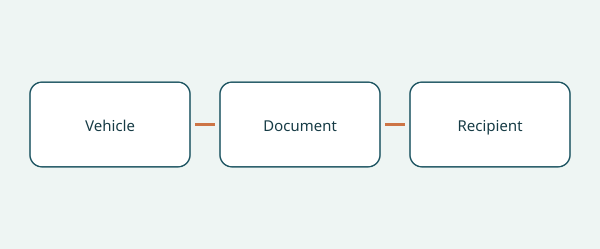

# Rescue-Sheet Checks for Vehicle Procurement and Handover

A folder labelled with a vehicle's model name can look complete while containing the wrong rescue document. For a buyer receiving a vehicle from another market, the useful question is not simply whether a PDF exists. It is whether the manufacturer document applies to the actual vehicle, whether its identity is preserved, and whether the receiving team can retrieve the intended document without guessing.

This guide covers document procurement and handover only. It does not provide emergency intervention instructions, certify vehicle condition, or establish import eligibility. Access to a rescue sheet does not make a buyer a trained responder. Keep specialist response information in its original manufacturer context rather than turning a purchasing checklist into an operational manual. The checks below are editorial recommendations for organizing a purchase file, not universal legal requirements to carry documents.

## Ask for two document identities, not one generic manual

NHTSA's US emergency-response resource distinguishes the detailed, vehicle-specific emergency response guide from the abbreviated rescue sheet for responders. It also provides make and model filtering for different electric powertrains. This is a description of a US information repository, not a rule imposed on international vehicle buyers.

When asking a seller for documents, name the rescue sheet and the detailed emergency response guide separately where the manufacturer provides both. Record whether each is present, its manufacturer title and its original link. An owner's manual is not automatically either of these documents, and a filename containing “rescue” does not establish applicability. If the manufacturer offers a different document arrangement, ask for an explanation rather than forcing it into an assumed universal format.

This distinction helps prevent an incomplete answer from looking complete. A seller can provide a short sheet while leaving the detailed guide unidentified. Conversely, a long manual may be supplied without establishing which concise sheet belongs with it. Record the gap as a request for clarification, not as proof that the vehicle itself is unsafe.

## Match the vehicle before accepting the file

Tesla's resource catalogue separates Model 3 emergency response guides and rescue sheets for 2017–2023 and 2024 onward. This example shows why a model name alone can be insufficient. Preserve those catalogue periods as stated; do not infer that a document's publication date is the formal model year of an offered car. Ask for evidence connecting the actual vehicle to the relevant production period.

Create a simple identity note containing the vehicle identification number, manufacturer, model designation, documented production period, propulsion type and original sales market. Record steering configuration where relevant. These fields are this guide's recommended buying method, not a claim that every authority requires the same form. If a field is unresolved, leave it unresolved and ask the seller or manufacturer to clarify before accepting a supposed match.

Do not substitute an apparently equivalent model from another market. Shared appearance or a familiar commercial name is not enough to conclude that the same rescue information applies. Keep the seller's vehicle identity alongside the manufacturer document's stated coverage so a difference remains visible rather than buried in an attachment.

## Use the manufacturer's lookup route

Mercedes-Benz's digital rescue portal offers lookup through VIN/FIN, model filters or the QR code on its rescue sticker. Its sheets describe vehicle construction and safety-system locations for rescue personnel. For a procurement check, the relevant task is identifying the returned document, not interpreting its technical contents as permission to perform response work.

If the vehicle already carries a relevant QR label, ask the seller to demonstrate the destination and compare the returned vehicle information with the purchase file. A readable code alone is not the end of the check. Record the manufacturer page and document identity reached. If the label, portal result and seller description do not agree, seek manufacturer or suitably qualified clarification. This guide does not instruct a buyer to replace a label or modify the rescue document.

## Preserve market and propulsion limits

Kia's UK-hosted rescue-sheet page expressly limits the sheets to vehicles intended for Europe, warns that right-hand-drive variants may differ, and says the information is intended for trained emergency personnel rather than customers, dealers or workshops. Retain all of those boundaries when considering a Kia document. Hosting on a UK website does not expand the coverage to every Kia sold worldwide.

Mercedes-Benz Japan explains that rescue guidance differs by propulsion type and links to guidance and model- or VIN-based rescue cards. That Japan-facing example reinforces the need to identify propulsion rather than selecting solely by badge. It does not prove that a document for one propulsion system applies to another, or that a regional portal automatically covers a vehicle imported from elsewhere.

Tesla also separates owner accident information from responder resources and directs first and second responders to appropriate support channels. Keep those audiences distinct in the handover file. Do not turn access to the responder portal into a claim that the purchaser has completed rescue training, or generalize a US support number to another country.

## Hand over a retrievable original, not a rewritten substitute

| Item to record | What the buyer should establish | What remains separate |
|---|---|---|
| Vehicle identity | Match vehicle records to the document coverage | Mechanical condition and import eligibility |
| Document identity | Manufacturer title, type, period and revision where shown | A filename or seller's summary alone |
| Market and propulsion | Check the stated coverage and relevant limitations | Assumed equivalence across markets or powertrains |
| Retrieval route | Test the official link and any existing relevant QR destination | An assumption that every file works offline |
| Receiving contact | Identify who receives and can find the documents | Responder qualifications and training |

Retain the manufacturer's original document and its available language identity. This guide does not recommend translating, redrawing or editing a rescue sheet. If a suitable official language version cannot be identified, ask the manufacturer for clarification and leave the issue visible. A buyer-created translation should not silently replace the original in the handover package.

Check how the receiving team will retrieve the material before delivery. Where a file is downloadable, verify the actual saved file and its access rather than promising that every portal works offline. Where access depends on a website, record that fact. Keep the original source link with any retained file so later checks can start from the manufacturer rather than an unexplained attachment.

## Make document discrepancies actionable

A useful handover note states what does not match, who will resolve it and what evidence is awaited. “Model name matches” is weaker than “production period confirmed, original-market coverage awaiting manufacturer clarification.” If the intended document cannot be matched or retrieved, this guide recommends deferring acceptance of the document package and any planned operational deployment dependent on it until the mismatch is addressed.

That recommendation is not a declaration that the vehicle is unroadworthy, nor is a complete package a declaration that it is safe. Keep condition inspection, legal import and registration checks, training and operational readiness separate. Reconfirm document revision, exact vehicle applicability and current local support before purchase and handover; a previously working link is not a promise of permanent access.

## Frequently asked questions

### Is the owner's manual enough?

Do not assume so. NHTSA distinguishes the detailed emergency response guide and abbreviated rescue sheet. Ask which manufacturer documents are available for the actual vehicle and record any missing identification.

### Can I use the sheet for the same model from another country?

Not without confirming applicability. Kia's European-market limitation and steering warning illustrate why a shared name does not settle market coverage.

### Does a rescue sheet prove the vehicle is safe or legally importable?

No. It is a document for its stated audience and purpose. Vehicle condition, import eligibility and registration require separate enquiries.

### Should the buyer rewrite the sheet in the receiving team's language?

Preserve the original and seek an appropriate official language version. Do not silently replace it with a buyer-created translation or altered diagram.

## Illustration

The diagram connects vehicle identity, document identity and the receiving contact.

## Related reading

Browse [vehicle information](https://www.autobridgeexport.com/vehicles/) and [more handover and buying guides](https://www.autobridgeexport.com/guides/).

## Sources and verification

Sources checked on 2026-11-05. US, European-market and Japan-facing examples retain their stated scope; no international document-carrying mandate is asserted.

- [Emergency response guides](https://www.nhtsa.gov/emergency-response-guides) — US Department of Transportation / NHTSA.
- [First responder vehicle resources](https://www.tesla.com/firstresponders/vehicles-charging) — Tesla.
- [Digital Mercedes-Benz rescue assistants](https://rk.mb-qr.com/en/) — Mercedes-Benz Group.
- [Kia rescue sheets](https://www.kia.com/uk/owners/rescue-sheets/) — Hyundai Motor Group / Kia.
- [Mercedes-Benz Japan rescue information](https://www.mercedes-benz.co.jp/passengercars/services/activity/rescue.html) — Mercedes-Benz Group.
- [Tesla first responders information](https://www.tesla.com/firstresponders/) — Tesla.
