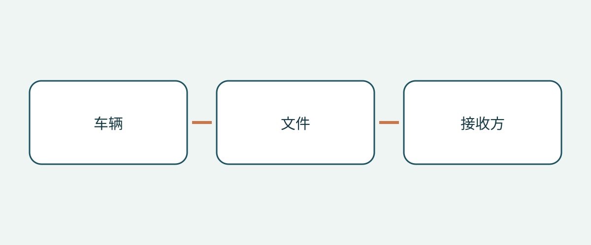

# 车辆采购与交接：救援信息表的身份核对

一个按车型命名的文件夹，看起来资料齐全，也可能装着不适用的救援文件。接收来自其他市场的车辆时，买家需要问的不只是“有没有 PDF”，而是制造商文件是否对应这辆实车、文件身份是否保留完整，以及接收方能否不靠猜测就找到正确文件。

本文仅讨论采购资料及交接，不提供紧急干预操作，不认证车况，也不确定进口资格。取得救援信息表，不代表买家已经接受救援训练。应让专业救援信息保持在制造商原有语境内，不要把采购清单当作操作手册。以下是整理采购资料的编辑建议，不是普遍适用的随车携带文件法律要求。

## 分别确认文件种类，不笼统索取“手册”

美国 NHTSA 的应急响应资料库区分详细的、针对具体车辆的应急响应指南，以及供救援人员使用的简明救援信息表，并提供按品牌、车型筛选不同电驱动类型车辆的方式。这是美国资料库的说明，不是对国际买家施加的规则。

制造商同时提供两类文件时，向卖方分别索取救援信息表和详细应急响应指南。记录每一类是否已提供、制造商使用的原始标题，以及原始链接。车主手册不应自动被视为其中任何一种，文件名带“救援”也不能证明适用。如果厂家采用不同的文档安排，应要求解释，而不是强行套用一个假定的统一格式。

这样可以避免不完整的回复看起来已经完整：卖方可能只给了一张简表，详细指南仍未确定；也可能提供一本长手册，却没有确认对应哪张简表。应把缺口写成需要澄清的问题，而不是由此认定车辆本身不安全。

## 接受文件前先对准车辆

Tesla 的资料目录将 Model 3 的应急响应指南和救援信息表分成 2017–2023 与 2024 起两个生产时期。这说明只匹配车型名称可能不够。应保留目录所写的时期，不能把文件发布日期自动当成报价车辆的正式车型年款。请卖方提供把实车与相应生产时期联系起来的证据。

建议建立简明身份记录，包含车辆识别代号、制造商、车型名称、有资料支持的生产时期、动力类型和原销售市场；相关时记录转向配置。这是本文建议的采购方法，不代表每个主管机关都要求同样表格。某项不明就保留为未确认，请卖方或厂家解释后再接受所谓的匹配结论。

不要用另一个市场中“看起来对应”的车型代替。外形相近或商业名称熟悉，不足以证明适用同一套救援资料。把卖方提供的车辆身份与制造商文件的覆盖范围并列保存，使差异始终可见，而不是藏在附件里。

## 沿着制造商的检索渠道确认

Mercedes-Benz 数字救援门户支持通过 VIN/FIN、车型筛选，或其救援贴纸上的二维码查找。相关信息表向救援人员描述车辆结构与安全系统位置。对采购人员而言，任务是识别返回的文件，不是把技术内容理解成自己可以进行救援操作的许可。

如果车上已有相关二维码标签，可请卖方演示其指向页面，再将返回的车辆信息与采购资料比较。二维码能读取，并不等于核对结束。建议记录到达的制造商页面和文件身份。如果标签、门户结果与卖方描述不一致，应请厂家或适当专业人员澄清。本文不指导买家更换标签或改动救援文件。

## 保留市场与动力类型限制

Kia 在英国网站发布的救援信息表页面明确限定为面向欧洲的车辆，提醒右舵版本可能不同，并说明资料供受过训练的紧急救援人员使用，而不是供客户、经销商或维修车间使用。考虑这份 Kia 资料时，应完整保留这些限制。网页位于英国站点，并不会让其覆盖所有全球销售的 Kia。

Mercedes-Benz 日本页面解释救援指南因动力类型而异，并链接到指南及按车型或 VIN 查找的救援卡。这一日本市场页面说明，不能只按车标选择文件，还要识别动力形式；但它并未证明一种动力的文件也适用于另一种，也不能证明区域门户自动覆盖从其他市场进口的车辆。

Tesla 也将车主事故信息与救援人员资源分开，并引导初期及后续响应人员使用相应支持渠道。交接资料中应保留受众区别。不能把能访问救援门户写成买家已完成救援培训，也不能把美国支持号码推广到其他国家。

## 交付可找到的原件，而不是重写替代品

| 记录项目 | 买家需要确认的内容 | 应分开处理的事项 |
|---|---|---|
| 车辆身份 | 车辆记录与文件覆盖范围匹配 | 机械状态及进口资格 |
| 文件身份 | 厂家标题、类别、时期和显示的修订信息 | 仅凭文件名或卖方摘要 |
| 市场与动力 | 文件明示范围及相关限制 | 跨市场、跨动力的默认等同 |
| 获取途径 | 实测官方链接及现有相关二维码的目标 | 默认所有文件均可离线使用 |
| 接收联系人 | 谁接收并能找到文件 | 救援资质和培训 |

保留制造商原文件和其语言版本信息。本文不建议翻译、重绘或编辑救援信息表。如果无法确定合适的官方语言版本，应向制造商询问，并把问题保留在交接记录中。买方自行翻译的文件，不应悄悄替换交付包中的原件。

交付前确认接收团队如何获取资料。如果存在可下载文件，应核实实际保存的文件及其访问情况，而不是保证所有门户都能离线使用。如果依赖网站访问，应明确记录。保存文件时保留原始来源链接，使后续复核能从厂家页面开始，而不是面对一份来历不明的附件。

## 让文件差异有明确的后续处理

有效的交接记录应说明哪里不匹配、由谁解决，以及还在等什么证据。“车型名称相符”不如“生产时期已确认，原销售市场适用范围待厂家澄清”具体。如果无法匹配或取得预定文件，本文建议暂缓接受该资料包，并暂缓依赖这份资料的计划投入使用安排，直到差异得到处理。

这一建议不等于认定车辆不具备道路行驶条件；反过来，资料齐全也不等于认证车辆安全。车况检查、合法进口与登记、培训和实际运营准备，应分别核实。采购与交接时再次确认文件修订、精确车辆适用范围和当前当地支持。以前可以打开的链接，不是永久可访问的保证。

## 常见问题

### 有车主手册就够了吗？

不能默认足够。NHTSA 区分详细应急响应指南和简明救援信息表。应问清厂家对实车提供哪些文件，并记录未明确的文件身份。

### 可以用其他国家同名车型的救援信息表吗？

需要先确认适用性。Kia 的欧洲市场限定和转向配置提醒说明，同名不能直接确定覆盖市场。

### 救援信息表能证明车安全或可以合法进口吗？

不能。文件有其规定受众和用途。车况、进口资格及登记均需另行核实。

### 应由买家把信息表改写成接收团队使用的语言吗？

应保留原件，并寻找合适的官方语言版本。不要以自行翻译或修改的图示悄悄替换原文件。

## 示意图

示意图连接车辆身份、文件身份和接收联系人。

## 延伸阅读

浏览[车型资料](https://www.autobridgeexport.com/vehicles/)和[更多交接及采购指南](https://www.autobridgeexport.com/guides/)。

## 来源与核验

来源核验日期：2026-11-05。美国、欧洲市场与日本页面实例保留原有范围；本文不主张存在国际统一的随车文件携带义务。

- [Emergency response guides](https://www.nhtsa.gov/emergency-response-guides) — US Department of Transportation / NHTSA.
- [First responder vehicle resources](https://www.tesla.com/firstresponders/vehicles-charging) — Tesla.
- [Digital Mercedes-Benz rescue assistants](https://rk.mb-qr.com/en/) — Mercedes-Benz Group.
- [Kia rescue sheets](https://www.kia.com/uk/owners/rescue-sheets/) — Hyundai Motor Group / Kia.
- [Mercedes-Benz Japan rescue information](https://www.mercedes-benz.co.jp/passengercars/services/activity/rescue.html) — Mercedes-Benz Group.
- [Tesla first responders information](https://www.tesla.com/firstresponders/) — Tesla.
