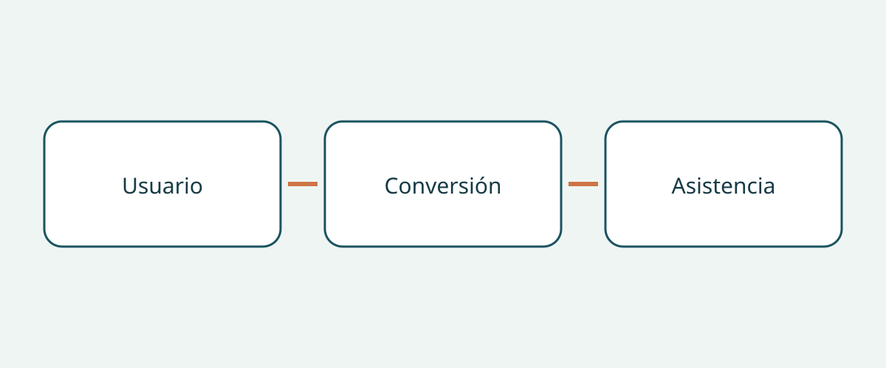

# Qué comprobar al comprar un vehículo accesible

La compra de un vehículo accesible para silla de ruedas empieza por la persona y su trayecto, no por la marca de la furgoneta. Una foto de un habitáculo amplio y una rampa desplegada no demuestra que el usuario pueda entrar, viajar en la posición prevista y salir con la ayuda disponible. El vehículo base, la transformación terminada y la configuración de la silla son asuntos distintos. Resolver uno no resuelve los demás.

Esta guía propone a compradores internacionales y responsables de flotas una evaluación documental acompañada de una demostración adecuada. No es una evaluación médica individual, un manual de instalación ni una explicación de requisitos de matriculación. Los ejemplos estadounidenses y los consejos británicos sirven para formular preguntas, no para establecer dimensiones, capacidades u obligaciones universales.

## Definir el viaje antes de elegir

Anote si la persona viajará en la silla, se transferirá a un asiento o necesita una adaptación para conducir. Indique quién ayudará, dónde suele subir y qué otros pasajeros viajarán. Son cuestiones para consultar con los profesionales pertinentes, no conclusiones que el vendedor pueda sacar de una fotografía. Una transformación para pasajeros no acredita la idoneidad de una configuración de conducción.

La NHTSA, en su orientación estadounidense sobre vehículos adaptados, recomienda consultar a un especialista en rehabilitación de la conducción antes de comprar. También aborda el asiento del pasajero, la entrada y salida y los elevadores u otros equipos adecuados. Pregunte qué evaluación y demostración corresponden a la persona concreta. Una presentación comercial no sustituye un juicio clínico individual.

## Identificar la transformación real

Solicite la identidad del vehículo base, su mercado de venta original, el transformador, la denominación de la conversión y los documentos del vehículo ya transformado. Distinga el año de modelo anunciado de la fecha de transformación. Si recibe un folleto genérico, pregunte a qué variante y periodo corresponde. Un interior parecido no prueba que lleve los mismos equipos; mantenga abiertas las diferencias sin explicar.

La guía estadounidense de BraunAbility separa altura y anchura de acceso, anchura de rampa, longitud útil del suelo y ángulo de rampa por variante de conversión y rango de años de modelo. Por tanto, el nombre del vehículo base no define toda la geometría. Esos ejemplos no proporcionan medidas para una conversión usada sin identificar. Pida documentación aplicable y confirmación profesional sobre la unidad real, sin trasladar cifras de otra variante al contrato.

## Recorrer el acceso con la silla ocupada

BraunAbility describe diseños de entrada lateral y trasera. Compare el acceso previsto con el lugar habitual de embarque y la asistencia disponible, no solo con una etiqueta. Organice una demostración supervisada apropiada para la persona y la silla. Su objetivo es detectar necesidades de evaluación, no improvisar soluciones para una entrada o una sujeción inadecuadas.

La organización británica de investigación para consumidores con discapacidad RiDC recomienda considerar la ayuda al entrar, el espacio para la cabeza, la posición de viaje de la silla y la comunicación con otros ocupantes. Son consejos de RiDC, no umbrales legales. Incluya el recorrido desde la entrada hasta la posición final: una foto de la puerta no describe el interior. Registre las inquietudes del usuario con sus propias palabras.

La orientación del programa británico Motability distingue rampas y elevadores y señala que instalar un elevador puede reducir el espacio para la cabeza en algunos vehículos. No significa que todos lo reduzcan ni que una rampa sea siempre preferible. Pregunte cómo afecta el equipo realmente instalado a ese habitáculo. Una categoría comercial no permite deducir una altura universal.

## Separar la sujeción de la silla y la del ocupante

Q’STRAINT describe su sistema completo de cuatro puntos como una combinación de amarres o retractores de silla, retenciones abdominal y diagonal del ocupante y anclajes al suelo. Son componentes distintos. Ver correas para la silla no aclara cómo se retiene a la persona; ver un cinturón tampoco identifica el sistema completo de sujeción de la silla.

Solicite referencias de equipos, instrucciones aplicables y una evaluación especializada de compatibilidad con la silla, la disposición del ocupante y la transformación. Pida que se detalle todo lo suministrado, en lugar de aceptar «incluye cinturones». Es una solicitud de evidencia, no una guía para instalar anclajes, cambiar asientos o conectar retenciones. La evaluación y las correcciones corresponden a profesionales cualificados.

## Reunir un expediente específico

| Pregunta | Evidencia recomendada | Motivo para detener la compra |
|---|---|---|
| ¿Qué conversión se ofrece? | Transformador, denominación y documentos | Solo se aporta el folleto del vehículo base |
| ¿Puede evaluarse el viaje previsto? | Asesoramiento y demostración supervisada | No se ha considerado al usuario o la silla |
| ¿Qué retenciones se incluyen? | Componentes, instrucciones y compatibilidad | Se presentan las correas como toda la retención del ocupante |
| ¿Quién prestará servicio local? | Contacto y alcance por escrito | Promesa sin identificar el equipo |
| ¿Qué cubre la garantía? | Condiciones separadas cuando estén disponibles | Se supone que la garantía base cubre la transformación |

Pida el historial de mantenimiento de la conversión y explicaciones sobre los documentos que faltan. «No aportado» no equivale a «confirmado satisfactorio». En una compra internacional, confirme al comprar que el proveedor indicado puede atender esa conversión en el destino. Esta guía no garantiza disponibilidad local, transferencia de garantía ni cobertura de exportación. Mantenga las cuestiones pendientes junto al presupuesto.

## Decidir qué evidencia cambiaría la compra

«Vehículo accesible» resulta impreciso. «Transformador identificado, configuración de silla pendiente de evaluación» permite actuar. Si siguen sin resolverse el acceso, la posición de viaje o la compatibilidad de retenciones, esta guía recomienda posponer el compromiso hasta obtener aclaración profesional. Un descuento no demuestra idoneidad.

El estado del vehículo, la matriculación en destino y la admisibilidad de importación requieren comprobaciones separadas. Ni una demostración ni un folleto las acreditan. Tampoco presuponga que la garantía del vehículo cubre la conversión. Pida condiciones escritas sin prometer cobertura. Reconfirme la correspondencia con el vehículo, la revisión documental y el servicio local en el momento de comprar.

## Preguntas frecuentes

### ¿Un vehículo base mayor es siempre mejor?

Las fuentes no permiten esa conclusión. Hay que evaluar acceso, posición interior, ayuda y equipo en la transformación terminada.

### ¿Un vídeo de la rampa sustituye la evaluación?

Solo aporta información adicional. Consulte al especialista qué demostración conviene y anote lo que el vídeo no acredita.

### ¿Las correas de la silla son retenciones del ocupante?

No deben confundirse. Q’STRAINT distingue amarres de silla, retenciones abdominal y diagonal y anclajes. Solicite documentación y evaluación de compatibilidad del sistema real.

### ¿La lista confirma que se puede importar legalmente?

No. Trata evidencias de compra y cuestiones para evaluación especializada. Las normas locales, el estado del vehículo y la idoneidad médica individual son asuntos separados.

## Ilustración

El diagrama relaciona al usuario, la conversión y la asistencia en la compra.

## Lecturas relacionadas

Consulte [información de vehículos](https://www.autobridgeexport.com/vehicles/) y [otras guías de compra](https://www.autobridgeexport.com/guides/).

## Fuentes y verificación

Fuentes comprobadas el 2026-11-05. Los ejemplos de fabricantes conservan su alcance; los consejos británicos no son especificaciones legales.

- [Adapted vehicles](https://www.nhtsa.gov/vehicle-safety/adapted-vehicles) — US Department of Transportation / NHTSA.
- [Wheelchair accessible vehicle dimension guide](https://www.braunability.com/us/en/help-me-buy/dimensions-specs.html) — BraunAbility.
- [What is a wheelchair accessible vehicle?](https://www.braunability.com/us/en/help-me-buy/product-faqs/what-is-an-accessible-vehicle.html) — BraunAbility.
- [Securement 101](https://www.qstraint.com/it/securement-101/?accessibility-mode=on) — Q’STRAINT.
- [WAV sizes](https://www.motability.co.uk/whats-available/wavs/passenger/sizes) — Motability Operations.
- [WAV checklist](https://ridc.org.uk/features-reviews/out-and-about/wheelchair-accessible-vehicles-wavs-0/wavs-checklist) — Research Institute for Disabled Consumers.
