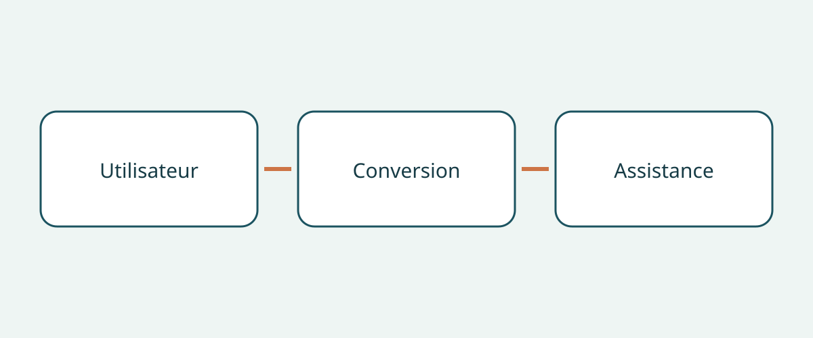

# Acheter un véhicule accessible en fauteuil roulant

L'achat commence par une personne et son trajet, pas par le nom d'un fourgon. Une annonce montrant un habitacle spacieux et une rampe déployée ne prouve pas que l'utilisateur pourra entrer, voyager à la place prévue et sortir avec l'aide réellement disponible. Le véhicule de base, la transformation terminée et la configuration du fauteuil sont trois éléments distincts. Une réponse satisfaisante pour l'un ne règle pas les autres.

Ce guide propose aux acheteurs internationaux et aux gestionnaires de flotte une démarche fondée sur les documents et une démonstration adaptée. Il ne constitue ni une évaluation médicale individuelle, ni un manuel d'installation, ni un exposé des règles d'immatriculation. Les exemples américains et les conseils britanniques servent à formuler des questions, sans établir de dimensions, capacités ou obligations universelles.

## Décrire le trajet avant de choisir

Précisez si la personne voyagera dans son fauteuil, prendra place sur un siège du véhicule ou souhaite conduire. Indiquez qui l'aidera, où elle montera habituellement et quels passagers l'accompagneront. Ces questions se discutent avec les spécialistes concernés ; une photographie du fauteuil ne permet pas au vendeur d'y répondre. Une transformation pour passager ne démontre pas l'adéquation d'un poste de conduite.

Dans ses conseils américains sur les véhicules adaptés, la NHTSA recommande de consulter un spécialiste de la réadaptation à la conduite avant l'achat. Elle aborde également la place du passager, l'entrée, la sortie et le choix d'un élévateur ou d'autres équipements. Demandez au spécialiste quelle évaluation et quelle démonstration conviennent à la personne concernée. Une présentation commerciale ne remplace pas un jugement clinique individuel.

## Identifier la transformation complète

Demandez l'identité du véhicule de base, son marché de vente d'origine, le nom du transformateur, la désignation de la transformation et les documents correspondant au véhicule achevé. Distinguez le millésime annoncé de la date de transformation. Si une brochure générique est fournie, faites préciser la version et la période couvertes. Un intérieur ressemblant ne prouve pas la présence des mêmes équipements ; conservez les écarts inexpliqués comme questions ouvertes.

Le guide américain de BraunAbility distingue la hauteur et la largeur de l'ouverture, la largeur de rampe, la longueur utile du plancher et l'angle de rampe selon la variante de transformation et la plage de millésimes. Le nom du véhicule de base ne définit donc pas à lui seul cette géométrie. Ces exemples ne donnent pas les dimensions d'une occasion non identifiée. Demandez le document applicable et une confirmation portant sur le véhicule réel, plutôt que de reprendre les chiffres d'une autre variante.

## Examiner tout le parcours du fauteuil occupé

BraunAbility décrit des véhicules à accès latéral et arrière. Comparez le trajet d'accès avec le lieu d'embarquement habituel et l'assistance disponible, pas seulement avec l'étiquette du type de transformation. Prévoyez une démonstration encadrée adaptée à l'utilisateur et au fauteuil. Son objectif est d'identifier les évaluations complémentaires, non d'improviser une solution à une entrée ou à une retenue inadaptée.

L'organisme britannique de recherche auprès des consommateurs handicapés RiDC recommande de considérer l'aide à l'entrée, la garde au toit, la position du fauteuil pendant le trajet et la communication avec les autres occupants. Ce sont ses conseils, pas des seuils légaux. Examinez aussi le passage entre l'entrée et la place de voyage : une photo de porte ne décrit pas l'intérieur. Notez les préoccupations de l'utilisateur avec ses propres mots.

Les conseils du programme britannique Motability distinguent les configurations avec rampe ou élévateur et précisent que l'installation d'un élévateur peut réduire la garde au toit dans certains véhicules. Cela ne signifie ni que tout élévateur réduit l'espace ni qu'une rampe est toujours préférable. Demandez les effets de l'équipement effectivement installé ; ne déduisez pas une hauteur universelle d'une catégorie générale.

## Distinguer le fauteuil de son occupant

Q’STRAINT décrit son système complet à quatre points comme comprenant les attaches ou enrouleurs du fauteuil, les retenues abdominale et diagonale de l'occupant et les ancrages au plancher. Ce sont des composants différents. Des sangles pour fauteuil ne suffisent pas à identifier la retenue de l'occupant ; une ceinture visible ne décrit pas non plus l'ensemble du système.

Demandez les références des équipements, leurs notices applicables et une évaluation spécialisée de leur compatibilité avec le fauteuil, l'occupant et la transformation. Faites détailler l'ensemble livré plutôt que d'accepter « ceintures incluses ». Il s'agit d'une demande de preuves, pas d'instructions pour poser des ancrages, déplacer des sièges ou attacher les retenues. Confiez l'évaluation et les corrections aux spécialistes qualifiés.

## Constituer un dossier propre à la transformation

| Question | Justificatif conseillé | Motif de suspension |
|---|---|---|
| Quelle transformation est proposée ? | Identité du transformateur, désignation et documents | Seule la brochure du véhicule de base est disponible |
| Le trajet prévu peut-il être évalué ? | Avis spécialisé et démonstration encadrée | Utilisateur ou fauteuil non pris en compte |
| Quelles retenues sont livrées ? | Références, notices et compatibilité | Les sangles sont présentées comme toute la retenue de l'occupant |
| Qui assurera le suivi local ? | Contact et périmètre écrits pour la transformation | Promesse sans identification des équipements |
| Que couvre la garantie ? | Conditions distinctes du véhicule et de la transformation | Couverture des modifications supposée |

Demandez l'historique d'entretien de la transformation et une explication des lacunes. Distinguez « non fourni » de « jugé satisfaisant ». Pour un achat international, vérifiez au moment de l'achat que le prestataire désigné peut prendre en charge cette transformation au lieu de réception. Ce guide ne garantit ni disponibilité locale, ni transfert de garantie, ni couverture à l'exportation. Gardez les questions ouvertes à côté du devis.

## Savoir ce qui ferait changer la décision

« Véhicule accessible » reste trop vague. « Transformateur identifié, configuration du fauteuil en attente d'évaluation » indique une action concrète. Si l'entrée, la place de voyage ou la compatibilité des retenues restent incertaines, ce guide recommande de différer l'engagement jusqu'à clarification spécialisée. Une remise ne prouve pas l'adéquation.

L'état du véhicule, l'immatriculation à destination et l'admissibilité à l'importation sont des enquêtes séparées. Ni démonstration ni brochure ne les établissent. Ne supposez pas que la garantie du véhicule couvre la transformation : demandez les conditions écrites sans présumer la réponse. Reconfirmez l'applicabilité au véhicule, la révision des documents et l'assistance locale à l'achat.

## Questions fréquentes

### Un véhicule de base plus grand est-il forcément préférable ?

Ces sources ne permettent pas cette conclusion. L'ouverture, la position intérieure, l'aide et les équipements restent à évaluer sur la transformation terminée.

### Une vidéo de la rampe remplace-t-elle l'évaluation ?

Elle constitue seulement une information complémentaire. Demandez au spécialiste quelle démonstration convient et consignez ce que la vidéo n'établit pas.

### Les sangles du fauteuil retiennent-elles aussi l'occupant ?

Ne les confondez pas. Q’STRAINT distingue attaches du fauteuil, retenues abdominale et diagonale et ancrages. Demandez la documentation du système réel et son évaluation de compatibilité.

### Cette liste confirme-t-elle la légalité de l'importation ?

Non. Elle concerne les preuves d'achat et les questions à soumettre aux spécialistes. Règles locales, état du véhicule et aptitude médicale individuelle restent distincts.

## Illustration

Le schéma relie les questions concernant l'utilisateur, la transformation et l'assistance.

## Pour aller plus loin

Consultez les [informations sur les véhicules](https://www.autobridgeexport.com/vehicles/) et les [autres guides d'achat](https://www.autobridgeexport.com/guides/).

## Sources et vérification

Sources vérifiées le 2026-11-05. Les exemples des fabricants conservent leur portée ; les conseils britanniques ne sont pas des normes légales.

- [Adapted vehicles](https://www.nhtsa.gov/vehicle-safety/adapted-vehicles) — US Department of Transportation / NHTSA.
- [Wheelchair accessible vehicle dimension guide](https://www.braunability.com/us/en/help-me-buy/dimensions-specs.html) — BraunAbility.
- [What is a wheelchair accessible vehicle?](https://www.braunability.com/us/en/help-me-buy/product-faqs/what-is-an-accessible-vehicle.html) — BraunAbility.
- [Securement 101](https://www.qstraint.com/it/securement-101/?accessibility-mode=on) — Q’STRAINT.
- [WAV sizes](https://www.motability.co.uk/whats-available/wavs/passenger/sizes) — Motability Operations.
- [WAV checklist](https://ridc.org.uk/features-reviews/out-and-about/wheelchair-accessible-vehicles-wavs-0/wavs-checklist) — Research Institute for Disabled Consumers.
