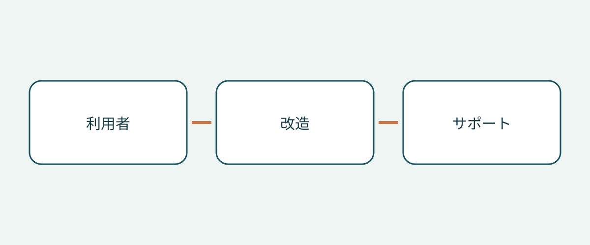

# 車いす対応車の購入前に確認したい改造と利用条件

車いす対応車の購入は、車名ではなく利用者と実際の移動から考えます。広い車内と展開したスロープの写真だけでは、予定している介助で乗車し、所定の位置で移動し、降車できるかは分かりません。ベース車両、完成した改造、使用する車いすの組み合わせは別々の確認事項です。一つが確認できても、残りまで解決したことにはなりません。

本稿は、海外から購入する方や車両管理者に、資料確認と適切な実演による検討を提案します。個別の医学的適合性評価、取付説明書、登録要件の解説ではありません。米国メーカーの例と英国の消費者向け助言から質問を整理しますが、共通の寸法、耐荷重、法的義務を示すものではありません。

## 改造を比べる前に移動方法を整理する

利用者が車いすのまま乗るのか、車両の座席へ移るのか、運転を希望するのかを記録します。誰が介助し、普段どこで乗降し、誰が同乗するのかも整理してください。これは関係する専門家と相談すべき事項であり、販売者が車いすの写真だけから判断できるものではありません。乗客用の改造が、運転用の構成にも適しているとは限りません。

米国 NHTSA の改造車に関する案内は、購入前に運転リハビリテーションの専門家へ相談することを勧めています。乗客の座席、乗降、適切なリフトや機器も扱っています。利用者にどの評価と実演が適切かを専門家に相談してください。販売時の実演は、個別の臨床的判断の代わりにはなりません。

## ベース車名ではなく完成した改造を特定する

ベース車両の識別情報と当初の販売市場に加え、改造業者、改造仕様名、完成車に対応する記録を求めます。広告のモデル年と改造日付は分けて記録してください。一般的なカタログしかない場合は、対象仕様と期間を確認します。内装が似ていても同じ機器の証拠にはならず、説明できない相違は未確認のまま残します。

BraunAbility の米国向け寸法案内は、ドア開口の高さと幅、スロープ幅、有効床長、スロープ角度を、改造仕様とモデル年の範囲ごとに区別しています。ベース車名だけでは改造後の空間は特定できません。ただし、この例から身元不明の中古改造車の寸法を決めることもできません。別仕様の数値を購入条件へ転記せず、該当資料と実車に関する専門家の確認を求めましょう。

## 車いすに座った状態での経路全体を考える

BraunAbility は側面から乗る設計と後部から乗る設計を紹介しています。名称だけで選ばず、実際の乗降場所と介助条件に照らして経路を比較します。予定する利用者と車いすに合わせ、指導を受けられる適切な実演を相談してください。目的は追加評価の必要性を見つけることであり、不適切な入口や拘束装置を即席の方法で使うことではありません。

英国の障害者向け消費者研究機関 RiDC は、乗車時の介助、頭上空間、走行中の車いす位置、他の乗員とのコミュニケーションを検討するよう勧めています。これは助言であり、法定の数値基準ではありません。入口から乗車位置までの移動も確認対象に含めてください。ドアの写真だけでは車内の状況は分かりません。利用者の懸念は本人の言葉で記録し、販売者の一般的な説明に埋もれさせないようにします。

英国 Motability 制度の案内はスロープ式とリフト式を区別し、一部の車両ではリフトの装着により頭上空間が減る場合があると説明しています。すべてのリフトで減る、あるいはスロープが常に優れるという意味ではありません。実際の装備がこの車内に与える影響を確認し、分類だけから共通の高さを導かないでください。

## 車いす固定と乗員拘束を区別する

Q’STRAINT は、同社の完全な四点式システムを、車いす用固定ベルトまたはリトラクター、乗員用の腰・肩拘束装置、床のアンカーから構成されるものと説明しています。それぞれ別の部品です。車いす固定ベルトが見えても乗員の拘束方法は分からず、乗員用ベルトが見えても車いす固定システム全体を特定できません。

機器の識別情報、適用する説明書、予定する車いす・乗員配置・改造との適合性に関する専門家の評価を求めます。「ベルト付き」だけでなく、引き渡す構成品全体を示してもらってください。これは資料の依頼であり、アンカーの取付け、座席変更、拘束装置の接続手順ではありません。評価や修正は適切な専門家へ相談してください。

## 改造固有の購入資料をまとめる

| 質問 | 求めたい資料 | 購入を保留する理由 |
|---|---|---|
| どの改造が対象か | 改造業者、仕様名、該当記録 | ベース車のカタログしかない |
| 実際の移動を評価できるか | 専門家の助言と適切な実演 | 利用者や車いすが検討されていない |
| どの拘束装置が付属するか | 部品情報、説明書、適合性評価 | 車いすベルトだけを乗員拘束全体としている |
| 現地で誰が支援するか | 対象改造の連絡先と書面の対応範囲 | 機器を特定せず支援を約束している |
| 保証は何を含むか | 入手できるベース車と改造それぞれの条件 | 改造も保証対象だと推測している |

改造の整備記録と、欠けている記録についての説明も求めます。「未提出」と「問題なしと確認済み」は区別してください。海外取引では、購入時に、指定された事業者が引渡先でこの改造に対応できるかを確認します。本稿は現地サービス、保証移転、輸出後の保証を確約しません。未解決の支援事項は見積書と一緒に残してください。

## 購入判断を変える条件を明確にする

「車いす対応」だけでは曖昧です。「改造業者は確認済み、車いす構成は評価待ち」とすれば次の行動が分かります。乗降、乗車位置、拘束装置の適合性が未解決なら、専門家の確認まで購入の確約を延期することを本稿では勧めます。値引きは適合性の証拠にはなりません。

車両状態、目的地の登録、輸入可否は別途確認します。実演や改造カタログではそれらを証明できません。ベース車の保証が改造も含むと決めつけず、書面の条件を求めてください。購入時に車両への適用、文書の改訂、現地支援を再確認しましょう。

## よくある質問

### 大きなベース車の方が必ず適していますか？

これらの資料からは判断できません。完成した改造について、開口、車内位置、介助、装備を評価する必要があります。

### スロープの動画で評価を代用できますか？

補足情報として扱います。適切な実演を専門家に相談し、動画では確認できない点を記録してください。

### 車いす固定ベルトは乗員用拘束装置ですか？

同じものとして扱わないでください。Q’STRAINT は車いす固定、腰・肩拘束、床アンカーを区別しています。実装システムの資料と適合性評価を求めます。

### この確認で合法的に輸入できると分かりますか？

いいえ。購入資料と専門評価の論点を扱うものです。現地規則、車両状態、個人の医学的適合性には別の確認が必要です。

## 図解

利用者、改造、サポートに関する購入時の確認事項をつないだ図です。

## 関連情報

[車両情報](https://www.autobridgeexport.com/vehicles/)と[その他の購入ガイド](https://www.autobridgeexport.com/guides/)をご覧ください。

## 出典と確認日

出典確認日：2026-11-05。メーカー例は元の適用範囲に限られ、英国の助言は法的仕様ではありません。

- [Adapted vehicles](https://www.nhtsa.gov/vehicle-safety/adapted-vehicles) — US Department of Transportation / NHTSA.
- [Wheelchair accessible vehicle dimension guide](https://www.braunability.com/us/en/help-me-buy/dimensions-specs.html) — BraunAbility.
- [What is a wheelchair accessible vehicle?](https://www.braunability.com/us/en/help-me-buy/product-faqs/what-is-an-accessible-vehicle.html) — BraunAbility.
- [Securement 101](https://www.qstraint.com/it/securement-101/?accessibility-mode=on) — Q’STRAINT.
- [WAV sizes](https://www.motability.co.uk/whats-available/wavs/passenger/sizes) — Motability Operations.
- [WAV checklist](https://ridc.org.uk/features-reviews/out-and-about/wheelchair-accessible-vehicles-wavs-0/wavs-checklist) — Research Institute for Disabled Consumers.
