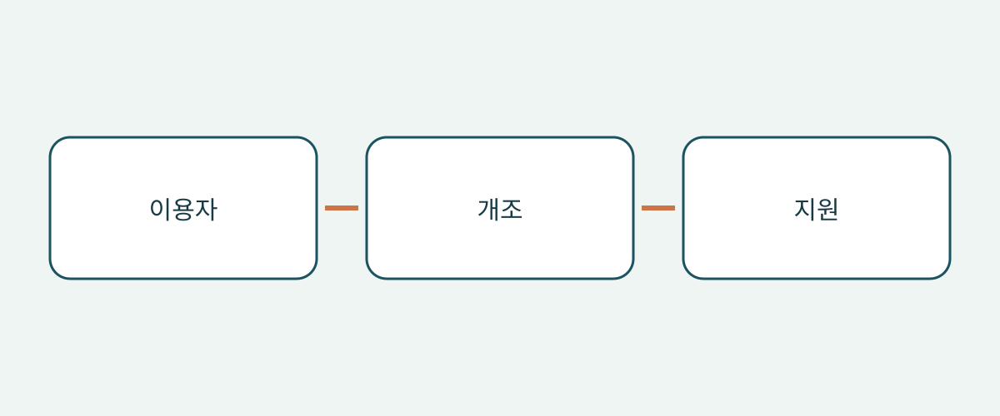

# 휠체어 탑승 차량 구매 전 개조와 이용 조건 확인

휠체어 접근 차량 구매는 차종 이름보다 이용자와 실제 이동에서 시작합니다. 넓은 실내와 펼쳐진 경사로 사진만으로는 이용자가 실제로 받을 수 있는 도움을 받아 승차하고, 예정된 위치에서 이동하고, 하차할 수 있는지 알 수 없습니다. 기본 차량, 완료된 개조, 사용할 휠체어 구성은 별개입니다. 하나가 확인되어도 나머지까지 해결된 것은 아닙니다.

이 안내는 해외 구매자와 차량 운영 담당자에게 문서 확인과 적절한 시연을 통한 검토를 권합니다. 개인의 의학적 적합성 평가, 설치 설명서 또는 등록 요건 안내가 아닙니다. 미국 제조사 사례와 영국 소비자 조언은 질문을 정리하는 데 쓰이며, 보편적인 치수나 허용 하중, 법적 의무를 정하지 않습니다.

## 개조 비교보다 먼저 이동 방식을 설명하기

이용자가 휠체어에 앉은 채 이동할지, 차량 좌석으로 옮길지, 직접 운전할 계획인지 기록합니다. 누가 도와주며, 평소 어디에서 타고, 어떤 동승자가 있는지도 정리합니다. 관련 전문가와 논의할 사안이지 판매자가 휠체어 사진만 보고 추측할 내용은 아닙니다. 승객용 개조가 운전용 구성에도 적합하다는 증거가 되지는 않습니다.

미국 NHTSA는 적응형 차량 안내에서 구매 전 운전 재활 전문가와 상담하도록 권고합니다. 승객 좌석, 승하차, 적합한 리프트와 기타 장비도 다룹니다. 실제 이용자에게 어떤 평가와 시연이 필요한지 전문가에게 물어보십시오. 판매 시연은 개인에 대한 임상적 판단을 대신하지 않습니다.

## 기본 차종이 아니라 완성된 개조를 식별하기

기본 차량의 식별 정보와 최초 판매 시장, 개조 업체, 개조 명칭, 완성된 차량에 해당하는 기록을 요청합니다. 광고상 모델 연도와 개조 시점은 구분합니다. 일반 카탈로그만 제공된다면 어느 사양과 기간을 설명하는지 확인하십시오. 실내가 비슷하다고 같은 장비가 설치되었다고 볼 수 없으므로 설명되지 않은 차이는 미확인으로 남깁니다.

BraunAbility의 미국 치수 안내는 출입구 높이와 폭, 경사로 폭, 사용 가능한 바닥 길이와 경사로 각도를 개조 사양 및 모델 연도 범위별로 구분합니다. 따라서 기본 차종 이름만으로 개조 후 공간이 정해지지 않습니다. 이 사례의 수치를 신원이 확인되지 않은 중고 개조 차량에 적용할 수도 없습니다. 다른 사양의 숫자를 계약에 옮기지 말고 해당 문서와 실차에 관한 전문 확인을 요청하십시오.

## 이용자가 탄 휠체어의 전체 경로 보기

BraunAbility는 측면 진입형과 후면 진입형을 설명합니다. 유형 이름만 보고 고르지 말고 평소 승차 장소와 도움 조건에 맞춰 경로를 비교합니다. 실제 이용자와 휠체어에 적절한 감독하의 시연을 준비하십시오. 목적은 추가 평가가 필요한 부분을 찾는 것이며, 부적합한 출입구나 구속 장치를 임시방편으로 사용하는 것이 아닙니다.

영국 장애인 소비자 연구기관 RiDC는 승차 시 도움, 머리 위 공간, 이동 중 휠체어 위치, 다른 탑승자와의 의사소통을 고려하도록 권합니다. 이는 소비자 조언이며 법적 수치 기준이 아닙니다. 입구부터 최종 탑승 위치까지의 이동도 포함하십시오. 문 사진만으로 실내 상황은 알 수 없습니다. 이용자가 느낀 우려를 자신의 표현대로 기록해 판매자의 일반적인 설명에 묻히지 않도록 합니다.

영국 Motability 제도의 안내는 경사로와 리프트 배치를 구분하며 일부 차량에서는 리프트 설치로 머리 위 공간이 줄 수 있다고 설명합니다. 모든 리프트가 공간을 줄이거나 경사로가 항상 낫다는 뜻은 아닙니다. 실제 설치 장비가 해당 실내에 미치는 영향을 확인하고, 분류 설명에서 보편적인 높이를 추론하지 마십시오.

## 휠체어 고정과 탑승자 구속 구분하기

Q’STRAINT는 자사의 완전한 4점식 시스템을 휠체어 고정 스트랩 또는 리트랙터, 탑승자 허리·어깨 구속 장치, 바닥 고정점으로 설명합니다. 서로 다른 구성품입니다. 휠체어 스트랩이 보인다고 탑승자 구속 방식까지 확인되는 것은 아니며, 안전벨트가 보인다고 휠체어 고정 시스템 전체가 확인되는 것도 아닙니다.

장비 식별 정보, 적용 설명서, 예정된 휠체어와 탑승자 배치 및 개조의 호환성에 대한 전문 평가를 요청하십시오. 단순히 “벨트 포함”이 아니라 공급되는 전체 구성품을 확인합니다. 이는 증거 요청이지 고정점 설치, 좌석 변경 또는 구속 장치 연결 방법이 아닙니다. 평가와 수정은 적절한 자격을 갖춘 전문가에게 맡기십시오.

## 개조 전용 구매 자료 만들기

| 질문 | 요청할 증거 | 구매를 미룰 이유 |
|---|---|---|
| 어떤 개조인가? | 업체, 명칭, 해당 기록 | 기본 차량 카탈로그만 제공 |
| 실제 이동을 평가할 수 있는가? | 전문 조언과 적절한 시연 | 이용자나 휠체어를 고려하지 않음 |
| 어떤 구속 장비가 포함되는가? | 구성품, 설명서, 호환성 평가 | 휠체어 스트랩을 탑승자 구속 전체로 설명 |
| 현지 지원은 누가 하는가? | 해당 개조의 연락처와 서면 범위 | 장비 식별 없이 지원 약속 |
| 보증 범위는 무엇인가? | 가능한 경우 기본 차량과 개조의 별도 조건 | 개조 보증을 추정 |

개조 정비 기록을 요청하고 빠진 기록은 설명을 받으십시오. “미제공”과 “문제없음 확인”은 다릅니다. 해외 거래라면 구매 시점에 지정된 서비스 업체가 수령 지역에서 실제 개조를 지원할 수 있는지 확인합니다. 이 안내는 현지 서비스, 보증 이전, 수출 보증을 보장하지 않습니다. 미해결 지원 질문을 견적서 옆에 남겨 비교 시 놓치지 않도록 합니다.

## 어떤 답변이 구매 결정을 바꿀지 정하기

“휠체어 접근 가능”만으로는 막연합니다. “개조 업체 확인, 휠체어 구성 평가 대기”라고 쓰면 다음 행동이 분명합니다. 승하차, 탑승 위치, 구속 장치 호환성이 미확인이라면 관련 전문가가 해결할 때까지 구매 약정을 미루는 것을 권합니다. 할인은 적합성 증거가 아닙니다.

차량 상태, 목적지 등록 및 수입 가능성은 별도로 확인해야 합니다. 시연이나 개조 카탈로그로 입증되지 않습니다. 기본 차량 보증이 개조에도 적용된다고 추정하지 말고 서면 조건을 요청하십시오. 구매 시 차량 적용 범위, 문서 개정, 현재 현지 지원을 다시 확인합니다.

## 자주 묻는 질문

### 기본 차량이 크면 무조건 더 좋은가요?

이 출처들로는 그렇게 결론 내릴 수 없습니다. 완성된 개조의 출입구, 내부 위치, 도움과 장비를 평가해야 합니다.

### 경사로 동영상이 평가를 대신하나요?

보조 자료일 뿐입니다. 전문가에게 적절한 시연을 문의하고 영상이 입증하지 못하는 내용을 기록하십시오.

### 휠체어 스트랩은 탑승자 구속 장치인가요?

혼동하지 마십시오. Q’STRAINT는 휠체어 고정, 허리·어깨 구속 및 바닥 고정점을 구분합니다. 실장 시스템의 자료와 호환성 평가를 요청하십시오.

### 이 목록으로 합법적 수입을 확인할 수 있나요?

아닙니다. 구매 증거와 전문 평가 질문을 다룹니다. 현지 규정, 차량 상태 및 개인의 의학적 적합성은 별도 확인 대상입니다.

## 도식

이 도식은 구매 시 이용자, 개조 및 지원에 관한 질문을 연결합니다.

## 관련 자료

[차량 정보](https://www.autobridgeexport.com/vehicles/)와 [다른 구매 안내](https://www.autobridgeexport.com/guides/)를 살펴보십시오.

## 출처 및 확인

출처 확인일: 2026-11-05. 제조사 사례는 원래 범위를 유지하며 영국 조언은 법적 규격이 아닙니다.

- [Adapted vehicles](https://www.nhtsa.gov/vehicle-safety/adapted-vehicles) — US Department of Transportation / NHTSA.
- [Wheelchair accessible vehicle dimension guide](https://www.braunability.com/us/en/help-me-buy/dimensions-specs.html) — BraunAbility.
- [What is a wheelchair accessible vehicle?](https://www.braunability.com/us/en/help-me-buy/product-faqs/what-is-an-accessible-vehicle.html) — BraunAbility.
- [Securement 101](https://www.qstraint.com/it/securement-101/?accessibility-mode=on) — Q’STRAINT.
- [WAV sizes](https://www.motability.co.uk/whats-available/wavs/passenger/sizes) — Motability Operations.
- [WAV checklist](https://ridc.org.uk/features-reviews/out-and-about/wheelchair-accessible-vehicles-wavs-0/wavs-checklist) — Research Institute for Disabled Consumers.
