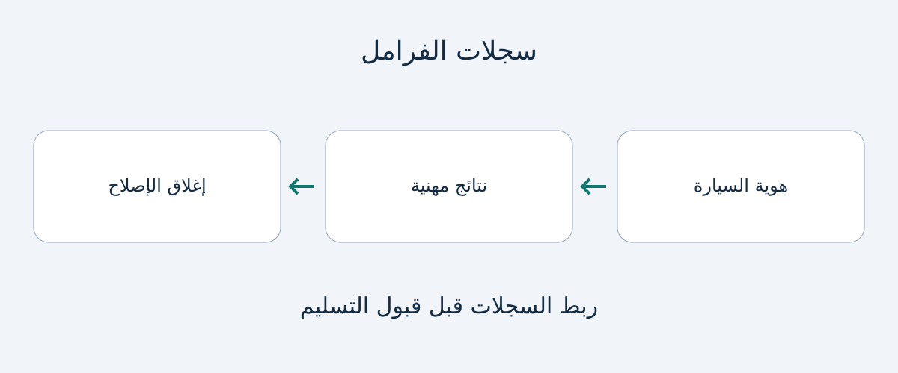

# سجلات الفرامل وفرامل التوقف عند شراء سيارة مستعملة

عبارة «تمت صيانة الفرامل» بداية مفيدة، لكنها ليست وصفاً كاملاً للحالة الحالية. قد تسجل الفاتورة إصلاحاً دون بيان المحور المفحوص أو الأجزاء المقاسة أو الحدود المستخدمة أو حل عطل فرامل التوقف. بالنسبة إلى المشتري الدولي ومسؤول الأسطول، تتمثل المهمة في ربط السيارة بنتائج الفحص والعمل المكتمل قبل قبول التسليم.

يوصي هذا الدليل بمجموعة مستندات، وليس بخطوات للفحص أو الإصلاح الذاتي. ولا يحدد سماكات عامة للبطانات أو الأقراص، أو فترات للسائل، أو معايير قانونية للنجاح. تساعد الوثائق المختص على فهم التاريخ، لكنها لا تحل محل الفحص الفعلي ولا تصدّق عن بعد على صلاحية السير. إذا بقي تحذير أو تسرب أو ضعف في الكبح، فأجّل القبول واطلب تقييماً مؤهلاً، بدلاً من ارتجال اختبار طريق أو منحدر.

## فصل الملاحظة والإصلاح والتحقق الختامي

تصف الملاحظة ما وُجد. وتصف الفاتورة العمل المفوتر أو المنجز. ويوضح سجل ما بعد الإصلاح كيفية تحقق الورشة من النتيجة. قد يجمع مستند واحد العناصر الثلاثة، لكن عبارة «أُنجزت الفرامل الخلفية» لا تثبتها كلها.

اطلب من البائع ربط كل مستند برقم VIN أو مرجع موثوق للسيارة، مع تاريخ الفحص وقراءة العداد المسجلة. واطلب هوية الورشة ونطاق العمل. هذه توصيات شراء تحريرية، وليست حقولاً قانونية موحدة. عند نقص البيانات، اطلب استكمالها بدلاً من تفسير فاتورة مبهمة باعتبارها ضماناً أوسع.

تعتمد فائدة الفاتورة الحديثة على نطاقها والتاريخ اللاحق للسيارة. اسأل عن شكوى أو تحذير أو عمل متعلق بالفرامل ما زال مفتوحاً. المستند القديم ليس عديم الفائدة تلقائياً، والتاريخ الحديث لا يثبت الحالة الراهنة. المهم تحديد سؤال الشراء الذي تجيب عنه كل وثيقة.

## نتائج مرتبطة بالموقع بدلاً من «الفرامل جيدة»

يوجّه مستند الصيانة الأمريكي لسيارة Toyota 86 لعام 2024 الفنيين المؤهلين إلى فحص بطانات الفرامل وأسطواناتها بحثاً عن الضرر والتسرب والتآكل، وفحص الوسادات والأقراص بحثاً عن الاهتراء والانحراف الدوراني والتسرب. هذا مثال على تفصيل الفحص ضمن مصدر محدد، وليس قولاً بأن جميع المركبات تحمل المكونات أو الإجراءات نفسها. وتذكر Brembo أيضاً الحد الأدنى للسماكة والخدوش والشقوق وتغير لون السطح والتشوه ضمن نقاط الفحص.

للسيارة المعروضة، اطلب تقريراً مهنياً يحدد المكونات المركبة ومواقعها والقياسات ذات الصلة. يُستحسن أن تذكر الورشة حد الشركة المصنّعة المناسب ومرجعه بجوار القياس. يصعب تفسير رقم بلا هوية الجزء أو أساس المقارنة، ولا يعوضه رقم عام من طراز آخر.

| المستند المطلوب | سؤال الشراء الذي يساعد في إجابته |
|---|---|
| تعريف المحور والمكوّن | أي فرامل فُحصت أو استُبدلت؟ |
| القياسات والوحدات ومرجع المصنع | على أي أساس قُيّمت الحالة؟ |
| ملاحظات التسرب والضرر والتآكل | ما المخاوف غير السماكة؟ |
| فاتورة بالأجزاء والأعمال | ما الذي تغيّر استجابة للنتائج؟ |
| تحقق ختامي وبنود مفتوحة | ما الذي حُل وما الذي بقي؟ |

الجدول ليس تسلسلاً للفحص الميكانيكي. الطريقة والحدود المناسبة تخص السيارة والورشة المؤهلة. إذا وُجدت صور، اطلب ربطها بالسيارة وموقع المكوّن. تضيف الصور سياقاً، لكنها لا تثبت كل القياسات أو الحالات المخفية وحدها.

## السائل وتآكل فرامل السيارات الكهربائية سؤالان منفصلان

استبدال الوسادات لا يوضح ما أُنجز في سائل الفرامل. اطلب سجل الخدمة المتاح وشرح الورشة لكيفية انطباق إرشادات المصنع الحالية على السيارة. لا يقدم الدليل فترة تغيير عامة ولا يدعو المشتري إلى فتح النظام.

ينص دليل Model 3 الإنجليزي لبلجيكا على مسؤولية المالك عن دقة ملخص الصيانة، بما فيها الأعمال المستقلة والذاتية. كما يقصر فحص مستوى سائل الفرامل على Tesla أو الورش المهنية. في هذا المثال، يُقرأ الملخص مع المستندات الداعمة ويُترك الفحص المحدد للمتخصصين. لا يتحول دليل سوق واحدة إلى إجراء لجميع السيارات.

يوضح دليل Model 3 الإنجليزي لأيرلندا أن الكبح المتجدد قد يقلل استخدام الوسادات الاحتكاكية بينما يظل الصدأ والتآكل قابلين للتراكم؛ ويطلب فحصاً بصرياً دورياً مع إزالة العجلات. هذا مبرر لطلب دليل مهني، لا تعليمات للمشتري بفك العجلات. الاستخدام الظاهري القليل للوسادات أو الدفع الكهربائي لا يبرران تجاهل حالة الفرامل. ولا يضع المصدر فترة موحدة لكل السيارات الكهربائية.

## تحديد نظام فرامل التوقف قبل تفسير الإصلاح

«فرامل توقف كهربائية» لا تعني آلية واحدة عامة. تصف HELLA بنيتين مختلفتين من خلال أمثلة Audi A8 وBMW 7 Series. ما يهم المشتري هو تحديد النظام المركب فعلاً قبل قبول وصف الإصلاح أو توقع إجراء معين.

يشترط دليل EPB من TRW تنفيذ العمل بواسطة مختصين مدرّبين وفق مواصفات OEM، ويصف وضع صيانة تشخيصياً ومعايرة بعد الإصلاح للأنظمة التي يغطيها. لا يثبت ذلك أن كل فرامل توقف كهربائية تحتاج إلى جهاز خارجي واحد أو تسلسل خدمة واحد.

إذا أُبلغ عن إصلاح، اطلب تحديد النظام والشكوى الأصلية والإجراء المناسب والعمل المكتمل. عندما يتضمن الإجراء وضعاً تشخيصياً أو معايرة، اطلب إثبات إتمامه على النحو الملائم. واسأل عن التحذيرات المستمرة أو الشكاوى المتكررة. هذه طلبات سجلات مهنية، لا أوامر لتشغيل الفرامل أو دخول وضع الخدمة أو اختبار قدرة التثبيت بنفسك.

## التوضيح أو التصحيح أو تأجيل القبول

تربط المجموعة المتسقة السيارة المعروضة بالنتائج والعمل والتحقق اللاحق. إنها تدعم المناقشة التجارية، وليست شهادة سلامة عن بعد. افصل قبول الصفقة عن رأي المختص بشأن أمان الاستخدام.

إذا نقص مرجع القياس أو موقع المكوّن، اطلب توضيحاً من الورشة المصدرة عبر البائع. وإذا تعارضت الوثائق، اطلب شرحاً يخص السيارة بدلاً من اختيار الصفحة الأكثر طمأنة. استمرار التحذير أو التسرب أو ضعف الكبح أو مشكلة التوقف يدعو لتأجيل قبول التسليم وترتيب تقييم مؤهل والتصحيح اللازم.

في شراء الأساطيل، احتفظ بسجل مستقل لكل سيارة. تقرير عينة أو بيان شامل لا يثبت حالة كل وحدة. وقبل الالتزام بشراء مستورد، تأكد أيضاً من وجود مقدم خدمة محلي مناسب يستطيع دعم النظام المركب والحصول على وثائقه. أعد التحقق من انطباق المستند على السيارة وإصداره وتوافر الخدمة وقت الشراء.

## أسئلة شائعة

### هل تكفي الفاتورة لقبول التسليم؟
قد توثق العمل، لكنها ليست تلقائياً تقرير حالة راهناً. اطلب النتائج والتحقق المناسب بعد الإصلاح، مع فحص فعلي مختص عند الحاجة.

### ما السماكة الدنيا التي ينبغي طلبها؟
لا توجد قيمة عامة هنا. ينبغي أن تحدد الورشة المؤهلة الجزء المركب وحد المصنع المناسب، ثم تسجل القياس والوحدة بجوار المرجع.

### هل يلغي الكبح المتجدد صيانة الفرامل؟
لا. يناقش دليل Model 3 المذكور التآكل رغم قلة استخدام الوسادات. طبّق إرشادات السيارة الفعلية، دون افتراض إعفاء السيارات الكهربائية من الفحص.

### هل تحتاج كل فرامل توقف كهربائية إلى وضع تشخيصي؟
لا تفترض ذلك. تختلف الأنظمة والإجراءات. يصف TRW نطاقه المحدد؛ اطلب إجراء السيارة وسجل إتمامه من ورشة مؤهلة.

## رسم المستندات

رسم أصلي للسجلات التي يُنصح بربطها، وليس اختبار فرامل أو شهادة سلامة.

## المصادر وقراءات إضافية

تاريخ التحقق 2026-11-05. يحتفظ كل مثال بنطاق سيارته وسوقه أو مجاله التقني؛ ولا يضع أي منها متطلبات استيراد أو فحص عالمية.

- [Toyota: صيانة Toyota 86 لعام 2024 في الولايات المتحدة](https://www.toyota.com/content/dam/toyota/brochures/pdf/2024/T-MMS-24_86.pdf)
- [ZF/TRW: الدليل التقني EPB](https://aftermarket.zf.com/en/media/master/downloads/xzm200.pdf)
- [HELLA: أنظمة فرامل التوقف الكهربائية](https://www.hella.com/techworld/en/technical/brakes/electric-parking-brake/)
- [Tesla: صيانة Model 3، بلجيكا، الإنجليزية](https://www.tesla.com/ownersmanual/model3/en_be/GUID-E95DAAD9-646E-4249-9930-B109ED7B1D91.html)
- [Tesla: كبح Model 3، أيرلندا، الإنجليزية](https://www.tesla.com/ownersmanual/model3/en_ie/GUID-3DFFB071-C0F6-474D-8A45-17BE1A006365.html)
- [Brembo: فحص المكونات](https://asia.bremboparts.com/europe/en/support/car/maintenance/indications-and-bedding-in-90374)

راجع [أدلة الشراء](https://www.autobridgeexport.com/guides/) و[دليل المركبات](https://www.autobridgeexport.com/vehicles/).
