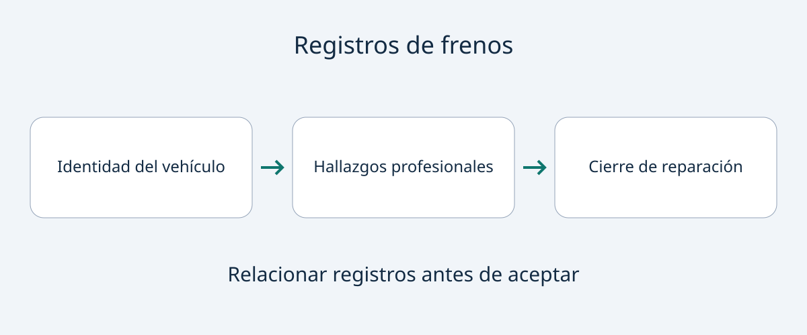

# Frenos y freno de estacionamiento: revisar los registros

«Frenos revisados» es un comienzo, no una descripción completa del estado actual. Una factura puede acreditar una reparación sin identificar el eje inspeccionado, las piezas medidas, los límites aplicados o la resolución de una avería del freno de estacionamiento. Para compradores internacionales y flotas, la tarea es relacionar vehículo, hallazgos y trabajo terminado antes de aceptar la entrega.

Esta guía recomienda documentación, no instrucciones de inspección o reparación casera. No establece espesores universales, intervalos del líquido ni umbrales legales. Los documentos orientan a un profesional competente, pero no sustituyen la inspección física ni certifican a distancia la aptitud para circular. Si persisten avisos, fugas o frenado deficiente, aplace la aceptación y solicite evaluación cualificada, sin improvisar pruebas en carretera o pendientes.

## Separar observación, reparación y comprobación final

Una observación describe lo encontrado. La factura describe trabajo cobrado o realizado. El registro posterior explica cómo comprobó el taller el resultado. Un documento puede reunir las tres cosas, pero «frenos traseros hechos» no permite presumirlas.

Pida que cada documento se vincule al VIN u otra identificación fiable, con fecha de inspección y kilometraje registrado. Solicite identidad del taller y alcance del trabajo. Son recomendaciones editoriales de compra, no campos legales universales. Si falta información, pídala en vez de convertir una factura ambigua en una garantía más amplia.

La utilidad de una factura reciente depende del alcance y del historial posterior. Pregunte si quedan quejas, avisos o trabajos pendientes relacionados con los frenos. Un documento antiguo no es necesariamente inútil; una fecha reciente no demuestra el estado presente. Identifique qué duda concreta resuelve cada registro.

## Resultados por ubicación, no solo «frenos bien»

El documento estadounidense de mantenimiento del Toyota 86 de 2024 indica que técnicos cualificados inspeccionen daños, fugas y desgaste en forros y tambores, y desgaste, alabeo y fugas en pastillas/discos. Es un ejemplo de detalle dentro de su ámbito, no prueba de que todos los vehículos tengan el mismo equipo o procedimiento. Brembo también menciona espesor mínimo, surcos, grietas, decoloración y deformación como aspectos de inspección.

Solicite un informe profesional del vehículo ofrecido que identifique componentes instalados, ubicaciones y mediciones pertinentes. Pida que el límite del fabricante aplicable y su referencia acompañen al valor medido. Un número sin identidad de la pieza o base de comparación resulta difícil de interpretar; un dato genérico de otro modelo no lo sustituye.

| Registro solicitado | Pregunta de compra que ayuda a responder |
|---|---|
| Identificación de eje y componente | ¿Qué frenos se inspeccionaron o sustituyeron? |
| Medidas, unidades y referencia del fabricante | ¿Con qué base se evaluó el estado? |
| Observaciones de fugas, daños y corrosión | ¿Qué problemas existen además del espesor? |
| Factura con piezas y trabajos | ¿Qué se cambió respecto de lo observado? |
| Comprobación final y asuntos pendientes | ¿Qué quedó resuelto y qué falta? |

La tabla no es una secuencia de inspección mecánica. Método y límites corresponden al vehículo y al taller cualificado. Si hay fotos, pida vincularlas a la unidad y a la ubicación de la pieza. Aportan contexto, pero no acreditan todas las mediciones ni condiciones ocultas.

## Líquido y corrosión de eléctricos: preguntas separadas

Cambiar pastillas no demuestra qué se hizo con el líquido. Solicite registros disponibles y una explicación del taller sobre la aplicación de las indicaciones actuales del fabricante a esa unidad. Esta guía no da un intervalo universal ni propone que el comprador abra el sistema.

El manual Model 3 en inglés para Bélgica responsabiliza al propietario de la exactitud del resumen de mantenimiento, incluidos trabajos independientes o propios. También limita la comprobación del nivel de líquido a Tesla o talleres profesionales. En ese ejemplo conviene leer el resumen junto con justificantes y dejar la comprobación a profesionales. Un manual nacional no constituye un procedimiento para todos los coches.

El manual Model 3 en inglés para Irlanda explica que la regeneración puede reducir el uso de pastillas de fricción, mientras siguen acumulándose óxido y corrosión; indica inspección visual periódica con ruedas retiradas. Es motivo para pedir evidencia profesional, no para que el comprador retire ruedas. Poco uso aparente de pastillas o propulsión eléctrica no justifican omitir la evaluación del estado de los frenos. Tampoco establece un intervalo para todos los eléctricos.

## Identificar el sistema del freno de estacionamiento

«Freno de estacionamiento eléctrico» no designa un único mecanismo. HELLA describe arquitecturas diferentes mediante ejemplos Audi A8 y BMW 7 Series. Para el comprador, la consecuencia es identificar lo instalado antes de interpretar una reparación o esperar cierto procedimiento.

La guía EPB de TRW exige profesionales formados que trabajen según especificaciones OEM y describe modo de mantenimiento diagnóstico y calibración posterior para los sistemas cubiertos. No demuestra que todos los frenos eléctricos requieran la misma herramienta externa o secuencia.

Si se declara una reparación, pida sistema, queja original, procedimiento aplicable y trabajo completado. Cuando ese procedimiento incluya modo diagnóstico o calibración, solicite constancia de su realización. Pregunte por avisos sin resolver y quejas repetidas. Son solicitudes documentales, no órdenes para accionar el freno, entrar en modo de servicio o probar su capacidad de retención por cuenta propia.

## Aclarar, corregir o aplazar

Un expediente coherente conecta el vehículo ofrecido con hallazgos, trabajos y comprobaciones. Apoya la conversación comercial, pero no es un certificado remoto de seguridad. Separe aceptación comercial y valoración profesional de uso seguro.

Si falta referencia de medida o ubicación de una pieza, solicite aclaración al taller emisor a través del vendedor. Si los documentos se contradicen, pida una explicación vinculada a la unidad, sin escoger la página más tranquilizadora. Avisos, fugas, frenado deficiente o fallos de estacionamiento pendientes justifican aplazar la aceptación y organizar evaluación cualificada y la corrección necesaria.

En flotas, conserve un expediente por vehículo. Un informe de muestra o una declaración global no demuestra la condición de cada unidad. Antes de comprometer una compra importada, confirme que un proveedor local adecuado puede atender el sistema instalado y acceder a documentación aplicable. Revise nuevamente aplicación al vehículo, versión documental y disponibilidad de servicio en el momento de comprar.

## Preguntas frecuentes

### ¿Basta una factura para aceptar la entrega?
Puede documentar trabajos, pero no es automáticamente un informe actual. Pida hallazgos y comprobaciones posteriores adecuadas, con inspección física competente cuando proceda.

### ¿Qué espesor mínimo debo exigir?
No hay valor universal aquí. El taller cualificado debe identificar pieza instalada y límite del fabricante, registrando medida y unidad junto a esa referencia.

### ¿La regeneración elimina el mantenimiento?
No. La guía Model 3 citada habla de corrosión pese al menor uso de pastillas. Aplique la documentación de la unidad real, sin suponer que un eléctrico no necesita revisión de frenos.

### ¿Todos los frenos eléctricos usan modo diagnóstico?
No lo presuponga. Sistemas y procedimientos difieren. TRW describe los que cubre su documento; solicite al taller el procedimiento específico y su registro de finalización.

## Diagrama de documentación

Diagrama original de registros que conviene relacionar, no una prueba de frenos ni un certificado de seguridad.

## Fuentes y lectura adicional

Consulta: 2026-11-05. Cada ejemplo conserva su vehículo, mercado o alcance técnico; ninguno establece requisitos universales de importación o inspección.

- [Toyota: mantenimiento estadounidense Toyota 86 de 2024](https://www.toyota.com/content/dam/toyota/brochures/pdf/2024/T-MMS-24_86.pdf)
- [ZF/TRW: guía técnica EPB](https://aftermarket.zf.com/en/media/master/downloads/xzm200.pdf)
- [HELLA: arquitecturas de freno eléctrico](https://www.hella.com/techworld/en/technical/brakes/electric-parking-brake/)
- [Tesla: mantenimiento Model 3, Bélgica, inglés](https://www.tesla.com/ownersmanual/model3/en_be/GUID-E95DAAD9-646E-4249-9930-B109ED7B1D91.html)
- [Tesla: frenado Model 3, Irlanda, inglés](https://www.tesla.com/ownersmanual/model3/en_ie/GUID-3DFFB071-C0F6-474D-8A45-17BE1A006365.html)
- [Brembo: inspección de componentes](https://asia.bremboparts.com/europe/en/support/car/maintenance/indications-and-bedding-in-90374)

Consulte [guías de compra](https://www.autobridgeexport.com/guides/) y [vehículos](https://www.autobridgeexport.com/vehicles/).
