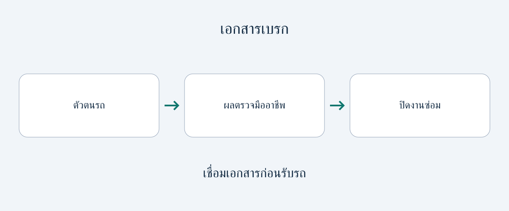

# ตรวจเอกสารเบรกและเบรกจอดก่อนซื้อรถมือสอง

คำว่า “บำรุงรักษาเบรกแล้ว” เป็นจุดเริ่มต้นที่ดี แต่ไม่ใช่คำอธิบายสภาพปัจจุบันที่ครบถ้วน ใบเสร็จอาจระบุการซ่อมโดยไม่บอกว่าได้ตรวจเพลาใด วัดชิ้นส่วนไหน ใช้เกณฑ์ใด หรือแก้ปัญหาเบรกจอดสำเร็จหรือยัง สำหรับผู้ซื้อต่างประเทศและฝ่ายจัดซื้อรถหลายคัน สิ่งสำคัญคือเชื่อมโยงตัวรถ ผลตรวจ และงานที่เสร็จแล้วก่อนยอมรับการส่งมอบ

คู่มือนี้แนะนำชุดเอกสาร ไม่ใช่วิธีตรวจหรือซ่อมด้วยตนเอง ไม่มีค่าความหนาผ้าเบรกหรือจานเบรก รอบเปลี่ยนน้ำมันเบรก หรือเกณฑ์ผ่านตามกฎหมายที่ใช้กับรถทุกคัน เอกสารช่วยให้ผู้เชี่ยวชาญเข้าใจประวัติ แต่ไม่แทนการตรวจรถจริงหรือรับรองความพร้อมใช้ถนนจากระยะไกล หากยังมีไฟเตือน การรั่ว หรือเบรกทำงานไม่ดี ควรเลื่อนการรับรถและขอการประเมินจากผู้มีคุณสมบัติ ไม่ทดลองขับหรือทดสอบบนทางลาดเอง

## แยกสิ่งที่พบ งานซ่อม และการตรวจหลังซ่อม

บันทึกสิ่งที่พบอธิบายผลสังเกต ใบเสร็จอธิบายงานที่คิดเงินหรือทำแล้ว ส่วนบันทึกหลังซ่อมอธิบายว่าอู่ตรวจผลอย่างไร เอกสารฉบับเดียวอาจรวมทั้งหมด แต่ข้อความว่า “ทำเบรกหลังแล้ว” ไม่ควรถูกตีความว่าครบทั้งสามส่วน

ขอให้ผู้ขายเชื่อมแต่ละเอกสารกับ VIN หรือข้อมูลระบุตัวรถที่เชื่อถือได้ พร้อมวันตรวจและเลขระยะทางที่บันทึก ขอชื่ออู่และขอบเขตงานด้วย สิ่งเหล่านี้เป็นคำแนะนำการจัดซื้อ ไม่ใช่ช่องข้อมูลบังคับตามกฎหมายทั่วโลก หากข้อมูลขาด ควรถามเพิ่ม ไม่ตีความใบเสร็จที่คลุมเครือให้กลายเป็นการรับประกันที่กว้างกว่า

ประโยชน์ของใบเสร็จล่าสุดขึ้นอยู่กับขอบเขตงานและประวัติหลังจากนั้น ถามว่ายังมีข้อร้องเรียน ไฟเตือน หรืองานเบรกค้างอยู่หรือไม่ เอกสารเก่าไม่ได้ไร้ประโยชน์เสมอ และวันที่ใหม่ไม่ได้ยืนยันสภาพปัจจุบันโดยอัตโนมัติ ควรระบุให้ได้ว่าแต่ละรายการตอบข้อสงสัยในการซื้อเรื่องใด

## ขอผลตามตำแหน่ง ไม่ใช่เพียง “เบรกดี”

เอกสารบำรุงรักษาสหรัฐฯ สำหรับ Toyota 86 ปี 2024 ระบุให้ช่างที่มีคุณสมบัติตรวจความเสียหาย การรั่ว และการสึกของวัสดุเสียดทานกับดรัม รวมถึงการสึก ระยะส่าย และการรั่วของผ้าเบรก/จานเบรก นี่เป็นตัวอย่างความละเอียดในขอบเขตของเอกสาร ไม่ได้บอกว่ารถทุกคันมีชิ้นส่วนหรือวิธีเดียวกัน Brembo ยังระบุความหนาขั้นต่ำ รอยขูด รอยร้าว สีผิวเปลี่ยน และการเสียรูปเป็นประเด็นตรวจ

สำหรับรถคันที่เสนอขาย ขอรายงานจากผู้เชี่ยวชาญที่ระบุชิ้นส่วนติดตั้ง ตำแหน่ง และค่าที่วัด พร้อมให้ผู้ตรวจบันทึกขีดจำกัดของผู้ผลิตที่ใช้จริงกับแหล่งอ้างอิงข้างค่าที่วัด ตัวเลขที่ไม่ระบุชิ้นส่วนหรือเกณฑ์เทียบตีความได้ยาก และตัวเลขทั่วไปจากรถคนละรุ่นใช้แทนไม่ได้

| เอกสารที่ควรขอ | คำถามในการซื้อที่ช่วยตอบ |
|---|---|
| ระบุเพลาและชิ้นส่วน | ตรวจหรือเปลี่ยนเบรกตำแหน่งใด? |
| ค่าวัด หน่วย และอ้างอิงผู้ผลิต | ใช้อะไรตัดสินสภาพ? |
| บันทึกรั่ว เสียหาย และกัดกร่อน | มีปัญหาอะไรนอกจากความหนา? |
| ใบเสร็จระบุอะไหล่และงาน | แก้อะไรตามผลที่พบ? |
| ตรวจหลังซ่อมและรายการค้าง | อะไรเสร็จแล้วและอะไรยังต้องทำ? |

ตารางไม่ใช่ลำดับตรวจทางกล วิธีและขีดจำกัดที่เหมาะสมขึ้นอยู่กับรถและอู่ที่มีคุณสมบัติ หากมีภาพถ่าย ควรให้เชื่อมกับตัวรถและตำแหน่งชิ้นส่วน ภาพช่วยอธิบายบริบท แต่ไม่พิสูจน์ค่าที่วัดทั้งหมดหรือสภาพส่วนที่มองไม่เห็น

## น้ำมันเบรกและการกัดกร่อนในรถไฟฟ้าต้องถามแยก

การเปลี่ยนผ้าเบรกไม่ได้บอกว่าทำอะไรกับน้ำมันเบรก ขอประวัติบริการที่มีและคำอธิบายจากอู่ว่าคำแนะนำปัจจุบันของผู้ผลิตใช้กับรถคันนี้อย่างไร บทความไม่กำหนดรอบเปลี่ยนทั่วไปหรือแนะนำให้ผู้ซื้อเปิดระบบเอง

คู่มือ Model 3 ภาษาอังกฤษสำหรับเบลเยียมระบุว่าเจ้าของรับผิดชอบความถูกต้องของสรุปบำรุงรักษา รวมทั้งงานอู่อิสระและงานที่ทำเอง อีกทั้งจำกัดการตรวจระดับน้ำมันเบรกให้ Tesla หรืออู่มืออาชีพ ในตัวอย่างนี้ควรอ่านสรุปพร้อมหลักฐานงาน และให้ผู้เชี่ยวชาญทำการตรวจที่ระบุ ไม่ขยายคู่มือของตลาดหนึ่งเป็นขั้นตอนสำหรับรถทุกคัน

คู่มือ Model 3 ภาษาอังกฤษสำหรับไอร์แลนด์อธิบายว่าการเบรกคืนพลังงานอาจลดการใช้ผ้าเบรกเสียดทาน แต่สนิมและการกัดกร่อนยังสะสมได้ และระบุการตรวจด้วยสายตาเป็นระยะโดยถอดล้อ การอ้างข้อมูลนี้มีไว้เพื่อขอหลักฐานจากผู้เชี่ยวชาญ ไม่ใช่สั่งให้ผู้ซื้อถอดล้อเอง ผ้าเบรกที่ดูใช้น้อยหรือระบบขับเคลื่อนไฟฟ้าไม่ใช่เหตุผลให้ข้ามคำถามเรื่องสภาพเบรก และแหล่งนี้ไม่ได้กำหนดช่วงตรวจเดียวสำหรับรถไฟฟ้าทุกคัน

## รู้จักระบบเบรกจอดก่อนตีความงานซ่อม

“เบรกจอดไฟฟ้า” ไม่ได้หมายถึงกลไกแบบเดียว HELLA อธิบายโครงสร้างต่างกันผ่านตัวอย่าง Audi A8 และ BMW 7 Series ผู้ซื้อจึงควรระบุระบบที่ติดตั้งจริงก่อนประเมินคำอธิบายการซ่อมหรือคาดหวังขั้นตอนแบบใดแบบหนึ่ง

คู่มือ EPB ของ TRW กำหนดงานโดยผู้เชี่ยวชาญที่ผ่านการฝึกและเป็นไปตามสเปก OEM พร้อมอธิบายโหมดบำรุงรักษาผ่านการวินิจฉัยและการปรับเทียบหลังซ่อมสำหรับระบบที่ครอบคลุม ไม่ได้แปลว่าเบรกจอดไฟฟ้าทุกแบบต้องใช้เครื่องมือภายนอกหรือขั้นตอนเหมือนกัน

หากแจ้งว่าซ่อมเบรกจอดแล้ว ขอให้ระบุระบบ อาการเดิม ขั้นตอนที่ใช้ และงานเสร็จ หากขั้นตอนนั้นมีโหมดวินิจฉัยหรือการปรับเทียบ ให้ขอหลักฐานว่าทำครบ และถามถึงไฟเตือนที่ยังอยู่หรืออาการซ้ำ นี่คือการขอเอกสารมืออาชีพ ไม่ใช่คำสั่งให้ใช้งานเบรก เข้าโหมดบริการ หรือทดสอบการยึดรถด้วยตนเอง

## ขอคำอธิบาย แก้ไข หรือเลื่อนรับรถ

ชุดเอกสารที่สอดคล้องกันเชื่อมรถที่เสนอขายกับสิ่งที่พบ งานซ่อม และการตรวจภายหลัง ช่วยในการตัดสินใจทางการค้า แต่ไม่ใช่ใบรับรองความปลอดภัยระยะไกล ควรแยกการยอมรับทางการค้าออกจากความเห็นผู้เชี่ยวชาญว่าใช้รถได้อย่างปลอดภัยหรือไม่

หากขาดแหล่งอ้างอิงค่าวัดหรือตำแหน่งชิ้นส่วน ให้ขอผู้ขายสอบถามอู่ผู้ออกเอกสาร หากเอกสารขัดกัน ควรขอคำอธิบายเฉพาะรถ ไม่เลือกเพียงหน้าที่ดูน่าอุ่นใจ หากไฟเตือน การรั่ว เบรกไม่ดี หรือข้อกังวลเบรกจอดยังไม่แก้ ควรเลื่อนรับมอบและจัดการประเมินกับการแก้ไขที่จำเป็นโดยผู้มีคุณสมบัติ

การซื้อเป็นกองรถควรเก็บเอกสารรายคัน รายงานตัวอย่างหรือคำรับรองรวมไม่พิสูจน์สภาพทุกคัน ก่อนผูกพันซื้อรถนำเข้า ควรยืนยันด้วยว่าผู้ให้บริการท้องถิ่นที่เหมาะสมดูแลระบบที่ติดตั้งและเข้าถึงเอกสารที่ใช้ได้ ตรวจซ้ำเรื่องความตรงกับตัวรถ ฉบับเอกสาร และบริการที่มีจริง ณ เวลาซื้อ

## คำถามที่พบบ่อย

### ใบเสร็จพอให้ยอมรับการส่งมอบหรือไม่?
อาจยืนยันงานได้ แต่ไม่ใช่รายงานสภาพปัจจุบันโดยอัตโนมัติ ขอผลตรวจและการตรวจหลังซ่อมที่เหมาะสม รวมถึงตรวจรถจริงโดยผู้เชี่ยวชาญเมื่อจำเป็น

### ควรขอความหนาขั้นต่ำเท่าไร?
ไม่มีค่ากลางในคู่มือนี้ อู่ที่มีคุณสมบัติควรระบุชิ้นส่วนและขีดจำกัดผู้ผลิต แล้วบันทึกค่ากับหน่วยเทียบอ้างอิงนั้น

### เบรกคืนพลังงานทำให้ไม่ต้องบำรุงรักษาหรือไม่?
ไม่ใช่ คู่มือ Model 3 ที่อ้างกล่าวถึงการกัดกร่อนแม้ผ้าเบรกใช้น้อย ใช้คำแนะนำของรถจริง ไม่สมมติว่ารถไฟฟ้าทุกคันไม่ต้องตรวจเบรก

### เบรกจอดไฟฟ้าทุกแบบต้องใช้โหมดวินิจฉัยหรือไม่?
ไม่ควรสมมติ ระบบและขั้นตอนต่างกัน TRW อธิบายระบบในขอบเขตเอกสาร จึงควรขอขั้นตอนเฉพาะรถและบันทึกการทำงานจากอู่

## แผนภาพเอกสาร

แผนภาพที่จัดทำขึ้นใหม่แสดงบันทึกที่ควรเชื่อมโยง ไม่ใช่การทดสอบเบรกหรือใบรับรองความปลอดภัย

## แหล่งข้อมูลและอ่านเพิ่มเติม

ตรวจสอบเมื่อ 2026-11-05 แต่ละตัวอย่างจำกัดตามรถ ตลาด หรือขอบเขตเทคนิคของตน ไม่สร้างข้อกำหนดนำเข้าหรือตรวจสภาพที่ใช้ทั่วโลก

- [Toyota: การบำรุงรักษา Toyota 86 ปี 2024 ในสหรัฐฯ](https://www.toyota.com/content/dam/toyota/brochures/pdf/2024/T-MMS-24_86.pdf)
- [ZF/TRW: คู่มือเทคนิค EPB](https://aftermarket.zf.com/en/media/master/downloads/xzm200.pdf)
- [HELLA: โครงสร้างเบรกจอดไฟฟ้า](https://www.hella.com/techworld/en/technical/brakes/electric-parking-brake/)
- [Tesla: บำรุงรักษา Model 3 ภาษาอังกฤษสำหรับเบลเยียม](https://www.tesla.com/ownersmanual/model3/en_be/GUID-E95DAAD9-646E-4249-9930-B109ED7B1D91.html)
- [Tesla: เบรก Model 3 ภาษาอังกฤษสำหรับไอร์แลนด์](https://www.tesla.com/ownersmanual/model3/en_ie/GUID-3DFFB071-C0F6-474D-8A45-17BE1A006365.html)
- [Brembo: การตรวจชิ้นส่วน](https://asia.bremboparts.com/europe/en/support/car/maintenance/indications-and-bedding-in-90374)

อ่าน [คู่มือการซื้อ](https://www.autobridgeexport.com/guides/) และ [ข้อมูลรถยนต์](https://www.autobridgeexport.com/vehicles/) เพิ่มเติม
