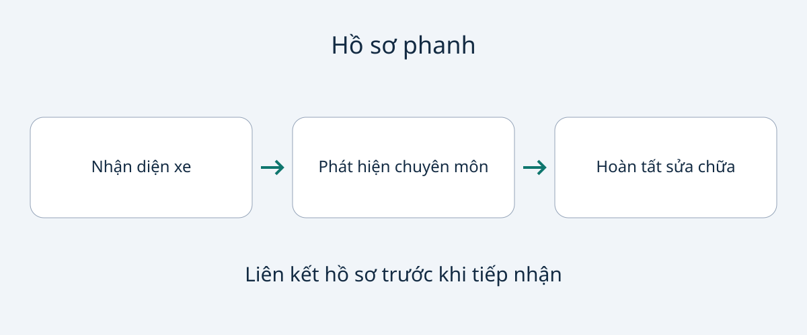

# Hồ sơ phanh và phanh đỗ khi mua xe đã qua sử dụng

“Đã bảo dưỡng phanh” là điểm khởi đầu, chưa phải mô tả đầy đủ tình trạng hiện tại. Hóa đơn có thể ghi sửa chữa nhưng không nói trục nào được kiểm tra, bộ phận nào được đo, giới hạn nào được áp dụng hoặc lỗi phanh đỗ đã hết chưa. Với người mua quốc tế và đội xe, nhiệm vụ là liên kết chiếc xe, phát hiện kiểm tra và công việc hoàn tất trước khi nhận bàn giao.

Hướng dẫn này đề xuất hồ sơ bằng chứng, không phải quy trình tự kiểm tra hay sửa chữa. Không có độ dày má/đĩa, chu kỳ dầu phanh hoặc ngưỡng pháp lý chung cho mọi xe. Tài liệu hỗ trợ chuyên gia hiểu lịch sử nhưng không thay kiểm tra trực tiếp hoặc chứng nhận từ xa xe đủ an toàn lưu thông. Nếu cảnh báo, rò rỉ hoặc phanh kém chưa được xử lý, nên hoãn chấp nhận và yêu cầu đánh giá chuyên môn, không tự thử trên đường hay trên dốc.

## Phân biệt phát hiện, sửa chữa và kiểm tra sau sửa

Phát hiện mô tả điều quan sát được. Hóa đơn mô tả công việc tính phí hoặc đã làm. Hồ sơ sau sửa giải thích xưởng đã kiểm tra kết quả thế nào. Một tài liệu có thể chứa cả ba, nhưng “đã làm phanh sau” không tự chứng minh đủ các phần.

Đề nghị người bán gắn mỗi tài liệu với VIN hoặc mã nhận diện đáng tin cậy, ngày kiểm tra và số công-tơ-mét ghi nhận. Xin tên xưởng và phạm vi công việc. Đây là khuyến nghị mua hàng của ban biên tập, không phải trường thông tin pháp lý phổ quát. Thiếu thông tin thì hỏi bổ sung, thay vì diễn giải hóa đơn mơ hồ thành cam kết mạnh hơn.

Giá trị của hóa đơn gần đây phụ thuộc phạm vi và lịch sử sử dụng sau đó. Hỏi xem còn phản ánh, cảnh báo hay công việc về phanh nào chưa được xử lý xong. Tài liệu cũ không hẳn vô ích; ngày mới không tự chứng minh tình trạng hiện tại. Điều cần biết là mỗi tài liệu giải đáp nghi vấn mua hàng nào.

## Xin kết quả theo vị trí, không chỉ “phanh tốt”

Tài liệu bảo dưỡng tại Mỹ cho Toyota 86 đời 2024 yêu cầu kỹ thuật viên đủ năng lực kiểm tra hư hỏng, rò rỉ và mòn ở bố phanh và tang trống; kiểm tra mòn, độ đảo và rò rỉ ở má/đĩa. Đây là ví dụ về độ chi tiết của một nguồn cụ thể, không nói mọi xe đều có cùng phần cứng hoặc quy trình. Brembo cũng nêu độ dày tối thiểu, rãnh xước, nứt, đổi màu bề mặt và biến dạng là các vấn đề cần xem xét.

Với xe chào bán, hãy xin báo cáo chuyên môn xác định bộ phận đang lắp, vị trí và số đo liên quan. Đề nghị xưởng ghi giới hạn đúng của nhà sản xuất cùng tài liệu tham chiếu bên cạnh số đo. Một con số thiếu danh tính phụ tùng hoặc cơ sở đối chiếu khó diễn giải; số chung lấy từ mẫu khác không thay thế được.

| Hồ sơ đề nghị | Câu hỏi mua xe được hỗ trợ |
|---|---|
| Nhận diện trục và bộ phận | Đã kiểm tra hoặc thay phanh ở đâu? |
| Số đo, đơn vị và tham chiếu hãng | Xưởng đánh giá tình trạng theo cơ sở nào? |
| Quan sát rò rỉ, hỏng và ăn mòn | Ngoài độ dày còn vấn đề gì? |
| Hóa đơn ghi phụ tùng và công việc | Đã thay đổi gì so với phát hiện ban đầu? |
| Kiểm tra sau sửa và việc còn mở | Điều gì đã giải quyết, điều gì còn lại? |

Bảng không phải trình tự kiểm tra cơ khí. Phương pháp và giới hạn phù hợp thuộc về xe cụ thể và xưởng đủ năng lực. Nếu có ảnh, đề nghị gắn với chiếc xe và vị trí bộ phận. Ảnh bổ sung bối cảnh nhưng không tự chứng minh toàn bộ số đo hay tình trạng khuất bên trong.

## Dầu phanh và ăn mòn trên xe điện cần hỏi riêng

Thay má phanh không cho biết đã làm gì với dầu phanh. Xin hồ sơ dịch vụ hiện có và lời giải thích của xưởng về cách hướng dẫn hiện hành của hãng áp dụng cho xe này. Bài viết không đưa chu kỳ thay chung hoặc khuyến khích người mua mở hệ thống.

Sổ tay Model 3 tiếng Anh dành cho Bỉ quy trách nhiệm cho chủ xe về độ chính xác của bản tóm tắt bảo dưỡng, kể cả việc làm ở xưởng độc lập hoặc tự làm. Tài liệu cũng giới hạn việc kiểm tra mức dầu phanh cho Tesla hoặc xưởng chuyên nghiệp. Trong ví dụ đó, nên đọc tóm tắt cùng chứng từ công việc và để chuyên gia thực hiện kiểm tra quy định. Không biến tài liệu của một thị trường thành quy trình cho mọi xe.

Sổ tay Model 3 tiếng Anh dành cho Ireland nói phanh tái sinh có thể giảm tần suất dùng má ma sát nhưng gỉ và ăn mòn vẫn tích tụ; tài liệu yêu cầu kiểm tra trực quan định kỳ với bánh xe được tháo. Đây là lý do xin bằng chứng chuyên môn, không hướng dẫn người mua tháo bánh. Má có vẻ ít dùng hoặc hệ truyền động điện không phải lý do bỏ qua tình trạng phanh. Nguồn này cũng không đặt chu kỳ chung cho tất cả xe điện.

## Nhận diện hệ thống phanh đỗ trước khi đọc sửa chữa

“Phanh đỗ điện” không chỉ một cơ cấu duy nhất. HELLA mô tả kiến trúc khác nhau qua Audi A8 và BMW 7 Series. Ý nghĩa với người mua là xác định hệ thống thực lắp trước khi diễn giải công việc hoặc kỳ vọng một quy trình.

Hướng dẫn EPB của TRW yêu cầu chuyên gia được đào tạo làm theo thông số OEM, đồng thời mô tả chế độ bảo dưỡng chẩn đoán và hiệu chuẩn sau sửa cho các hệ thống mà tài liệu bao phủ. Nó không chứng minh mọi phanh đỗ điện cần cùng máy chẩn đoán ngoài hoặc cùng thứ tự thao tác.

Nếu có sửa phanh đỗ, xin xưởng xác định hệ thống, triệu chứng ban đầu, quy trình áp dụng và công việc hoàn tất. Khi quy trình có chế độ chẩn đoán hoặc hiệu chuẩn, xin bằng chứng đã thực hiện. Hỏi về cảnh báo chưa hết hay khiếu nại lặp lại. Đây là yêu cầu hồ sơ chuyên môn, không phải lệnh tự vận hành phanh, vào chế độ dịch vụ hoặc thử khả năng giữ xe.

## Làm rõ, khắc phục hoặc hoãn tiếp nhận

Hồ sơ nhất quán nối xe được bán với phát hiện, sửa chữa và kiểm tra sau đó. Nó hỗ trợ thảo luận mua hàng, không phải chứng chỉ an toàn từ xa. Nên tách quyết định tiếp nhận thương mại khỏi đánh giá chuyên môn về an toàn sử dụng.

Nếu thiếu tham chiếu đo hoặc vị trí bộ phận, nhờ người bán hỏi lại xưởng phát hành. Nếu tài liệu mâu thuẫn, xin giải thích gắn với chiếc xe thay vì chọn trang khiến mình yên tâm hơn. Cảnh báo, rò rỉ, phanh kém hay lỗi phanh đỗ chưa giải quyết là lý do hoãn nhận bàn giao và bố trí đánh giá chuyên môn cùng khắc phục cần thiết.

Với đội xe, lưu hồ sơ riêng từng chiếc. Báo cáo mẫu hoặc tuyên bố chung không chứng minh tình trạng mọi đơn vị. Trước khi cam kết mua xe nhập khẩu, cũng cần xác nhận cơ sở địa phương phù hợp có thể hỗ trợ hệ thống thực lắp và lấy tài liệu áp dụng. Kiểm tra lại tính phù hợp với xe, phiên bản tài liệu và dịch vụ hiện có tại thời điểm mua.

## Câu hỏi thường gặp

### Hóa đơn có đủ để chấp nhận bàn giao không?
Hóa đơn có thể chứng minh công việc, không tự là báo cáo hiện trạng. Xin phát hiện, kiểm tra sau sửa phù hợp và kiểm tra thực tế bởi người có năng lực khi cần.

### Nên yêu cầu độ dày tối thiểu bao nhiêu?
Không có số chung ở đây. Xưởng đủ năng lực cần xác định bộ phận lắp và giới hạn hãng, rồi ghi số đo, đơn vị cùng tham chiếu.

### Phanh tái sinh có loại bỏ bảo dưỡng không?
Không. Hướng dẫn Model 3 được dẫn nói rõ về ăn mòn dù má ít hoạt động. Áp dụng tài liệu của xe thực tế, không mặc định xe điện miễn kiểm tra phanh.

### Mọi phanh đỗ điện đều cần chế độ chẩn đoán?
Không nên giả định. Hệ thống và quy trình khác nhau. TRW nói về hệ thống trong tài liệu; hãy xin quy trình riêng của xe và hồ sơ hoàn tất từ xưởng.

## Sơ đồ hồ sơ

Sơ đồ tự thiết kế về hồ sơ cần liên kết, không phải thử phanh hay chứng nhận an toàn.

## Nguồn và đọc thêm

Kiểm tra ngày 2026-11-05. Mỗi ví dụ giữ phạm vi xe, thị trường hoặc kỹ thuật riêng; không tạo yêu cầu nhập khẩu hay kiểm tra chung.

- [Toyota: bảo dưỡng Toyota 86 đời 2024 tại Mỹ](https://www.toyota.com/content/dam/toyota/brochures/pdf/2024/T-MMS-24_86.pdf)
- [ZF/TRW: hướng dẫn kỹ thuật EPB](https://aftermarket.zf.com/en/media/master/downloads/xzm200.pdf)
- [HELLA: kiến trúc phanh đỗ điện](https://www.hella.com/techworld/en/technical/brakes/electric-parking-brake/)
- [Tesla: bảo dưỡng Model 3, Bỉ, tiếng Anh](https://www.tesla.com/ownersmanual/model3/en_be/GUID-E95DAAD9-646E-4249-9930-B109ED7B1D91.html)
- [Tesla: phanh Model 3, Ireland, tiếng Anh](https://www.tesla.com/ownersmanual/model3/en_ie/GUID-3DFFB071-C0F6-474D-8A45-17BE1A006365.html)
- [Brembo: kiểm tra bộ phận](https://asia.bremboparts.com/europe/en/support/car/maintenance/indications-and-bedding-in-90374)

Xem [hướng dẫn mua xe](https://www.autobridgeexport.com/guides/) và [các mẫu xe](https://www.autobridgeexport.com/vehicles/).
