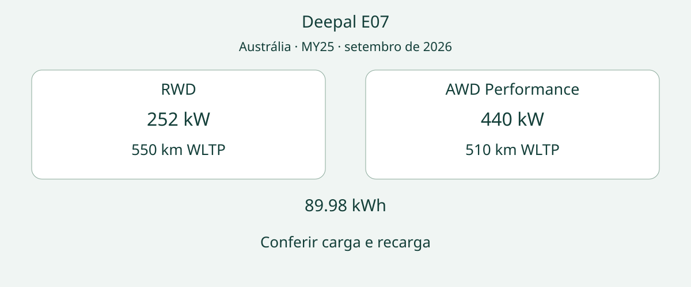

# Deepal E07 MY25 na Austrália: RWD ou AWD Performance para seu uso?

A pergunta útil sobre o Deepal E07 não é apenas se um SUV elétrico pode parecer uma picape, mas se a traseira reconfigurável resolve uma necessidade real de transporte. Na referência australiana, RWD oferece a maior autonomia combinada estimada WLTP, enquanto AWD Performance tem mais potência e torque. Ambas exigem conferir dimensões da carga, recarga e documentos da unidade.

A referência é a ficha DEEPAL Australia MY25, edição v1:2, dados de setembro de 2026, código DPL7855/MY25/09.26. A publicação não transforma MY25 em MY26. Anos usados em títulos de avaliações também não substituem essa identificação. Trata-se do E07 elétrico de cinco lugares da geração inicial australiana, sem presumir equivalência com veículos de outros mercados.

## Começar pelos objetos transportados

O vidro traseiro e a tampa alteram o acesso à carga. Assim, o formato dos seus equipamentos importa mais que uma foto chamativa. Meça os objetos, defina quando os bancos traseiros precisam permanecer disponíveis e peça uma demonstração conforme as instruções oficiais. Uma configuração aberta fotografada não significa que seja autorizada para circular.

A ficha informa 131 litros na dianteira, 524 litros na área traseira fechada e 1654 litros com os bancos traseiros rebatidos. São volumes, não capacidade de carga em peso nem prova de que caiba determinada quantidade de caixas. Peça medidas de abertura e piso e trate os limites de peso separadamente. O nome “Multitruck” não comprova que substitua uma picape de trabalho em qualquer tarefa.

## Comparar as versões

Fonte: [ficha técnica DEEPAL Australia](https://www.deepal.com.au/media/gzupdrje/deepal_e07_spec_sheet_web.pdf), MY25, edição v1:2 de setembro de 2026. As duas colunas representam o E07 elétrico da geração inicial australiana. WLTP aplica-se somente à autonomia combinada estimada em laboratório; os demais valores são especificações técnicas.

| Parâmetro | E07 RWD | E07 AWD Performance |
|---|---|---|
| Tração | Traseira | Integral |
| Bateria | 89.98 kWh | 89.98 kWh |
| Química | Lítio ternário | Lítio ternário |
| Potência | 252 kW | 440 kW |
| Torque | 365 Nm | 645 Nm |
| Autonomia combinada estimada WLTP | 550 km | 510 km |
| Recarga AC máxima | 7 kW | 7 kW |
| Recarga DC máxima | 240 kW | 240 kW |
| Conexões | Type 2 AC; CCS2 DC | Type 2 AC; CCS2 DC |

RWD é o ponto inicial para quem prioriza a autonomia declarada. AWD Performance atende à preferência por mais potência e torque, com tração integral. A bateria comum não torna os números de autonomia intercambiáveis, e o nome AWD não prova aptidão para uma trilha específica. Mais potência não melhora necessariamente todos os aspectos de uso.

As estimativas WLTP não garantem a mesma distância com reboque, carga completa ou determinada condição climática. Não se apresenta aqui uma estimativa de autonomia real sem evidências. Para planejar trajetos, identifique locais compatíveis e alternativas caso a parada de recarga prevista não esteja disponível.

## Potência máxima não é plano de recarga

A ficha anuncia até 240 kW DC e 15 minutos para a faixa de 30–80%. São valores do fabricante para esse intervalo, não uma carga completa, uma potência mantida durante toda a sessão ou uma promessa em qualquer estação. Pergunte pelas condições da afirmação do vendedor e pela adequação da infraestrutura planejada.

O máximo AC indicado é 7 kW, com Type 2 para AC e CCS2 para DC. Contudo, descrições oficiais divergem quanto ao tempo AC, por isso não há uma duração definitiva de carga completa nesta comparação. Peça esclarecimento à DEEPAL ou ao fornecedor responsável para o veículo e a instalação. Não organize a recarga noturna apenas escolhendo o prazo publicado mais conveniente. Potência máxima e tempo decorrido são grandezas distintas.

## Conferir tamanho e reboque separadamente

As medidas são 5045 mm de comprimento, 1996 mm de largura e 1680 mm de altura, com entre-eixos de 3120 mm. Verifique vaga, acesso e área de carga. A classificação SUV não garante facilidade de acomodação. Uma demonstração permite sua própria avaliação, não representa um teste da AutoBridge.

As duas versões informam reboque máximo de 1500 kg com freio e 750 kg sem freio. São especificações australianas, não aprovação no destino nem cálculo para uma combinação carregada específica. Solicite documentos de peso e reboque, informações dos equipamentos adequados e as regras locais. Não derive capacidade de carga pela subtração de massas não conciliadas nem trate capacidade de plataforma parada como limite de transporte rodoviário.

## Incluir uso cotidiano e suporte

A ficha descreve suspensão dianteira de duplo braço triangular, traseira multibraço e suspensão pneumática. Também lista tela sensível ao toque de 15.4 polegadas e projeção de informações no para-brisa. Isso sugere perguntas sobre comandos e manutenção, não comprova determinada qualidade de rodagem. Experimente as funções relevantes e pergunte quem pode atender a unidade no destino.

O equipamento previsto é um kit de reparo de pneus, não um estepe. Para viagens longe de assistência fácil, confirme o que será entregue e o apoio disponível. A lista de equipamentos não ensina reparos nem garante que o kit resolva qualquer problema de pneu.

## Perguntas antes de decidir

### A data de setembro de 2026 significa ano-modelo 2026?

Não. O código do documento traz MY25. Confira identidade e fabricação da unidade em vez de trocar a identificação pelo ano da publicação.

### AWD Performance tem a maior autonomia declarada?

Não: 510 km combinados estimados WLTP, contra 550 km da RWD. AWD Performance informa mais potência e torque.

### O volume permite determinar a capacidade de carga em peso?

Não. Litros descrevem espaço. Peça limites de peso e documentos de carregamento da unidade exata.

### A ficha australiana basta para comprar de outro país?

Não. Disponibilidade, preço, exportação, registro, garantia e assistência local exigem confirmações próprias. Não há comprovação de equivalência com o mercado chinês ou de outra motorização. Adie o sinal se o vendedor não relacionar tração, recarga e documentos de carga à unidade oferecida.

Informe versão, referência MY25, objetos e plano de recarga e peça comprovação vinculada ao VIN. Consulte a [seleção de veículos](https://www.autobridgeexport.com/vehicles/) e os [guias de compra](https://www.autobridgeexport.com/guides/).

## Diagrama de referência

Dois cartões comparam as versões E07 com bateria comum e verificações de carga e recarga.

## Fontes e verificação

Fontes verificadas em 2026-11-05. Os números vêm da ficha australiana; a página do modelo descreve a traseira. O portal oferece acesso ao manual oficial, sem reprodução de procedimentos aqui. Avaliações independentes fornecem contexto australiano, não experiência da AutoBridge ou prova de outro ano-modelo.

- [DEEPAL Australia: ficha MY25, setembro de 2026](https://www.deepal.com.au/media/gzupdrje/deepal_e07_spec_sheet_web.pdf)
- [DEEPAL Australia: página E07](https://www.deepal.com.au/vehicles/deepal/e07/)
- [DEEPAL Australia: portal de manuais](https://www.deepal.com.au/ownership/owners-manual/)
- [CarExpert: avaliação E07 Multitruck](https://www.carexpert.com.au/car-reviews/2026-deepal-e07-multitruck-review)
- [Wheels Media: praticidade do E07](https://www.whichcar.com.au/reviews/2025-deepal-e07-review-multitruck-suv)
- [carsales: avaliação E07](https://www.carsales.com.au/editorial/details/deepal-e07-2025-review-150321/)
