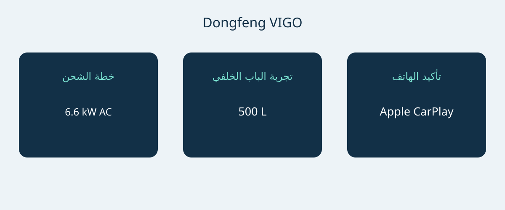

# دونغفنغ VIGO: الشحن والأمتعة في مواصفات نيوزيلندا

تحتاج دونغفنغ VIGO إلى تقييم عملي بدل اتخاذ القرار من رقم واحد للمدى. يجمع المرجع النيوزيلندي بين الدفع الكهربائي بالبطارية والدفع الأمامي وباب خلفي مقسوم وأبعاد مدمجة. تعتمد فائدتها على سهولة الشحن وتحميل الأغراض اليومية واتصال الهاتف المستخدم فعلًا. من الأفضل حسم هذه الأسئلة على السيارة المعروضة قبل الاتفاق على حزمة الشراء النهائية.

يعتمد المقال على كتيب نيوزيلندا بإصدار أكتوبر 2026 وصفحة الطراز الرسمية المحلية. تاريخ الكتيب ليس إعلانًا عن سنة طراز من المصنع. المرجع هو تكوين الدفع الأمامي ببطارية 51.87 kWh، المسمى Standard في الكتيب؛ لا تمنحه أسماء فئات أسواق أخرى. اطلب VIN وتاريخ الإنتاج والمواصفات الأصلية. لا تعتبر تجهيزات ماليزيا أو هونغ كونغ أو سنغافورة أو الصين متطابقة لمجرد تشابه الاسم أو المظهر.

## ابدأ بخطة الشحن اليومية

يسرد المرجع بطارية LFP بسعة 51.87 kWh ومحركًا بقدرة 120 kW وعزم 230 Nm. يعلن المصنع تسارع 0–100 km/h في 7.8 ثانية. الأرقام تخص التجهيز المذكور، لا كل سيارة تحمل اسم VIGO. المدى المعلن 471 km CLTC. أبقِ CLTC مع الرقم؛ فهو ليس نتيجة WLTP مستقلة أو ضمانًا لمسافة الرحلة الواقعية.

يصف الكتيب أيضًا تحويلًا للمدى باستخدام حاسبة حكومية نيوزيلندية. التحويل لا يثبت إجراء اختبار WLTP مستقل. للمقارنة مع سيارة أخرى، اطلب أساس الاختبار المعني بدل ترتيب دورات مختلفة في قائمة واحدة. خطط للطريق وفق محطات الشحن وظروف الاستخدام، دون تحويل رقم الكتيب إلى نطاق يومي مضمون.

| البند المرجعي لنيوزيلندا | القيمة |
|---|---|
| منظومة الحركة والدفع | كهربائية بالبطارية؛ أمامي |
| البطارية | 51.87 kWh LFP |
| قدرة المحرك القصوى | 120 kW |
| العزم الأقصى | 230 Nm |
| تسارع المصنع 0–100 km/h | 7.8 ثانية |
| المدى المعلن | 471 km CLTC |
| الشحن AC الأقصى | 6.6 kW |
| الشحن DC الأقصى | 167 kW |
| نافذة الشحن المعلنة | 30–80% خلال 18 دقيقة |

المصدر: كتيب دونغفنغ نيوزيلندا أكتوبر 2026 للتجهيز المرجعي الواحد. الإصدار لا يثبت رمز سنة طراز رسميًا.

نافذة الشحن مهمة: 30–80% في 18 دقيقة لا تعني 10–80%. كما أن قدرة DC القصوى البالغة 167 kW لا تعني بلوغها أو الحفاظ عليها في كل جلسة. سجلت Auto Trader NZ ذروة أقل في اختبارها، لكن جلسة واحدة لا تثبت عيبًا عامًا أو معدلًا مضمونًا لسيارة أخرى. افصل قدرة المصنع المعلنة عن تجربة المراجع الفردية.

في المنزل أو العمل، اطلب من فني مؤهل أو المشغل تأكيد التغذية والمعدات المتوافقة. الحد AC البالغ 6.6 kW مرجع للنقاش، وليس إثباتًا لسرعة الشحن في موقع معين. للرحلات الطويلة المتكررة، افحص الشبكة المقصودة واترك وقتًا لتغير الظروف. اطلب عرضًا عمليًا على السيارة الفعلية؛ رقم الذروة لا يغني عن خطة شحن قابلة للتنفيذ.

## جرّب الباب الخلفي بأغراضك

الأبعاد 4306 × 1868 × 1654 mm، وقاعدة العجلات 2715 mm، مع خمسة مقاعد. يذكر الكتيب حجم أمتعة 500 L وحدًا أقصى 1040 L ومقاعد خلفية قابلة للطي بنسبة 60/40. تساعد هذه البيانات على دراسة المرونة، لكنها لا تثبت سهولة تحميل عربة طفل أو كرسي متحرك أو صندوق محدد.

الباب الخلفي القياسي في الكتيب مقسوم إلى جزء علوي وآخر سفلي ويعمل يدويًا. لا تفترض التشغيل الكهربائي من التصميم أو من سيارة عرض مزودة بملحق. افتح الجزأين وجرّب وضعية التحميل وافحص الوصول في الموقف المقصود. قد يؤثر الجزء السفلي في مدى اقتراب الشخص من الفتحة؛ التجربة أهم من الصورة. هذا اقتراح لفحص الاستخدام، وليس اختبارًا ميدانيًا أجرته AutoBridge.

جرّب ترتيب الركاب والأمتعة المعتاد قبل الاعتماد على طي المقاعد. إذا اقترح البائع ملحقًا كهربائيًا أو ترتيبًا آخر، فليظهر منفصلًا في العرض مع شروط التركيب والدعم. الحجم ليس حمولة وزنية، والأرقام هنا لا تثبت قدرة الجر. لا تحوّل ميزة المساحة إلى قدرة نقل غير موثقة.

## اصطحب الهاتف إلى العرض العملي

تسرد الوثائق النيوزيلندية Apple CarPlay. أما Android Auto فيوصف بأنه ملحق اختياري يركب بعد التصنيع، لا تجهيز مصنع قياسي. اسأل هل هو مركب بالفعل أو سيورَّد منفصلًا أو متاح للطلب فقط. القول العام إن السيارة تدعم الهواتف لا يجيب عن ذلك.

يذكر الكتيب شاشة وسطية 12.8 بوصة، وتذكر الصفحة الرسمية تكييفًا آليًا مع مضخة حرارية. لا يضمن أي منهما عمل التطبيقات المفضلة أو الخدمات المتصلة في وجهة أخرى. صِل الهاتف المقصود واطلب شرح التركيب ومسؤولية الدعم. احصل على تفاصيل الملحق مكتوبة؛ نجاح جهاز واحد لا يثبت التوافق مع جميع الهواتف.

## اجعل العرض خاصًا بالسيارة

- تحديد VIN وتاريخ الإنتاج ومواصفات نيوزيلندا الأصلية والتجهيز المسلم.
- فصل الباب اليدوي القياسي عن الملحق الكهربائي وتحديد مسؤولية التركيب.
- تسمية اتصال الهاتف المقدم، خصوصًا أي ملحق Android Auto.
- تأكيد معدات الشحن وتوافقها مع المواقع المزمع استخدامها.
- الحصول على شروط خدمة وضمان مكتوبة للوجهة وعرض حالي مفصل.

صفحة نيوزيلندية لا تثبت أهلية التصدير أو التسجيل أو الضرائب أو الشحن أو الضمان خارج البلاد. السعر والتوافر يحتاجان أيضًا تأكيدًا حديثًا. أجّل القرار إذا تعذر تفسير التجهيز، أو قُدم التحويل كأنه نتيجة اختبار مباشر مكافئ، أو وُصف الاتصال الاختياري بأنه قياسي. وإذا كانت السلامة عاملًا حاسمًا، فاطلب سجل التقييم المنطبق بدقة؛ هذا المقال لا يثبت تصنيف نجوم ANCAP أو Euro NCAP.

الحجة الأقوى للشراء مشروطة بثلاث نتائج: خطة شحن مناسبة، وتجربة تحميل مرضية، وتجهيز هاتف موثق. عند تحققها، يوفر المرجع النيوزيلندي أساسًا ملموسًا لعرض أكثر تفصيلًا. وإذا لم تتحقق، فلن تعالج الأرقام البارزة عدم الملاءمة للاستخدام.

## أسئلة شائعة

### هل هذه مواصفات سنة طراز رسمية؟
لا. هي مرجع نيوزيلندي من كتيب أكتوبر 2026. تحقق من هوية المصنع وبيانات إنتاج VIN بدل استنتاجها من اسم الملف.

### هل يقارن المدى مباشرة مع WLTP؟
رقم 471 km يتبع CLTC. التحويل الموصوف منفصلًا ليس اختبار WLTP مستقلًا. قارن أسس اختبار متطابقة وافصل تخطيط الرحلات الفعلية.

### هل تعني 18 دقيقة الشحن من 10–80%؟
لا، يذكر المصنع 30–80%. تبقى الظروف والمعدات مهمة، والذروة ليست قدرة مستمرة مضمونة.

### هل الباب الكهربائي وAndroid Auto قياسيان؟
الكتيب المذكور يصف بابًا مقسومًا يدويًا. Android Auto ملحق اختياري لاحق، بينما Apple CarPlay مدرج. تحقق من السيارة والفاتورة.

رسم أصلي يربط الوصول إلى الشحن واستخدام الأمتعة والتحقق من تجهيز الهاتف.

## المصادر والتحقق

تاريخ التحقق من المصادر: 2026-11-05.

- [Dongfeng NZ / Armstrongs Distribution — VIGO New Zealand brochure, October 2026 edition](https://dongfeng.co.nz/wp-content/uploads/2026/10/Dongfeng-Vigo-Brochure-Oct26-Web.pdf)
- [Dongfeng NZ / Armstrongs Distribution — VIGO New Zealand official model page](https://dongfeng.co.nz/electric-vehicles/vigo-ev/)
- [Dongfeng NZ / Armstrongs Distribution — VIGO New Zealand launch release, January 15 2026](https://dongfeng.co.nz/newsroom/new-dongfeng-vigo-breaks-barriers-to-electric-vehicle-versatility-with-best-value-ev-suv-in-new-zealand/)
- [NZME / Driven Car Guide — VIGO review: sit, sleep and drive, March 9 2026](https://www.drivencarguide.co.nz/reviews/dongfeng-vigo-review-sit-sleep-and-drive/)
- [CarExpert — VIGO Quick Drive, February 19 2026](https://www.carexpert.co.nz/car-reviews/dongfeng-vigo-review-quick-drive)
- [Auto Trader NZ — VIGO review, April 11 2026](https://autotrader.co.nz/car-reviews/2026-dongfeng-vigo-review)

[استكشف السيارات](https://www.autobridgeexport.com/vehicles/) · [اقرأ أدلة الشراء](https://www.autobridgeexport.com/guides/)
