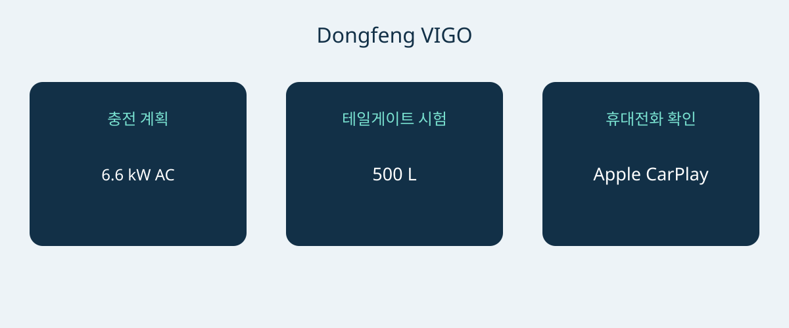

# 동펑 VIGO: 뉴질랜드 사양의 충전·적재·휴대전화 연결 확인

동펑 VIGO는 단일 주행거리 수치보다 실제 사용 조건으로 평가할 만한 차입니다. 뉴질랜드 참고 사양은 배터리 전기 구동과 전륜구동, 분할 테일게이트, 비교적 작은 차체를 결합합니다. 편리하게 충전할 수 있는지, 일상 물품을 쉽게 싣는지, 실제 사용하는 휴대전화가 연결되는지가 중요합니다. 구매 구성을 확정하기 전에 제시된 차량에서 확인하세요.

이 글은 뉴질랜드 2026년 10월판 브로슈어와 현지 공식 모델 페이지를 사용합니다. 브로슈어 날짜는 공장의 공식 연식 선언이 아닙니다. 대상은 51.87 kWh 전륜구동 뉴질랜드 사양으로 브로슈어에는 Standard라고 표시됩니다. 다른 시장의 트림명을 붙이지 말고 VIN, 생산일, 최초 판매 사양을 요청하세요. 말레이시아, 홍콩, 싱가포르, 중국 사양은 이름이나 외관이 비슷하다는 이유만으로 서로 대체할 수 없습니다.

## 일상 충전 계획부터 검토

참고 사양은 51.87 kWh LFP 배터리, 120 kW 모터, 230 Nm 토크를 제시하며 제조사 0–100 km/h 가속은 7.8초입니다. 이는 인용한 구성의 수치이지 VIGO라는 이름의 모든 차량에 적용되는 값이 아닙니다. 광고 주행거리는 471 km CLTC입니다. CLTC를 숫자와 함께 유지하세요. 독립적인 WLTP 시험 결과나 실제 경로 거리 보장이 아닙니다.

같은 브로슈어는 뉴질랜드 정부 계산기로 주행거리를 환산했다고 설명합니다. 환산값은 독립 WLTP 시험을 받았다는 증거가 아닙니다. 다른 차와 비교할 때 각 시험 근거를 확인하고 서로 다른 시험 주기를 하나의 순위로 섞지 마세요. 경로는 이용 가능한 충전 지점과 사용 조건을 바탕으로 계획해야 하며, 브로슈어 숫자를 매일 보장되는 이동 범위로 바꾸면 안 됩니다.

| 뉴질랜드 참고 항목 | 값 |
|---|---|
| 동력 및 구동 | 배터리 전기차; 전륜구동 |
| 배터리 | 51.87 kWh LFP |
| 모터 최고 출력 | 120 kW |
| 최대 토크 | 230 Nm |
| 제조사 0–100 km/h | 7.8초 |
| 광고 주행거리 | 471 km CLTC |
| 최대 AC 충전 | 6.6 kW |
| 최대 DC 충전 | 167 kW |
| 제조사 충전 구간 | 30–80%, 18분 |

출처는 동펑 뉴질랜드 2026년 10월 브로슈어의 단일 참고 사양입니다. 이 판본으로 공식 연식 코드는 확인되지 않습니다.

충전 구간이 특히 중요합니다. 30–80%에 18분이지 10–80%가 아닙니다. DC 최대 167 kW 역시 모든 충전에서 도달하거나 유지한다는 뜻이 아닙니다. Auto Trader NZ는 자체 시험에서 더 낮은 최고치를 보고했지만 한 번의 관측으로 전체 차량의 결함이나 다른 차량의 보장 성능을 정할 수는 없습니다. 제조사 성능 설명과 개별 매체 시험 경험을 구분하세요.

집이나 직장에서는 자격을 갖춘 설치업체나 운영자에게 전원과 호환 장비를 확인하세요. AC 최대 6.6 kW는 상담 기준이지 특정 설치 장소의 속도를 입증하지 않습니다. 장거리가 잦다면 예정된 충전망을 살펴보고 조건 변화에 대비할 시간을 두세요. 실제 차량으로 호환성을 시연해 달라고 요청하고, 최고 출력 문구를 실행 가능한 충전 계획 대신 받아들이지 마세요.

## 자신의 물건으로 분할 테일게이트 시험

크기는 4306 × 1868 × 1654 mm, 휠베이스 2715 mm, 좌석은 5개입니다. 브로슈어는 적재 공간 500 L, 최대 1040 L와 60/40 분할 접이식 뒷좌석을 제시합니다. 활용성을 살펴볼 출발점이지만 특정 유모차, 휠체어, 장비 상자를 쉽게 넣을 수 있다는 증거는 아닙니다.

브로슈어의 기본 테일게이트는 위아래 분할형이며 수동입니다. 분할 구조나 액세서리 장착 전시차만 보고 전동이 기본이라고 가정하지 마세요. 두 부분을 열고 적재 자세를 시험하며 주차 공간에서 접근성을 확인하세요. 아래 부분은 사람이 개구부에 얼마나 가까이 설 수 있는지에 영향을 줄 수 있어 사진보다 실제 시험이 중요합니다. 이는 사용성 확인 권고이며 AutoBridge의 실차 시험 결과가 아닙니다.

좌석을 접는 데 의존하기 전에 평소 승객과 짐 조합부터 확인하세요. 전동 액세서리나 다른 방식을 제안받으면 견적에서 설치와 지원 조건을 따로 명시하도록 하세요. 적재 용적은 적재중량이 아니며 여기의 수치는 견인 능력도 입증하지 않습니다. 공간 장점을 문서로 확인되지 않은 운송 능력으로 확대하지 마세요.

## 목록만 보지 말고 휴대전화를 가져가기

뉴질랜드 자료에는 Apple CarPlay가 기재되어 있습니다. Android Auto는 선택형 사후 장착 액세서리이며 기본 공장 장비가 아닙니다. 이미 설치됐는지, 별도로 공급되는지, 단지 주문할 수 있다는 뜻인지 물어보세요. 일반적인 스마트폰 연결 지원 문구만으로는 알 수 없습니다.

브로슈어는 12.8인치 중앙 화면을, 공식 페이지는 히트펌프가 있는 자동 공조를 제시합니다. 어느 것도 다른 목적지에서 원하는 앱이나 연결 서비스를 쓸 수 있다고 보장하지 않습니다. 사용할 전화기를 연결하고 설치 방식과 지원 책임을 설명받으세요. 액세서리 상세 내용을 서면으로 받고, 한 기기의 시연 성공을 모든 휴대전화 호환성으로 해석하지 마세요.

## 차량별로 구체화할 견적 내용

- VIN, 생산일, 최초 뉴질랜드 사양, 실제 납품 장비를 식별할 것.
- 기본 수동 테일게이트와 전동 액세서리 및 설치 책임을 구분할 것.
- 특히 Android Auto 후장착품을 포함한 휴대전화 연결 내용을 명시할 것.
- 충전 장비와 예정된 사용 장소의 호환성을 확인할 것.
- 목적지 서비스·보증 조건을 서면으로 받고 최신 항목별 견적을 확보할 것.

뉴질랜드 제품 페이지는 수출 자격, 등록, 세금, 운임, 해외 보증을 입증하지 않습니다. 가격과 재고 역시 최신 확인이 필요합니다. 판매자가 사양을 설명하지 못하거나, 환산값을 직접 시험한 동등 결과로 제시하거나, 선택 연결 장비를 기본이라고 하면 결정을 보류하세요. 안전 평가가 중요하다면 정확히 적용되는 기록을 요청하세요. 이 글은 ANCAP 또는 Euro NCAP 별점을 확정하지 않습니다.

구매 근거는 세 가지 결과에 달려 있습니다. 충전 계획이 적합하고, 적재 시험이 만족스럽고, 휴대전화 구성이 문서로 명확해야 합니다. 그렇다면 뉴질랜드 자료가 상세 견적의 구체적 기준이 됩니다. 맞지 않는다면 눈에 띄는 숫자로 사용상 불일치를 해결할 수 없습니다.

## 자주 묻는 질문

### 공식 연식 사양인가요?
아닙니다. 2026년 10월 브로슈어의 뉴질랜드 참고 사양입니다. 파일명으로 추정하지 말고 해당 VIN의 공장 식별과 생산 정보를 확인하세요.

### WLTP와 직접 비교할 수 있나요?
471 km는 CLTC입니다. 따로 설명한 환산은 독립 WLTP 시험이 아닙니다. 같은 시험 기준끼리 비교하고 실제 경로 계획은 구분하세요.

### 18분은 10–80% 충전인가요?
아닙니다. 제조사 표기는 30–80%입니다. 조건과 장비가 중요하며 최고 출력은 보장된 지속 출력이 아닙니다.

### 전동 테일게이트와 Android Auto는 기본인가요?
인용한 브로슈어는 수동 분할 테일게이트를 설명합니다. Android Auto는 선택형 후장착 액세서리이고 Apple CarPlay는 기재되어 있습니다. 실제 차량과 청구서를 확인하세요.

충전 접근성, 짐 적재, 휴대전화 장비 확인을 연결한 자체 제작 도식.

## 출처 및 확인

자료 확인일: 2026-11-05.

- [Dongfeng NZ / Armstrongs Distribution — VIGO New Zealand brochure, October 2026 edition](https://dongfeng.co.nz/wp-content/uploads/2026/10/Dongfeng-Vigo-Brochure-Oct26-Web.pdf)
- [Dongfeng NZ / Armstrongs Distribution — VIGO New Zealand official model page](https://dongfeng.co.nz/electric-vehicles/vigo-ev/)
- [Dongfeng NZ / Armstrongs Distribution — VIGO New Zealand launch release, January 15 2026](https://dongfeng.co.nz/newsroom/new-dongfeng-vigo-breaks-barriers-to-electric-vehicle-versatility-with-best-value-ev-suv-in-new-zealand/)
- [NZME / Driven Car Guide — VIGO review: sit, sleep and drive, March 9 2026](https://www.drivencarguide.co.nz/reviews/dongfeng-vigo-review-sit-sleep-and-drive/)
- [CarExpert — VIGO Quick Drive, February 19 2026](https://www.carexpert.co.nz/car-reviews/dongfeng-vigo-review-quick-drive)
- [Auto Trader NZ — VIGO review, April 11 2026](https://autotrader.co.nz/car-reviews/2026-dongfeng-vigo-review)

[차량 살펴보기](https://www.autobridgeexport.com/vehicles/) · [구매 가이드 읽기](https://www.autobridgeexport.com/guides/)
