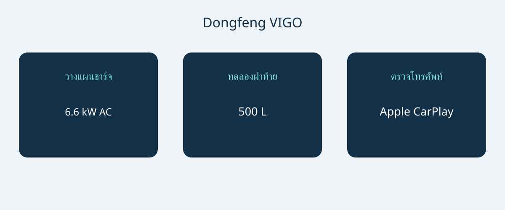

# Dongfeng VIGO: ตรวจการชาร์จและพื้นที่รุ่นนิวซีแลนด์

Dongfeng VIGO ควรได้รับการประเมินจากการใช้จริง มากกว่าตัดสินจากตัวเลขระยะทางเพียงค่าเดียว รุ่นอ้างอิงนิวซีแลนด์เป็นรถไฟฟ้าแบตเตอรี่ขับเคลื่อนล้อหน้า มีฝาท้ายแยกส่วนและตัวถังค่อนข้างกะทัดรัด ความเหมาะสมขึ้นกับการชาร์จที่สะดวก การขนของประจำวัน และการเชื่อมต่อโทรศัพท์ที่ผู้ซื้อใช้จริง ควรตรวจบนรถคันที่เสนอขายก่อนตกลงชุดอุปกรณ์สุดท้าย

บทความนี้อ้างอิงโบรชัวร์นิวซีแลนด์ฉบับเดือนตุลาคม 2026 และหน้าเว็บรุ่นอย่างเป็นทางการ วันที่โบรชัวร์ไม่ใช่การประกาศปีรุ่นจากโรงงาน ข้อมูลอ้างอิงคือรุ่นขับล้อหน้า 51.87 kWh ซึ่งโบรชัวร์เรียก Standard ไม่ควรนำชื่อรุ่นย่อยตลาดอื่นมาใช้แทน ควรขอ VIN วันผลิต และสเปกตลาดเดิม อย่าถือว่าสเปกมาเลเซีย ฮ่องกง สิงคโปร์ หรือจีนเหมือนกันเพียงเพราะชื่อหรือรูปลักษณ์คล้ายกัน

## เริ่มจากแผนชาร์จประจำวัน

ข้อมูลระบุแบตเตอรี่ LFP 51.87 kWh มอเตอร์ 120 kW และแรงบิด 230 Nm ผู้ผลิตให้เวลา 0–100 km/h ที่ 7.8 วินาที ตัวเลขเหล่านี้เป็นของสเปกที่อ้างถึง ไม่ใช่รถทุกคันชื่อ VIGO ระยะทางโฆษณาคือ 471 km CLTC ควรคงคำว่า CLTC ไว้กับตัวเลข เพราะไม่ใช่ผลทดสอบ WLTP อิสระหรือการรับประกันระยะทางจริง

โบรชัวร์ยังอธิบายการแปลงระยะทางด้วยเครื่องคำนวณของรัฐบาลนิวซีแลนด์ ค่าที่แปลงไม่ใช่หลักฐานว่าทดสอบ WLTP อย่างอิสระ หากเทียบกับรถอื่น ควรถามเกณฑ์ทดสอบที่ใช้ แทนการจัดอันดับค่าต่างมาตรฐานร่วมกัน วางแผนเส้นทางจากจุดชาร์จและสภาพใช้งาน ไม่แปลงตัวเลขโบรชัวร์เป็นรัศมีเดินทางประจำวันที่รับประกัน

| รายการอ้างอิงนิวซีแลนด์ | ค่า |
|---|---|
| ระบบกำลังและขับเคลื่อน | ไฟฟ้าแบตเตอรี่; ล้อหน้า |
| แบตเตอรี่ | 51.87 kWh LFP |
| กำลังมอเตอร์สูงสุด | 120 kW |
| แรงบิดสูงสุด | 230 Nm |
| 0–100 km/h ตามผู้ผลิต | 7.8 วินาที |
| ระยะทางโฆษณา | 471 km CLTC |
| ชาร์จ AC สูงสุด | 6.6 kW |
| ชาร์จ DC สูงสุด | 167 kW |
| ช่วงชาร์จตามผู้ผลิต | 30–80% ใน 18 นาที |

ที่มา: โบรชัวร์ Dongfeng นิวซีแลนด์เดือนตุลาคม 2026 สำหรับสเปกอ้างอิงเดียว ฉบับนี้ไม่ได้ยืนยันรหัสปีรุ่นอย่างเป็นทางการ

ช่วงชาร์จสำคัญมาก: 30–80% ใน 18 นาทีไม่ได้หมายถึง 10–80% และ DC สูงสุด 167 kW ไม่ได้แปลว่าทุกครั้งจะถึงหรือรักษาค่านั้น Auto Trader NZ รายงานกำลังสูงสุดที่ต่ำกว่าในการทดสอบของตน แต่หนึ่งครั้งไม่พิสูจน์ความผิดปกติของรถทุกคันหรือรับประกันอัตราของอีกคัน ควรแยกความสามารถที่ผู้ผลิตระบุกับประสบการณ์ทดสอบรายครั้ง

ที่บ้านหรือที่ทำงาน ให้ผู้ติดตั้งที่มีคุณสมบัติหรือผู้ให้บริการตรวจแหล่งจ่ายและอุปกรณ์ที่เข้ากันได้ ค่า AC สูงสุด 6.6 kW ใช้เป็นข้อมูลสนทนา ไม่ใช่หลักฐานความเร็วของสถานที่ใดโดยเฉพาะ หากเดินทางไกลบ่อย ให้ตรวจเครือข่ายที่จะใช้และเผื่อเวลาสำหรับเงื่อนไขเปลี่ยนแปลง ขอการสาธิตบนรถจริง ไม่ใช้ตัวเลขกำลังสูงสุดแทนแผนชาร์จที่ทำได้จริง

## ทดลองฝาท้ายด้วยสัมภาระที่ใช้จริง

ขนาดอ้างอิงคือ 4306 × 1868 × 1654 mm ฐานล้อ 2715 mm และ 5 ที่นั่ง โบรชัวร์ระบุพื้นที่สัมภาระ 500 L สูงสุด 1040 L พร้อมเบาะหลังพับแยก 60/40 เป็นข้อมูลเริ่มต้นของความยืดหยุ่น แต่ไม่ยืนยันว่ารถเข็นเด็ก รถเข็นสำหรับผู้มีข้อจำกัดด้านการเคลื่อนไหว หรือกล่องอุปกรณ์จะยกใส่ได้ง่าย

ฝาท้ายมาตรฐานในโบรชัวร์แบ่งส่วนบนและล่างและเปิดด้วยมือ อย่าสันนิษฐานว่าเป็นไฟฟ้าเพราะการแบ่งส่วนหรือเพราะรถสาธิตติดอุปกรณ์เพิ่ม ควรเปิดทั้งสองส่วน ทดลองท่ายกของและพื้นที่เข้าถึงในที่จอด ส่วนล่างอาจเปลี่ยนระยะที่คนยืนใกล้ปากห้องสัมภาระ จึงควรทดลองมากกว่าดูภาพ นี่คือข้อแนะนำด้านการใช้งาน ไม่ใช่ผลทดสอบรถจริงของ AutoBridge

ลองผู้โดยสารและของที่ใช้ประจำก่อนพึ่งการพับเบาะ หากผู้ขายเสนออุปกรณ์ไฟฟ้าหรือรูปแบบอื่น ควรระบุแยกในใบเสนอราคา รวมการติดตั้งและบริการ ปริมาตรไม่ใช่น้ำหนักบรรทุก และข้อมูลนี้ไม่ยืนยันความสามารถลากจูง อย่าขยายข้อดีด้านพื้นที่เป็นสมรรถนะขนส่งที่ไม่มีเอกสาร

## นำโทรศัพท์ไปทดลองด้วย

เอกสารนิวซีแลนด์ระบุ Apple CarPlay ส่วน Android Auto เป็นอุปกรณ์เสริมติดตั้งภายหลัง ไม่ใช่มาตรฐานจากโรงงาน ถามว่าติดตั้งแล้ว จะส่งแยก หรือเพียงสั่งซื้อได้ คำว่าเชื่อมต่อสมาร์ตโฟนได้แบบกว้าง ๆ ไม่ตอบรายละเอียดเหล่านี้

โบรชัวร์ระบุจอกลาง 12.8 นิ้ว และหน้าเว็บทางการระบุเครื่องปรับอากาศอัตโนมัติพร้อมฮีตปั๊ม ทั้งสองอย่างไม่รับประกันว่าแอปหรือบริการเชื่อมต่อจะทำงานในปลายทางอื่น ควรเชื่อมต่อโทรศัพท์ที่จะใช้และขอคำอธิบายวิธีติดตั้งกับผู้รับผิดชอบบริการ เก็บรายละเอียดอุปกรณ์เป็นลายลักษณ์อักษร การสาธิตสำเร็จด้วยเครื่องเดียวไม่ยืนยันโทรศัพท์ทุกเครื่อง

## ทำใบเสนอราคาให้ตรงกับรถคันจริง

- ระบุ VIN วันผลิต สเปกนิวซีแลนด์เดิม และอุปกรณ์ที่ส่งมอบ
- แยกฝาท้ายมือเปิดมาตรฐานกับอุปกรณ์ไฟฟ้า พร้อมผู้รับผิดชอบติดตั้ง
- ระบุระบบเชื่อมต่อโทรศัพท์ โดยเฉพาะอุปกรณ์เสริม Android Auto ที่ติดตั้งภายหลัง
- ยืนยันอุปกรณ์ชาร์จและความเข้ากันได้กับสถานที่ที่จะใช้
- ขอเงื่อนไขบริการและรับประกันในปลายทางเป็นเอกสาร พร้อมราคาปัจจุบันแยกรายการ

หน้าเว็บนิวซีแลนด์ไม่ยืนยันสิทธิส่งออก การจดทะเบียน ภาษี ค่าขนส่ง หรือการรับประกันต่างประเทศ ราคาและสต็อกก็ต้องยืนยันใหม่ ควรชะลอหากผู้ขายอธิบายสเปกไม่ได้ เรียกค่าคำนวณว่าเทียบเท่าผลทดสอบตรง หรือเรียกอุปกรณ์เชื่อมต่อเสริมว่ามาตรฐาน หากผลประเมินความปลอดภัยสำคัญ ให้ขอบันทึกที่ตรงรุ่น บทความนี้ไม่ได้ยืนยันดาว ANCAP หรือ Euro NCAP

เหตุผลซื้อที่หนักแน่นจึงขึ้นกับสามผลลัพธ์: แผนชาร์จเหมาะสม ทดลองสัมภาระพอใจ และระบบโทรศัพท์มีเอกสารชัดเจน หากครบ ข้อมูลนิวซีแลนด์ช่วยต่อยอดใบเสนอราคาได้ หากไม่ตรง ความโดดเด่นของตัวเลขไม่แก้ความไม่เหมาะกับการใช้

## คำถามที่พบบ่อย

### เป็นสเปกปีรุ่นอย่างเป็นทางการหรือไม่?
ไม่ใช่ นี่คือข้อมูลนิวซีแลนด์จากโบรชัวร์ตุลาคม 2026 ควรตรวจตัวตนโรงงานและข้อมูลผลิตของ VIN ไม่อนุมานจากชื่อไฟล์

### เทียบกับ WLTP โดยตรงได้หรือไม่?
471 km เป็น CLTC การแปลงที่อธิบายแยกไม่ใช่การทดสอบ WLTP อิสระ ควรเทียบฐานทดสอบเดียวกัน และแยกการวางแผนเส้นทางจริง

### 18 นาทีหมายถึง 10–80% หรือไม่?
ไม่ใช่ ผู้ผลิตระบุ 30–80% เงื่อนไขและอุปกรณ์ยังสำคัญ และกำลังสูงสุดไม่ใช่กำลังต่อเนื่องที่รับประกัน

### ฝาท้ายไฟฟ้าและ Android Auto เป็นมาตรฐานหรือไม่?
โบรชัวร์ที่อ้างถึงระบุฝาท้ายแยกส่วนแบบมือเปิด Android Auto เป็นอุปกรณ์เสริมติดตั้งภายหลัง ส่วน Apple CarPlay มีระบุไว้ ควรตรวจรถและใบกำกับรายการจริง

แผนภาพต้นฉบับเชื่อมจุดชาร์จ การใช้สัมภาระ และการยืนยันอุปกรณ์โทรศัพท์

## แหล่งข้อมูลและการตรวจสอบ

ตรวจสอบแหล่งข้อมูลวันที่ 2026-11-05.

- [Dongfeng NZ / Armstrongs Distribution — VIGO New Zealand brochure, October 2026 edition](https://dongfeng.co.nz/wp-content/uploads/2026/10/Dongfeng-Vigo-Brochure-Oct26-Web.pdf)
- [Dongfeng NZ / Armstrongs Distribution — VIGO New Zealand official model page](https://dongfeng.co.nz/electric-vehicles/vigo-ev/)
- [Dongfeng NZ / Armstrongs Distribution — VIGO New Zealand launch release, January 15 2026](https://dongfeng.co.nz/newsroom/new-dongfeng-vigo-breaks-barriers-to-electric-vehicle-versatility-with-best-value-ev-suv-in-new-zealand/)
- [NZME / Driven Car Guide — VIGO review: sit, sleep and drive, March 9 2026](https://www.drivencarguide.co.nz/reviews/dongfeng-vigo-review-sit-sleep-and-drive/)
- [CarExpert — VIGO Quick Drive, February 19 2026](https://www.carexpert.co.nz/car-reviews/dongfeng-vigo-review-quick-drive)
- [Auto Trader NZ — VIGO review, April 11 2026](https://autotrader.co.nz/car-reviews/2026-dongfeng-vigo-review)

[ดูรถรุ่นต่าง ๆ](https://www.autobridgeexport.com/vehicles/) · [อ่านคู่มือจัดซื้อ](https://www.autobridgeexport.com/guides/)
