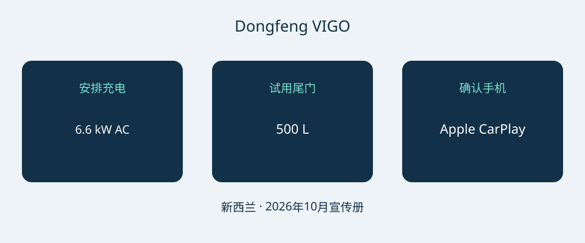

# 东风 VIGO 新西兰版：充电、分体尾门与手机互联选购

选择东风 VIGO，值得先做实际用途评估，而不是被单一续航标题左右。新西兰参考配置是一款前轮驱动纯电车型，采用分体尾门和相对紧凑的车身。是否适合购买，取决于充电是否方便、日常物品能否顺手装卸，以及买家自己的手机能否按预期使用。最终确定采购组合之前，建议在所售车辆上逐项确认这些问题。

本文采用2026年10月版新西兰宣传册，并结合当地官方车型页面。宣传册日期不是工厂正式年款声明。参考对象是新西兰51.87 kWh前驱配置，宣传册将其标为 Standard，不应自行套用其他市场的配置名称。建议索取 VIN、生产日期和原销售市场规格，不因车型名称或外观相近，就把马来西亚、香港、新加坡或中国市场的配置视为完全一致。

## 从日常充电安排开始判断

新西兰资料列出51.87 kWh LFP电池、120 kW电机和230 Nm扭矩，厂商0–100 km/h加速数据为7.8秒。这些数字对应所引用的具体配置，不代表所有以VIGO名称出售的车辆。宣传册标称续航为471 km CLTC。CLTC应与数字同时保留，不能改写为独立验证的WLTP结果，也不能当成实际路线里程保证。

宣传册还说明了利用新西兰政府计算器进行的续航换算。换算结果并不证明车辆接受过独立WLTP测试。若要与另一款车有效比较，建议先确认双方适用的测试依据，不把不同工况放进同一排名。规划路线时，应关注充电站分布和实际使用条件，而不是把宣传里程直接当成每天可以保证覆盖的范围。

| 新西兰参考参数 | 数值 |
|---|---|
| 动力与驱动 | 纯电；前轮驱动 |
| 电池 | 51.87 kWh LFP |
| 电机最大功率 | 120 kW |
| 最大扭矩 | 230 Nm |
| 厂商0–100 km/h加速 | 7.8秒 |
| 标称续航 | 471 km CLTC |
| 最高交流充电功率 | 6.6 kW |
| 最高直流充电功率 | 167 kW |
| 厂商充电区间 | 30–80%，18分钟 |

来源为东风新西兰2026年10月宣传册中的单一参考配置。此版资料没有确立正式年款代码。

充电区间尤其容易误读：30–80%用时18分钟，不是10–80%的承诺。167 kW直流峰值也不代表每次充电都能达到或持续保持。Auto Trader NZ在自己的测试中报告过较低峰值，但一次观察不能证明所有车辆都有问题，也不能确定另一辆车的保证充电速度。厂商能力描述与媒体某次实测经历应分开理解。

居家或工作场所充电，应请合格安装人员或运营方确认供电条件及兼容设备。6.6 kW交流最高功率可作为沟通参考，但不能证明某处安装后的实际速度。经常跑长途的买家，应查看计划使用的充电网络，并为条件变化预留时间。建议要求卖方在实车上演示兼容性，不能用峰值功率宣传替代可执行的充电方案。

## 用自己的物品试用分体尾门

参考尺寸为4306 × 1868 × 1654 mm，轴距2715 mm，五座布局。宣传册列出500 L行李容积、最大1040 L，并配置60/40比例分折后排座椅。它们有助于初步判断空间灵活性，却不能仅凭容积就确认某个婴儿车、轮椅或设备箱能否轻松装入。

宣传册标准配置的尾门分上下两部分，为手动开启。不能因分体结构或一辆加装附件车辆的演示，就推断标配电动开启。建议打开上下两部分，试验装卸姿势，并在计划停车的位置检查操作空间。下半部分会影响人靠近行李开口的位置，因此实际试用比看照片更重要。这是采购使用性建议，不是基于AutoBridge实车测试的结论。

先尝试正常乘员与行李组合，再考虑放倒座椅后的用途。如果卖方提供电动附件或其他尾门方案，宜在报价中单独写明安装内容、责任方和售后条款。行李容积不等于载重能力，这些资料也没有确立牵引能力。不要把空间优势直接扩展成未经证明的运输能力。

## 把手机带到现场，而不只勾选配置表

新西兰资料列有Apple CarPlay。Android Auto被描述为可选的后装附件，不是标准原厂设备。应询问所售车辆究竟包含什么：附件是否已经安装、另行供货，还是仅表示可以订购。笼统地说“支持手机互联”，无法回答这些关键问题。

宣传册列出12.8英寸中央屏幕，官方车型页面列有带热泵的自动空调。两者都不能证明买家偏好的手机应用或联网服务在其他目的地一定正常。建议在演示时连接将要使用的手机，请卖方解释安装方案和支持责任，并把附件信息写入文件。一部手机演示成功，不能代替对所有设备兼容性的确认。

## 把报价落实到具体车辆

- 标明VIN、生产日期、新西兰原始配置以及实际交付设备。
- 区分标准手动尾门与任何电动附件，列明安装责任。
- 写清手机互联方案，尤其是Android Auto后装附件是否包含。
- 核对随车充电设备与计划充电地点的兼容性。
- 取得目的地服务与保修的书面条件，并更新分项商业报价。

新西兰产品网页不能证明出口资格、目的地注册许可、税费、运费或境外保修覆盖；现价和库存也需要重新确认。如果卖方无法解释配置差异，把换算续航说成直接测试的等同结果，或把可选互联附件说成标配，建议暂缓决定。如果安全评价是采购重点，也应索取明确适用的评价记录；本文没有确立ANCAP或Euro NCAP星级。

因此，VIGO较有说服力的采购理由应建立在三个实际结果上：充电安排合适、装卸试用满意、手机配置清楚且有文件支持。三项均满足时，新西兰资料能够为进一步报价提供具体依据；如果不匹配，再亮眼的标题参数也无法消除使用需求上的差距。

## 常见问题

### 这是正式年款规格吗？
不是。它是2026年10月宣传册的新西兰参考配置。应核实所售VIN的工厂身份和生产信息，不能从文件名推定。

### 标称续航可以直接和WLTP比较吗？
471 km属于CLTC。宣传册另外说明的换算不等于独立WLTP测试，应在相同测试依据下比较，并把实际路线规划另行考虑。

### 18分钟是10–80%的充电时间吗？
不是，厂商写的是30–80%。实际充电仍受条件与设备影响，峰值功率也不代表保证持续功率。

### 电动尾门和Android Auto都是标配吗？
引用的宣传册说明尾门是手动分体式。Android Auto为可选后装附件，Apple CarPlay列于资料中。请核对实车和发票，不默认升级已经包含。

原创示意图连接充电条件、装载用途与手机设备确认。

## 来源与核验

资料核验日期：2026-11-05。

- [Dongfeng NZ / Armstrongs Distribution — VIGO New Zealand brochure, October 2026 edition](https://dongfeng.co.nz/wp-content/uploads/2026/10/Dongfeng-Vigo-Brochure-Oct26-Web.pdf)
- [Dongfeng NZ / Armstrongs Distribution — VIGO New Zealand official model page](https://dongfeng.co.nz/electric-vehicles/vigo-ev/)
- [Dongfeng NZ / Armstrongs Distribution — VIGO New Zealand launch release, January 15 2026](https://dongfeng.co.nz/newsroom/new-dongfeng-vigo-breaks-barriers-to-electric-vehicle-versatility-with-best-value-ev-suv-in-new-zealand/)
- [NZME / Driven Car Guide — VIGO review: sit, sleep and drive, March 9 2026](https://www.drivencarguide.co.nz/reviews/dongfeng-vigo-review-sit-sleep-and-drive/)
- [CarExpert — VIGO Quick Drive, February 19 2026](https://www.carexpert.co.nz/car-reviews/dongfeng-vigo-review-quick-drive)
- [Auto Trader NZ — VIGO review, April 11 2026](https://autotrader.co.nz/car-reviews/2026-dongfeng-vigo-review)

[浏览车型](https://www.autobridgeexport.com/vehicles/) · [阅读采购指南](https://www.autobridgeexport.com/guides/)
