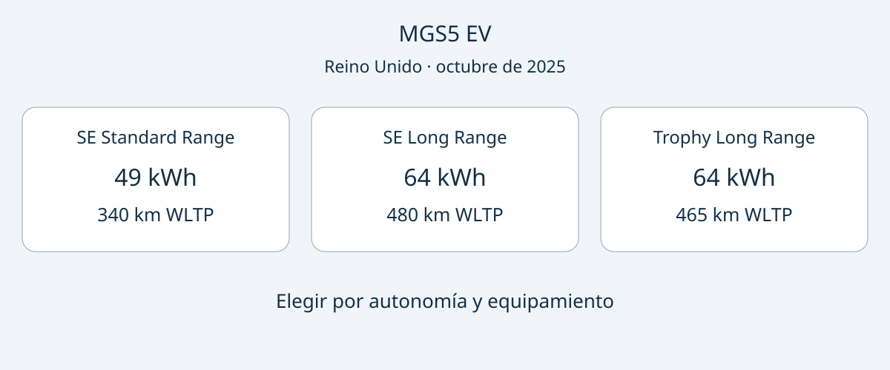

# MGS5 EV: elegir SE o Trophy con el catálogo británico de octubre de 2025

La capacidad de batería no basta para elegir un MGS5 EV. En el catálogo británico de octubre de 2025, SE Long Range y Trophy Long Range comparten 64 kWh nominales, pero difieren en autonomía WLTP y equipamiento de confort. SE Long Range es el punto de partida si prima la autonomía declarada; Trophy merece compararse por sus funciones adicionales. SE Standard Range utiliza una batería menor y otra química.

Esta comparación corresponde a una edición británica fechada, no confirma un año-modelo 2026 ni la configuración del inventario actual. Se refiere al SUV eléctrico de cinco puertas y propulsión trasera de la serie de lanzamiento descrita en el catálogo. Una oferta para otro país necesita sus propias comprobaciones de identidad y equipamiento. Un nombre parecido o la misma capacidad no prueban equivalencia entre mercados.

## Tres versiones y motivos distintos para elegir

Los datos proceden del [catálogo MG Motor UK de octubre de 2025](https://b.cogcms.co.uk/media/txzcpetj/mgs5_ev_brochure_oct_2025.pdf). Ámbito: Reino Unido, edición de octubre de 2025, serie de lanzamiento MGS5 EV, eléctrico de batería y tracción trasera en las tres versiones. La fecha del catálogo no es un código de año-modelo confirmado. WLTP se aplica solo a la fila de autonomía; el resto son especificaciones técnicas.

| Parámetro | SE Standard Range | SE Long Range | Trophy Long Range |
|---|---|---|---|
| Capacidad nominal | 49 kWh | 64 kWh | 64 kWh |
| Química de batería | LFP | NCM | NCM |
| Autonomía combinada WLTP | 340 km | 480 km | 465 km |
| Potencia máxima del motor | 125 kW | 170 kW | 170 kW |
| Diámetro de llanta | 17 pulgadas | 17 pulgadas | 18 pulgadas |

SE Standard Range merece considerarse cuando las rutas y la recarga previstas no justifican priorizar la batería grande. La decisión debería basarse en desplazamientos reales, no en una distancia diaria universal. Una capacidad menor no demuestra por sí sola menor coste de uso, más vida útil ni un tiempo de recarga concreto.

SE Long Range tiene la mayor cifra combinada WLTP de las tres. Trophy mantiene 64 kWh nominales y 170 kW, pero declara 465 km WLTP. Subir de acabado no equivale, por tanto, a obtener la máxima autonomía. Ninguno de estos resultados de laboratorio garantiza un viaje concreto por autopista, con determinada temperatura o carga.

## Valorar el equipamiento que sí importa

El catálogo incluye para los SE cámara de marcha atrás, Apple CarPlay y Android Auto inalámbricos y pantalla central de 12.8 pulgadas. Para Trophy enumera cámara de aparcamiento de 360 grados, asientos delanteros y volante calefactados, cargador inalámbrico de teléfono y portón eléctrico inteligente. Son diferencias concretas para explicar un presupuesto, más útiles que decir simplemente «mejor equipado».

Si aparca en espacios estrechos, pida una demostración de la cámara. Si carga equipaje con frecuencia, revise el acceso y el funcionamiento del portón. Son recomendaciones de compra, no pruebas realizadas por AutoBridge. La lista, las imágenes y la demostración deberían corresponder al VIN ofertado. Una foto promocional de Trophy no acredita el equipamiento de un SE. Separe funciones imprescindibles, deseables e irrelevantes para comparar ofertas sin dar el mismo valor a todo y detectar contradicciones entre fotografías y descripción.

## Comprobar medidas y forma del maletero

Las versiones del catálogo británico miden 4476 mm de largo y 1849 mm de ancho sin espejos, con 2730 mm de batalla. El maletero declara 453 litros con los asientos levantados, incluido el espacio bajo el piso, y 1441 litros con los asientos abatidos.

Mida la plaza de aparcamiento y los objetos habituales. El ancho sin espejos no basta para decidir si cabe por una entrada estrecha. El volumen total tampoco describe la boca de carga ni la forma de cada compartimento. Solicite medidas de abertura y suelo en lugar de convertir litros en un número inventado de maletas. El volumen del maletero no es una cifra de carga útil.

## Resolver la recarga antes de entregar una señal

El catálogo británico identifica una conexión combinada Type 2 y CCS. Las publicaciones difieren sobre la capacidad de recarga en corriente alterna y la capacidad útil de batería. Por ello, aquí no se fija una potencia máxima AC ni una capacidad útil definitiva. La capacidad nominal de la tabla es un concepto diferente.

Solicite documentación del fabricante para el VIN y la edición exactos, y confirme su compatibilidad con la instalación prevista. Pregunte aparte por el cable incluido y los puntos de recarga que utilizará. El tipo de conector no garantiza una potencia ni un plazo para cargar por completo. Si la compra depende de recargar de noche y la especificación no queda clara, posponer la señal es una precaución razonable.

## Seguridad: leer el resultado completo

El MGS5 EV obtuvo cinco estrellas en la [evaluación Euro NCAP de 2025](https://www.euroncap.com/assessments/mg/mgs5%2Bev/1109/). El informe también recoge una penalización en el impacto frontal descentrado relacionada con estructuras del salpicadero del lado del conductor. Conviene leer tanto el resultado como sus límites.

Es una evaluación europea de la especificación cubierta, no una autorización de importación, una prueba de equipamiento idéntico en otros mercados ni una garantía de conducción sin riesgo. Si el vendedor la utiliza como argumento, pregunte cómo se corresponde la unidad ofertada con la evaluada.

## Preguntas frecuentes

### ¿64 kWh significa Trophy?

No. SE Long Range y Trophy Long Range tienen ambos 64 kWh nominales en este catálogo. Pida el acabado completo y una relación de equipamiento.

### ¿Cuál declara más autonomía?

SE Long Range: 480 km combinados WLTP, frente a 465 km del Trophy Long Range y 340 km del SE Standard Range. Son comparaciones de laboratorio, no promesas de ruta.

### ¿Esto confirma garantía o matriculación en otro país?

No. El vendedor responsable y las entidades del destino deben aclarar el caso individual. Disponibilidad, precio, servicios conectados y garantía requieren confirmación actual.

### ¿Qué debe incluir la consulta?

Acabado, edición de referencia, prioridad entre autonomía y confort, y documentos de recarga y equipamiento vinculados al VIN. Resuelva las discrepancias antes de comprometer dinero. También puede consultar el [catálogo de vehículos](https://www.autobridgeexport.com/vehicles/) y las [guías de compra](https://www.autobridgeexport.com/guides/).

## Diagrama de referencia

Tres tarjetas comparan las baterías y la autonomía WLTP de las versiones del MGS5 EV.

## Fuentes y comprobación

Fuentes comprobadas el 2026-11-05. El catálogo fechado respalda la tabla y Euro NCAP la evaluación de seguridad. Las fuentes secundarias aportan contexto y permiten detectar discrepancias, no sustituyen la especificación individual.

- [MG Motor UK: catálogo de octubre de 2025](https://b.cogcms.co.uk/media/txzcpetj/mgs5_ev_brochure_oct_2025.pdf)
- [Euro NCAP: evaluación del MGS5 EV](https://www.euroncap.com/assessments/mg/mgs5%2Bev/1109/)
- [MG Motor Europe: anuncio de seguridad](https://news.mgmotor.eu/press/new-mgs5-ev-achieves-highest-safety-rating/)
- [EV Database: MGS5 EV Long Range](https://ev-database.org/uk/car/3147/MG-MGS5-EV-Long-Range)
- [Electrifying: análisis del MGS5 EV](https://www.electrifying.com/reviews/mg-reviews/mgs5-ev/review)
- [What Car?: análisis del MGS5 EV](https://www.whatcar.com/mg-motor-uk/mgs5/estate/review/n27533)
