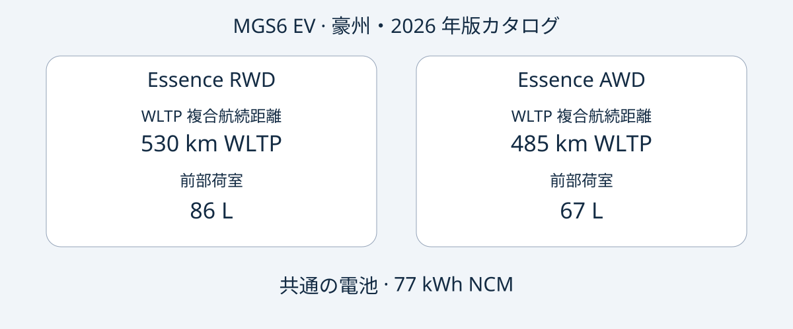

# MG MGS6 EV：豪州仕様の Essence RWD と AWD を選ぶ

豪州の MGS6 EV では、重視する点によって候補が分かれます。Essence RWD は公表された WLTP 複合航続距離と前部荷室の容量が大きく、Essence AWD は最高出力が高く、メーカー公表の加速時間が短くなっています。ただし、その比較だけでは購入判断は完結しません。実際の販売車両の特定、豪州仕様との一致、仕向地での使用とサービス体制を確認することが重要です。

本稿は 2026-11-05 に確認した MG の豪州向け 2026 年版カタログに基づきます。2026 は資料の版を示し、販売されるすべての車両が正式な MY2026 であるとの確認ではありません。MGS6 EV は中型のバッテリー電気自動車 SUV です。比較対象は豪州の Essence RWD と Essence AWD に限定され、世界共通仕様や別名の中国市場車との同一性を示すものではありません。個体の製造日は車両書類で確認してください。

## 同じ電池容量でも選択の軸は異なる

以下は豪州向け 2026 年版カタログの純電動仕様です。航続距離は WLTP 複合値、加速はメーカー値であり、独自の走行試験結果ではありません。77 kWh は電池容量として掲載されており、使用可能容量と確認された値ではありません。

| 項目 | Essence RWD | Essence AWD |
|---|---|---|
| 駆動方式 | 後輪駆動 | 全輪駆動 |
| 電池 | 77 kWh NCM | 77 kWh NCM |
| WLTP 複合航続距離 | 530 km | 485 km |
| 最高出力 | 180 kW | 266 kW |
| 最大トルク | 350 Nm | 540 Nm |
| メーカー公表 0–100 km/h | 7.3 秒 | 5.1 秒 |
| 前部荷室 | 86 L | 67 L |

出典：[MG 豪州カタログ](https://mgmotor.com.au/brochures/MGS6_EV_2026_v2.pdf)。荷室容量の測定方式はここでは特定していないため、特定の荷物が収まる保証にはなりません。

公表航続距離と前部収納を重視するなら、RWD から検討すると比較しやすくなります。出力や公表加速性能を明確に求める場合は AWD がその希望に合います。これは資料上の属性比較であり、AutoBridge の試乗評価ではありません。実際の維持費、冬季性能、制動距離、再販売価値の差は示していません。

見積書には完全な仕様名を記載してもらうことを勧めます。「MGS6 EV、77 kWh」だけでは、航続距離、性能、前部荷室を左右する違いが不明です。一般的なカタログだけでなく、販売個体の仕様と VIN 情報を見積書に添付してもらいましょう。

## 充電能力と充電時間を区別する

豪州の両仕様には車載 AC 充電 11 kW、最大 DC 充電 144 kW が記載されています。どのコンセントや充電器でもその出力が得られるという保証ではありません。カタログの 38 分という値は、25°C、150 kW 充電器、メーカーの標準化試験条件における 10–80% の充電を示します。比較時にはこれらの条件を省かないでください。

試験用充電器の定格と車両側の最大 DC 出力は別の指標です。いずれも充電全体の平均出力を表しません。また、空から満充電までの時間でもありません。充電器、温度、電池の状態が影響するため、毎回同じ時間で充電できる前提で配送や旅行を計画しない方がよいでしょう。

特定の経路で使用する場合は、販売個体の充電端子、現地の対応機器、関連書類を確認してください。仕向地の充電環境はカタログ比較とは別に調べる事項です。本稿は電池容量と試験航続距離から電費、電気料金、実走行距離の保証を算出しません。

## 荷室の容量と実際の積載性

両仕様の公表寸法は 4708 × 1912 × 1664 mm、ホイールベースは 2835 mm です。後部荷室は座席使用時 581 L、折り畳み時 1690 L と記載されています。前部荷室は仕様によって異なるため、前後の空間をひとまとめにせず比較すると用途との適合を判断しやすくなります。

同時に積む荷物や機材をリストにし、販売車両の開口部と座席状態の寸法や写真を求めましょう。容量だけでは形状、乗員がいる場合の使い勝手、固定方法は分かりません。また、これらの値は積載重量や牽引能力を証明しません。

参考仕様にはヒートポンプ、12.8 インチのインフォテインメントディスプレイ、10.25 インチのドライバーディスプレイ、20 インチのホイールが含まれます。実際の販売仕様と照合してください。画面サイズは他国での表示言語、通信サービス、ソフトウェア支援を保証しません。仕向地に関する回答を文書で得ることを勧めます。

## 安全評価は適用時期とともに読む

ANCAP の 2025 年評価は、2025 年 12 月以降に製造され、2026 年 6 月以降に豪州・ニュージーランドで販売された対象仕様に適用されます。成人乗員保護 92%、子供乗員保護 87%、交通弱者保護 84%、安全支援 81% が公表されています。[ANCAP のページ](https://www.ancap.com.au/safety-ratings/mg/mgs6-ev/588e29)と報告書で適用範囲を確認できます。

評価年、適用製造時期、カタログの版は別の情報であり、個体の身元確認の代わりにはなりません。安全評価は仕向地の型式認可、けがの防止、ある中古車の現在の状態を保証するものでもありません。車種評価を車両状態報告と混同せず、個体に関する記録を求めてください。

## 比較を確認可能な見積もりにつなげる

以下は編集上の購入提案であり、世界共通の法定書類一覧ではありません。

- VIN、製造日の根拠、当初の販売市場、Essence RWD または Essence AWD の完全な仕様を求める。
- 豪州カタログとの相違点を、装備、充電機器、ソフトウェアを含めて販売者に説明してもらう。
- 価格、在庫、納期、保証、サービスを個別取引について確認する。豪州の情報だけで輸出後の保証は確定しない。
- 支払いを約束する前に、輸入・登録の可否を所管機関などの適切な情報源で確認する。カタログと ANCAP だけでは判断できない。
- 仕様名と車両書類の矛盾が解消されない場合や、他市場との同一性を根拠なく主張された場合は購入を保留する。

適切なのは明確な用途に合い、書類が一貫した仕様です。高出力が必ず役立つわけではなく、長い試験航続距離も特定の旅行を保証しません。まず豪州の同じ範囲の仕様を比較し、次に取引固有の証拠を評価しましょう。

## よくある質問

### 2026 年版なら正式な MY2026 ですか？
いいえ。資料の版です。正式な車両表記と製造記録を確認し、ファイル名や広告から推定しないでください。

### 77 kWh は使用可能容量ですか？
出典は電池容量としています。本稿は使用可能容量に読み替えず、電費計算にも用いません。

### 他市場の車両にも適用できますか？
自動的には適用できません。市場、仕様、個体の確認が必要です。豪州 Essence を英国や欧州の仕様名と同一視していません。

### 充電は必ず 38 分で終わりますか？
いいえ。25°C、150 kW 充電器、メーカーの標準化条件による 10–80% の値で、毎回の充電や満充電を示しません。

## 比較図

豪州の二仕様と共通の電池容量を示したオリジナル比較図。

## 出典と関連記事

確認日：2026-11-05。MG は豪州仕様、ANCAP は評価範囲の出典です。独立媒体の記事は発売背景を伝えるもので、AutoBridge の試験を示しません。

- [MG：豪州 2026 年版カタログ](https://mgmotor.com.au/brochures/MGS6_EV_2026_v2.pdf)
- [MG：豪州モデルページ](https://mgmotor.com.au/vehicles/mgs6-ev)
- [ANCAP：評価](https://www.ancap.com.au/safety-ratings/mg/mgs6-ev/588e29)
- [ANCAP：報告書](https://cdn.ancap.com.au/app/public/assets/c0121809eba68316282bba1fc3b9fcd6e0d03b41/original.pdf?1782710064=)
- [WhichCar：豪州試乗記事](https://www.whichcar.com.au/reviews/mgs6-ev-first-drive-medium-suv)
- [CarsGuide：豪州紹介記事](https://www.carsguide.com.au/ev/mg-s6-ev-101791)

[車種情報](https://www.autobridgeexport.com/vehicles/)と[購入ガイド](https://www.autobridgeexport.com/guides/)もご覧ください。
