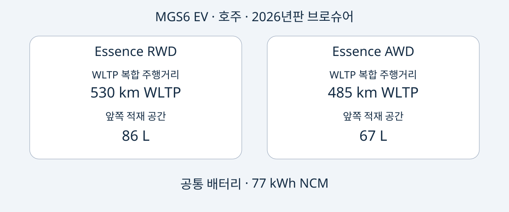

# MG MGS6 EV: 호주 Essence RWD와 AWD 선택하기

호주 MGS6 EV의 선택 기준은 분명합니다. Essence RWD는 공표된 WLTP 복합 주행거리와 앞쪽 적재 공간이 더 크고, Essence AWD는 최고출력이 높으며 제조사 발표 가속 시간이 더 짧습니다. 그러나 이 장점만으로 구매를 결정할 수는 없습니다. 실제 매물의 신원, 호주 기준 사양과의 일치 여부, 목적지의 사용 및 서비스 여건도 확인해야 합니다.

이 비교는 2026-11-05에 확인한 MG 호주용 2026년판 브로슈어를 사용합니다. 2026은 문서의 판본이며 모든 판매 차량의 공식 MY2026 연식을 확인했다는 뜻이 아닙니다. MGS6 EV는 중형 배터리 전기 SUV입니다. 여기서는 호주 Essence RWD와 Essence AWD만 비교하며, 세계 공통 사양이나 다른 이름의 중국 모델과의 동일성을 주장하지 않습니다. 개별 차량의 생산일은 차량 서류로 확인해야 합니다.

## 같은 배터리 용량, 서로 다른 우선순위

표의 수치는 모두 호주 2026년판 브로슈어의 순수 전기차 사양입니다. 주행거리는 WLTP 복합 기준이고 가속은 제조사 수치이지 자체 주행시험 결과가 아닙니다. 77 kWh는 배터리 용량으로 표시되며 사용 가능 용량으로 확인된 값이 아닙니다.

| 항목 | Essence RWD | Essence AWD |
|---|---|---|
| 구동 | 후륜구동 | 사륜구동 |
| 배터리 | 77 kWh NCM | 77 kWh NCM |
| WLTP 복합 주행거리 | 530 km | 485 km |
| 최고출력 | 180 kW | 266 kW |
| 최대토크 | 350 Nm | 540 Nm |
| 제조사 0–100 km/h | 7.3초 | 5.1초 |
| 앞쪽 적재 공간 | 86 L | 67 L |

출처: [MG 호주 브로슈어](https://mgmotor.com.au/brochures/MGS6_EV_2026_v2.pdf). 여기서는 적재 용량 측정 방식을 확인하지 않았으므로 특정 가방이 들어간다는 증거로 보아서는 안 됩니다.

공표 주행거리와 앞쪽 수납이 중요하면 RWD를 먼저 검토할 수 있습니다. 높은 출력과 발표 가속 성능을 명확히 원한다면 AWD가 그 선호에 부합합니다. 이는 문서에 기재된 특성의 비교이며 AutoBridge의 시승 평가가 아닙니다. 실제 운행 비용, 겨울철 성능, 제동거리 또는 중고 가치의 차이를 입증하지 않습니다.

견적에는 전체 트림명이 적히는 것이 좋습니다. “MGS6 EV, 77 kWh”만으로는 주행거리, 성능, 앞쪽 공간을 바꾸는 차이를 구분할 수 없습니다. 일반 브로슈어만 받기보다 매물의 사양과 VIN 정보를 견적에 첨부해 달라고 요청하세요.

## 충전 능력과 충전 시간을 구별하기

호주 두 사양은 11 kW 온보드 AC 충전과 최대 144 kW DC 충전을 명시합니다. 이는 어느 콘센트나 충전소에서나 해당 출력을 얻는다는 보장이 아닙니다. 브로슈어의 38분은 25°C에서 150 kW 충전기를 사용한 제조사 표준화 시험 조건의 10–80% 충전 시간입니다. 제안을 비교할 때 이 조건을 함께 유지해야 합니다.

시험 충전기의 정격과 차량의 DC 최대치는 서로 다른 지표이며, 둘 다 전체 세션의 평균 충전 출력을 뜻하지 않습니다. 완전 방전에서 완충까지의 시간도 아닙니다. 충전기, 온도, 배터리 상태가 영향을 주므로 매 충전 정차가 같은 시간으로 끝날 것이라고 배송이나 여행 일정을 잡지 않는 편이 좋습니다.

특정 경로에 사용할 차량이라면 매물의 충전 단자, 현지 호환 장비와 관련 문서를 확인하세요. 목적지 충전 접근성은 브로슈어 비교와 별개로 검토해야 합니다. 본문은 배터리 용량과 시험 주행거리로 전비, 전기요금 또는 보장되는 실제 주행거리를 계산하지 않습니다.

## 용량과 실제 적재 가능성은 다르다

호주 브로슈어에는 두 사양 모두 4708 × 1912 × 1664 mm, 휠베이스 2835 mm로 기재됩니다. 뒤쪽 적재 용량은 좌석을 세웠을 때 581 L, 접었을 때 1690 L입니다. 앞쪽 공간은 사양에 따라 다르므로 모든 적재 공간을 서로 대체 가능한 것으로 취급하지 말고 따로 살펴보세요.

함께 운반할 가방이나 장비를 목록으로 정리하고 실제 매물의 적재구와 좌석 배치 사진 또는 치수를 요청하세요. 리터 수치만으로 공간 모양, 승객 탑승 시 접근성, 짐 고정 가능성을 알 수 없습니다. 이 수치들은 적재중량이나 견인능력도 증명하지 않습니다.

두 기준 사양에는 히트펌프, 12.8인치 인포테인먼트 화면, 10.25인치 운전자 화면, 20인치 휠이 기재됩니다. 실제 판매 사양과 대조하세요. 화면 크기는 해외에서의 언어 지원, 연결 서비스나 소프트웨어 지원을 확인해 주지 않습니다. 목적지에 관한 서면 답변을 요청하는 것이 좋습니다.

## 안전 평가는 적용 날짜와 함께 읽기

ANCAP의 2025년 평가는 2025년 12월 이후 생산되어 2026년 6월부터 호주와 뉴질랜드에서 판매된 평가 대상 사양에 적용됩니다. 성인 탑승자 보호 92%, 어린이 탑승자 보호 87%, 취약 도로 이용자 보호 84%, 안전 보조 81%가 발표되었습니다. [ANCAP 페이지](https://www.ancap.com.au/safety-ratings/mg/mgs6-ev/588e29)와 보고서에서 적용 범위를 확인할 수 있습니다.

평가 연도, 적용 생산 시점, 브로슈어 판본은 별개 정보입니다. 어느 것도 판매 차량의 신원을 대신하지 않습니다. 안전 평가는 목적지 형식승인, 상해 방지 또는 특정 중고차의 현재 상태를 보장하지 않습니다. 모델 평가를 차량 상태 보고서로 간주하지 말고 개별 차량 기록을 요청하세요.

## 비교를 확인 가능한 견적으로 연결하기

아래는 편집부의 구매 권고이며 세계 공통 법정 서류 목록이 아닙니다.

- VIN, 생산일 증빙, 최초 판매 시장, Essence RWD 또는 Essence AWD의 전체 사양을 요청합니다.
- 장비, 충전 하드웨어와 소프트웨어를 포함해 호주 브로슈어와 다른 점을 판매자가 명시하도록 합니다.
- 가격, 재고, 납기, 보증과 서비스를 해당 거래에 대해 확인합니다. 호주 정보만으로 수출 후 보증이 확인되는 것은 아닙니다.
- 자금을 약속하기 전에 담당 기관 등 적절한 출처에서 수입 및 등록 가능성을 확인합니다. 브로슈어와 ANCAP만으로 해결할 수 없습니다.
- 트림명과 차량 기록이 맞지 않거나 다른 시장 사양과의 동일성을 근거 없이 주장하면 구매를 보류합니다.

적합한 선택은 명확한 용도에 맞고 일관된 문서로 확인되는 버전입니다. 더 높은 출력이 항상 더 유용한 것은 아니며 더 긴 시험 주행거리가 특정 여행을 보장하지도 않습니다. 호주 두 사양을 먼저 비교한 뒤 거래별 증거를 평가하세요.

## 자주 묻는 질문

### 2026년판이면 공식 MY2026인가요?
아닙니다. 문서 판본입니다. 파일명이나 광고로 추정하지 말고 차량의 공식 표기와 생산 기록을 확인하세요.

### 77 kWh는 사용 가능 용량인가요?
출처는 배터리 용량이라고 표현합니다. 사용 가능 용량으로 바꾸어 해석하거나 전비 계산에 쓰지 않습니다.

### 다른 시장에도 이 수치를 적용할 수 있나요?
자동 적용할 수 없습니다. 시장, 사양과 신원이 일치해야 합니다. 호주 Essence를 영국 또는 유럽 트림과 동일시하지 않습니다.

### 충전 시간이 항상 38분인가요?
아닙니다. 25°C, 150 kW 충전기, 제조사 표준화 조건의 10–80% 수치이며 모든 충전이나 완충 시간이 아닙니다.

## 비교 그림

호주 두 사양과 공통 배터리 용량을 나타낸 자체 제작 비교도.

## 출처와 추가 자료

확인일: 2026-11-05. MG는 호주 사양, ANCAP은 평가 범위의 출처입니다. 독립 매체 기사는 출시 배경 자료이며 AutoBridge 시험 증거가 아닙니다.

- [MG: 호주 2026년판 브로슈어](https://mgmotor.com.au/brochures/MGS6_EV_2026_v2.pdf)
- [MG: 호주 모델 페이지](https://mgmotor.com.au/vehicles/mgs6-ev)
- [ANCAP: 평가](https://www.ancap.com.au/safety-ratings/mg/mgs6-ev/588e29)
- [ANCAP: 보고서](https://cdn.ancap.com.au/app/public/assets/c0121809eba68316282bba1fc3b9fcd6e0d03b41/original.pdf?1782710064=)
- [WhichCar: 호주 시승 기사](https://www.whichcar.com.au/reviews/mgs6-ev-first-drive-medium-suv)
- [CarsGuide: 호주 분석](https://www.carsguide.com.au/ev/mg-s6-ev-101791)

[차량 자료](https://www.autobridgeexport.com/vehicles/)와 [구매 안내](https://www.autobridgeexport.com/guides/)도 확인하세요.
