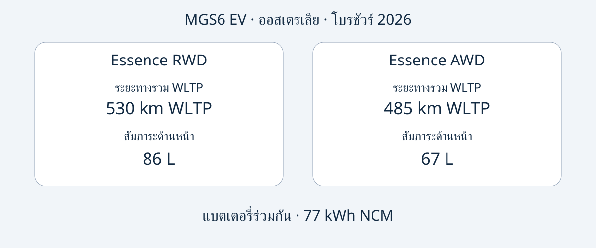

# MG MGS6 EV: เลือก Essence RWD หรือ AWD รุ่นออสเตรเลีย

MGS6 EV ในออสเตรเลียมีจุดเด่นต่างกันอย่างชัดเจน: Essence RWD มีระยะทางรวม WLTP ตามประกาศและพื้นที่เก็บสัมภาระด้านหน้ามากกว่า ส่วน Essence AWD มีกำลังสูงสุดมากกว่าและตัวเลขอัตราเร่งจากผู้ผลิตเร็วกว่า แต่ข้อได้เปรียบเหล่านี้ยังไม่เพียงพอต่อการตัดสินใจซื้อ ผู้ซื้อควรตรวจสอบรถคันที่เสนอขาย ความตรงกันกับข้อมูลออสเตรเลีย และความพร้อมใช้งานกับบริการในประเทศปลายทางด้วย

บทความใช้โบรชัวร์ MG ออสเตรเลียฉบับปี 2026 ตรวจสอบเมื่อ 2026-11-05 ปีดังกล่าวเป็นปีของเอกสาร ไม่ใช่การยืนยันว่ารถทุกคันเป็นรุ่นปี MY2026 อย่างเป็นทางการ MGS6 EV เป็น SUV ไฟฟ้าแบตเตอรี่ขนาดกลาง การเปรียบเทียบนี้จำกัดเฉพาะ Essence RWD และ Essence AWD ของออสเตรเลีย ไม่ใช่สเปกเดียวทั่วโลกหรือการยืนยันว่าเป็นรถเดียวกับรุ่นชื่ออื่นในจีน วันผลิตของรถที่เสนอขายควรตรวจสอบจากเอกสารประจำรถ

## สองรุ่นย่อยสำหรับความต้องการต่างกัน

ตัวเลขทั้งหมดเป็นสเปกรถไฟฟ้าออสเตรเลียในโบรชัวร์ปี 2026 ระยะทางเป็นแบบรวม WLTP ส่วนอัตราเร่งเป็นตัวเลขผู้ผลิต ไม่ใช่ผลทดสอบของ AutoBridge ค่า 77 kWh ระบุว่าเป็นความจุแบตเตอรี่ ไม่ได้ยืนยันว่าเป็นความจุที่ใช้งานได้จริง

| รายการ | Essence RWD | Essence AWD |
|---|---|---|
| ระบบขับเคลื่อน | ล้อหลัง | ทุกล้อ |
| แบตเตอรี่ | 77 kWh NCM | 77 kWh NCM |
| ระยะทางรวม WLTP | 530 km | 485 km |
| กำลังสูงสุด | 180 kW | 266 kW |
| แรงบิดสูงสุด | 350 Nm | 540 Nm |
| 0–100 km/h จากผู้ผลิต | 7.3 วินาที | 5.1 วินาที |
| ช่องสัมภาระด้านหน้า | 86 L | 67 L |

แหล่งข้อมูล: [โบรชัวร์ MG ออสเตรเลีย](https://mgmotor.com.au/brochures/MGS6_EV_2026_v2.pdf) บทความไม่ได้ยืนยันวิธีวัดปริมาตรสัมภาระ ตัวเลขจึงไม่ใช่หลักฐานว่ากระเป๋าขนาดใดขนาดหนึ่งจะใส่ได้แน่นอน

หากให้ความสำคัญกับระยะทางที่ประกาศและที่เก็บของด้านหน้า ควรเริ่มพิจารณา RWD หากต้องการกำลังและอัตราเร่งที่ประกาศสูงกว่าโดยเฉพาะ AWD จะตรงกับความต้องการนั้น การเปรียบเทียบนี้อ้างอิงเอกสาร ไม่ใช่การทดลองขับโดย AutoBridge และไม่ได้พิสูจน์ความต่างด้านค่าใช้จ่ายจริง สมรรถนะฤดูหนาว ระยะเบรก หรือราคาขายต่อ

ใบเสนอราคาที่ชัดเจนควรระบุรุ่นย่อยเต็มชื่อ ข้อความเพียง “MGS6 EV, 77 kWh” ยังไม่แยกความต่างที่ส่งผลต่อระยะทาง สมรรถนะ และช่องสัมภาระหน้า ขอให้ผู้ขายแนบข้อมูล VIN และสเปกของรถคันจริงกับใบเสนอราคา แทนการส่งเพียงโบรชัวร์ทั่วไป

## แยกกำลังชาร์จออกจากเวลาในการชาร์จ

ทั้งสองรุ่นของออสเตรเลียระบุระบบชาร์จ AC ในรถ 11 kW และกำลัง DC สูงสุด 144 kW ซึ่งเป็นความสามารถของรถ ไม่ใช่การรับประกันว่าเต้ารับหรือสถานีทุกแห่งจะจ่ายกำลังได้ถึงระดับดังกล่าว โบรชัวร์ระบุการชาร์จ 10–80% ใน 38 นาทีที่ 25°C โดยใช้เครื่องชาร์จ 150 kW ภายใต้เงื่อนไขทดสอบมาตรฐานของผู้ผลิต ควรเก็บเงื่อนไขทั้งหมดนี้ไว้ในการเปรียบเทียบ

กำลังพิกัดของเครื่องชาร์จกับกำลัง DC สูงสุดของรถเป็นคนละค่า และไม่ใช่กำลังเฉลี่ยตลอดการชาร์จ เวลาดังกล่าวก็ไม่ใช่การชาร์จจากหมดจนเต็ม เครื่องชาร์จ อุณหภูมิ และสภาพแบตเตอรี่มีผล จึงไม่ควรวางแผนส่งมอบหรือเดินทางโดยถือว่าทุกครั้งจะใช้เวลาตามโฆษณา

สำหรับเส้นทางเฉพาะ ควรขอยืนยันหัวชาร์จของรถ อุปกรณ์ท้องถิ่นที่รองรับ และเอกสารการชาร์จ ตรวจสอบการเข้าถึงจุดชาร์จที่ปลายทางแยกต่างหาก บทความนี้ไม่คำนวณอัตราสิ้นเปลือง ค่าไฟ หรือระยะทางจริงที่รับประกันจากความจุแบตเตอรี่กับระยะทางในห้องทดสอบ

## ปริมาตรไม่ได้บอกว่าของทุกชิ้นจะใส่ได้

โบรชัวร์ออสเตรเลียระบุขนาด 4708 × 1912 × 1664 mm และฐานล้อ 2835 mm สำหรับทั้งสองรุ่น พื้นที่สัมภาระหลังมีปริมาตร 581 L เมื่อใช้เบาะตามปกติ และ 1690 L เมื่อพับเบาะ ส่วนพื้นที่ด้านหน้าต่างกัน จึงควรพิจารณาแยกกัน ไม่ถือว่าทุกช่องใช้แทนกันได้

ทำรายการสิ่งของหรืออุปกรณ์ที่จะขนพร้อมกัน แล้วขอภาพหรือขนาดช่องเปิดและตำแหน่งเบาะของรถคันที่เสนอขาย ตัวเลขลิตรไม่ได้อธิบายรูปทรง การเข้าถึงเมื่อมีผู้โดยสาร หรือวิธีรัดของให้มั่นคง และไม่ได้ยืนยันน้ำหนักบรรทุกหรือความสามารถลากจูง

สเปกอ้างอิงทั้งคู่มีฮีตปั๊ม จอข้อมูลบันเทิง 12.8 นิ้ว จอผู้ขับ 10.25 นิ้ว และล้อ 20 นิ้ว ควรเทียบกับรายการอุปกรณ์ที่ขายจริง ขนาดจอไม่ได้ยืนยันภาษาที่ใช้ บริการเชื่อมต่อ หรือการสนับสนุนซอฟต์แวร์ในต่างประเทศ ควรขอคำตอบเป็นลายลักษณ์อักษรสำหรับประเทศที่จะใช้งาน

## อ่านผลความปลอดภัยพร้อมช่วงเวลาที่ครอบคลุม

การประเมิน ANCAP ปี 2025 ครอบคลุมรุ่นที่อยู่ในการประเมินซึ่งผลิตตั้งแต่เดือนธันวาคม 2025 และจำหน่ายในออสเตรเลียกับนิวซีแลนด์ตั้งแต่เดือนมิถุนายน 2026 คะแนนคือการคุ้มครองผู้ใหญ่ 92% เด็ก 87% ผู้ใช้ถนนที่เปราะบาง 84% และระบบช่วยความปลอดภัย 81% [หน้า ANCAP](https://www.ancap.com.au/safety-ratings/mg/mgs6-ev/588e29) และรายงานอธิบายขอบเขตนี้

ปีประเมิน ช่วงผลิตที่ครอบคลุม และฉบับโบรชัวร์เป็นข้อมูลคนละส่วน ไม่มีรายการใดแทนการระบุตัวรถ ผลประเมินไม่ได้พิสูจน์การอนุมัติในประเทศปลายทาง ไม่รับประกันว่าจะไม่เกิดการบาดเจ็บ และไม่บอกสภาพปัจจุบันของรถมือสองคันหนึ่ง ควรขอประวัติของรถจริง ไม่ใช้คะแนนระดับรุ่นแทนรายงานสภาพรถ

## เปลี่ยนการเปรียบเทียบให้เป็นข้อเสนอที่ตรวจสอบได้

รายการต่อไปนี้เป็นคำแนะนำการจัดซื้อจากกองบรรณาธิการ ไม่ใช่รายการเอกสารตามกฎหมายที่ใช้ทั่วโลก:

- ขอ VIN หลักฐานวันผลิต ตลาดจำหน่ายเดิม และสเปก Essence RWD หรือ Essence AWD เต็มรูปแบบ
- ให้ผู้ขายระบุสิ่งที่ต่างจากโบรชัวร์ออสเตรเลีย รวมถึงอุปกรณ์ ฮาร์ดแวร์ชาร์จ และซอฟต์แวร์
- ยืนยันราคา สต็อก กำหนดส่ง การรับประกัน และบริการสำหรับธุรกรรมนั้น ข้อมูลออสเตรเลียไม่ใช่หลักฐานรับประกันหลังส่งออก
- ตรวจสอบสิทธินำเข้าและจดทะเบียนกับแหล่งที่มีอำนาจก่อนผูกพันการชำระเงิน โบรชัวร์และ ANCAP ไม่ตอบคำถามนี้
- พักการซื้อหากชื่อรุ่นย่อยไม่ตรงกับเอกสาร หรือผู้ขายอ้างว่าสเปกตลาดอื่นเหมือนกันโดยไม่มีหลักฐาน

รุ่นที่เหมาะสมควรตอบการใช้งานที่กำหนดชัดและมีเอกสารสอดคล้องกัน กำลังมากกว่าไม่ได้มีประโยชน์มากกว่าเสมอ และระยะทางทดสอบที่ยาวกว่าไม่รับประกันการเดินทางเฉพาะเส้นทาง เปรียบเทียบรุ่นออสเตรเลียก่อน แล้วจึงตรวจหลักฐานของธุรกรรมจริง

## คำถามที่พบบ่อย

### โบรชัวร์ 2026 หมายถึง MY2026 หรือไม่?
ไม่ใช่ นี่คือฉบับเอกสาร ขอให้ยืนยันชื่อปีรุ่นอย่างเป็นทางการและประวัติผลิตของรถ ไม่อนุมานจากชื่อไฟล์หรือโฆษณา

### 77 kWh คือความจุที่ใช้งานได้จริงหรือไม่?
แหล่งข้อมูลเรียกว่าความจุแบตเตอรี่ บทความไม่ได้เปลี่ยนความหมายเป็นความจุใช้ได้หรือใช้คำนวณอัตราสิ้นเปลือง

### ใช้ตัวเลขนี้กับตลาดอื่นได้ไหม?
ไม่ได้โดยอัตโนมัติ ต้องตรงทั้งตลาด รุ่นย่อย และตัวรถ บทความไม่เทียบ Essence ออสเตรเลียว่าเหมือนรุ่นย่อยของอังกฤษหรือยุโรป

### ชาร์จได้ใน 38 นาทีทุกครั้งหรือไม่?
ไม่ใช่ เป็น 10–80% ที่ 25°C กับเครื่องชาร์จ 150 kW ภายใต้เงื่อนไขมาตรฐานผู้ผลิต ไม่ใช่ทุกครั้งหรือการชาร์จเต็ม

## แผนภาพเปรียบเทียบ

แผนภาพที่จัดทำขึ้นใหม่แสดงสองรุ่นออสเตรเลียและความจุแบตเตอรี่ร่วมกัน

## แหล่งข้อมูลและอ่านเพิ่มเติม

ตรวจสอบเมื่อ 2026-11-05 MG เป็นแหล่งสเปกออสเตรเลีย ส่วน ANCAP เป็นแหล่งขอบเขตการประเมิน บทความสื่ออิสระให้บริบทการเปิดตัว ไม่ใช่หลักฐานการทดสอบโดย AutoBridge

- [MG: โบรชัวร์ออสเตรเลีย 2026](https://mgmotor.com.au/brochures/MGS6_EV_2026_v2.pdf)
- [MG: หน้ารุ่นออสเตรเลีย](https://mgmotor.com.au/vehicles/mgs6-ev)
- [ANCAP: การประเมิน](https://www.ancap.com.au/safety-ratings/mg/mgs6-ev/588e29)
- [ANCAP: รายงาน](https://cdn.ancap.com.au/app/public/assets/c0121809eba68316282bba1fc3b9fcd6e0d03b41/original.pdf?1782710064=)
- [WhichCar: บททดสอบในออสเตรเลีย](https://www.whichcar.com.au/reviews/mgs6-ev-first-drive-medium-suv)
- [CarsGuide: บทความรุ่นออสเตรเลีย](https://www.carsguide.com.au/ev/mg-s6-ev-101791)

ดู [ข้อมูลรถยนต์](https://www.autobridgeexport.com/vehicles/) และ [คู่มือการซื้อ](https://www.autobridgeexport.com/guides/) เพิ่มเติม
