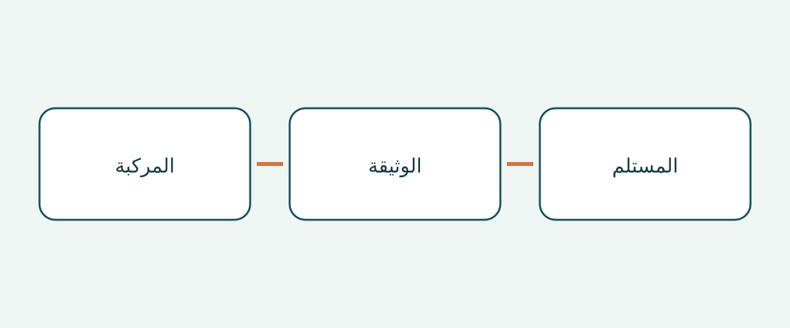

# فحص أوراق الإنقاذ عند شراء المركبة وتسليمها

قد يبدو مجلد يحمل اسم طراز السيارة مكتملاً مع أنه يحتوي على وثيقة إنقاذ غير مناسبة. عند استلام مركبة من سوق أخرى، لا يكفي السؤال عن وجود ملف PDF. المهم هو انطباق وثيقة المصنع على المركبة الفعلية، والحفاظ على هويتها، وقدرة الفريق المستلم على العثور عليها دون تخمين.

يتناول هذا الدليل وثائق الشراء والتسليم فقط. لا يقدم إجراءات تدخل طارئ، ولا يصادق على حالة المركبة، ولا يحدد أهليتها للاستيراد. امتلاك ورقة إنقاذ لا يجعل المشتري مستجيباً مدرباً. التوصيات التالية لتنظيم ملف الشراء ليست التزاماً قانونياً عالمياً بحمل الوثائق داخل السيارة.

## طلب نوعي الوثائق بصورة منفصلة

يميّز مورد الاستجابة للطوارئ لدى NHTSA الأمريكية بين الدليل التفصيلي الخاص بالمركبة وورقة الإنقاذ المختصرة للمستجيبين. كما يتيح التصفية حسب الصانع والطراز لأنواع مختلفة من الدفع الكهربائي. هذا وصف لمستودع معلومات أمريكي، وليس قاعدة للمشترين الدوليين.

إذا وفر المصنع الوثيقتين، فاطلبهما منفصلتين وسجّل وجود كل منهما وعنوانها الأصلي ورابطها. دليل المالك ليس تلقائياً أياً منهما، وكلمة «إنقاذ» في اسم الملف لا تثبت انطباقه. إذا استخدم المصنع ترتيباً مختلفاً، فاطلب تفسيراً بدلاً من فرض شكل يُفترض أنه عالمي.

يمنع هذا التمييز ظهور الإجابة الجزئية كأنها مكتملة. قد تُسلّم ورقة قصيرة دون تحديد الدليل التفصيلي، أو كتيب طويل دون الورقة المقابلة. سجّل الفجوة كطلب توضيح، لا كدليل على أن المركبة غير آمنة.

## مطابقة المركبة قبل قبول الملف

يفصل فهرس Tesla بين أدلة الطوارئ وأوراق الإنقاذ لطراز Model 3 للفترة 2017–2023 ومن 2024 فصاعداً. يوضح المثال أن اسم الطراز وحده قد لا يكفي. حافظ على الفترات كما وردت؛ لا تجعل تاريخ نشر الوثيقة سنة الطراز الرسمية للسيارة المعروضة. اطلب دليلاً يربط الوحدة بفترة الإنتاج المعنية.

يُقترح إعداد ملاحظة تشمل رقم تعريف المركبة، والصانع، وتسمية الطراز، وفترة الإنتاج الموثقة، ونوع الدفع، وسوق البيع الأصلي. أضف موضع المقود حيث يلزم. هذه طريقة شراء مقترحة، وليست استمارة تفرضها جميع الجهات. اترك الحقول غير المحسومة مفتوحة واستوضحها من البائع أو المصنع.

لا تستبدل الطراز بنسخة تبدو مكافئة من سوق أخرى. التشابه الشكلي أو الاسم التجاري المألوف لا يثبت انطباق معلومات الإنقاذ نفسها. ضع هوية السيارة لدى البائع بجانب نطاق الوثيقة حتى تبقى الفروق ظاهرة ولا تضيع داخل مرفق.

## استخدام مسار البحث لدى المصنع

تتيح بوابة Mercedes-Benz الرقمية للإنقاذ البحث بواسطة VIN/FIN أو مرشحات الطراز أو رمز QR على ملصق الإنقاذ الخاص بها. تصف الأوراق بناء المركبة ومواضع أنظمة السلامة لأفراد الإنقاذ. مهمة المشتري هي تحديد الوثيقة الناتجة، لا اعتبار تفاصيلها التقنية إذناً بالتدخل.

إذا وُجد ملصق QR مناسب على المركبة، فاطلب من البائع عرض وجهته وقارن معلومات المركبة الناتجة بملف الشراء. قراءة الرمز وحدها لا تُنهي الفحص. سجّل صفحة المصنع وهوية الوثيقة. وإذا اختلف الملصق ونتيجة البوابة ووصف البائع، فاطلب توضيحاً من المصنع أو مختص مناسب. لا يوجّه هذا الدليل إلى استبدال الملصق أو تعديل الوثيقة.

## حفظ حدود السوق ونوع الدفع

تقصر صفحة Kia البريطانية أوراقها صراحة على المركبات المخصصة لأوروبا، وتحذر من احتمال اختلاف نسخ المقود الأيمن، وتقول إن المعلومات للعاملين المدربين في الطوارئ لا للعملاء أو الوكلاء أو الورش. احتفظ بكل هذه القيود. وجود الصفحة في موقع بريطاني لا يوسعها إلى كل Kia تباع عالمياً.

تشرح Mercedes-Benz اليابان أن إرشادات الإنقاذ تختلف باختلاف الدفع، وتربط بالأدلة وبطاقات الإنقاذ المبنية على الطراز أو VIN. يبرز المثال الموجّه لليابان ضرورة تحديد الدفع بدلاً من الاعتماد على الشعار. لكنه لا يثبت انطباق وثيقة على نظام دفع آخر، أو تغطية البوابة الإقليمية تلقائياً لمركبة مستوردة من سوق مختلفة.

تفصل Tesla أيضاً معلومات الحوادث للمالكين عن موارد المستجيبين وتوجه فرق الاستجابة الأولى واللاحقة إلى قنوات الدعم المناسبة. حافظ على اختلاف الجمهور في ملف التسليم. الوصول إلى البوابة لا يثبت اجتياز تدريب إنقاذ، ولا ينبغي تعميم رقم دعم أمريكي على بلد آخر.

## تسليم أصل يمكن العثور عليه

| البند | ما ينبغي إثباته | ما يبقى منفصلاً |
|---|---|---|
| هوية المركبة | مطابقة السجلات لنطاق الوثيقة | الحالة الميكانيكية وأهلية الاستيراد |
| هوية الوثيقة | عنوان المصنع والنوع والفترة والمراجعة الظاهرة | اسم الملف أو ملخص البائع وحده |
| السوق والدفع | النطاق والقيود المذكورة | تكافؤ مفترض بين الأسواق أو أنظمة الدفع |
| مسار الوصول | اختبار الرابط الرسمي ووجهة QR الموجودة | افتراض عمل كل الملفات دون اتصال |
| المستلم | من يستلم الوثائق ويجدها | مؤهلات المستجيبين وتدريبهم |

احتفظ بوثيقة المصنع الأصلية وسجّل لغتها. لا يوصي هذا الدليل بترجمة ورقة الإنقاذ أو إعادة رسمها أو تحريرها. إذا لم تُحدّد نسخة رسمية بلغة مناسبة، فاسأل المصنع وأبقِ المشكلة ظاهرة. لا ينبغي لترجمة ينشئها المشتري أن تحل خفية محل الأصل.

تحقق قبل التسليم من كيفية وصول الفريق المستلم إلى المواد. إذا أمكن تنزيل ملف، فاختبر الملف المحفوظ فعلاً والوصول إليه، بدلاً من الوعد بأن كل البوابات تعمل دون اتصال. إذا كان الوصول يعتمد على موقع، فسجّل ذلك. احتفظ برابط المصدر مع النسخة ليبدأ الفحص اللاحق من المصنع لا من مرفق مجهول الأصل.

## تحويل الاختلافات إلى خطوات محددة

تبيّن ملاحظة التسليم المفيدة موضع الاختلاف، ومن سيعالجه، والدليل المنتظر. «فترة الإنتاج مؤكدة، ونطاق السوق الأصلي ينتظر توضيح المصنع» أدق من «اسم الطراز مطابق». إذا تعذر ربط الوثيقة المطلوبة أو استرجاعها، يوصي الدليل بتأجيل قبول الحزمة وأي تشغيل مخطط يعتمد عليها حتى معالجة الاختلاف.

هذا ليس حكماً بأن السيارة غير صالحة للسير، كما أن اكتمال الملف ليس شهادة سلامة. فحص الحالة والاستيراد القانوني والتسجيل والتدريب والاستعداد التشغيلي أمور منفصلة. أعد تأكيد المراجعة والانطباق الدقيق والدعم المحلي الحالي قبل الشراء والتسليم. رابط كان يعمل سابقاً لا يضمن وصولاً دائماً.

## أسئلة شائعة

### هل يكفي دليل المالك؟

لا تفترض ذلك. تميّز NHTSA الدليل التفصيلي عن الورقة المختصرة. اسأل عن وثائق المصنع للمركبة الفعلية وسجّل ما لم تُحدّد هويته.

### هل يمكن استخدام ورقة الطراز نفسه من بلد آخر؟

يلزم تأكيد الانطباق أولاً. يوضح نطاق Kia الأوروبي وتحذير المقود لماذا لا يكفي الاسم.

### هل تثبت الورقة السلامة أو قانونية الاستيراد؟

لا. لها جمهور وغرض محددان. الحالة وأهلية الاستيراد والتسجيل تحتاج إلى تحريات مستقلة.

### هل يعيد المشتري كتابتها بلغة أخرى؟

احتفظ بالأصل وابحث عن نسخة رسمية مناسبة. لا تستبدله خفية بترجمة شخصية أو رسم معدل.

## رسم توضيحي

يربط الرسم هوية المركبة وهوية الوثيقة وجهة الاستلام.

## قراءة ذات صلة

تصفح [معلومات المركبات](https://www.autobridgeexport.com/vehicles/) و[أدلة الشراء والتسليم](https://www.autobridgeexport.com/guides/).

## المصادر والتحقق

تم التحقق من المصادر في 2026-11-05. تحتفظ أمثلة الولايات المتحدة والسوق الأوروبية واليابان بنطاقها؛ لا يُدّعى وجود إلزام دولي بحمل الوثائق.

- [Emergency response guides](https://www.nhtsa.gov/emergency-response-guides) — US Department of Transportation / NHTSA.
- [First responder vehicle resources](https://www.tesla.com/firstresponders/vehicles-charging) — Tesla.
- [Digital Mercedes-Benz rescue assistants](https://rk.mb-qr.com/en/) — Mercedes-Benz Group.
- [Kia rescue sheets](https://www.kia.com/uk/owners/rescue-sheets/) — Hyundai Motor Group / Kia.
- [Mercedes-Benz Japan rescue information](https://www.mercedes-benz.co.jp/passengercars/services/activity/rescue.html) — Mercedes-Benz Group.
- [Tesla first responders information](https://www.tesla.com/firstresponders/) — Tesla.
