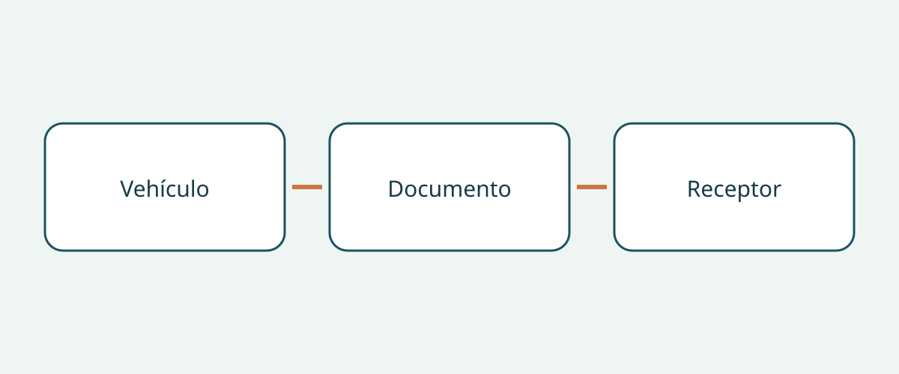

# Fichas de rescate: comprobaciones para comprar y entregar

Una carpeta con el nombre del modelo puede parecer completa y contener el documento de rescate equivocado. Al recibir un vehículo de otro mercado, no basta con preguntar si existe un PDF. Hay que establecer si el documento del fabricante corresponde a la unidad real, conserva su identidad y puede localizarlo el equipo receptor sin adivinar.

Esta guía trata solo la adquisición y entrega de documentos. No ofrece procedimientos de intervención, ni certifica el estado del vehículo, ni determina su admisibilidad de importación. Mantenga la información especializada en su contexto original del fabricante, sin convertir esta lista de compra en un manual operativo. Tener una ficha de rescate no convierte al comprador en personal formado. Las recomendaciones para organizar el expediente no son una obligación universal de llevar documentos a bordo.

## Pedir documentos distintos, no un manual genérico

El recurso estadounidense de NHTSA distingue la guía detallada de respuesta a emergencias específica del vehículo de la ficha de rescate abreviada para intervinientes. También permite filtrar por marca y modelo diferentes propulsiones eléctricas. Es la descripción de un repositorio estadounidense, no una regla para compradores internacionales.

Cuando el fabricante ofrezca ambos, solicítelos por separado. Anote si están presentes, su título original y su enlace. El manual del propietario no es automáticamente ninguno de ellos, y que un archivo se llame «rescate» no demuestra aplicabilidad. Si el fabricante organiza la información de otra manera, pida explicación en vez de imponer un formato supuestamente universal.

Así se evita que una respuesta parcial parezca completa. Puede entregarse una ficha sin identificar la guía detallada, o un manual extenso sin la ficha correspondiente. Registre el vacío como una aclaración pendiente, no como prueba de que el vehículo sea inseguro.

## Relacionar la unidad con el alcance del documento

Tesla separa las guías de emergencia y fichas de rescate de Model 3 para 2017–2023 y desde 2024. El nombre del modelo puede ser insuficiente. Conserve esos periodos tal como aparecen; no convierta la fecha de publicación del documento en el año de modelo oficial del coche. Pida evidencia que vincule la unidad con su periodo de producción.

Prepare una nota con número de identificación, fabricante, denominación, periodo de producción documentado, propulsión y mercado de venta original. Añada la configuración de dirección cuando corresponda. Es un método recomendado de compra, no un formulario exigido por todas las autoridades. Mantenga los datos inciertos abiertos y consulte al vendedor o fabricante antes de aceptar una supuesta coincidencia.

No sustituya el modelo por una versión aparentemente equivalente de otro mercado. La apariencia o un nombre comercial familiar no prueban que se aplique la misma información. Conserve juntos la identidad anunciada y el alcance del documento para que las diferencias sean visibles.

## Seguir la búsqueda del fabricante

El portal digital de Mercedes-Benz permite buscar por VIN/FIN, filtros de modelo o código QR de su adhesivo de rescate. Las fichas describen construcción y ubicación de sistemas de seguridad para personal de rescate. La tarea de compra consiste en identificar el resultado, no en interpretar sus detalles como permiso para intervenir.

Si ya hay una etiqueta QR pertinente, pida al vendedor que muestre su destino y compare los datos obtenidos con el expediente. Un código legible no termina la comprobación. Anote la página del fabricante y la identidad del documento. Si etiqueta, portal y descripción no concuerdan, solicite aclaración al fabricante o a un profesional apropiado. Esta guía no indica sustituir etiquetas ni modificar fichas.

## Mantener los límites de mercado y propulsión

La página británica de Kia limita expresamente sus fichas a vehículos destinados a Europa, advierte de posibles diferencias en versiones con volante a la derecha y destina la información a personal de emergencia formado, no a clientes, concesionarios o talleres. Conserve estas restricciones. Estar en un sitio británico no amplía la cobertura a todos los Kia del mundo.

Mercedes-Benz Japón explica que las indicaciones de rescate varían según la propulsión y enlaza guías y tarjetas por modelo o VIN. Este ejemplo dirigido a Japón refuerza la necesidad de identificar la propulsión, no solo la insignia. No demuestra que un documento sirva para otra motorización ni que un portal regional cubra automáticamente una importación.

Tesla también separa información de accidentes para propietarios de los recursos para intervinientes y dirige a los equipos de primera intervención y posteriores hacia canales apropiados. Mantenga separados los destinatarios. Acceder al portal no prueba formación, y un número estadounidense no debe generalizarse a otros países.

## Entregar un original localizable

| Elemento | Qué establecer | Qué queda separado |
|---|---|---|
| Identidad del vehículo | Correspondencia entre expediente y cobertura | Estado mecánico y admisibilidad de importación |
| Identidad documental | Título, tipo, periodo y revisión indicada | Nombre de archivo o resumen del vendedor |
| Mercado y propulsión | Alcance y restricciones expresas | Equivalencia supuesta entre mercados o propulsiones |
| Acceso | Probar enlace oficial y destino QR existente | Acceso sin conexión supuesto |
| Receptor | Quién recibe y encuentra los documentos | Cualificación y formación del personal |

Conserve el documento original del fabricante e identifique el idioma de la versión disponible. Esta guía no recomienda traducir, redibujar ni editar una ficha de rescate. Si no se identifica una versión oficial en un idioma adecuado, consulte al fabricante y mantenga visible el problema. Una traducción creada por el comprador no debería sustituir silenciosamente el original.

Antes de entregar, compruebe cómo accederá el equipo receptor. Si hay un archivo descargable, pruebe el archivo realmente guardado y su acceso, sin prometer que todos los portales funcionan sin conexión. Si depende de una web, indíquelo. Conserve el enlace original con cualquier copia para futuras comprobaciones en el fabricante.

## Dar seguimiento a las discrepancias

Una nota útil indica qué no coincide, quién lo resolverá y qué evidencia falta. «Periodo confirmado, mercado original pendiente de aclaración del fabricante» es más preciso que «nombre correcto». Si no puede relacionarse o recuperarse el documento previsto, esta guía recomienda aplazar la aceptación del paquete y cualquier puesta en servicio planificada que dependa de él hasta resolverlo.

Esto no declara que el vehículo no sea apto para circular; un paquete completo tampoco certifica seguridad. Inspección, importación legal, matriculación, formación y preparación operativa son asuntos distintos. Reconfirme revisión, aplicabilidad exacta y asistencia local actual antes de compra y entrega. Un enlace que funcionó antes no garantiza acceso permanente.

## Preguntas frecuentes

### ¿Basta el manual del propietario?

No lo presuponga. NHTSA distingue guía detallada y ficha abreviada. Pregunte por los documentos de la unidad y registre las identificaciones que falten.

### ¿Sirve la ficha del mismo modelo de otro país?

Solo tras confirmar aplicabilidad. La limitación europea y la advertencia de Kia sobre la dirección muestran por qué el nombre no basta.

### ¿La ficha demuestra seguridad o importación legal?

No. Tiene destinatarios y finalidad definidos. Estado, admisibilidad y matriculación requieren comprobaciones propias.

### ¿Debe el comprador reescribirla en otro idioma?

Conserve el original y busque una versión oficial apropiada. No lo sustituya silenciosamente por traducciones propias o diagramas modificados.

## Ilustración

El diagrama conecta la identidad del vehículo, la del documento y el receptor.

## Lecturas relacionadas

Consulte [información de vehículos](https://www.autobridgeexport.com/vehicles/) y [guías de compra y entrega](https://www.autobridgeexport.com/guides/).

## Fuentes y verificación

Fuentes comprobadas el 2026-11-05. Los ejemplos de Estados Unidos, Europa y Japón conservan su alcance; no se afirma una obligación internacional de llevar documentos.

- [Emergency response guides](https://www.nhtsa.gov/emergency-response-guides) — US Department of Transportation / NHTSA.
- [First responder vehicle resources](https://www.tesla.com/firstresponders/vehicles-charging) — Tesla.
- [Digital Mercedes-Benz rescue assistants](https://rk.mb-qr.com/en/) — Mercedes-Benz Group.
- [Kia rescue sheets](https://www.kia.com/uk/owners/rescue-sheets/) — Hyundai Motor Group / Kia.
- [Mercedes-Benz Japan rescue information](https://www.mercedes-benz.co.jp/passengercars/services/activity/rescue.html) — Mercedes-Benz Group.
- [Tesla first responders information](https://www.tesla.com/firstresponders/) — Tesla.
