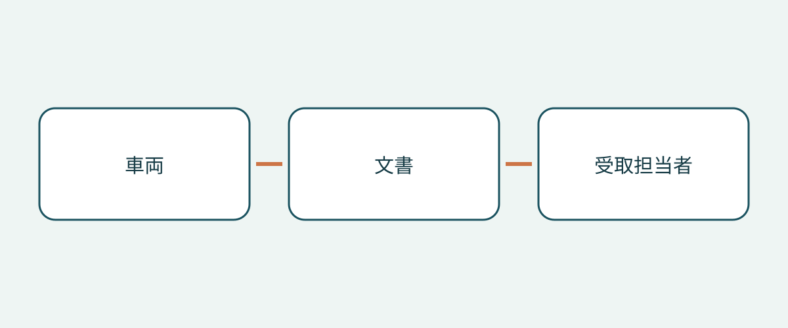

# 車両購入と引渡しで確認するレスキューシート

車名を付けたフォルダーでも、中に違うレスキュー資料が入っていることがあります。他市場の車両を受け取る際は、PDF の有無だけでは不十分です。メーカー文書が実車に適用され、文書の識別情報が保たれ、受取担当者が推測せずに該当資料へアクセスできるかを確認します。

本稿の範囲は購入資料と引渡しだけです。緊急時の介入手順、車両状態の認証、輸入可否の判断は提供しません。レスキューシートを持っていても、救助訓練を受けたことにはなりません。専門的な対応情報はメーカーの原資料の文脈を保ち、購入用の確認表を作業マニュアルに変えないでください。以下は購入書類の整理方法の提案であり、世界共通の書類携帯義務ではありません。

## 一般的なマニュアルではなく文書の種類を分けて依頼する

米国 NHTSA の緊急対応資料は、車両別の詳細な緊急対応ガイドと、救助者向けの簡略なレスキューシートを区別しています。また、異なる電動パワートレインについてメーカー・車種別の絞り込みを提供しています。これは米国の情報集の説明であり、海外購入者に適用される規則ではありません。

メーカーが両方を提供する場合は、それぞれ依頼し、有無、原題、元のリンクを記録します。取扱説明書が自動的にどちらかに相当するわけではなく、ファイル名に「レスキュー」があっても適用性は証明できません。メーカーの文書構成が異なるなら、共通形式に無理に当てはめず説明を求めます。

こうすれば、不完全な回答を完全な資料と誤認せずに済みます。簡略シートだけあり詳細ガイドが不明な場合や、長いマニュアルはあっても対応するシートが不明な場合があります。不足は確認依頼として記録し、それだけで車両が危険と断定しないでください。

## 文書を受け入れる前に車両と対応させる

Tesla の資料一覧では Model 3 の緊急対応ガイドとレスキューシートを、2017–2023 と 2024 以降に分けています。車名だけでは不十分になり得る例です。この期間区分をそのまま保持し、文書の発行日を車の正式なモデル年とみなさないでください。実車と該当生産期間を結び付ける資料を求めます。

車両識別番号、メーカー、車種名、裏付けのある生産期間、動力形式、当初の販売市場を記した簡単な記録を作ることを勧めます。必要に応じてハンドル位置も記録します。これは購入方法の提案であり、すべての当局が同じ書式を要求するという意味ではありません。不明項目を埋め合わせず、販売者やメーカーに確認します。

他市場の「相当車種」で代用しないでください。外観や販売名が似ていても、同じ救助情報が適用されるとは限りません。販売者の車両情報と文書の適用範囲を並べ、違いを添付資料の中に埋もれさせないようにします。

## メーカーの検索経路で確認する

Mercedes-Benz のデジタル救助ポータルは、VIN/FIN、車種フィルター、救助ステッカーの QR コードから検索できます。シートは救助者向けに車両構造と安全システムの位置を説明します。購入時の仕事は検索結果の文書を特定することであり、技術内容を作業許可と解釈することではありません。

車両に既存の関連 QR ラベルがあれば、販売者にリンク先を示してもらい、表示された車両情報を購入資料と比較します。読み取れるだけで確認完了ではありません。メーカーのページと文書識別情報を記録します。ラベル、検索結果、販売説明が一致しなければ、メーカーまたは適切な専門家へ確認してください。本稿はラベル交換や文書変更を指示しません。

## 市場と動力の制限を保持する

Kia の英国サイトのレスキューシートページは、対象を欧州向け車両に限定し、右ハンドル仕様は異なる場合があると注意しています。また情報は訓練を受けた緊急対応要員向けであり、顧客、販売店、整備工場向けではないとしています。これらの制限を保ってください。英国サイトにあるからといって世界中の Kia に適用されるわけではありません。

Mercedes-Benz 日本の案内は、動力形式によって救助ガイドが異なると説明し、ガイドと車種または VIN によるレスキューカードへリンクしています。エンブレムだけでなく動力を特定する必要性を示す日本向けの例です。別の動力にも同じ文書が使える証拠でも、地域ポータルが輸入車を自動的に網羅する証拠でもありません。

Tesla も車両所有者向け事故情報と救助者向け資料を分け、初動および後続の対応者を適切な支援窓口へ案内しています。引渡し資料でも対象者を区別してください。ポータルを開けることは救助訓練の修了を意味せず、米国の窓口番号を他国へ一般化することもできません。

## 書き直した代用品ではなく取得できる原本を渡す

| 記録事項 | 確認すること | 別に扱うこと |
|---|---|---|
| 車両の識別 | 車両記録と適用範囲の一致 | 機械状態と輸入可否 |
| 文書の識別 | メーカー原題、種類、期間、表示された改訂 | ファイル名や販売者の要約だけ |
| 市場と動力 | 明記された範囲と制限 | 市場・動力間の推定による同一視 |
| 取得経路 | 公式リンクと既存 QR のリンク先の確認 | すべてオフラインで使えるという推測 |
| 受取担当者 | 誰が受け取り、見つけられるか | 救助者の資格と訓練 |

メーカー原本とその言語情報を保持します。本稿はレスキューシートの翻訳、描き直し、編集を勧めません。適切な公式言語版が特定できなければメーカーへ問い合わせ、未解決事項として残します。購入者作成の翻訳で原本を黙って置き換えないでください。

引渡し前に受取側の取得方法を確認します。ダウンロード可能なら、実際に保存したファイルとアクセスを確認し、すべてのポータルがオフライン対応だと約束しないでください。サイトが必要ならその旨を記録します。保存文書には元のリンクも添え、次回は出所不明の添付ではなくメーカーから確認できるようにします。

## 不一致に具体的な次の行動を設定する

役立つ引渡し記録には、不一致の内容、担当者、待っている証拠を書きます。「車名一致」より「生産期間確認済み、当初市場の適用性はメーカー回答待ち」の方が明確です。予定する文書を対応付けられない、または取得できない場合、本稿では資料一式の受入れと、それに依存する予定の運用開始を解決まで延期することを勧めます。

これは公道走行に適さないとの判定ではなく、資料が揃っても安全認証にはなりません。車両状態、合法的な輸入、登録、訓練、運用準備は別々です。購入・引渡し時に改訂、実車への適用、現在の現地支援を再確認します。以前開けたリンクは永続的なアクセスの保証ではありません。

## よくある質問

### 取扱説明書があれば十分ですか？

決めつけないでください。NHTSA は詳細ガイドと簡略シートを区別しています。実車に対応するメーカー文書を尋ね、未特定のものを記録します。

### 他国の同名車種のシートを使えますか？

適用性の確認が必要です。Kia の欧州限定とハンドル位置の注意は、名前だけでは不十分な理由を示します。

### シートは安全や合法的輸入の証明ですか？

いいえ。対象者と目的が定められた文書です。状態、輸入可否、登録は別途調査します。

### 購入者が別言語へ書き直すべきですか？

原本を保ち、適切な公式言語版を探してください。独自翻訳や改変図で黙って置き換えないでください。

## 図解

車両の識別、文書の識別、受取担当者をつないだ図です。

## 関連情報

[車両情報](https://www.autobridgeexport.com/vehicles/)と[購入・引渡しガイド](https://www.autobridgeexport.com/guides/)をご覧ください。

## 出典と確認日

出典確認日：2026-11-05。米国、欧州市場、日本向けの例は元の範囲を維持し、国際的な書類携帯義務は主張しません。

- [Emergency response guides](https://www.nhtsa.gov/emergency-response-guides) — US Department of Transportation / NHTSA.
- [First responder vehicle resources](https://www.tesla.com/firstresponders/vehicles-charging) — Tesla.
- [Digital Mercedes-Benz rescue assistants](https://rk.mb-qr.com/en/) — Mercedes-Benz Group.
- [Kia rescue sheets](https://www.kia.com/uk/owners/rescue-sheets/) — Hyundai Motor Group / Kia.
- [Mercedes-Benz Japan rescue information](https://www.mercedes-benz.co.jp/passengercars/services/activity/rescue.html) — Mercedes-Benz Group.
- [Tesla first responders information](https://www.tesla.com/firstresponders/) — Tesla.
