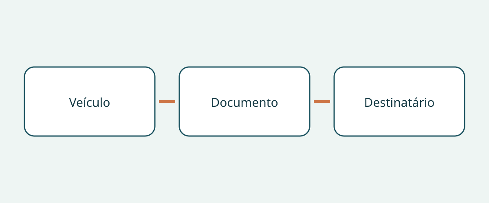

# Fichas de resgate na compra e entrega de veículos

Uma pasta com o nome do modelo pode parecer completa e conter o documento de resgate errado. Ao receber um veículo de outro mercado, não basta saber se existe um PDF. Importa estabelecer se o documento do fabricante corresponde à unidade real, conserva a sua identidade e pode ser encontrado pela equipa destinatária sem adivinhações.

Este guia trata apenas da aquisição e entrega de documentos. Não fornece procedimentos de intervenção, nem certifica o estado do veículo, nem determina a admissibilidade de importação. Mantenha a informação especializada no contexto original do fabricante, sem transformar esta lista de compra num manual operacional. Ter uma ficha de resgate não torna o comprador um interveniente formado. As recomendações para organizar o dossier não são uma obrigação universal de transportar documentos no veículo.

## Pedir documentos separados

O recurso norte-americano da NHTSA distingue o guia detalhado de resposta a emergências específico do veículo da ficha de resgate abreviada para intervenientes. Também permite filtrar marca e modelo para diferentes propulsões elétricas. É a descrição de um repositório dos Estados Unidos, não uma regra para compradores internacionais.

Se o fabricante disponibilizar ambos, peça-os separadamente. Registe a presença, o título original e a ligação de origem. O manual do proprietário não é automaticamente nenhum deles, e «resgate» no nome do ficheiro não comprova aplicabilidade. Se a organização documental for diferente, peça explicação em vez de impor um formato supostamente universal.

Assim, uma resposta parcial não parece completa. Pode existir uma ficha sem identificação do guia detalhado, ou um manual extenso sem ficha correspondente. Registe a lacuna como pedido de esclarecimento, não como prova de insegurança do veículo.

## Relacionar a unidade com a cobertura

A Tesla separa guias de emergência e fichas de resgate do Model 3 para 2017–2023 e a partir de 2024. O nome do modelo pode ser insuficiente. Preserve os períodos indicados; a data de publicação do documento não se transforma no ano-modelo oficial da viatura. Peça evidência que ligue a unidade ao período de produção pertinente.

Prepare uma nota com número de identificação, fabricante, designação do modelo, período de produção documentado, propulsão e mercado de venda original. Acrescente a configuração da direção quando relevante. É um método de compra recomendado, não um formulário exigido por todas as autoridades. Mantenha as dúvidas abertas e solicite esclarecimento ao vendedor ou fabricante.

Não substitua o modelo por uma versão aparentemente equivalente de outro mercado. Aparência semelhante ou nome comercial conhecido não demonstram a aplicação da mesma informação. Conserve a identidade vendida ao lado da cobertura documental para tornar visíveis as diferenças.

## Utilizar a pesquisa do fabricante

O portal digital Mercedes-Benz permite pesquisar por VIN/FIN, filtros de modelo ou código QR do autocolante de resgate. As fichas descrevem construção e localização de sistemas de segurança para profissionais de socorro. Para o comprador, a tarefa é identificar o resultado, não interpretar os detalhes como autorização para intervir.

Se já existir uma etiqueta QR pertinente, peça ao vendedor que mostre o destino e compare os dados obtidos com o dossier. Um código legível não termina a verificação. Registe a página do fabricante e a identidade do documento. Se etiqueta, portal e descrição não coincidirem, procure esclarecimento do fabricante ou de profissional adequado. Este guia não instrui a substituir etiquetas ou alterar fichas.

## Manter limites de mercado e propulsão

A página britânica da Kia limita expressamente as fichas a veículos destinados à Europa, alerta para possíveis diferenças nas versões com volante à direita e destina a informação a profissionais de emergência formados, não a clientes, concessionários ou oficinas. Preserve estas restrições. Um sítio britânico não estende a cobertura a todos os Kia vendidos mundialmente.

A Mercedes-Benz Japão explica que as orientações de resgate diferem conforme a propulsão e liga a guias e fichas por modelo ou VIN. Este exemplo dirigido ao Japão reforça a identificação da propulsão em vez da escolha apenas pelo emblema. Não comprova que um documento serve para outro sistema ou que um portal regional cobre automaticamente um veículo importado.

A Tesla também separa informações de acidente para proprietários dos recursos para intervenientes e encaminha equipas de primeira intervenção e de fases posteriores para canais adequados. Preserve os públicos distintos. Acesso ao portal não comprova formação; um contacto de apoio norte-americano não deve ser generalizado a outro país.

## Entregar um original que possa ser encontrado

| Elemento | O que estabelecer | O que continua separado |
|---|---|---|
| Identidade do veículo | Correspondência entre dossier e cobertura | Estado mecânico e admissibilidade de importação |
| Identidade documental | Título, tipo, período e revisão indicada | Nome do ficheiro ou resumo do vendedor |
| Mercado e propulsão | Âmbito e restrições expressos | Equivalência presumida entre variantes |
| Acesso | Testar ligação oficial e destino QR existente | Acesso sem ligação presumido |
| Destinatário | Quem recebe e encontra documentos | Qualificação e formação dos profissionais |

Conserve o original do fabricante e a identificação do idioma. Este guia não recomenda traduzir, redesenhar ou editar uma ficha de resgate. Se não identificar uma versão oficial numa língua adequada, contacte o fabricante e mantenha a questão visível. Uma tradução do comprador não deveria substituir silenciosamente o original.

Antes da entrega, verifique como a equipa acederá aos materiais. Se houver ficheiro descarregável, teste o ficheiro efetivamente guardado e o acesso, sem prometer funcionamento de todos os portais sem ligação. Se depender de um sítio, registe-o. Guarde a ligação original com a cópia para futuras verificações junto do fabricante.

## Dar seguimento às diferenças

Uma nota útil identifica a diferença, quem a resolverá e a evidência aguardada. «Período confirmado, mercado original a esclarecer pelo fabricante» é mais preciso que «nome correto». Se o documento previsto não puder ser associado ou recuperado, este guia recomenda adiar a aceitação do conjunto documental e qualquer entrada em serviço planeada que dele dependa até à resolução.

Isto não declara o veículo impróprio para circular; um dossier completo também não certifica segurança. Inspeção, importação legal, matrícula, formação e preparação operacional são verificações distintas. Reconfirme revisão, aplicabilidade exata e apoio local atual antes de comprar e entregar. Uma ligação que funcionava não garante acesso permanente.

## Perguntas frequentes

### Basta o manual do proprietário?

Não presuma. A NHTSA distingue guia detalhado e ficha abreviada. Pergunte que documentos correspondem à unidade e registe identificações em falta.

### Serve a ficha do mesmo modelo de outro país?

Só após confirmar a aplicabilidade. A limitação europeia e o alerta da Kia sobre direção mostram por que o nome não basta.

### A ficha comprova segurança ou importação legal?

Não. Tem público e finalidade próprios. Estado, admissibilidade e matrícula exigem verificações separadas.

### O comprador deve reescrever a ficha noutra língua?

Conserve o original e procure uma versão oficial adequada. Não o substitua discretamente por tradução própria ou diagrama alterado.

## Ilustração

O diagrama liga a identidade do veículo, a do documento e o destinatário.

## Leitura relacionada

Consulte [informações sobre veículos](https://www.autobridgeexport.com/vehicles/) e [guias de compra e entrega](https://www.autobridgeexport.com/guides/).

## Fontes e verificação

Fontes verificadas em 2026-11-05. Os exemplos dos Estados Unidos, Europa e Japão mantêm o seu âmbito; não se afirma uma obrigação internacional de transportar documentos.

- [Emergency response guides](https://www.nhtsa.gov/emergency-response-guides) — US Department of Transportation / NHTSA.
- [First responder vehicle resources](https://www.tesla.com/firstresponders/vehicles-charging) — Tesla.
- [Digital Mercedes-Benz rescue assistants](https://rk.mb-qr.com/en/) — Mercedes-Benz Group.
- [Kia rescue sheets](https://www.kia.com/uk/owners/rescue-sheets/) — Hyundai Motor Group / Kia.
- [Mercedes-Benz Japan rescue information](https://www.mercedes-benz.co.jp/passengercars/services/activity/rescue.html) — Mercedes-Benz Group.
- [Tesla first responders information](https://www.tesla.com/firstresponders/) — Tesla.
