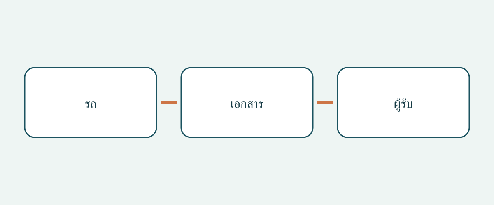

# ตรวจเอกสารกู้ภัยในการซื้อและส่งมอบรถ

แฟ้มที่ตั้งชื่อตามรุ่นรถอาจดูครบถ้วนแต่มีเอกสารกู้ภัยผิดฉบับ สำหรับรถจากตลาดอื่น คำถามไม่ใช่เพียงมี PDF หรือไม่ แต่ต้องตรวจว่าเอกสารผู้ผลิตใช้กับรถจริงหรือไม่ ข้อมูลระบุเอกสารยังครบหรือไม่ และทีมผู้รับค้นหาเอกสารที่ถูกต้องได้โดยไม่ต้องเดาหรือไม่

บทความนี้ครอบคลุมเฉพาะเอกสารจัดซื้อและส่งมอบ ไม่ให้ขั้นตอนปฏิบัติการช่วยเหลือฉุกเฉิน ไม่รับรองสภาพรถ และไม่ตัดสินสิทธินำเข้า การมีแผ่นข้อมูลกู้ภัยไม่ได้แปลว่าผู้ซื้อผ่านการฝึกกู้ภัย ควรเก็บข้อมูลสำหรับเจ้าหน้าที่ไว้ในบริบทต้นฉบับของผู้ผลิต ไม่เปลี่ยนรายการตรวจจัดซื้อให้เป็นคู่มือปฏิบัติการ คำแนะนำจัดแฟ้มต่อไปนี้ไม่ใช่หน้าที่ตามกฎหมายสากลในการพกเอกสารไว้ในรถ

## ขอเอกสารแยกประเภท ไม่ใช่เพียงคู่มือทั่วไป

คลังข้อมูลตอบโต้เหตุฉุกเฉินของ NHTSA ในสหรัฐฯ แยกคู่มือฉุกเฉินแบบละเอียดเฉพาะรถออกจากแผ่นข้อมูลกู้ภัยฉบับย่อสำหรับผู้ปฏิบัติงาน และมีตัวกรองยี่ห้อและรุ่นสำหรับระบบขับเคลื่อนไฟฟ้าหลายแบบ นี่คือคำอธิบายคลังข้อมูลสหรัฐฯ ไม่ใช่กฎสำหรับผู้ซื้อระหว่างประเทศ

หากผู้ผลิตมีทั้งสองอย่าง ให้ขอแยกกันและบันทึกว่าได้รับหรือยัง ชื่อเดิมคืออะไร และลิงก์ต้นทางอยู่ที่ใด คู่มือเจ้าของรถไม่ใช่หนึ่งในสองอย่างนี้โดยอัตโนมัติ และชื่อไฟล์มีคำว่า “กู้ภัย” ก็ไม่ยืนยันว่าใช้ได้กับรถ หากผู้ผลิตจัดเอกสารต่างออกไป ให้ขอคำอธิบายแทนการบังคับให้ตรงรูปแบบที่คิดว่าเป็นสากล

การแยกประเภทช่วยไม่ให้คำตอบบางส่วนดูเหมือนครบ อาจมีแผ่นย่อแต่ยังไม่ระบุคู่มือละเอียด หรือมีคู่มือเล่มยาวแต่ยังไม่รู้แผ่นย่อที่ตรงกัน บันทึกส่วนขาดเป็นคำถามที่ต้องชี้แจง ไม่ใช่หลักฐานว่ารถไม่ปลอดภัย

## จับคู่รถกับขอบเขตเอกสารก่อนรับไฟล์

รายการเอกสาร Tesla แยกคู่มือฉุกเฉินและแผ่นข้อมูลกู้ภัย Model 3 สำหรับ 2017–2023 กับตั้งแต่ 2024 เป็นต้นไป ชื่อรุ่นอย่างเดียวจึงอาจไม่พอ รักษาช่วงเวลาตามที่ระบุ และอย่านำวันที่เผยแพร่เอกสารมาเป็นปีรุ่นอย่างเป็นทางการของรถที่ขาย ขอหลักฐานเชื่อมรถจริงกับช่วงการผลิตที่เกี่ยวข้อง

แนะนำให้ทำบันทึกสั้น ๆ ระบุหมายเลขประจำรถ ผู้ผลิต ชื่อรุ่น ช่วงผลิตที่มีเอกสารรองรับ ระบบขับเคลื่อน และตลาดจำหน่ายเดิม รวมตำแหน่งพวงมาลัยเมื่อเกี่ยวข้อง นี่เป็นวิธีจัดซื้อที่แนะนำ ไม่ใช่แบบฟอร์มที่ทุกหน่วยงานกำหนด หากข้อมูลใดยังไม่ชัด ให้คงไว้แล้วถามผู้ขายหรือผู้ผลิตก่อนรับข้อสรุปว่าตรงกัน

อย่าใช้รุ่นที่ดูเทียบเท่าจากอีกตลาดแทน รูปลักษณ์หรือชื่อการค้าที่คุ้นเคยไม่พิสูจน์ว่าใช้ข้อมูลกู้ภัยเดียวกัน วางข้อมูลรถจากผู้ขายคู่กับขอบเขตของเอกสาร เพื่อให้เห็นความต่างโดยไม่จมหายไปในไฟล์แนบ

## ใช้ช่องทางค้นหาของผู้ผลิต

พอร์ทัลกู้ภัยดิจิทัล Mercedes-Benz ค้นหาได้ด้วย VIN/FIN ตัวกรองรุ่น หรือ QR บนสติกเกอร์กู้ภัยของบริษัท แผ่นข้อมูลอธิบายโครงสร้างรถและตำแหน่งระบบความปลอดภัยให้เจ้าหน้าที่กู้ภัย สำหรับผู้ซื้อ งานคือระบุเอกสารที่ได้ ไม่ใช่ตีความข้อมูลเทคนิคว่าอนุญาตให้ลงมือปฏิบัติการกู้ภัย

หากรถมีฉลาก QR ที่เกี่ยวข้องอยู่แล้ว ให้ผู้ขายแสดงปลายทางและเปรียบเทียบข้อมูลรถที่ได้กับแฟ้มซื้อ การอ่านโค้ดได้ไม่ใช่จุดจบของการตรวจ บันทึกหน้าผู้ผลิตและข้อมูลระบุเอกสาร หากฉลาก ผลค้นหา และคำอธิบายผู้ขายไม่ตรงกัน ขอผู้ผลิตหรือผู้เชี่ยวชาญที่เหมาะสมชี้แจง บทความไม่สั่งให้เปลี่ยนฉลากหรือแก้เอกสาร

## รักษาข้อจำกัดด้านตลาดและระบบขับเคลื่อน

หน้าข้อมูลกู้ภัย Kia บนเว็บไซต์สหราชอาณาจักรจำกัดเอกสารไว้สำหรับรถที่ตั้งใจจำหน่ายในยุโรป เตือนว่ารุ่นพวงมาลัยขวาอาจต่างกัน และระบุว่าเป็นข้อมูลสำหรับบุคลากรฉุกเฉินที่ผ่านการฝึก ไม่ใช่ลูกค้า ผู้จำหน่าย หรืออู่ซ่อม ควรเก็บข้อจำกัดทั้งหมดไว้ เว็บไซต์อังกฤษไม่ได้ขยายการครอบคลุมไปยัง Kia ทุกคันทั่วโลก

Mercedes-Benz ญี่ปุ่นอธิบายว่าคำแนะนำกู้ภัยแตกต่างตามระบบขับเคลื่อน และเชื่อมไปยังคู่มือกับการ์ดกู้ภัยที่ค้นด้วยรุ่นหรือ VIN ตัวอย่างสำหรับญี่ปุ่นนี้ย้ำว่าต้องระบุระบบขับเคลื่อน ไม่เลือกจากตรารถเพียงอย่างเดียว แต่ไม่ได้พิสูจน์ว่าเอกสารหนึ่งใช้ได้กับอีกระบบ หรือพอร์ทัลภูมิภาครองรับรถนำเข้าจากทุกตลาดโดยอัตโนมัติ

Tesla ยังแยกข้อมูลอุบัติเหตุสำหรับเจ้าของออกจากทรัพยากรสำหรับผู้ตอบโต้เหตุ และแนะนำช่องทางสนับสนุนสำหรับผู้เข้าระงับเหตุช่วงแรกและช่วงถัดไป ควรรักษาความต่างของกลุ่มผู้อ่านในแฟ้มส่งมอบ การเข้าพอร์ทัลได้ไม่ยืนยันการฝึกกู้ภัย และไม่ควรนำหมายเลขสนับสนุนสหรัฐฯ ไปใช้เป็นข้อสรุปสำหรับประเทศอื่น

## ส่งมอบต้นฉบับที่ค้นพบได้ ไม่ใช่ฉบับเขียนใหม่

| รายการ | สิ่งที่ควรยืนยัน | สิ่งที่ยังแยกต่างหาก |
|---|---|---|
| ตัวตนรถ | เอกสารรถตรงขอบเขตของไฟล์ | สภาพกลไกและสิทธินำเข้า |
| ตัวตนเอกสาร | ชื่อผู้ผลิต ประเภท ช่วงเวลา และฉบับแก้ไขที่ระบุ | ชื่อไฟล์หรือสรุปผู้ขายอย่างเดียว |
| ตลาดและระบบขับเคลื่อน | ขอบเขตและข้อจำกัดที่ระบุ | การเดาว่าต่างตลาดหรือระบบเทียบกันได้ |
| ทางเข้าถึง | ทดลองลิงก์ทางการและปลายทาง QR เดิม | การคิดว่าทุกไฟล์ใช้แบบออฟไลน์ได้ |
| ผู้รับ | ใครได้รับและค้นหาเอกสารได้ | คุณสมบัติและการฝึกเจ้าหน้าที่ |

เก็บต้นฉบับผู้ผลิตและข้อมูลภาษาของเอกสาร บทความไม่แนะนำให้แปล วาดใหม่ หรือแก้แผ่นข้อมูลกู้ภัย หากยังไม่พบฉบับภาษาทางการที่เหมาะสม ให้ถามผู้ผลิตและคงปัญหาไว้ในบันทึก ฉบับแปลที่ผู้ซื้อทำไม่ควรแทนต้นฉบับโดยไม่แจ้ง

ตรวจวิธีเข้าถึงของทีมผู้รับก่อนส่งมอบ หากดาวน์โหลดได้ ให้ทดลองไฟล์ที่บันทึกจริงและการเปิดใช้ ไม่รับปากว่าทุกพอร์ทัลใช้แบบออฟไลน์ได้ หากต้องพึ่งเว็บไซต์ ให้ระบุไว้ เก็บลิงก์ต้นทางพร้อมสำเนา เพื่อให้ตรวจครั้งถัดไปจากผู้ผลิตแทนไฟล์แนบที่ไม่รู้ที่มา

## ทำให้ความต่างนำไปสู่การแก้ไขที่ชัดเจน

บันทึกที่ดีระบุว่าอะไรไม่ตรง ใครแก้ และรอหลักฐานใด “ยืนยันช่วงผลิตแล้ว รอผู้ผลิตชี้แจงตลาดเดิม” ชัดกว่า “ชื่อรุ่นตรง” หากจับคู่หรือเปิดเอกสารที่ต้องการไม่ได้ บทความแนะนำให้ชะลอการรับชุดเอกสารและแผนนำรถไปใช้งานที่พึ่งเอกสารนั้นจนกว่าจะแก้ข้อแตกต่าง

คำแนะนำนี้ไม่ใช่การประกาศว่ารถวิ่งบนถนนไม่ได้ และแฟ้มครบก็ไม่รับรองความปลอดภัย การตรวจสภาพ การนำเข้าถูกกฎหมาย การจดทะเบียน การฝึก และความพร้อมใช้งานเป็นคนละเรื่อง ตรวจซ้ำฉบับเอกสาร การใช้กับรถจริง และบริการท้องถิ่นปัจจุบันก่อนซื้อและส่งมอบ ลิงก์ที่เคยเปิดได้ไม่รับประกันการเข้าถึงตลอดไป

## คำถามที่พบบ่อย

### มีคู่มือเจ้าของรถก็พอหรือไม่

อย่าสันนิษฐานเช่นนั้น NHTSA แยกคู่มือละเอียดและแผ่นย่อ ถามว่าเอกสารใดตรงรถจริง และบันทึกสิ่งที่ยังระบุไม่ได้

### ใช้แผ่นของรุ่นชื่อเดียวกันจากอีกประเทศได้ไหม

ต้องยืนยันการใช้ได้ก่อน ข้อจำกัดยุโรปและคำเตือนพวงมาลัยของ Kia แสดงว่าชื่อรุ่นไม่เพียงพอ

### แผ่นข้อมูลพิสูจน์ความปลอดภัยหรือการนำเข้าถูกกฎหมายไหม

ไม่พิสูจน์ เอกสารมีผู้ใช้และวัตถุประสงค์เฉพาะ สภาพรถ สิทธินำเข้า และทะเบียนต้องตรวจแยก

### ผู้ซื้อควรเขียนใหม่เป็นภาษาอื่นไหม

เก็บต้นฉบับและหาฉบับภาษาทางการที่เหมาะสม อย่าแทนด้วยคำแปลเองหรือภาพที่แก้ไขโดยไม่แจ้ง

## ภาพประกอบ

แผนภาพเชื่อมตัวตนของรถ เอกสาร และผู้รับ

## อ่านเพิ่มเติม

ดู[ข้อมูลรถ](https://www.autobridgeexport.com/vehicles/)และ[คู่มือซื้อและส่งมอบ](https://www.autobridgeexport.com/guides/)

## แหล่งข้อมูลและการตรวจสอบ

ตรวจแหล่งข้อมูลเมื่อ 2026-11-05 ตัวอย่างสหรัฐฯ ตลาดยุโรป และญี่ปุ่นยังจำกัดตามขอบเขตเดิม ไม่ได้อ้างหน้าที่พกเอกสารแบบสากล

- [Emergency response guides](https://www.nhtsa.gov/emergency-response-guides) — US Department of Transportation / NHTSA.
- [First responder vehicle resources](https://www.tesla.com/firstresponders/vehicles-charging) — Tesla.
- [Digital Mercedes-Benz rescue assistants](https://rk.mb-qr.com/en/) — Mercedes-Benz Group.
- [Kia rescue sheets](https://www.kia.com/uk/owners/rescue-sheets/) — Hyundai Motor Group / Kia.
- [Mercedes-Benz Japan rescue information](https://www.mercedes-benz.co.jp/passengercars/services/activity/rescue.html) — Mercedes-Benz Group.
- [Tesla first responders information](https://www.tesla.com/firstresponders/) — Tesla.
