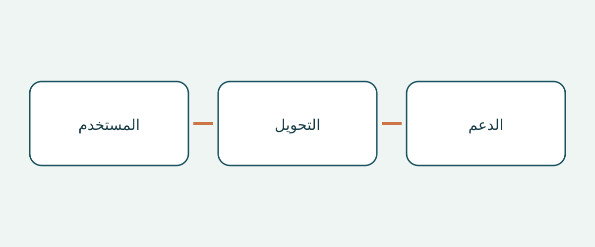

# فحص المركبات المهيأة للكراسي المتحركة قبل الشراء

يبدأ شراء مركبة مهيأة للكرسي المتحرك بالشخص ورحلته، لا باسم السيارة الأساسية. فصورة المقصورة الواسعة والمنحدر المفتوح لا تثبت أن المستخدم يستطيع الصعود والسفر في الموضع المقترح والنزول بالمساعدة المتاحة فعلاً. السيارة الأساسية، والتحويل المكتمل، وترتيب الكرسي المتحرك ثلاثة أمور منفصلة. وضوح أحدها لا يحسم البقية.

يقترح هذا الدليل للمشترين الدوليين ومسؤولي الأساطيل مراجعة الوثائق وعرضاً مناسباً بإشراف مختص. وهو ليس تقييماً طبياً فردياً، ولا دليل تركيب، ولا شرحاً لشروط التسجيل. الأمثلة الأمريكية والإرشادات البريطانية تساعد على طرح الأسئلة، ولا تحدد أبعاداً أو قدرات تحميل أو التزامات قانونية عامة.

## وصف الرحلة قبل اختيار التحويل

سجّل ما إذا كان الشخص سيبقى في كرسيه أثناء السفر، أو سينتقل إلى مقعد السيارة، أو يحتاج إلى ترتيب للقيادة. حدّد من يساعده، وأين يصعد عادة، ومن يرافقه. هذه مسائل تناقش مع المختصين المعنيين، وليست استنتاجات يبنيها البائع على صورة للكرسي. تحويل مخصص للراكب لا يثبت ملاءمة ترتيب للقيادة.

توصي NHTSA في إرشاداتها الأمريكية للمركبات المعدلة باستشارة مختص في إعادة تأهيل القيادة قبل الشراء. وتناقش أيضاً جلوس الراكب والصعود والنزول والرافعات أو المعدات المناسبة. اسأل المختص عن التقييم والعرض المناسبين للشخص المعني. العرض البيعي لا يحل محل الحكم السريري الفردي.

## تحديد التحويل المكتمل

اطلب هوية السيارة الأساسية وسوق بيعها الأصلي، واسم جهة التحويل، وتسمية التحويل، والوثائق المطابقة للمركبة المكتملة. افصل سنة الطراز المعلنة عن تاريخ التحويل. وإذا قُدّم كتيب عام، فاسأل عن النسخة والفترة التي يغطيها. تشابه المقصورة لا يثبت تطابق المعدات؛ احتفظ بالفروق غير المفسرة كأسئلة مفتوحة.

يفصل دليل BraunAbility الأمريكي للأبعاد بين ارتفاع فتحة الباب وعرضها، وعرض المنحدر، وطول الأرضية القابل للاستخدام، وزاوية المنحدر بحسب نسخة التحويل ونطاق سنوات الطراز. لذلك لا يحدد اسم السيارة الأساسية وحده هندسة التحويل. كما أن هذه الأمثلة لا تعطي قياسات لمركبة مستعملة مجهولة التحويل. اطلب الوثيقة المناسبة وتأكيداً متخصصاً للمركبة الفعلية بدلاً من نقل أرقام نسخة أخرى إلى اتفاق الشراء.

## النظر إلى مسار الكرسي المشغول كاملاً

تصف BraunAbility تصاميم الدخول الجانبي والخلفي. قارن المسار بمكان الصعود المعتاد والمساعدة المتاحة، وليس بتسمية التصميم وحدها. رتّب عرضاً بإشراف مناسب للمستخدم والكرسي المقصودين. الغرض هو كشف ما يحتاج إلى تقييم إضافي، لا ابتكار حلول مؤقتة لمدخل أو منظومة تقييد غير ملائمة.

يوصي معهد أبحاث المستهلكين ذوي الإعاقة البريطاني RiDC بالنظر في المساعدة عند الدخول، والحيز فوق الرأس، وموضع الكرسي أثناء الرحلة، والتواصل مع بقية الركاب. هذه نصائح من RiDC وليست حدوداً قانونية. ناقش الانتقال من الباب إلى موضع السفر؛ فصورة الباب لا تصف ما يحدث داخل المقصورة. سجّل ملاحظات المستخدم بكلماته حتى لا تضيع وراء تطمين عام من البائع.

تميّز إرشادات برنامج Motability البريطاني بين ترتيبات المنحدر والرافعة، وتذكر أن تركيب رافعة قد يقلل الحيز فوق الرأس في بعض المركبات. لا يعني ذلك أن كل رافعة تقلله أو أن المنحدر أفضل دائماً. اسأل عن أثر المعدات المركبة فعلاً في هذه المقصورة، ولا تستنتج ارتفاعاً عاماً من وصف فئة.

## فصل تثبيت الكرسي عن تقييد الراكب

تصف Q’STRAINT نظامها الكامل ذي النقاط الأربع بأنه يشمل أربطة الكرسي أو بكرات أحزمة التثبيت، وأحزمة الحوض والكتف للراكب، ونقاط التثبيت الأرضية. هذه مكونات مختلفة. وجود أربطة للكرسي لا يوضح كيفية تقييد الشخص، وظهور حزام راكب لا يحدد منظومة تثبيت الكرسي كاملة.

اطلب هوية المعدات والتعليمات المنطبقة وتقييماً متخصصاً لتوافقها مع الكرسي وترتيب الراكب والتحويل. اطلب بيان جميع المعدات المسلّمة، لا عبارة «الأحزمة مشمولة» فقط. هذا طلب أدلة، وليس تعليمات لتركيب نقاط تثبيت أو تغيير المقاعد أو توصيل وسائل التقييد. اترك التقييم والتصحيح للمختصين المؤهلين.

## إعداد ملف شراء خاص بالتحويل

| السؤال | الدليل المقترح | سبب التأجيل |
|---|---|---|
| ما التحويل المعروض؟ | جهة التحويل وتسميته ووثائقه | وجود كتيب السيارة الأساسية فقط |
| هل يمكن تقييم الرحلة المقصودة؟ | مشورة متخصصة وعرض بإشراف | عدم مراعاة المستخدم أو الكرسي |
| ما وسائل التقييد المشمولة؟ | المكونات والتعليمات والتوافق | عرض أربطة الكرسي باعتبارها كامل تقييد الشخص |
| من يقدم الدعم محلياً؟ | جهة اتصال ونطاق مكتوب | وعد دون تحديد المعدات |
| ما نطاق الضمان؟ | شروط منفصلة حيث تتوفر | افتراض تغطية التحويل بضمان السيارة |

اطلب سجل صيانة التحويل وتفسير الوثائق الناقصة. ميّز بين «لم يُقدَّم» و«تأكدت ملاءمته». في الشراء الدولي، تحقق وقت الشراء من قدرة مقدم الخدمة المذكور على دعم هذا التحويل في مكان الاستلام. لا يضمن هذا الدليل توفر الخدمة المحلية أو انتقال الضمان أو تغطية التصدير. ضع أسئلة الدعم المفتوحة إلى جانب عرض السعر.

## تحديد ما قد يغيّر قرار الشراء

عبارة «مركبة مهيأة» فضفاضة. أما «جهة التحويل معروفة وترتيب الكرسي ينتظر التقييم» فتحدد خطوة تالية. إذا بقي الدخول أو موضع السفر أو توافق التقييد غير محسوم، يوصي الدليل بتأجيل الالتزام حتى يوضحه المختص المعني. الخصم ليس دليلاً على الملاءمة.

حالة السيارة والتسجيل في الوجهة وقابلية الاستيراد مسائل منفصلة. لا يثبتها العرض أو كتيب التحويل. ولا تفترض أن ضمان السيارة الأساسية يغطي التحويل؛ اطلب الشروط المكتوبة دون وعد مسبق بالتغطية. أعد التحقق عند الشراء من مطابقة الوثيقة للمركبة وإصدارها والدعم المحلي الحالي.

## أسئلة شائعة

### هل السيارة الأساسية الأكبر أفضل تلقائياً؟

لا تدعم هذه المصادر ذلك الاستنتاج. تظل الفتحة والموضع الداخلي والمساعدة والمعدات بحاجة إلى تقييم على التحويل المكتمل.

### هل يغني فيديو المنحدر عن التقييم؟

هو معلومة مساندة فقط. اسأل المختص عن العرض المناسب وسجّل ما لا يثبته الفيديو.

### هل أربطة الكرسي هي نفسها أحزمة الراكب؟

لا تخلط بينها. تميّز Q’STRAINT بين تثبيت الكرسي وأحزمة الحوض والكتف ونقاط الأرضية. اطلب وثائق النظام الفعلي وتقييم توافقه.

### هل تؤكد القائمة قانونية الاستيراد؟

لا. تتناول أدلة الشراء ومسائل التقييم المتخصص. قواعد الوجهة وحالة المركبة والملاءمة الطبية الفردية تتطلب فحوصاً مستقلة.

## رسم توضيحي

يربط الرسم أسئلة المستخدم والتحويل والدعم في قرار الشراء.

## قراءة ذات صلة

تصفح [معلومات المركبات](https://www.autobridgeexport.com/vehicles/) و[أدلة الشراء الأخرى](https://www.autobridgeexport.com/guides/).

## المصادر والتحقق

تم التحقق من المصادر في 2026-11-05. تبقى أمثلة المصنعين ضمن نطاقها الأصلي، والإرشادات البريطانية ليست مواصفات قانونية.

- [Adapted vehicles](https://www.nhtsa.gov/vehicle-safety/adapted-vehicles) — US Department of Transportation / NHTSA.
- [Wheelchair accessible vehicle dimension guide](https://www.braunability.com/us/en/help-me-buy/dimensions-specs.html) — BraunAbility.
- [What is a wheelchair accessible vehicle?](https://www.braunability.com/us/en/help-me-buy/product-faqs/what-is-an-accessible-vehicle.html) — BraunAbility.
- [Securement 101](https://www.qstraint.com/it/securement-101/?accessibility-mode=on) — Q’STRAINT.
- [WAV sizes](https://www.motability.co.uk/whats-available/wavs/passenger/sizes) — Motability Operations.
- [WAV checklist](https://ridc.org.uk/features-reviews/out-and-about/wheelchair-accessible-vehicles-wavs-0/wavs-checklist) — Research Institute for Disabled Consumers.
