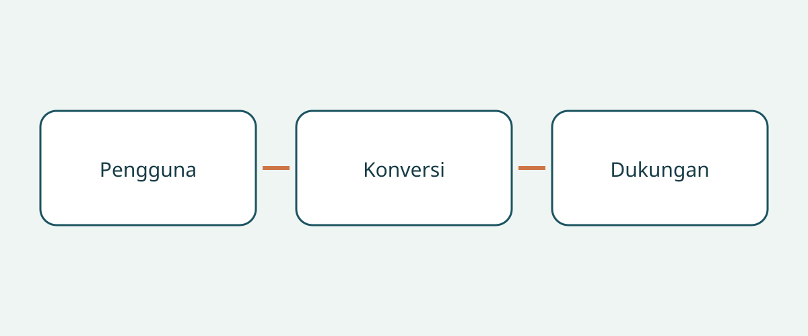

# Memeriksa mobil ramah kursi roda sebelum membeli

Pembelian kendaraan yang dapat diakses pengguna kursi roda dimulai dari pengguna dan perjalanannya, bukan nama mobil dasar. Foto kabin luas dan ramp terbuka belum membuktikan pengguna dapat masuk, bepergian pada posisi yang direncanakan, dan keluar dengan bantuan yang tersedia. Kendaraan dasar, konversi selesai, dan konfigurasi kursi roda adalah tiga hal berbeda. Kepastian pada satu bagian tidak menyelesaikan bagian lainnya.

Panduan ini menyarankan pemeriksaan dokumen dan demonstrasi yang sesuai bagi pembeli lintas negara serta pengelola armada. Ini bukan penilaian medis individual, petunjuk pemasangan, atau penjelasan aturan registrasi. Contoh produsen AS dan saran konsumen Inggris membantu menyusun pertanyaan, bukan menetapkan dimensi, kapasitas, atau kewajiban universal.

## Jelaskan perjalanan sebelum memilih

Catat apakah pengguna akan tetap di kursi roda, berpindah ke jok, atau memerlukan pengaturan untuk mengemudi. Jelaskan siapa yang membantu, tempat naik yang biasa digunakan, dan penumpang lain. Bahas dengan tenaga ahli terkait, bukan membiarkan penjual menebak dari foto kursi roda. Konversi untuk penumpang tidak membuktikan kesesuaian suatu pengaturan mengemudi.

NHTSA dalam panduan kendaraan adaptif AS menyarankan konsultasi dengan spesialis rehabilitasi mengemudi sebelum membeli. Panduan juga membahas tempat duduk penumpang, akses masuk-keluar, serta lift atau peralatan yang sesuai. Tanyakan penilaian dan demonstrasi yang tepat untuk pengguna tersebut. Demonstrasi penjualan tidak menggantikan pertimbangan klinis individual.

## Kenali konversi yang benar-benar terpasang

Minta identitas kendaraan dasar, pasar penjualan asal, pembuat konversi, nama konversi, dan catatan kendaraan yang sudah selesai. Pisahkan tahun model dalam iklan dari tanggal konversi. Jika hanya ada brosur umum, tanyakan varian dan periode yang dicakup. Interior serupa tidak membuktikan peralatan identik; simpan perbedaan yang belum dijelaskan sebagai pertanyaan terbuka.

Panduan dimensi BraunAbility AS membedakan tinggi dan lebar pintu, lebar ramp, panjang lantai yang dapat digunakan, dan sudut ramp menurut varian konversi serta rentang tahun model. Nama mobil dasar tidak menentukan seluruh geometri konversi. Contoh ini juga tidak menyediakan ukuran untuk konversi bekas yang belum teridentifikasi. Mintalah dokumen yang sesuai dan konfirmasi ahli atas kendaraan nyata, bukan menyalin angka varian lain ke kesepakatan pembelian.

## Tinjau seluruh jalur kursi roda saat ditempati pengguna

BraunAbility menjelaskan desain masuk samping dan belakang. Bandingkan jalur masuk dengan lokasi naik sebenarnya serta bantuan yang tersedia, bukan sekadar nama tata letak. Atur demonstrasi dengan pendampingan yang sesuai untuk pengguna dan kursi rodanya. Tujuannya menemukan hal yang perlu dinilai lagi, bukan mengakali akses atau sistem penahan yang tidak cocok.

RiDC, organisasi penelitian konsumen penyandang disabilitas di Inggris, menyarankan pertimbangan bantuan saat masuk, ruang kepala, posisi kursi roda selama perjalanan, dan komunikasi dengan penghuni lain. Itu saran RiDC, bukan ambang hukum. Perhatikan jalur dari pintu hingga posisi perjalanan; foto pintu tidak menjelaskan bagian dalam. Catat kekhawatiran pengguna dengan kata-katanya sendiri.

Panduan program Motability Inggris membedakan tata letak ramp dan lift serta menyebut pemasangan lift dapat mengurangi ruang kepala pada sebagian kendaraan. Ini bukan klaim bahwa semua lift mengurangi ruang atau ramp selalu lebih baik. Tanyakan dampak peralatan yang benar-benar terpasang pada kabin tersebut, bukan menyimpulkan tinggi universal dari suatu kategori.

## Bedakan pengikat kursi roda dan penahan penumpang

Q’STRAINT menjelaskan sistem empat titik lengkapnya mencakup pengikat atau retraktor kursi roda, sabuk pengaman pangkuan dan bahu penumpang, serta jangkar lantai. Ketiganya berbeda. Adanya tali kursi roda belum menjawab bagaimana penumpang ditahan; sabuk penumpang yang terlihat juga belum mengidentifikasi sistem kursi roda lengkap.

Minta identitas peralatan, petunjuk yang berlaku, dan penilaian ahli mengenai kompatibilitas dengan kursi roda, posisi penumpang, serta konversi. Mintalah daftar perlengkapan lengkap, bukan hanya pernyataan “termasuk sabuk”. Ini permintaan bukti, bukan petunjuk memasang jangkar, mengubah jok, atau menghubungkan penahan. Penilaian dan perbaikan sebaiknya ditangani tenaga berkualifikasi.

## Susun berkas khusus konversi

| Pertanyaan | Bukti yang disarankan | Alasan menunda |
|---|---|---|
| Konversi apa yang ditawarkan? | Pembuat, nama, dan catatan sesuai | Hanya brosur mobil dasar |
| Dapatkah perjalanan dinilai? | Saran ahli dan demonstrasi didampingi | Pengguna atau kursi roda belum dipertimbangkan |
| Penahan apa yang disertakan? | Komponen, petunjuk, kompatibilitas | Tali kursi roda dianggap seluruh penahan penumpang |
| Siapa mendukung secara lokal? | Kontak dan cakupan tertulis | Janji tanpa identitas peralatan |
| Apa cakupan garansi? | Ketentuan terpisah jika tersedia | Konversi diasumsikan tercakup garansi mobil dasar |

Mintalah riwayat perawatan konversi dan penjelasan catatan yang hilang. Bedakan “belum diberikan” dari “sudah dikonfirmasi memadai”. Dalam transaksi internasional, pastikan saat membeli bahwa penyedia layanan yang disebut dapat menangani konversi itu di lokasi penerimaan. Panduan ini tidak menjamin layanan lokal, pengalihan garansi, atau cakupan ekspor. Letakkan pertanyaan dukungan yang terbuka di samping penawaran.

## Tentukan bukti yang akan mengubah keputusan

“Kendaraan aksesibel” terlalu umum. “Pembuat konversi teridentifikasi, konfigurasi kursi roda menunggu penilaian” menunjukkan tindak lanjut. Jika akses, posisi perjalanan, atau kompatibilitas penahan belum jelas, panduan ini menyarankan menunda komitmen sampai ahli menyelesaikannya. Diskon bukan bukti kesesuaian.

Kondisi kendaraan, registrasi tujuan, dan kelayakan impor merupakan pemeriksaan terpisah. Demonstrasi atau brosur tidak membuktikannya. Jangan berasumsi garansi mobil dasar mencakup konversi; minta ketentuan tertulis tanpa menjanjikan cakupan. Konfirmasikan kembali kecocokan kendaraan, revisi dokumen, dan dukungan lokal saat pembelian.

## Pertanyaan umum

### Apakah mobil dasar lebih besar selalu lebih baik?

Sumber ini tidak mendukung kesimpulan tersebut. Pintu, posisi kabin, bantuan, dan peralatan tetap perlu dinilai pada hasil konversi.

### Apakah video ramp menggantikan penilaian?

Video hanya informasi tambahan. Tanyakan demonstrasi yang sesuai kepada ahli dan catat hal yang tidak dibuktikannya.

### Apakah tali kursi roda sama dengan penahan penumpang?

Jangan samakan keduanya. Q’STRAINT membedakan pengikat kursi roda, sabuk pengaman pangkuan dan bahu, dan jangkar. Mintalah dokumentasi serta penilaian kompatibilitas sistem aktual.

### Apakah daftar ini memastikan impor legal?

Tidak. Ini membahas bukti pembelian dan pertanyaan bagi ahli. Aturan tujuan, kondisi mobil, dan kesesuaian medis individual perlu pemeriksaan tersendiri.

## Ilustrasi

Diagram menghubungkan pertanyaan pengguna, konversi, dan dukungan dalam pembelian.

## Bacaan terkait

Lihat [informasi kendaraan](https://www.autobridgeexport.com/vehicles/) dan [panduan pembelian lain](https://www.autobridgeexport.com/guides/).

## Sumber dan verifikasi

Sumber diperiksa pada 2026-11-05. Contoh produsen tetap dalam cakupannya; saran Inggris bukan spesifikasi hukum.

- [Adapted vehicles](https://www.nhtsa.gov/vehicle-safety/adapted-vehicles) — US Department of Transportation / NHTSA.
- [Wheelchair accessible vehicle dimension guide](https://www.braunability.com/us/en/help-me-buy/dimensions-specs.html) — BraunAbility.
- [What is a wheelchair accessible vehicle?](https://www.braunability.com/us/en/help-me-buy/product-faqs/what-is-an-accessible-vehicle.html) — BraunAbility.
- [Securement 101](https://www.qstraint.com/it/securement-101/?accessibility-mode=on) — Q’STRAINT.
- [WAV sizes](https://www.motability.co.uk/whats-available/wavs/passenger/sizes) — Motability Operations.
- [WAV checklist](https://ridc.org.uk/features-reviews/out-and-about/wheelchair-accessible-vehicles-wavs-0/wavs-checklist) — Research Institute for Disabled Consumers.
