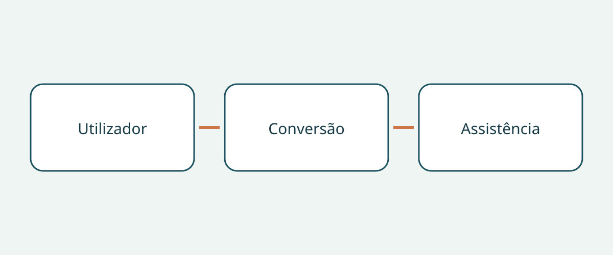

# Comprar um veículo acessível a cadeiras de rodas

A compra começa pela pessoa e pela viagem, não pelo nome do veículo. Uma fotografia de um habitáculo espaçoso e de uma rampa aberta não demonstra que o utilizador consiga entrar, viajar no lugar previsto e sair com a ajuda disponível. O veículo de base, a transformação concluída e a configuração da cadeira são componentes distintos da decisão. Uma resposta favorável sobre um deles não resolve os restantes.

Este guia recomenda a compradores internacionais e gestores de frotas uma análise de documentos e uma demonstração adequada. Não constitui avaliação médica individual, manual de instalação ou descrição de requisitos de matrícula. Os exemplos dos Estados Unidos e os conselhos britânicos ajudam a formular perguntas, sem estabelecer dimensões, capacidades ou deveres universais.

## Descrever a viagem antes de comparar

Registe se a pessoa pretende viajar na cadeira, transferir-se para um banco ou conduzir. Identifique quem ajudará, onde costuma embarcar e que outros passageiros viajarão. São questões para discutir com os profissionais pertinentes, não conclusões que o vendedor possa retirar de uma fotografia. Uma transformação para passageiros não comprova a adequação de uma configuração de condução.

A NHTSA recomenda, nas suas orientações norte-americanas sobre veículos adaptados, consultar um especialista em reabilitação da condução antes da compra. Aborda também o lugar do passageiro, a entrada e saída e os elevadores ou outros equipamentos adequados. Pergunte que avaliação e demonstração fazem sentido para a pessoa em causa. Uma apresentação comercial não substitui uma apreciação clínica individual.

## Identificar a transformação concluída

Peça a identificação do veículo de base, o mercado de venda original, a empresa responsável pela transformação, a designação da conversão e os documentos relativos ao veículo concluído. Distinga o ano-modelo anunciado da data de transformação. Se receber um folheto genérico, esclareça a variante e o período abrangidos. Um interior semelhante não demonstra equipamentos idênticos; conserve como pendentes as diferenças sem explicação.

O guia de dimensões da BraunAbility para os Estados Unidos distingue altura e largura da abertura, largura da rampa, comprimento útil do piso e ângulo da rampa por variante de conversão e intervalo de anos-modelo. O nome do veículo de base não determina toda a geometria. Esses exemplos não fornecem medidas para uma conversão usada não identificada. Solicite documentação aplicável e confirmação especializada da unidade real, em vez de copiar números de outra variante.

## Considerar todo o percurso da cadeira ocupada

A BraunAbility descreve veículos com acesso lateral e traseiro. Compare o percurso de entrada com o local habitual e com a assistência disponível, não apenas com o nome da configuração. Organize uma demonstração supervisionada adequada à pessoa e à cadeira. O objetivo é identificar necessidades de avaliação adicional, não improvisar soluções para um acesso ou sistema de retenção inadequado.

A organização britânica de investigação para consumidores com deficiência RiDC recomenda considerar a ajuda à entrada, o espaço para a cabeça, a posição de viagem da cadeira e a comunicação com os restantes ocupantes. São recomendações da RiDC, não limites legais. Inclua a passagem da entrada até ao lugar de viagem: uma fotografia da porta não explica o interior. Registe as preocupações do utilizador pelas suas próprias palavras.

As orientações do programa britânico Motability distinguem configurações com rampa e elevador e indicam que instalar um elevador pode reduzir o espaço para a cabeça em alguns veículos. Não se conclui que todos os elevadores reduzam esse espaço ou que uma rampa seja sempre preferível. Pergunte como o equipamento instalado afeta aquele habitáculo; uma categoria não permite estabelecer uma altura universal.

## Distinguir fixação da cadeira e retenção da pessoa

A Q’STRAINT descreve o seu sistema completo de quatro pontos como incluindo cintas ou retratores da cadeira, retenções pélvica e diagonal do ocupante e ancoragens ao piso. São componentes diferentes. A presença de cintas da cadeira não esclarece a retenção da pessoa; um cinto visível também não identifica todo o sistema de fixação da cadeira.

Solicite referências dos equipamentos, instruções aplicáveis e uma avaliação especializada de compatibilidade com a cadeira, a posição do ocupante e a transformação. Peça a descrição completa do fornecimento, não apenas «inclui cintos». Trata-se de pedir evidência, não de ensinar a instalar ancoragens, alterar bancos ou ligar retenções. Confie a avaliação e as correções a profissionais qualificados.

## Criar um dossier da conversão

| Pergunta | Evidência aconselhada | Motivo para suspender |
|---|---|---|
| Qual é a transformação? | Transformador, designação e documentos | Só existe o folheto do veículo de base |
| É possível avaliar a viagem? | Parecer e demonstração supervisionada | Utilizador ou cadeira não considerados |
| Que retenções estão incluídas? | Componentes, instruções e compatibilidade | Cintas apresentadas como toda a retenção da pessoa |
| Quem dará assistência local? | Contacto e âmbito escritos | Promessa sem identificar os equipamentos |
| O que cobre a garantia? | Condições separadas, quando disponíveis | Cobertura da transformação apenas presumida |

Peça o histórico de manutenção da conversão e explicações sobre lacunas. Distinga «não fornecido» de «confirmado satisfatório». Numa compra internacional, confirme no momento da compra que o prestador indicado pode assistir aquela conversão no destino. Este guia não garante disponibilidade local, transferência de garantia ou cobertura de exportação. Mantenha as questões de assistência pendentes ao lado do orçamento.

## Ligar a decisão a respostas concretas

«Veículo acessível» é demasiado vago. «Transformador identificado, configuração da cadeira a aguardar avaliação» indica o próximo passo. Se a entrada, o lugar de viagem ou a compatibilidade das retenções continuarem por esclarecer, este guia recomenda adiar o compromisso até obter esclarecimento profissional. Um desconto não comprova adequação.

Estado do veículo, matrícula no destino e admissibilidade de importação são verificações separadas. Nem a demonstração nem o folheto as comprovam. Não presuma que a garantia do veículo de base cobre a conversão. Peça condições escritas sem prometer cobertura. Reconfirme a correspondência com o veículo, a revisão dos documentos e a assistência local no momento da compra.

## Perguntas frequentes

### Um veículo de base maior é necessariamente melhor?

Estas fontes não permitem concluir isso. Abertura, posição interior, ajuda e equipamento continuam a precisar de avaliação na transformação concluída.

### Um vídeo da rampa substitui a avaliação?

É apenas informação complementar. Pergunte ao especialista que demonstração é adequada e registe o que o vídeo não demonstra.

### As cintas da cadeira são retenções do ocupante?

Não confunda os componentes. A Q’STRAINT distingue fixação da cadeira, retenções pélvica e diagonal e ancoragens. Peça documentação e avaliação de compatibilidade do sistema real.

### Esta lista comprova que a importação é legal?

Não. Aborda evidência de compra e questões para avaliação especializada. Regras locais, estado do veículo e adequação médica individual exigem verificações próprias.

## Ilustração

O diagrama relaciona o utilizador, a conversão e a assistência na decisão de compra.

## Leitura relacionada

Consulte [informações sobre veículos](https://www.autobridgeexport.com/vehicles/) e [outros guias de compra](https://www.autobridgeexport.com/guides/).

## Fontes e verificação

Fontes verificadas em 2026-11-05. Os exemplos dos fabricantes mantêm o seu âmbito; os conselhos britânicos não são especificações legais.

- [Adapted vehicles](https://www.nhtsa.gov/vehicle-safety/adapted-vehicles) — US Department of Transportation / NHTSA.
- [Wheelchair accessible vehicle dimension guide](https://www.braunability.com/us/en/help-me-buy/dimensions-specs.html) — BraunAbility.
- [What is a wheelchair accessible vehicle?](https://www.braunability.com/us/en/help-me-buy/product-faqs/what-is-an-accessible-vehicle.html) — BraunAbility.
- [Securement 101](https://www.qstraint.com/it/securement-101/?accessibility-mode=on) — Q’STRAINT.
- [WAV sizes](https://www.motability.co.uk/whats-available/wavs/passenger/sizes) — Motability Operations.
- [WAV checklist](https://ridc.org.uk/features-reviews/out-and-about/wheelchair-accessible-vehicles-wavs-0/wavs-checklist) — Research Institute for Disabled Consumers.
