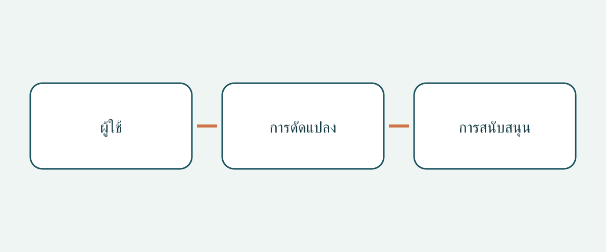

# ตรวจรถดัดแปลงสำหรับผู้ใช้รถเข็นก่อนตัดสินใจซื้อ

การซื้อรถที่รองรับรถเข็นควรเริ่มจากผู้ใช้และการเดินทาง ไม่ใช่ชื่อรุ่นรถ ภาพห้องโดยสารกว้างและทางลาดที่กางแล้วไม่ได้ยืนยันว่าผู้ใช้จะขึ้นรถ นั่งในตำแหน่งที่กำหนด และลงรถได้ด้วยความช่วยเหลือที่มีจริง รถพื้นฐาน งานดัดแปลงที่เสร็จแล้ว และรูปแบบการใช้รถเข็นเป็นเรื่องที่ต้องตรวจแยกกัน การตอบได้เรื่องหนึ่งไม่ได้แปลว่าอีกสองเรื่องเรียบร้อยแล้ว

บทความนี้เสนอการตรวจเอกสารและการสาธิตที่เหมาะสมสำหรับผู้ซื้อข้ามประเทศและผู้จัดซื้อรถประจำองค์กร ไม่ใช่การประเมินความเหมาะสมทางการแพทย์เฉพาะบุคคล คู่มือติดตั้ง หรือคำอธิบายกฎจดทะเบียน ตัวอย่างผู้ผลิตในสหรัฐฯ และคำแนะนำผู้บริโภคในสหราชอาณาจักรช่วยตั้งคำถาม แต่ไม่ได้กำหนดขนาด น้ำหนักที่รองรับ หรือหน้าที่ตามกฎหมายแบบสากล

## อธิบายการเดินทางก่อนเลือกแบบดัดแปลง

ระบุว่าผู้ใช้จะนั่งบนรถเข็นขณะเดินทาง ย้ายไปนั่งเบาะรถ หรือมีความต้องการขับรถเอง ใครจะช่วย ปกติขึ้นรถที่ไหน และมีใครร่วมเดินทางบ้าง ควรหารือเรื่องเหล่านี้กับผู้เชี่ยวชาญที่เกี่ยวข้อง ไม่ใช่ให้ผู้ขายสรุปจากภาพรถเข็น งานดัดแปลงสำหรับผู้โดยสารไม่ได้พิสูจน์ว่ารูปแบบสำหรับผู้ขับเหมาะสมด้วย

คำแนะนำเรื่องรถดัดแปลงของ NHTSA ในสหรัฐฯ แนะนำให้ปรึกษาผู้เชี่ยวชาญด้านการฟื้นฟูสมรรถภาพการขับขี่ก่อนซื้อ และกล่าวถึงที่นั่งผู้โดยสาร การขึ้นลง รวมถึงลิฟต์หรืออุปกรณ์ที่เหมาะสมด้วย ถามผู้เชี่ยวชาญว่าควรประเมินและสาธิตอะไรสำหรับผู้ใช้จริง การสาธิตเพื่อขายไม่ใช่ข้อวินิจฉัยทางคลินิกเฉพาะบุคคล

## ระบุงานดัดแปลงจริง ไม่ใช่เพียงรุ่นรถ

ขอข้อมูลระบุตัวรถพื้นฐาน ตลาดที่จำหน่ายเดิม ผู้ดัดแปลง ชื่อแบบดัดแปลง และเอกสารที่ตรงกับรถที่ทำเสร็จแล้ว แยกปีรุ่นที่โฆษณาออกจากวันที่ดัดแปลง หากมีเพียงโบรชัวร์ทั่วไป ให้ถามว่าครอบคลุมแบบและช่วงเวลาใด ภายในที่ดูเหมือนกันไม่ได้ยืนยันว่าใช้อุปกรณ์เดียวกัน ความต่างที่ยังอธิบายไม่ได้ควรคงไว้เป็นข้อรอตรวจ

คู่มือขนาดของ BraunAbility สำหรับสหรัฐฯ แยกความสูงและความกว้างช่องประตู ความกว้างทางลาด ความยาวพื้นใช้งาน และมุมทางลาดตามแบบดัดแปลงและช่วงปีรุ่น ชื่อรถพื้นฐานจึงไม่สามารถระบุรูปทรงพื้นที่หลังดัดแปลงได้ทั้งหมด ตัวอย่างนี้ไม่ได้ให้ขนาดของรถมือสองที่ยังระบุแบบไม่ได้ ขอเอกสารที่ตรงรุ่นและการยืนยันจากผู้เชี่ยวชาญเกี่ยวกับรถจริง แทนการนำตัวเลขของอีกแบบมาใส่ในข้อตกลงซื้อ

## พิจารณาตลอดเส้นทางเมื่อมีคนนั่งรถเข็น

BraunAbility อธิบายทั้งแบบเข้าด้านข้างและด้านหลัง เปรียบเทียบทางเข้ากับจุดขึ้นรถจริงและความช่วยเหลือที่มี ไม่เลือกจากชื่อรูปแบบอย่างเดียว จัดการสาธิตที่มีผู้ดูแลและเหมาะกับผู้ใช้และรถเข็น จุดประสงค์คือหาสิ่งที่ยังต้องประเมิน ไม่ใช่หาวิธีเฉพาะหน้าเพื่อใช้ทางเข้าหรืออุปกรณ์ยึดที่ไม่เหมาะสม

RiDC ซึ่งเป็นองค์กรวิจัยผู้บริโภคที่มีความพิการในสหราชอาณาจักร แนะนำให้พิจารณาความช่วยเหลือขณะขึ้นรถ ช่องว่างเหนือศีรษะ ตำแหน่งรถเข็นระหว่างเดินทาง และการสื่อสารกับผู้โดยสารอื่น นี่เป็นคำแนะนำของ RiDC ไม่ใช่เกณฑ์ตามกฎหมาย รวมเส้นทางจากประตูไปถึงตำแหน่งโดยสารในการหารือด้วย ภาพประตูไม่อธิบายพื้นที่ภายในทั้งหมด ควรบันทึกข้อกังวลด้วยคำพูดของผู้ใช้เอง

คำแนะนำของโครงการ Motability ในสหราชอาณาจักรแยกแบบทางลาดและลิฟต์ และระบุว่าการติดลิฟต์อาจลดพื้นที่เหนือศีรษะในรถบางคัน ไม่ได้หมายความว่าลิฟต์ทุกแบบลดพื้นที่ หรือทางลาดดีกว่าเสมอ ถามผลของอุปกรณ์ที่ติดตั้งจริงต่อห้องโดยสารคันนี้ อย่าอนุมานความสูงมาตรฐานจากชื่อหมวดหมู่

## แยกการยึดรถเข็นออกจากการยึดรั้งผู้โดยสาร

Q’STRAINT อธิบายระบบสี่จุดแบบครบชุดของตนว่าประกอบด้วยสายยึดหรือชุดดึงกลับสำหรับรถเข็น อุปกรณ์ยึดรั้งช่วงเอวและไหล่ของผู้โดยสาร และจุดยึดที่พื้น ทั้งหมดเป็นส่วนประกอบต่างกัน การเห็นสายยึดรถเข็นยังไม่ตอบว่าผู้โดยสารถูกยึดรั้งอย่างไร และการเห็นเข็มขัดผู้โดยสารก็ไม่ระบุระบบยึดรถเข็นครบชุด

ขอข้อมูลระบุอุปกรณ์ คู่มือที่เกี่ยวข้อง และการประเมินความเข้ากันได้กับรถเข็น ตำแหน่งผู้ใช้ และงานดัดแปลงโดยผู้เชี่ยวชาญ ให้ผู้ขายแจกแจงอุปกรณ์ที่ส่งมอบครบ ไม่ใช่เพียงบอกว่า “มีเข็มขัด” นี่เป็นคำขอหลักฐาน ไม่ใช่วิธีติดจุดยึด เปลี่ยนเบาะ หรือเชื่อมต่ออุปกรณ์ยึดรั้ง การประเมินและแก้ไขควรให้ผู้เชี่ยวชาญที่เหมาะสมดำเนินการ ไม่ใช้บทความนี้เป็นรายการตรวจสำหรับการติดตั้ง

## จัดแฟ้มเฉพาะงานดัดแปลง

| คำถาม | หลักฐานที่แนะนำ | เหตุให้ชะลอ |
|---|---|---|
| ขายงานดัดแปลงแบบใด | ผู้ดัดแปลง ชื่อแบบ และเอกสาร | มีแค่โบรชัวร์รถพื้นฐาน |
| ประเมินการเดินทางจริงได้หรือไม่ | ความเห็นผู้เชี่ยวชาญและการสาธิต | ยังไม่พิจารณาผู้ใช้หรือรถเข็น |
| มีอุปกรณ์ยึดรั้งอะไรบ้าง | ส่วนประกอบ คู่มือ และความเข้ากันได้ | อ้างว่าสายรถเข็นคือระบบยึดรั้งคนทั้งหมด |
| ใครให้บริการในพื้นที่ | ผู้ติดต่อและขอบเขตงานเป็นลายลักษณ์อักษร | รับปากโดยไม่ระบุอุปกรณ์ |
| รับประกันอะไร | เงื่อนไขรถพื้นฐานและงานดัดแปลงแยกกันถ้ามี | คาดเดาว่าการรับประกันเดิมครอบคลุม |

ขอประวัติบำรุงรักษางานดัดแปลงและคำอธิบายเอกสารที่ขาด แยก “ยังไม่ให้ข้อมูล” ออกจาก “ยืนยันแล้วว่าเหมาะสม” สำหรับการซื้อข้ามประเทศ ให้ยืนยันในเวลาซื้อว่าผู้ให้บริการที่ระบุรองรับงานดัดแปลงนี้ในพื้นที่รับรถจริง บทความไม่ได้รับรองบริการในพื้นที่ การโอนสิทธิ์การรับประกัน หรือความคุ้มครองหลังส่งออก เก็บคำถามค้างไว้ข้างใบเสนอราคาเพื่อไม่ให้มองข้าม

## ระบุว่าอะไรจะเปลี่ยนการตัดสินใจซื้อ

คำว่า “รองรับรถเข็น” กว้างเกินไป แต่ “ยืนยันผู้ดัดแปลงแล้ว รอประเมินรูปแบบรถเข็น” ชี้ขั้นตอนต่อไปได้ หากทางเข้า ตำแหน่งโดยสาร หรือความเข้ากันได้ของระบบยึดรั้งยังไม่ชัด บทความแนะนำให้รอผู้เชี่ยวชาญแก้ข้อสงสัยก่อนผูกพันซื้อ ส่วนลดไม่ใช่หลักฐานความเหมาะสม

สภาพรถ การจดทะเบียนปลายทาง และสิทธินำเข้าเป็นคนละการตรวจ การสาธิตหรือโบรชัวร์ดัดแปลงพิสูจน์ไม่ได้ อย่าสันนิษฐานว่าการรับประกันรถพื้นฐานครอบคลุมงานดัดแปลง ขอเงื่อนไขเป็นลายลักษณ์อักษรโดยไม่รับรองล่วงหน้า ตรวจซ้ำว่าเอกสารตรงรถ เป็นฉบับใด และยังมีบริการในพื้นที่เมื่อซื้อ

## คำถามที่พบบ่อย

### รถพื้นฐานใหญ่กว่าจะดีกว่าเสมอหรือไม่

แหล่งข้อมูลนี้ไม่รองรับข้อสรุปดังกล่าว ยังต้องประเมินช่องเข้า ตำแหน่งภายใน ความช่วยเหลือ และอุปกรณ์ของรถที่ดัดแปลงเสร็จแล้ว

### วิดีโอทางลาดใช้แทนการประเมินได้ไหม

เป็นเพียงข้อมูลเสริม ถามผู้เชี่ยวชาญถึงการสาธิตที่เหมาะสม และบันทึกสิ่งที่วิดีโอพิสูจน์ไม่ได้

### สายยึดรถเข็นคืออุปกรณ์ยึดรั้งคนหรือไม่

ไม่ควรสับสนกัน Q’STRAINT แยกส่วนยึดรถเข็น ส่วนเอวและไหล่ และจุดยึดพื้น ขอเอกสารระบบจริงและการประเมินความเข้ากันได้

### รายการนี้ยืนยันการนำเข้าถูกกฎหมายหรือไม่

ไม่ยืนยัน บทความเกี่ยวกับหลักฐานซื้อและคำถามสำหรับผู้เชี่ยวชาญ กฎปลายทาง สภาพรถ และความเหมาะสมทางการแพทย์รายบุคคลต้องตรวจแยก

## ภาพประกอบ

แผนภาพเชื่อมคำถามเรื่องผู้ใช้ การดัดแปลง และการสนับสนุนในการซื้อ

## อ่านเพิ่มเติม

ดู[ข้อมูลรถ](https://www.autobridgeexport.com/vehicles/)และ[คู่มือซื้ออื่น](https://www.autobridgeexport.com/guides/)

## แหล่งข้อมูลและการตรวจสอบ

ตรวจแหล่งข้อมูลเมื่อ 2026-11-05 ตัวอย่างผู้ผลิตจำกัดตามขอบเขตเดิม และคำแนะนำจากสหราชอาณาจักรไม่ใช่ข้อกำหนดทางกฎหมาย

- [Adapted vehicles](https://www.nhtsa.gov/vehicle-safety/adapted-vehicles) — US Department of Transportation / NHTSA.
- [Wheelchair accessible vehicle dimension guide](https://www.braunability.com/us/en/help-me-buy/dimensions-specs.html) — BraunAbility.
- [What is a wheelchair accessible vehicle?](https://www.braunability.com/us/en/help-me-buy/product-faqs/what-is-an-accessible-vehicle.html) — BraunAbility.
- [Securement 101](https://www.qstraint.com/it/securement-101/?accessibility-mode=on) — Q’STRAINT.
- [WAV sizes](https://www.motability.co.uk/whats-available/wavs/passenger/sizes) — Motability Operations.
- [WAV checklist](https://ridc.org.uk/features-reviews/out-and-about/wheelchair-accessible-vehicles-wavs-0/wavs-checklist) — Research Institute for Disabled Consumers.
