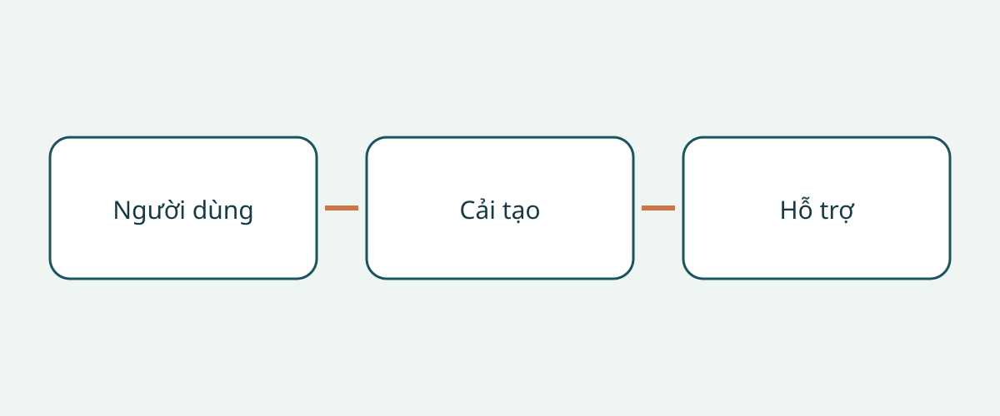

# Kiểm tra xe cải tạo cho người dùng xe lăn trước khi mua

Mua xe tiếp cận được bằng xe lăn nên bắt đầu từ người sử dụng và hành trình, không phải tên xe nền. Ảnh khoang rộng và cầu dẫn mở không chứng minh người dùng có thể lên xe, ngồi ở vị trí dự kiến và xuống xe với sự hỗ trợ thực tế. Xe nền, phần cải tạo hoàn chỉnh và cấu hình xe lăn là những nội dung riêng. Làm rõ một nội dung không đồng nghĩa đã giải quyết tất cả.

Hướng dẫn này đề xuất cách xem hồ sơ và tổ chức trình diễn phù hợp cho người mua quốc tế, đơn vị quản lý đội xe. Đây không phải đánh giá y khoa cá nhân, hướng dẫn lắp đặt hay quy định đăng ký. Ví dụ của nhà sản xuất tại Mỹ và lời khuyên tại Anh giúp đặt câu hỏi, không xác lập kích thước, tải trọng thiết bị hay nghĩa vụ chung.

## Mô tả hành trình trước khi chọn cấu hình

Ghi rõ người dùng sẽ ngồi trên xe lăn, chuyển sang ghế xe hay cần bố trí để lái xe. Xác định người hỗ trợ, nơi thường lên xuống và những người cùng đi. Đây là vấn đề cần trao đổi với chuyên gia phù hợp, không phải điều người bán có thể suy ra từ ảnh xe lăn. Cải tạo cho hành khách không chứng minh một bố trí lái xe là phù hợp.

Trong hướng dẫn của Mỹ về xe thích ứng, NHTSA khuyến nghị tham khảo chuyên gia phục hồi chức năng lái xe trước khi mua. Tài liệu cũng đề cập ghế hành khách, việc lên xuống và thiết bị nâng hoặc thiết bị khác phù hợp. Hãy hỏi chuyên gia cần đánh giá và trình diễn thế nào cho người dùng cụ thể. Buổi giới thiệu bán hàng không thay thế nhận định lâm sàng cá nhân.

## Xác định phần cải tạo thực tế

Yêu cầu nhận dạng xe nền, thị trường bán ban đầu, đơn vị cải tạo, tên cấu hình và hồ sơ của xe đã hoàn thiện. Tách năm mẫu xe quảng cáo khỏi ngày cải tạo. Nếu chỉ có tài liệu chung, hỏi tài liệu áp dụng cho biến thể và giai đoạn nào. Nội thất giống nhau không chứng minh thiết bị giống nhau; giữ lại các khác biệt chưa giải thích như câu hỏi còn mở.

Hướng dẫn kích thước của BraunAbility tại Mỹ phân biệt chiều cao, chiều rộng cửa, chiều rộng cầu dẫn, chiều dài sàn hữu dụng và góc cầu dẫn theo biến thể cải tạo và phạm vi năm mẫu xe. Vì vậy tên xe nền không xác định toàn bộ hình học của phần cải tạo. Các ví dụ cũng không cung cấp số đo cho xe cải tạo cũ chưa rõ danh tính. Xin tài liệu đúng cấu hình và xác nhận chuyên môn trên xe thực tế, thay vì chép số của biến thể khác vào thỏa thuận mua.

## Xem toàn bộ đường đi khi người dùng ngồi trên xe lăn

BraunAbility mô tả kiểu vào bên hông và từ phía sau. So sánh đường vào với địa điểm lên xe thường dùng và mức hỗ trợ sẵn có, không chỉ chọn theo tên bố trí. Sắp xếp buổi trình diễn có giám sát phù hợp với người dùng và xe lăn. Mục đích là tìm những điểm cần đánh giá thêm, không ứng biến để sử dụng lối vào hoặc hệ thống giữ không phù hợp.

Tổ chức nghiên cứu người tiêu dùng khuyết tật RiDC của Anh khuyên cân nhắc hỗ trợ lúc lên xe, khoảng trống trên đầu, vị trí xe lăn khi di chuyển và giao tiếp với người khác. Đây là lời khuyên của RiDC, không phải ngưỡng pháp lý. Hãy xem cả đoạn từ cửa tới vị trí ngồi; ảnh cửa không giải thích không gian bên trong. Ghi lại băn khoăn của người dùng bằng lời của họ.

Hướng dẫn thuộc chương trình Motability của Anh phân biệt bố trí cầu dẫn và thiết bị nâng, đồng thời lưu ý lắp thiết bị nâng có thể làm giảm khoảng trống trên đầu ở một số xe. Điều đó không có nghĩa mọi thiết bị nâng đều làm giảm không gian hoặc cầu dẫn luôn tốt hơn. Hỏi tác động của thiết bị thực lắp trên khoang xe này, không suy ra chiều cao chung từ một nhóm cấu hình.

## Phân biệt giữ xe lăn và giữ người ngồi

Q’STRAINT mô tả hệ thống bốn điểm hoàn chỉnh của hãng gồm dây hoặc bộ thu dây giữ xe lăn, đai ngang hông và qua vai cho người ngồi, cùng điểm neo sàn. Đây là các thành phần khác nhau. Có dây giữ xe lăn chưa trả lời cách giữ người; nhìn thấy dây an toàn hành khách cũng chưa nhận dạng toàn bộ hệ thống giữ xe lăn.

Yêu cầu mã thiết bị, hướng dẫn áp dụng và đánh giá chuyên môn về tính tương thích với xe lăn, vị trí người ngồi và phần cải tạo. Đề nghị liệt kê đủ thiết bị bàn giao, thay vì chỉ ghi “có dây an toàn”. Đây là yêu cầu bằng chứng, không phải cách lắp neo, thay ghế hoặc nối dây giữ. Việc đánh giá và sửa chữa nên do chuyên gia phù hợp thực hiện; không dùng bài viết này làm danh sách hướng dẫn lắp đặt.

## Lập hồ sơ mua riêng cho phần cải tạo

| Câu hỏi | Bằng chứng nên xin | Lý do tạm dừng |
|---|---|---|
| Chào bán cấu hình nào? | Đơn vị cải tạo, tên cấu hình, hồ sơ | Chỉ có tài liệu xe nền |
| Có thể đánh giá hành trình dự kiến không? | Ý kiến chuyên gia và trình diễn có giám sát | Chưa xét người dùng hoặc xe lăn |
| Bao gồm thiết bị giữ nào? | Thành phần, hướng dẫn, tính tương thích | Dây giữ xe lăn bị coi là toàn bộ hệ thống giữ người |
| Ai hỗ trợ tại địa phương? | Liên hệ và phạm vi bằng văn bản | Hứa hỗ trợ nhưng chưa rõ thiết bị |
| Bảo hành gồm gì? | Điều kiện riêng cho xe nền và cải tạo nếu có | Mặc định bảo hành xe nền bao gồm cải tạo |

Xin lịch sử bảo dưỡng phần cải tạo và giải thích hồ sơ thiếu. Phân biệt “chưa cung cấp” với “đã xác nhận đạt yêu cầu”. Với giao dịch quốc tế, xác nhận khi mua rằng đơn vị dịch vụ được nêu thực sự hỗ trợ cấu hình này tại nơi nhận. Bài viết không bảo đảm dịch vụ địa phương, chuyển nhượng bảo hành hoặc bảo hành khi xuất khẩu. Đặt câu hỏi còn mở bên cạnh báo giá để dễ so sánh.

## Xác định điều gì sẽ thay đổi quyết định

“Xe tiếp cận được” quá chung. “Đã rõ đơn vị cải tạo, cấu hình xe lăn còn chờ đánh giá” giúp xác định bước tiếp theo. Nếu lối vào, vị trí ngồi khi xe di chuyển hoặc tính tương thích của hệ thống giữ chưa rõ, hướng dẫn này khuyên hoãn cam kết mua tới khi chuyên gia giải quyết. Giảm giá không phải bằng chứng phù hợp.

Tình trạng xe, đăng ký tại đích đến và khả năng nhập khẩu là những kiểm tra riêng. Trình diễn hoặc tài liệu cải tạo không chứng minh các nội dung đó. Không mặc định bảo hành xe nền bao gồm cải tạo; xin điều kiện bằng văn bản mà không hứa trước phạm vi bảo hành. Khi mua, xác nhận lại đúng xe, bản sửa đổi tài liệu và hỗ trợ địa phương hiện có.

## Câu hỏi thường gặp

### Xe nền lớn hơn có luôn tốt hơn không?

Các nguồn không cho phép kết luận như vậy. Cửa, vị trí bên trong, trợ giúp và thiết bị vẫn cần đánh giá trên xe cải tạo hoàn chỉnh.

### Video cầu dẫn có thay thế đánh giá không?

Chỉ nên coi là thông tin bổ sung. Hỏi chuyên gia về trình diễn phù hợp và ghi rõ những gì video không chứng minh.

### Dây giữ xe lăn có phải dây giữ người không?

Không nên nhầm lẫn. Q’STRAINT phân biệt giữ xe lăn, đai ngang hông và qua vai, cùng neo sàn. Xin tài liệu và đánh giá tương thích của hệ thống thực tế.

### Danh sách này xác nhận nhập khẩu hợp pháp không?

Không. Nó đề cập bằng chứng mua và vấn đề cho chuyên gia đánh giá. Quy định đích đến, tình trạng xe và phù hợp y khoa cá nhân cần kiểm tra riêng.

## Minh họa

Sơ đồ nối các câu hỏi về người dùng, cải tạo và hỗ trợ khi mua.

## Đọc thêm

Xem [thông tin xe](https://www.autobridgeexport.com/vehicles/) và [hướng dẫn mua khác](https://www.autobridgeexport.com/guides/).

## Nguồn và kiểm tra

Nguồn được kiểm tra ngày 2026-11-05. Ví dụ nhà sản xuất giữ nguyên phạm vi; lời khuyên tại Anh không phải quy định pháp lý.

- [Adapted vehicles](https://www.nhtsa.gov/vehicle-safety/adapted-vehicles) — US Department of Transportation / NHTSA.
- [Wheelchair accessible vehicle dimension guide](https://www.braunability.com/us/en/help-me-buy/dimensions-specs.html) — BraunAbility.
- [What is a wheelchair accessible vehicle?](https://www.braunability.com/us/en/help-me-buy/product-faqs/what-is-an-accessible-vehicle.html) — BraunAbility.
- [Securement 101](https://www.qstraint.com/it/securement-101/?accessibility-mode=on) — Q’STRAINT.
- [WAV sizes](https://www.motability.co.uk/whats-available/wavs/passenger/sizes) — Motability Operations.
- [WAV checklist](https://ridc.org.uk/features-reviews/out-and-about/wheelchair-accessible-vehicles-wavs-0/wavs-checklist) — Research Institute for Disabled Consumers.
