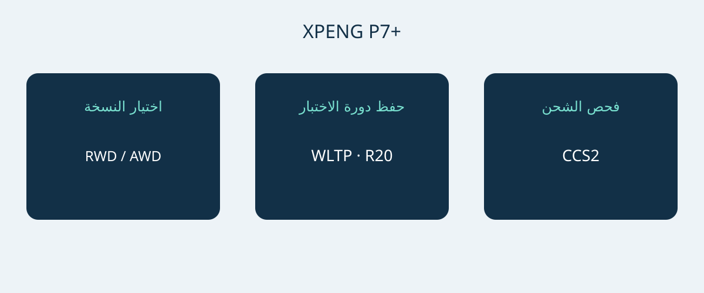

# XPENG P7+: المدى والشحن والمساحة بالمواصفات النرويجية

تستحق XPENG P7+ الدخول في قائمة الشراء عندما تناسب أبعادها واحتياجات شحنها وتجهيزاتها الفعلية استخدام المشتري. قدرة الشحن القصوى وحدها لا تكفي لاتخاذ القرار. تصف ورقة المواصفات النرويجية المؤرخة في 6 يناير 2026 سيارة فاستباك كهربائية بالبطارية بخمسة مقاعد، بنسختي RWD Long Range وAWD Performance. المقارنة تخص هاتين النسختين، وليست مواصفات عالمية لجميع سيارات P7+.

تاريخ الوثيقة لا يثبت رمز سنة طراز رسميًا. اطلب رقم VIN وشهر الإنتاج ومواصفات سوق البيع الأصلية. اطلب من البائع تأكيد التجهيز الموافق لشهر الإنتاج المذكور. وتستخدم الصفحة النرويجية الحالية أسماء Pro أيضًا، لكنها لا تثبت التكافؤ مع نسختي وثيقة يناير. لا تخلط P7 أو P7i أو P7+ ذات موسع المدى للسوق الصينية بهذه المقارنة.

## نسختان وأولويات مختلفة

تستخدم النسختان المرجعيتان بطارية LFP بسعة إجمالية 74.9 kWh. هذا توصيف المصنع للسعة الإجمالية، وليس رقمًا للسعة القابلة للاستخدام جرى التحقق منه بشكل مستقل. مع عجلات 20 بوصة، تعلن الورقة مدى 530 km WLTP لنسخة RWD Long Range و500 km WLTP لنسخة AWD Performance. احتفظ بدورة الاختبار وحجم العجلات مع كل رقم. لا يضمن أي منهما المسافة التي ستقطعها السيارة في رحلة معينة.

| المواصفات النرويجية المرجعية | RWD Long Range | AWD Performance |
|---|---|---|
| الدفع | خلفي | كلي |
| سعة بطارية LFP الإجمالية | 74.9 kWh | 74.9 kWh |
| المدى WLTP، عجلات 20 بوصة | 530 km | 500 km |
| قدرة المحرك | 230 kW | 230 + 140 kW حسب المحور |
| عزم المحرك | 450 Nm | 450 + 220 Nm حسب المحور |
| تسارع 0–100 km/h المعلن | 6.2 ثانية | 4.3 ثانية |

المصدر: ورقة XPENG النرويجية في 6 يناير 2026 للنسختين الكهربائيتين المذكورتين. تصف أرقام AWD المحورين بصورة منفصلة، ولا تعني قدرة إجمالية للنظام معتمدة بشكل مستقل.

إذا كانت الأولوية للمدى المعلن وفق WLTP، فابدأ بدراسة RWD Long Range. أما AWD Performance فهي البديل عندما يكون الدفع الكلي والتسارع الأسرع المعلن من المتطلبات الواضحة. لا تثبت هذه التوصية انخفاض تكلفة الاستخدام أو تفوق الكبح في الشتاء. وحّد السوق والعجلات والتجهيزات عند مقارنة العروض قبل تفسير فرق السعر.

## اختبر موقف السيارة والأمتعة

الأبعاد المرجعية 5071 × 1937 × 1512 mm، وقاعدة العجلات 3000 mm. قِس مكان الوقوف وافحص مسار الدخول ومساحة فتح الأبواب وموضع تحميل الأمتعة. العرض المنشور لا يضمن جميع مسافات الخلوص حول المرايا أو الأبواب المفتوحة. تجربة الوقوف الفعلية أفضل من افتراض الملاءمة استنادًا إلى فئة السيارة.

تذكر XPENG خمسة مقاعد وحجم أمتعة 573 L، يرتفع إلى 1931 L مع طي المقاعد الخلفية. هذه أحجام يعلنها المصنع، وليست ضمانًا لاستيعاب حقيبة أو كرسي متحرك أو صندوق معدات محدد. اختبر أولًا الجمع المعتاد بين الركاب والأمتعة، ثم الأحمال الكبيرة العرضية مع طي المقاعد. استخدم الأغراض التي تحملها فعلًا. حجم الصندوق لا يثبت الحمولة الوزنية أو قدرة الجر.

## ابدأ من مواقع الشحن المتاحة

تذكر المواصفات النرويجية شحن AC بقدرة 11 kW وDC حتى 446 kW وموصل CCS2 أوروبيًا. يعطي المصنع مرجعًا زمنيًا قدره 12 دقيقة للشحن من 10–80%. هذه نافذة شحن مشروطة وليست ضمانًا لمدة كل توقف. تؤثر حالة السيارة والبطارية ودرجة الحرارة ومستوى الشحن الأولي والشاحن في النتيجة. ليس كل شاحن قادرًا على توفير القدرة القصوى، ولا يلزم أن تستمر هذه القدرة طوال الجلسة.

للشحن المعتاد، اطلب من فني تركيب مؤهل أو مشغل المحطة تأكيد التغذية والموصل والتوافق. وللرحلات الطويلة، افحص المحطات المخطط استخدامها بدل اختيار السيارة من القدرة القصوى وحدها. عرض البائع العملي يساعد في تأكيد التوافق، لكن نجاح جلسة واحدة لا يضمن الأزمنة المستقبلية. اترك هامشًا لتغير ظروف الشحن والانقطاعات، ولا تبنِ جدول الرحلة على أقصر وقت إعلاني.

## افصل مساعدة السائق عن دعم ما بعد البيع

تسرد الورقة سبع وسائد هوائية. XPILOT نظام لمساعدة السائق؛ يظل السائق مطالبًا بالانتباه والتدخل عند الحاجة. الاسم لا يعني قيادة ذاتية بلا مراقبة. اطلب شرح الوظائف وحدودها وفق دليل السيارة الفعلية والتعليمات المحلية المناسبة، لا وفق فيديو دعائي من سوق أخرى.

كذلك لا تثبت قائمة تجهيزات نرويجية قابلية نقل الخدمات المتصلة أو الضمان أو وظائف البرمجيات إلى وجهة أخرى. حدد من يتولى التشخيص والإصلاح وقطع الغيار لرقم VIN المعروض، واحصل على الشروط مكتوبة. السعر والتوافر والضرائب وأهلية الاستيراد وسريان الضمان تحتاج إلى تأكيد حديث مستقل. صفحة المنتج ليست قرار قبول للاستيراد ولا عرضًا تجاريًا ملزمًا.

## ما الذي ينبغي توضيحه في العرض؟

- النسخة الدقيقة ورقم VIN وشهر الإنتاج والسوق الأصلية مع وثائق السيارة المطابقة.
- العجلات ووصف البطارية الموافقان للمرجع المختار، دون استعارة مدى من سوق أخرى.
- معدات الشحن المشمولة والموصل المتوافق والملحقات ذات التكلفة المنفصلة.
- الخدمة في الوجهة وحدود الوظائف المتصلة وشروط الضمان المكتوبة.
- عرض مفصل وهوية البائع وإجابات عن الاختلافات قبل قرار الدفع.

أجّل قرار الشراء إذا اكتفى البائع باسم P7+ عام، أو استبدل النسخة باسم Pro دون إثبات التجهيز، أو ضمن وقت الشحن بصرف النظر عن الشاحن والظروف. يمكن تقييم تجهيز مختلف موضح بوضوح، لكن خلط المواصفات دون تفسير لا يوفر مقارنة موثوقة.

## أسئلة شائعة

### هل تنطبق الأرقام على جميع سيارات P7+؟
لا. هي مرجع كهربائي نرويجي مؤرخ في 6 يناير 2026، ولا تثبت أسواقًا أخرى أو نسخ موسع المدى أو سنة طراز رسمية أو تجهيز رقم VIN بعينه.

### أي نسخة أدرس أولًا إذا كانت الأولوية للمدى؟
تعلن RWD Long Range عن 530 km WLTP بعجلات 20 بوصة، مقابل 500 km WLTP لنسخة AWD Performance على أساس العجلات نفسه. يبقى مدى الرحلة الفعلي مرتبطًا بظروف الاستخدام.

### هل الشحن خلال 12 دقيقة مضمون؟
لا. نافذة 10–80% تتأثر بالشاحن والحرارة وحالة السيارة والشحن الأولي. أما مدة التوقف الكاملة فهي مسألة منفصلة.

### هل تتوفر 1931 L مع إشغال جميع المقاعد؟
لا. هذا الحجم مع طي المقاعد الخلفية، والحجم الآخر المذكور 573 L. تحقق من احتياجات الركاب والأمتعة معًا.

رسم أصلي يربط نسخة P7+ بمقارنة المدى وتوافق الشحن.

## المصادر والتحقق

تاريخ التحقق من المصادر: 2026-11-05.

- [XPENG — XPENG P7+ Norwegian specification sheet, 6 January 2026](https://s-cdn.xpeng.com/commoncms/prod/2026-02-12/24d25f0ebb8c439b80144b3cc7ee5b00.pdf)
- [XPENG — XPENG P7+ Norway model page](https://www.xpeng.com/no/model/p7plus)
- [XPENG — XPENG P7+ Norway configurator](https://store.xpeng.com/no/configurator/P7%2B?source=ow_os_top_nav)
- [Bilforlaget — Xpeng P7+ RWD Long Range test](https://www.bilnorge.no/biltest-elbil-hurtiglading/oslo-kristiansand-pa-10-minutter/4178720)
- [NAF / Motor — Xpeng med diger kombicoupé](https://www.motor.no/aktuelt/xpeng-med-diger-kombicoupe-p7/342336)
- [Norsk elbilforening — XPENG P7+ Norwegian introduction: range, charging and luggage](https://elbil.no/xpeng-p7-plus-ki-pris-norge/)

[استكشف السيارات](https://www.autobridgeexport.com/vehicles/) · [اقرأ أدلة الشراء](https://www.autobridgeexport.com/guides/)
