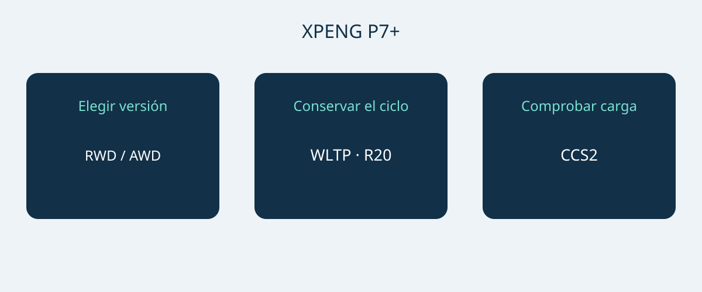

# XPENG P7+: autonomía, carga y espacio en Noruega

El XPENG P7+ encaja en una selección de compra cuando sus dimensiones, necesidades de carga y configuración responden al uso previsto. Una potencia máxima de carga llamativa no basta para justificar la elección. La ficha noruega del 6 de enero de 2026 describe un fastback eléctrico de cinco plazas en versiones RWD Long Range y AWD Performance. Estas son las dos referencias comparadas, no una especificación universal de todos los P7+.

La fecha del documento no acredita un año modelo formal. Solicite el VIN, el mes de fabricación y la especificación del mercado de venta original. Pida al vendedor que confirme la configuración correspondiente al mes de producción. La página noruega actual también utiliza nombres Pro, sin demostrar su equivalencia con las versiones de enero. No mezcle P7, P7i ni P7+ de autonomía extendida del mercado chino con esta comparación.

## Dos versiones y prioridades distintas

Ambas referencias incorporan una batería LFP de 74.9 kWh brutos. La capacidad bruta no equivale a una energía utilizable verificada por separado. Con llantas de 20 pulgadas, la ficha anuncia 530 km WLTP para RWD Long Range y 500 km WLTP para AWD Performance. Mantenga el ciclo y las llantas unidos a cada cifra: ninguna garantiza la distancia de un viaje concreto.

| Referencia noruega | RWD Long Range | AWD Performance |
|---|---|---|
| Tracción | Trasera | Integral |
| Batería LFP bruta | 74.9 kWh | 74.9 kWh |
| Autonomía WLTP, llantas de 20 pulgadas | 530 km | 500 km |
| Potencia del motor | 230 kW | 230 + 140 kW, por eje |
| Par del motor | 450 Nm | 450 + 220 Nm, por eje |
| 0–100 km/h del fabricante | 6.2 segundos | 4.3 segundos |

Fuente: ficha XPENG Noruega del 6 de enero de 2026 para las versiones eléctricas indicadas. Las cifras AWD describen los dos ejes por separado y no acreditan una potencia conjunta homologada independiente.

Si prima la autonomía WLTP anunciada, conviene estudiar primero RWD Long Range. AWD Performance es la alternativa si la tracción integral y la aceleración del fabricante más rápida son prioridades expresas. Esta recomendación no demuestra menores costes de uso ni mejor frenada invernal. Compare ofertas del mismo mercado, con las mismas llantas y equipamiento identificado antes de interpretar la diferencia de precio.

## Comprobar aparcamiento y equipaje

Las dimensiones de referencia son 5071 × 1937 × 1512 mm, con 3000 mm de batalla. Mida la plaza prevista y examine el acceso, la apertura de puertas y la posición para cargar equipaje. La anchura publicada no garantiza todo el espacio alrededor de retrovisores o puertas abiertas. Una demostración de aparcamiento es más útil que suponer que el vehículo cabe por pertenecer a una categoría conocida.

XPENG indica cinco plazas y 573 L de maletero, ampliables a 1931 L con los asientos traseros abatidos. Son volúmenes del fabricante, no garantías de que quepan una maleta, una silla de ruedas o una caja determinada. Compruebe primero la combinación habitual de pasajeros y equipaje, y después las cargas voluminosas ocasionales con los asientos abatidos. Pruebe los objetos que realmente transportará. El volumen del maletero no establece carga útil ni capacidad de remolque.

## La carga se decide con las estaciones disponibles

La referencia noruega admite 11 kW en corriente alterna, hasta 446 kW en corriente continua y conexión europea CCS2. El fabricante cita 12 minutos para pasar del 10% al 80% de carga. Es una ventana sujeta a condiciones, no la duración garantizada de cualquier parada. Influyen el estado del vehículo y de la batería, la temperatura, la carga inicial y el cargador. La potencia máxima no está disponible necesariamente en todas las estaciones ni se mantiene durante toda la sesión.

Para la carga habitual, pida a un instalador cualificado o al operador que confirme suministro, conector y compatibilidad. Para viajes largos, revise las estaciones previstas en vez de elegir únicamente por el pico de potencia. Una demostración del vendedor ayuda a comprobar la conexión, pero una sesión satisfactoria no garantiza las siguientes. Reserve margen para condiciones de carga e interrupciones, sin fijar todo el itinerario al tiempo publicitario más corto.

## Asistencia y servicio posventa por separado

La ficha enumera siete airbags. XPILOT es asistencia a la conducción: el conductor debe mantener la atención e intervenir cuando sea necesario. El nombre no autoriza conducción autónoma o sin supervisión. Solicite una explicación de funciones y límites basada en el manual del vehículo concreto y las indicaciones locales aplicables, no en un vídeo de otro mercado.

Una lista noruega de equipamiento tampoco acredita que los servicios conectados, la garantía o las funciones de software se transfieran a otro destino. Identifique quién realizará diagnóstico, reparaciones y suministro de piezas para ese VIN y obtenga condiciones escritas. Precio, disponibilidad, fiscalidad, admisibilidad de importación y garantía requieren confirmación actual independiente. Una página de producto no es una decisión de importación ni una oferta comercial vinculante.

## Qué debería incluir la oferta

- Versión exacta, VIN, mes de producción y mercado original, con documentos del vehículo.
- Llantas y batería correspondientes a la referencia elegida, sin tomar autonomía de otro mercado.
- Equipo de carga incluido, conexión compatible y accesorios cobrados aparte.
- Servicio en destino, limitaciones de funciones conectadas y garantía escrita.
- Oferta desglosada, identidad del vendedor y aclaración de diferencias antes de decidir el pago.

Pause la compra si solo se ofrece el nombre genérico P7+, si aparece una denominación Pro sin prueba de configuración o si se garantiza el tiempo de carga sin considerar estación y condiciones. Una configuración distinta bien explicada puede evaluarse; una mezcla de especificaciones sin explicación no permite comparar con rigor.

## Preguntas frecuentes

### ¿Son las especificaciones de todos los P7+?
No. Es la referencia eléctrica noruega del 6 de enero de 2026. No acredita otros mercados, versiones de autonomía extendida, un año modelo formal ni el equipamiento de un VIN particular.

### ¿Qué versión mirar primero si importa la autonomía?
RWD Long Range anuncia 530 km WLTP con llantas de 20 pulgadas, frente a 500 km WLTP de AWD Performance sobre la misma base. La distancia real depende de las condiciones de uso.

### ¿Se garantiza una carga de 12 minutos?
No. La ventana del fabricante del 10–80% depende del cargador, temperatura, estado del vehículo y carga inicial. El tiempo total de parada es otra cuestión.

### ¿Los 1931 L están disponibles con todas las plazas ocupadas?
No. Corresponden a los asientos traseros abatidos; el otro volumen indicado es 573 L. Verifique pasajeros y equipaje conjuntamente.

Diagrama original que relaciona versión del P7+, autonomía y compatibilidad de carga.

## Fuentes y comprobación

Fuentes consultadas el 2026-11-05.

- [XPENG — XPENG P7+ Norwegian specification sheet, 6 January 2026](https://s-cdn.xpeng.com/commoncms/prod/2026-02-12/24d25f0ebb8c439b80144b3cc7ee5b00.pdf)
- [XPENG — XPENG P7+ Norway model page](https://www.xpeng.com/no/model/p7plus)
- [XPENG — XPENG P7+ Norway configurator](https://store.xpeng.com/no/configurator/P7%2B?source=ow_os_top_nav)
- [Bilforlaget — Xpeng P7+ RWD Long Range test](https://www.bilnorge.no/biltest-elbil-hurtiglading/oslo-kristiansand-pa-10-minutter/4178720)
- [NAF / Motor — Xpeng med diger kombicoupé](https://www.motor.no/aktuelt/xpeng-med-diger-kombicoupe-p7/342336)
- [Norsk elbilforening — XPENG P7+ Norwegian introduction: range, charging and luggage](https://elbil.no/xpeng-p7-plus-ki-pris-norge/)

[Explorar vehículos](https://www.autobridgeexport.com/vehicles/) · [Leer guías de compra](https://www.autobridgeexport.com/guides/)
