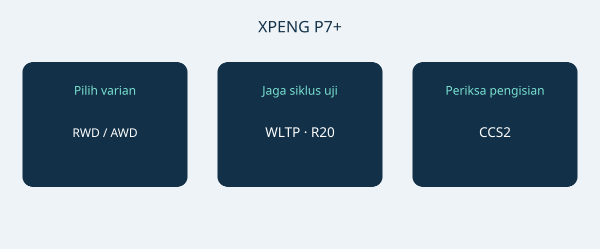

# XPENG P7+ Norwegia: Jarak Tempuh, Pengisian dan Bagasi

XPENG P7+ layak masuk daftar pembelian jika dimensi, kebutuhan pengisian dan konfigurasi aktual sesuai penggunaan. Daya pengisian puncak saja bukan alasan cukup untuk membeli. Lembar spesifikasi Norwegia bertanggal 6 Januari 2026 menggambarkan fastback listrik baterai lima kursi dalam varian RWD Long Range dan AWD Performance. Perbandingan ini terbatas pada keduanya, bukan spesifikasi global semua P7+.

Tanggal dokumen tidak membuktikan kode tahun model resmi. Mintalah VIN, bulan produksi dan spesifikasi pasar penjualan awal. Mintalah penjual mengonfirmasi konfigurasi untuk bulan produksi tersebut. Halaman Norwegia sekarang juga memakai nama Pro, tetapi itu tidak membuktikan kesetaraan dengan dua varian Januari. Jangan mencampurkan P7, P7i atau P7+ dengan pemanjang jarak dari pasar Tiongkok.

## Dua varian dengan prioritas berbeda

Keduanya memakai baterai LFP berkapasitas bruto 74.9 kWh. Angka tersebut adalah kapasitas bruto menurut produsen, bukan angka kapasitas yang dapat digunakan yang telah diverifikasi secara terpisah. Dengan roda 20 inci, dokumen menyebut 530 km WLTP untuk RWD Long Range dan 500 km WLTP untuk AWD Performance. Cantumkan siklus uji dan ukuran roda bersama angka tersebut. Keduanya tidak menjamin jarak pada perjalanan tertentu.

| Acuan Norwegia | RWD Long Range | AWD Performance |
|---|---|---|
| Penggerak | Roda belakang | Semua roda |
| Baterai LFP bruto | 74.9 kWh | 74.9 kWh |
| Jarak WLTP, roda 20 inci | 530 km | 500 km |
| Daya motor | 230 kW | 230 + 140 kW, per poros |
| Torsi motor | 450 Nm | 450 + 220 Nm, per poros |
| 0–100 km/h menurut produsen | 6.2 detik | 4.3 detik |

Sumber: spesifikasi XPENG Norwegia 6 Januari 2026 untuk varian listrik tersebut. Angka AWD menjelaskan kedua poros secara terpisah dan bukan daya sistem gabungan yang disertifikasi tersendiri.

Jika jarak WLTP yang diumumkan menjadi prioritas, periksa RWD Long Range lebih dahulu. AWD Performance menjadi alternatif bila penggerak semua roda dan akselerasi produsen yang lebih cepat benar-benar dibutuhkan. Ini tidak membuktikan biaya penggunaan lebih rendah atau pengereman musim dingin lebih baik. Samakan pasar, roda dan perlengkapan saat membandingkan penawaran sebelum menilai selisih harga.

## Periksa parkir dan barang bawaan

Dimensi acuan adalah 5071 × 1937 × 1512 mm, dengan jarak sumbu roda 3000 mm. Ukur tempat parkir, jalur masuk, ruang membuka pintu dan posisi memuat barang. Lebar publikasi tidak menjamin seluruh ruang bebas di sekitar spion atau pintu terbuka. Demonstrasi parkir lebih berguna daripada mengira kendaraan akan muat berdasarkan kategorinya.

XPENG menyebut lima kursi, bagasi 573 L dan 1931 L saat kursi belakang dilipat. Volume produsen bukan jaminan koper, kursi roda atau kotak tertentu dapat masuk. Periksa dahulu kombinasi penumpang dan barang sehari-hari, kemudian barang besar sesekali dengan kursi terlipat. Cobalah benda yang benar-benar akan dibawa. Volume bagasi tidak menetapkan daya angkut atau kapasitas penarikan.

## Mulai dari lokasi pengisian yang tersedia

Acuan Norwegia mencantumkan AC 11 kW, DC hingga 446 kW dan koneksi CCS2 Eropa. Produsen menyebut 12 menit untuk rentang 10–80%. Ini adalah jendela pengisian bersyarat, bukan durasi berhenti yang dijamin. Kondisi kendaraan dan baterai, suhu, muatan awal serta pengisi daya memengaruhi hasil. Tidak semua stasiun menyediakan daya maksimum, dan kendaraan tidak selalu mempertahankannya sepanjang sesi.

Untuk pengisian rutin, mintalah pemasang berkualifikasi atau operator mengonfirmasi pasokan listrik, konektor dan kompatibilitas. Pada perjalanan jauh, periksa stasiun yang direncanakan, bukan memilih hanya dari daya puncak. Demonstrasi penjual membantu memeriksa koneksi, tetapi satu sesi berhasil tidak menjamin waktu berikutnya. Sisakan kelonggaran untuk kondisi pengisian dan gangguan, bukan menjadwalkan perjalanan hanya menurut waktu iklan tersingkat.

## Bedakan bantuan pengemudi dan layanan purnajual

Lembar spesifikasi mencantumkan tujuh kantong udara. XPILOT merupakan bantuan pengemudi; pengemudi tetap perlu memperhatikan dan mengambil alih bila diperlukan. Nama tersebut tidak berarti pengemudian otonom tanpa pengawasan. Mintalah penjelasan fungsi dan batasnya berdasarkan manual kendaraan serta petunjuk lokal, bukan video promosi pasar lain.

Daftar perlengkapan Norwegia juga tidak membuktikan layanan terhubung, garansi atau fungsi perangkat lunak dapat dipindahkan ke tujuan lain. Pastikan siapa yang menangani diagnosis, perbaikan dan suku cadang untuk VIN yang ditawarkan, lalu minta ketentuan tertulis. Harga, stok, pajak, kelayakan impor dan garansi membutuhkan konfirmasi terbaru tersendiri. Halaman produk bukan keputusan impor ataupun penawaran mengikat.

## Isi penawaran yang perlu jelas

- Varian tepat, VIN, bulan produksi, pasar awal dan dokumen kendaraan terkait.
- Roda serta baterai sesuai acuan pilihan, tanpa mengambil jarak tempuh pasar lain.
- Peralatan pengisian yang disertakan, koneksi kompatibel dan aksesori berbiaya terpisah.
- Layanan di tujuan, keterbatasan fungsi terhubung dan ketentuan garansi tertulis.
- Rincian penawaran, identitas penjual dan jawaban atas perbedaan sebelum memutuskan pembayaran.

Tunda pembelian jika penjual hanya menyebut P7+ secara umum, mengganti dengan nama Pro tanpa bukti konfigurasi, atau menjamin waktu pengisian tanpa memperhatikan stasiun dan kondisi. Konfigurasi berbeda yang dijelaskan jelas tetap bisa dinilai; campuran spesifikasi tanpa penjelasan bukan dasar perbandingan andal.

## Pertanyaan umum

### Apakah angka berlaku untuk semua P7+?
Tidak. Ini acuan listrik Norwegia 6 Januari 2026, bukan pasar lain, versi pemanjang jarak, tahun model formal atau perlengkapan VIN tertentu.

### Varian mana diperiksa dahulu jika mengutamakan jarak?
RWD Long Range mengumumkan 530 km WLTP dengan roda 20 inci, dibanding 500 km WLTP pada AWD Performance dengan dasar roda sama. Jarak perjalanan aktual tetap bergantung kondisi.

### Apakah pengisian 12 menit dijamin?
Tidak. Rentang 10–80% bergantung pengisi daya, suhu, kondisi kendaraan dan muatan awal. Total waktu berhenti merupakan pertimbangan terpisah.

### Apakah 1931 L tersedia saat semua kursi ditempati?
Tidak. Angka itu untuk kursi belakang terlipat; volume lain yang dicantumkan adalah 573 L. Periksa kebutuhan penumpang dan barang bersama-sama.

Diagram orisinal yang menghubungkan varian P7+, jarak tempuh dan kompatibilitas pengisian.

## Sumber dan verifikasi

Sumber diperiksa pada 2026-11-05.

- [XPENG — XPENG P7+ Norwegian specification sheet, 6 January 2026](https://s-cdn.xpeng.com/commoncms/prod/2026-02-12/24d25f0ebb8c439b80144b3cc7ee5b00.pdf)
- [XPENG — XPENG P7+ Norway model page](https://www.xpeng.com/no/model/p7plus)
- [XPENG — XPENG P7+ Norway configurator](https://store.xpeng.com/no/configurator/P7%2B?source=ow_os_top_nav)
- [Bilforlaget — Xpeng P7+ RWD Long Range test](https://www.bilnorge.no/biltest-elbil-hurtiglading/oslo-kristiansand-pa-10-minutter/4178720)
- [NAF / Motor — Xpeng med diger kombicoupé](https://www.motor.no/aktuelt/xpeng-med-diger-kombicoupe-p7/342336)
- [Norsk elbilforening — XPENG P7+ Norwegian introduction: range, charging and luggage](https://elbil.no/xpeng-p7-plus-ki-pris-norge/)

[Jelajahi kendaraan](https://www.autobridgeexport.com/vehicles/) · [Baca panduan pembelian](https://www.autobridgeexport.com/guides/)
