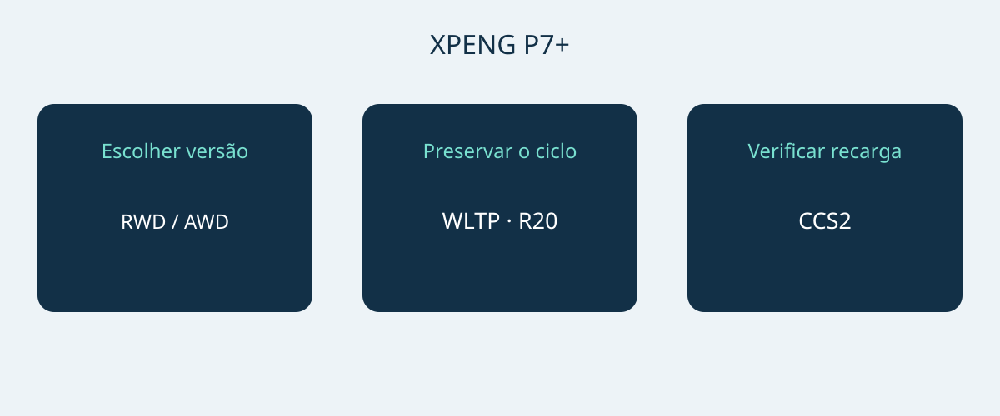

# XPENG P7+: autonomia, recarga e espaço na Noruega

O XPENG P7+ merece entrar na lista de compra quando suas dimensões, necessidades de recarga e configuração correspondem ao uso previsto. Uma potência máxima elevada, isoladamente, não justifica a escolha. A ficha norueguesa de 6 de janeiro de 2026 descreve um fastback elétrico de cinco lugares nas versões RWD Long Range e AWD Performance. A comparação trata dessas duas referências, não de uma especificação mundial do P7+.

A data do documento não comprova um ano-modelo formal. Peça VIN, mês de produção e especificação do mercado original, com confirmação do vendedor de que a configuração corresponde àquele mês. A página norueguesa atual também usa nomes Pro, sem comprovar equivalência com as versões de janeiro. P7, P7i e P7+ com extensor de autonomia do mercado chinês não pertencem a esta comparação.

## Duas versões e prioridades distintas

Ambas têm bateria LFP de 74.9 kWh brutos. A capacidade bruta não é uma quantidade de energia utilizável verificada separadamente. Com rodas de 20 polegadas, a ficha anuncia 530 km WLTP para RWD Long Range e 500 km WLTP para AWD Performance. Preserve ciclo e tamanho das rodas junto dos números. Nenhum deles garante a distância percorrida em uma viagem específica.

| Referência norueguesa | RWD Long Range | AWD Performance |
|---|---|---|
| Tração | Traseira | Integral |
| Bateria LFP bruta | 74.9 kWh | 74.9 kWh |
| Autonomia WLTP, rodas de 20 polegadas | 530 km | 500 km |
| Potência dos motores | 230 kW | 230 + 140 kW, por eixo |
| Torque dos motores | 450 Nm | 450 + 220 Nm, por eixo |
| 0–100 km/h do fabricante | 6.2 segundos | 4.3 segundos |

Fonte: ficha XPENG Noruega de 6 de janeiro de 2026 para as versões elétricas indicadas. Os valores AWD descrevem os dois eixos separadamente e não representam uma potência combinada homologada verificada à parte.

Para priorizar a maior autonomia WLTP declarada, examine primeiro RWD Long Range. AWD Performance é a alternativa quando tração integral e aceleração mais rápida são prioridades explícitas. Isso não demonstra menores custos de uso nem melhor frenagem no inverno. Compare propostas do mesmo mercado, com rodas e equipamentos identificados, antes de avaliar a diferença de preço.

## Conferir estacionamento e bagagem

As dimensões são 5071 × 1937 × 1512 mm, com entre-eixos de 3000 mm. Meça a vaga e observe acesso, abertura de portas e posição de carga. A largura publicada não garante a folga total para espelhos ou portas abertas. Uma demonstração no estacionamento previsto é mais útil do que presumir que o carro cabe por sua categoria.

A XPENG informa cinco lugares, bagageiro de 573 L e 1931 L com os bancos traseiros rebatidos. Os volumes não garantem espaço para uma mala, cadeira de rodas ou caixa específica. Avalie primeiro passageiros e bagagem em uso normal, depois objetos grandes ocasionais com os bancos rebatidos. Experimente os itens reais. Volume de bagageiro não estabelece capacidade de carga nem de reboque.

## Decidir com base nos carregadores disponíveis

A referência norueguesa indica 11 kW em corrente alternada, até 446 kW em corrente contínua e conexão europeia CCS2. O fabricante cita 12 minutos de 10–80% de carga. É um intervalo condicionado, não uma duração garantida em qualquer parada. Estado do veículo e da bateria, temperatura, carga inicial e carregador influenciam o resultado. Nem toda estação fornece a potência máxima, que tampouco é necessariamente mantida durante toda a sessão.

Para recarga regular, solicite a um instalador qualificado ou operador a confirmação da alimentação, conector e compatibilidade. Em viagens longas, examine as estações previstas em vez de escolher apenas pela potência de pico. Uma demonstração ajuda a verificar compatibilidade, mas uma sessão bem-sucedida não garante as seguintes. Reserve margem para condições de recarga e interrupções; não organize todo o percurso pelo menor tempo anunciado.

## Assistência e pós-venda são verificações distintas

A ficha lista sete airbags. XPILOT é assistência ao motorista, que precisa manter a atenção e intervir quando necessário. O nome não significa condução autônoma ou sem supervisão. Peça uma demonstração das funções e limites com base no manual do veículo e nas orientações locais, não em um vídeo de outro mercado.

Uma lista norueguesa não comprova a transferência de serviços conectados, garantia ou funções de software para outro destino. Identifique quem fará diagnóstico, reparos e fornecimento de peças para o VIN oferecido e obtenha condições escritas. Preço, disponibilidade, tributação, admissibilidade de importação e garantia exigem confirmação atual separada. Uma página de produto não é autorização de importação nem proposta comercial vinculante.

## O que esclarecer na proposta

- Versão exata, VIN, mês de produção e mercado original com documentação correspondente.
- Rodas e bateria da referência escolhida, sem autonomia retirada de outro mercado.
- Equipamento de recarga incluído, conexão compatível e acessórios cobrados à parte.
- Serviço no destino, limitações de funções conectadas e termos de garantia escritos.
- Valores discriminados, identidade do vendedor e diferenças esclarecidas antes da decisão de pagamento.

Pause a compra se houver apenas uma identificação P7+ genérica, substituição por nome Pro sem prova de configuração ou promessa de tempo de recarga independentemente do carregador. Uma configuração diferente bem explicada pode ser avaliada; misturar especificações sem explicação impede uma comparação confiável.

## Perguntas frequentes

### Os dados valem para qualquer P7+?
Não. São a referência elétrica norueguesa de 6 de janeiro de 2026, não outros mercados, versões com extensor, ano-modelo formal ou equipamento de um VIN específico.

### Qual versão considerar primeiro para autonomia?
RWD Long Range anuncia 530 km WLTP com rodas de 20 polegadas, contra 500 km WLTP de AWD Performance na mesma base. A autonomia da viagem depende das condições de uso.

### A recarga em 12 minutos é garantida?
Não. O intervalo de 10–80% depende de carregador, temperatura, estado do veículo e carga inicial. O tempo total da parada é outra questão.

### Os 1931 L estão disponíveis com todos os lugares ocupados?
Não. Correspondem aos bancos traseiros rebatidos; o outro volume informado é 573 L. Verifique passageiros e bagagem em conjunto.

Diagrama original relacionando versão do P7+, autonomia e compatibilidade de recarga.

## Fontes e verificação

Fontes consultadas em 2026-11-05.

- [XPENG — XPENG P7+ Norwegian specification sheet, 6 January 2026](https://s-cdn.xpeng.com/commoncms/prod/2026-02-12/24d25f0ebb8c439b80144b3cc7ee5b00.pdf)
- [XPENG — XPENG P7+ Norway model page](https://www.xpeng.com/no/model/p7plus)
- [XPENG — XPENG P7+ Norway configurator](https://store.xpeng.com/no/configurator/P7%2B?source=ow_os_top_nav)
- [Bilforlaget — Xpeng P7+ RWD Long Range test](https://www.bilnorge.no/biltest-elbil-hurtiglading/oslo-kristiansand-pa-10-minutter/4178720)
- [NAF / Motor — Xpeng med diger kombicoupé](https://www.motor.no/aktuelt/xpeng-med-diger-kombicoupe-p7/342336)
- [Norsk elbilforening — XPENG P7+ Norwegian introduction: range, charging and luggage](https://elbil.no/xpeng-p7-plus-ki-pris-norge/)

[Explorar veículos](https://www.autobridgeexport.com/vehicles/) · [Ler guias de compra](https://www.autobridgeexport.com/guides/)
