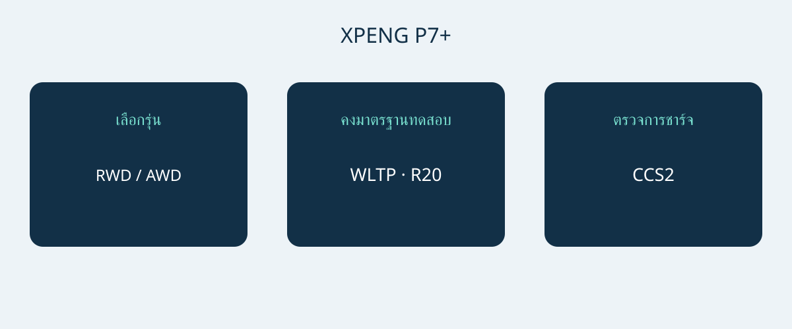

# XPENG P7+: ระยะทาง การชาร์จ และพื้นที่ของรุ่นนอร์เวย์

XPENG P7+ น่าสนใจสำหรับการจัดซื้อเมื่อขนาดรถ ความต้องการชาร์จ และอุปกรณ์จริงเหมาะกับการใช้งาน ไม่ควรตัดสินใจจากกำลังชาร์จสูงสุดเพียงอย่างเดียว เอกสารนอร์เวย์ลงวันที่ 6 มกราคม 2026 ระบุรถไฟฟ้าแบตเตอรี่ทรงฟาสต์แบ็ก 5 ที่นั่ง รุ่น RWD Long Range และ AWD Performance บทความนี้เปรียบเทียบสองรุ่นดังกล่าว ไม่ใช่สเปกกลางของ P7+ ทุกตลาด

วันที่ของเอกสารไม่ได้ยืนยันรหัสปีรุ่นอย่างเป็นทางการ ควรขอ VIN เดือนผลิต และเอกสารสเปกของตลาดจำหน่ายเดิม ควรให้ผู้ขายยืนยันอุปกรณ์ของเดือนผลิตนั้น หน้าเว็บนอร์เวย์ปัจจุบันยังใช้ชื่อ Pro แต่ไม่ได้พิสูจน์ว่าเท่ากับสองรุ่นในเอกสารเดือนมกราคม อย่านำ P7, P7i หรือ P7+ แบบขยายระยะทางของตลาดจีนมาปะปนในการเปรียบเทียบนี้

## เลือกรุ่นจากสิ่งที่ให้ความสำคัญ

ทั้งสองรุ่นอ้างอิงใช้แบตเตอรี่ LFP ความจุรวม 74.9 kWh ความจุรวมไม่ใช่พลังงานที่ใช้งานได้ซึ่งได้รับการยืนยันแยกต่างหาก เมื่อติดล้อ 20 นิ้ว เอกสารระบุ RWD Long Range ที่ 530 km WLTP และ AWD Performance ที่ 500 km WLTP ควรเก็บขนาดล้อและมาตรฐานทดสอบไว้คู่กับตัวเลขเสมอ ทั้งสองค่าไม่รับประกันระยะทางบนเส้นทางจริงของผู้ซื้อ

| ข้อมูลอ้างอิงนอร์เวย์ | RWD Long Range | AWD Performance |
|---|---|---|
| ระบบขับเคลื่อน | ล้อหลัง | ทุกล้อ |
| ความจุรวมแบตเตอรี่ LFP | 74.9 kWh | 74.9 kWh |
| ระยะทาง WLTP ล้อ 20 นิ้ว | 530 km | 500 km |
| กำลังมอเตอร์ | 230 kW | 230 + 140 kW แยกตามเพลา |
| แรงบิดมอเตอร์ | 450 Nm | 450 + 220 Nm แยกตามเพลา |
| 0–100 km/h ตามผู้ผลิต | 6.2 วินาที | 4.3 วินาที |

ที่มา: เอกสาร XPENG นอร์เวย์วันที่ 6 มกราคม 2026 สำหรับรุ่นไฟฟ้าที่ระบุ ค่า AWD อธิบายสองเพลาแยกกัน ไม่ใช่ค่ากำลังหรือแรงบิดรวมของระบบที่ได้รับการรับรองแยกต่างหาก

หากเน้นระยะทาง WLTP ที่ประกาศ ควรเริ่มพิจารณา RWD Long Range ส่วน AWD Performance เป็นอีกทางเลือกเมื่อระบบขับเคลื่อนทุกล้อและอัตราเร่งตามผู้ผลิตที่เร็วกว่าเป็นความต้องการชัดเจน ข้อเสนอแนะนี้ไม่ได้พิสูจน์ว่าค่าใช้จ่ายใช้งานต่ำกว่าหรือเบรกในฤดูหนาวดีกว่า ก่อนตีความส่วนต่างราคา ควรเทียบตลาดจำหน่าย ล้อ และอุปกรณ์ที่รวมมาให้ตรงกัน

## ทดลองพื้นที่จอดและสัมภาระ

ขนาดอ้างอิงคือ 5071 × 1937 × 1512 mm ฐานล้อ 3000 mm ควรวัดที่จอด ตรวจทางเข้า พื้นที่เปิดประตู และตำแหน่งยืนยกสัมภาระ ความกว้างที่เผยแพร่ไม่ได้รับประกันช่องว่างทั้งหมดรอบกระจกหรือประตูที่เปิด การทดลองจอดจริงมีประโยชน์กว่าการเดาว่ารถในประเภทนี้น่าจะจอดได้

XPENG ระบุ 5 ที่นั่ง พื้นที่สัมภาระ 573 L และ 1931 L เมื่อพับเบาะหลัง ตัวเลขปริมาตรของผู้ผลิตไม่รับประกันว่ากระเป๋า รถเข็น หรือกล่องอุปกรณ์ชิ้นใดจะใส่ได้ ควรตรวจการโดยสารพร้อมสัมภาระในชีวิตประจำวันก่อน แล้วจึงดูการขนของชิ้นใหญ่เมื่อพับเบาะ ทดลองด้วยของที่ใช้จริง และอย่าแปลงปริมาตรห้องสัมภาระเป็นน้ำหนักบรรทุกหรือความสามารถลากจูง

## เริ่มเรื่องชาร์จจากสถานที่ใช้งานจริง

ข้อมูลนอร์เวย์ระบุ AC 11 kW, DC สูงสุด 446 kW และการเชื่อมต่อ CCS2 แบบยุโรป ผู้ผลิตให้เวลาอ้างอิง 12 นาทีสำหรับช่วงแบตเตอรี่ 10–80% นี่คือช่วงชาร์จภายใต้เงื่อนไข ไม่ใช่เวลาหยุดรถที่รับประกันทุกครั้ง สภาพรถและแบตเตอรี่ อุณหภูมิ ระดับประจุเริ่มต้น และเครื่องชาร์จมีผลต่อผลลัพธ์ ไม่ใช่ทุกสถานีจะจ่ายกำลังสูงสุดได้ และรถไม่จำเป็นต้องรักษากำลังนั้นตลอดการชาร์จ

สำหรับการชาร์จประจำ ควรให้ผู้ติดตั้งที่มีคุณสมบัติหรือผู้ให้บริการยืนยันแหล่งจ่าย หัวต่อ และความเข้ากันได้ สำหรับทางไกลให้ตรวจสถานีที่จะใช้ แทนการเลือกจากกำลังสูงสุดเท่านั้น การสาธิตของผู้ขายช่วยตรวจการเชื่อมต่อ แต่การชาร์จสำเร็จครั้งหนึ่งไม่ได้รับประกันครั้งต่อไป ควรเผื่อเวลาสำหรับสภาพการชาร์จและการหยุดชะงัก ไม่กำหนดตารางเดินทางจากเวลาโฆษณาที่สั้นที่สุด

## แยกระบบช่วยขับออกจากบริการหลังซื้อ

เอกสารระบุถุงลมนิรภัย 7 จุด XPILOT เป็นระบบช่วยผู้ขับ ผู้ขับยังต้องใส่ใจและเข้าควบคุมเมื่อจำเป็น ชื่อระบบไม่ได้หมายถึงการขับอัตโนมัติโดยไม่มีคนกำกับ ควรให้ผู้ขายอธิบายการทำงานและข้อจำกัดตามคู่มือของรถคันจริงและคำแนะนำที่ใช้ในพื้นที่ ไม่ใช้วิดีโอจากอีกตลาดแทน

รายการอุปกรณ์นอร์เวย์ไม่ได้ยืนยันว่าบริการเชื่อมต่อ การรับประกัน หรือซอฟต์แวร์จะโอนไปใช้ในประเทศปลายทางได้ ควรถามว่าใครดูแลการวิเคราะห์ปัญหา การซ่อม และอะไหล่ของ VIN นี้ พร้อมขอเงื่อนไขเป็นลายลักษณ์อักษร ราคา สต็อก ภาษี สิทธินำเข้า และความคุ้มครองต้องตรวจสอบข้อมูลปัจจุบันแยกกัน หน้าแนะนำรถไม่ใช่คำวินิจฉัยด้านนำเข้าหรือข้อเสนอทางการค้าที่มีผลผูกพัน

## สิ่งที่ควรระบุในใบเสนอราคา

- รุ่นย่อยที่แน่นอน VIN เดือนผลิต ตลาดเดิม และเอกสารรถที่ตรงกัน
- ล้อและแบตเตอรี่ตามข้อมูลอ้างอิงที่เลือก โดยไม่ยืมระยะทางจากตลาดอื่น
- อุปกรณ์ชาร์จที่รวมมา การเชื่อมต่อที่รองรับ และอุปกรณ์เสริมที่คิดเงินต่างหาก
- บริการในปลายทาง ข้อจำกัดฟังก์ชันเชื่อมต่อ และเงื่อนไขรับประกันเป็นลายลักษณ์อักษร
- ราคาแยกรายการ ตัวตนผู้ขาย และคำชี้แจงความแตกต่างก่อนตัดสินใจจ่ายเงิน

ควรชะลอการซื้อหากผู้ขายระบุเพียง P7+ แบบกว้าง ๆ เปลี่ยนเป็นชื่อ Pro โดยไม่มีหลักฐานอุปกรณ์ หรือรับประกันเวลาชาร์จโดยไม่สนใจเครื่องชาร์จและเงื่อนไข สเปกต่างกันแต่ชี้แจงได้ยังพิจารณาได้ ส่วนตัวเลขที่ปะปนโดยไร้คำอธิบายไม่ใช่ฐานเปรียบเทียบที่น่าเชื่อถือ

## คำถามที่พบบ่อย

### ตัวเลขใช้กับ P7+ ทุกคันหรือไม่?
ไม่ใช่ นี่คือข้อมูลรถไฟฟ้านอร์เวย์วันที่ 6 มกราคม 2026 ไม่ยืนยันตลาดอื่น รุ่นขยายระยะทาง ปีรุ่นอย่างเป็นทางการ หรืออุปกรณ์ของ VIN ใดโดยเฉพาะ

### ถ้าเน้นระยะทางควรเริ่มจากรุ่นใด?
RWD Long Range ระบุ 530 km WLTP บนล้อ 20 นิ้ว เทียบกับ AWD Performance ที่ 500 km WLTP บนเกณฑ์ล้อเดียวกัน ระยะทางจริงยังขึ้นกับสภาพการใช้

### รับประกันชาร์จ 12 นาทีหรือไม่?
ไม่รับประกัน ช่วง 10–80% ของผู้ผลิตขึ้นกับเครื่องชาร์จ อุณหภูมิ สภาพรถ และประจุเริ่มต้น เวลาหยุดทั้งหมดต้องพิจารณาแยกกัน

### ใช้พื้นที่ 1931 L ขณะนั่งครบทุกที่ได้หรือไม่?
ไม่ได้ ตัวเลขนี้ใช้เมื่อพับเบาะหลัง ส่วนอีกค่าที่ระบุคือ 573 L ควรตรวจความต้องการผู้โดยสารและสัมภาระร่วมกัน

แผนภาพต้นฉบับเชื่อมรุ่น P7+ การเทียบระยะทาง และความเข้ากันได้ของการชาร์จ

## แหล่งข้อมูลและการตรวจสอบ

ตรวจสอบแหล่งข้อมูลวันที่ 2026-11-05.

- [XPENG — XPENG P7+ Norwegian specification sheet, 6 January 2026](https://s-cdn.xpeng.com/commoncms/prod/2026-02-12/24d25f0ebb8c439b80144b3cc7ee5b00.pdf)
- [XPENG — XPENG P7+ Norway model page](https://www.xpeng.com/no/model/p7plus)
- [XPENG — XPENG P7+ Norway configurator](https://store.xpeng.com/no/configurator/P7%2B?source=ow_os_top_nav)
- [Bilforlaget — Xpeng P7+ RWD Long Range test](https://www.bilnorge.no/biltest-elbil-hurtiglading/oslo-kristiansand-pa-10-minutter/4178720)
- [NAF / Motor — Xpeng med diger kombicoupé](https://www.motor.no/aktuelt/xpeng-med-diger-kombicoupe-p7/342336)
- [Norsk elbilforening — XPENG P7+ Norwegian introduction: range, charging and luggage](https://elbil.no/xpeng-p7-plus-ki-pris-norge/)

[ดูรถรุ่นต่าง ๆ](https://www.autobridgeexport.com/vehicles/) · [อ่านคู่มือจัดซื้อ](https://www.autobridgeexport.com/guides/)
